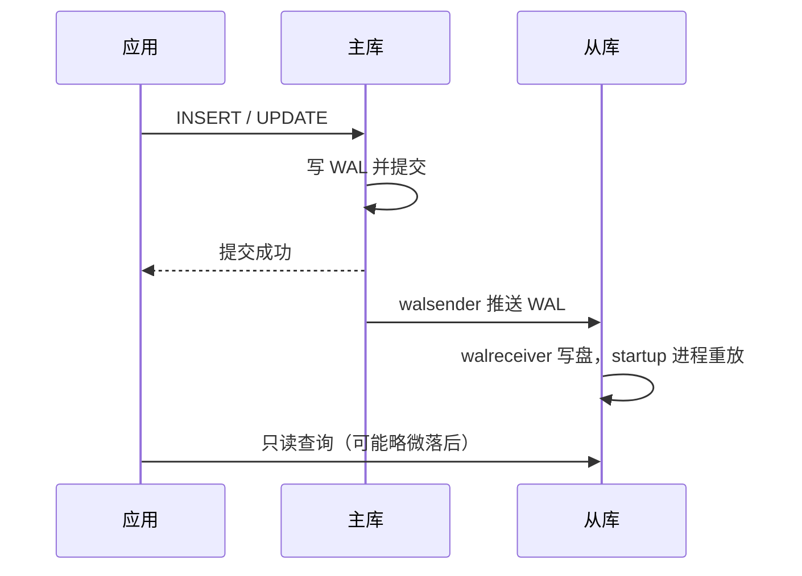
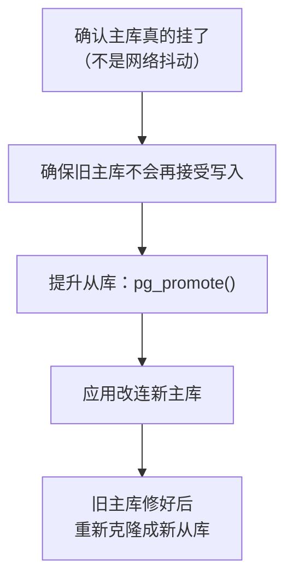

# 主从复制

前两章的备份解决「数据丢了能找回来」，但恢复要停服务、要时间。**复制**解决的是另一个问题：主库所在的机器挂了，有一台数据几乎同步的从库可以顶上来；或者把报表这类重查询分流到从库，不影响主库。本章讲 Postgres 的流复制原理，用两个 compose 服务把一主一从搭起来，演练手动切换，最后讨论一人公司到底需不需要它。

命令以 PostgreSQL 18、`postgres:18-alpine` 镜像为准（18 的镜像挂载点是 `/var/lib/postgresql`，数据目录在其下的 `18/docker`，见[第 1 章](01-install-tuning.md#关于这本书)）。

## 复制不是备份

先把最常见的误解说清楚：**从库会忠实地复制主库上的一切，包括你的误操作**。主库上 `DELETE FROM stock_receipts;` 执行完，一秒之后从库上也没了。所以复制不能替代第 2、3 章的备份，它只解决可用性问题。

| | 备份（dump / PITR） | 流复制 |
|---|---|---|
| 防误操作 | 能 | 不能 |
| 防机器故障 | 能，但要恢复时间 | 能，切换只要几十秒 |
| 读写分离 | 不适用 | 从库可只读查询 |
| 额外成本 | 存储 | 一台同规格机器 |

## 流复制原理

流复制复用的还是 WAL：从库建立一条到主库的复制连接，主库的 `walsender` 进程把 WAL 实时推给从库的 `walreceiver`，从库持续重放。从库本质上是「一个永远在做崩溃恢复、永远恢复不完」的实例，同时可以接受只读查询（hot standby）。



这张图是**异步复制**的默认行为：主库提交后立刻返回，不等从库。好处是主库性能不受影响，代价是主库突然损坏时，最后几百毫秒已提交的事务可能还没传到从库。

### 同步还是异步

| 模式 | 设置 | 主库挂了丢不丢 | 代价 |
|---|---|---|---|
| 异步 | 默认 | 可能丢最后一点 | 无 |
| 同步 | `synchronous_standby_names` + `synchronous_commit = on` | 不丢 | 每次提交多一个网络往返；**从库挂了主库的写入会卡住** |

只有一个从库时开同步复制要非常小心：从库宕机或网络断开，主库所有写事务都会等下去，等于主库也挂了。一人公司的场景，**异步 + 监控复制延迟**几乎总是更合适的选择。

### 物理复制与逻辑复制

| | 物理（流）复制 | 逻辑复制 |
|---|---|---|
| 复制什么 | 整个集群的 WAL，字节级一致 | 按表发布的行变更 |
| 从库能写吗 | 不能 | 能（但要自己避免冲突） |
| 跨大版本 | 不能 | **能** |
| DDL 会同步吗 | 会 | 不会 |
| 典型用途 | 高可用、只读分流 | 大版本升级、迁移、部分表同步 |

本章讲物理复制。逻辑复制在第 8 章做大版本升级时会用到。

## 用 compose 搭一主一从

**生产上，从库必须在另一台机器上**，否则机器挂了主从一起挂，失去了意义。为了把流程讲清楚，下面先在同一个 compose 里起两个服务；换成两台机器时，只是连接地址从服务名换成内网 IP、`pg_hba.conf` 里的网段换成从库的 IP。

### 1. 主库：建复制角色和复制槽

```bash
docker compose exec postgres psql -U counter -d counter
```

```sql
-- 专用复制角色，只有 REPLICATION 权限，不能读写业务表
CREATE ROLE replicator WITH REPLICATION LOGIN PASSWORD '换成随机生成的密码';

-- 物理复制槽：主库会为这个槽保留从库还没收到的 WAL
SELECT pg_create_physical_replication_slot('replica1');
```

密码用 `openssl rand -hex 24` 生成。

### 2. 主库：允许复制连接

复制连接在 `pg_hba.conf` 里要单独授权：数据库一栏写的 `all` **不包含**复制连接，必须写 `replication`。官方镜像的 `pg_hba.conf` 在数据目录里：

```bash
docker compose exec postgres sh -c \
  'echo "host replication replicator samenet scram-sha-256" >> "$PGDATA/pg_hba.conf"'
docker compose exec postgres psql -U counter -d counter -c "SELECT pg_reload_conf();"
```

`samenet` 表示「主库所在的任一子网」，在 compose 网络里就是同一个 bridge 网段。换成两台机器时写成从库的内网地址，比如 `10.0.0.12/32`。

确认规则生效：

```sql
SELECT type, database, user_name, address, auth_method, error
FROM pg_hba_file_rules WHERE 'replication' = ANY(database);
```

几个主库参数的默认值（16 到 18 相同）已经够用：`wal_level = replica`、`max_wal_senders = 10`、`max_replication_slots = 10`，不用改。

再加一条保护：

```ini
max_slot_wal_keep_size = 10GB
```

原因见下文「复制槽的坑」。

### 3. 从库：用 pg_basebackup 克隆

在 compose 里加一个 `replica` 服务和它自己的卷：

```yaml
services:
  replica:
    image: postgres:18-alpine
    restart: unless-stopped
    volumes:
      - replica_pgdata:/var/lib/postgresql
    depends_on:
      - postgres

volumes:
  replica_pgdata:
```

先不要启动它。用一次性容器把主库克隆到 `replica_pgdata` 卷里：

```bash
docker compose run --rm --no-deps --user postgres \
  -e PGPASSWORD='复制角色的密码' \
  replica \
  pg_basebackup -h postgres -U replicator \
    -D /var/lib/postgresql/18/docker \
    -X stream -S replica1 -R -P
```

| 参数 | 含义 |
|---|---|
| `--user postgres` | 以 postgres 用户运行，克隆出来的文件属主才正确 |
| `-S replica1` | 使用刚才建的复制槽 |
| `-R` | 自动写 `standby.signal`，并把 `primary_conninfo` 写进 `postgresql.auto.conf` |

`-R` 写进去的 `primary_conninfo` 包含密码。这个文件在从库的数据卷里，只有容器内 postgres 用户可读；如果介意，可以事后改成用 `.pgpass` 文件。

### 4. 启动从库并验证

```bash
docker compose up -d replica
docker compose logs replica | tail -5
```

应该看到 `entering standby mode` 和 `started streaming WAL from primary`。镜像的入口脚本看到数据目录里已经有 `PG_VERSION`，会跳过初始化，直接以从库身份启动。

在主库上看复制状态：

```sql
SELECT client_addr, state, sent_lsn, replay_lsn,
       write_lag, flush_lag, replay_lag
FROM pg_stat_replication;
```

`state = streaming` 表示正常。`replay_lag` 是从库重放落后的时间，空闲时会显示为空或很小。

在从库上确认它确实是从库：

```bash
docker compose exec replica psql -U counter -d counter -c "SELECT pg_is_in_recovery();"
```

返回 `t`。试着在从库上写一行，会得到 `cannot execute INSERT in a read-only transaction`。

## 复制槽的坑

复制槽保证从库没收到的 WAL 不会被主库删掉，这样从库短暂断开再连上时能接着追。但反过来，**从库永久下线而槽还在，主库就会无限期保留 WAL**，直到磁盘写满、主库停机。这是生产上常见的事故之一。

两道防线：

1. `max_slot_wal_keep_size`（13 起提供）：给槽能保留的 WAL 设上限，超过后槽失效，从库需要重新克隆，但主库不会被拖死
2. 监控不活跃的槽：

```sql
SELECT slot_name, active, wal_status,
       pg_size_pretty(pg_wal_lsn_diff(pg_current_wal_lsn(), restart_lsn)) AS retained
FROM pg_replication_slots;
```

`active = f` 且 `retained` 持续增长，说明有个从库掉线了。不再需要的槽立刻删掉：

```sql
SELECT pg_drop_replication_slot('replica1');
```

## 手动故障切换

主库挂了，要把从库提升为新主库：



```bash
docker compose exec replica psql -U counter -d counter -c "SELECT pg_promote();"
```

返回 `t` 后，从库删掉 `standby.signal`、切换到新时间线，开始接受写入。然后把应用的数据库连接地址改到新主库，重启应用。

第二步最容易被忽略。如果旧主库其实只是网络断了一会儿，恢复后应用又有一部分连回它，两个库同时在接受写入，这叫**脑裂**，数据会分叉，事后几乎无法合并。手动切换的好处恰恰在这里：由你确认旧主库已经停掉（关机、停容器、从安全组里断开），再提升从库。

旧主库不能直接作为从库接回来，它可能有新主库没有的最后几个事务。最简单可靠的做法是清空它的数据目录，按上面第 3 步重新克隆。库大时可以了解 `pg_rewind`，它能只同步分叉之后的差异。

### 自动切换值得吗

Patroni 这类工具可以自动检测主库故障、选主、切换，背后依赖 etcd 或 Consul 做分布式共识，至少要三个节点才能可靠防止脑裂。对一人公司来说，这套东西的运维复杂度本身就是新的故障来源。

更现实的路径是：

| 阶段 | 方案 |
|---|---|
| 刚起步 | 单库 + 每日 dump + WAL 归档（第 2、3 章） |
| 有了付费用户 | 加一个异地异步从库，手动切换，写好切换手册并演练 |
| 需要自动高可用 | 直接换托管数据库（第 9 章讨论） |

## 从库用来分流只读查询

从库可以承接报表、导出这类重查询。需要注意两点：

- **读到的数据可能略旧**。用户刚提交一张进货单，立刻跳转到列表页，如果列表从从库读，可能看不到刚才那张。要求「读自己写的」的查询必须走主库
- **长查询和重放冲突**。从库上的查询正在读某些行，主库上 VACUUM 已经把它们清理了，重放这条 WAL 时就会冲突，Postgres 默认等 `max_standby_streaming_delay`（30 秒）后取消查询，报 `canceling statement due to conflict with recovery`。可以在从库上开 `hot_standby_feedback = on` 让主库推迟清理，代价是主库可能膨胀（第 7 章）

hatch-counter 目前的规模不需要读写分离，一个库加连接池足够。这一节是为以后准备的。

## 本章要点

- 复制解决可用性，不能防误操作，**不能替代备份**
- 流复制把主库 WAL 实时推给从库重放；默认异步，单从库别轻易开同步
- 搭建步骤：复制角色 → `pg_hba.conf` 里写 `replication` → 复制槽 → `pg_basebackup -R -S` 克隆 → 启动 → `pg_stat_replication` 验证
- 设置 `max_slot_wal_keep_size`，监控不活跃的复制槽，否则 WAL 会撑满主库磁盘
- 手动切换：确认旧主库已停 → `pg_promote()` → 改应用连接 → 旧主库重新克隆，严防脑裂
- 一人公司优先「异步从库 + 手动切换」，需要自动高可用时考虑托管数据库

## 动手练习

在本机用两个一次性容器搭一主一从（主库 `pg1`、从库 `pg2`），做完执行 `docker rm -f pg1 pg2; docker volume rm pg2data; docker network rm pgnet` 清理：

```bash
docker network create pgnet
docker run -d --name pg1 --network pgnet -e POSTGRES_PASSWORD=x postgres:18-alpine -c max_slot_wal_keep_size=64MB
sleep 5
docker exec pg1 psql -U postgres -c "CREATE ROLE replicator REPLICATION LOGIN PASSWORD 'rep'" \
  -c "SELECT pg_create_physical_replication_slot('replica1')"
docker exec pg1 sh -c 'echo "host replication replicator samenet scram-sha-256" >> "$PGDATA/pg_hba.conf"'
docker exec pg1 psql -U postgres -c "SELECT pg_reload_conf()"
docker run --rm --network pgnet --user postgres -e PGPASSWORD=rep -v pg2data:/var/lib/postgresql \
  postgres:18-alpine pg_basebackup -h pg1 -U replicator -D /var/lib/postgresql/18/docker -X stream -S replica1 -R
docker run -d --name pg2 --network pgnet -e POSTGRES_PASSWORD=x -v pg2data:/var/lib/postgresql postgres:18-alpine
```

1. **复制不是备份**：在 `pg1` 上建表插数据，在 `pg2` 上查到它；再在 `pg1` 上执行 `DELETE FROM` 这张表，回到 `pg2` 查。另外在 `pg2` 上尝试插入一行。

   验证：`pg1` 上 `SELECT state FROM pg_stat_replication;` 返回 `streaming`；`pg2` 上 `SELECT pg_is_in_recovery();` 返回 `t`；删除后一两秒内 `pg2` 上也查不到数据；在 `pg2` 上插入报 `cannot execute INSERT in a read-only transaction`。

   参考答案：从库忠实重放主库的一切 WAL，误删也照样复制过去，所以防误操作只能靠第 2、3 章的备份。

2. **掉线的复制槽**：`docker stop pg2`，然后在 `pg1` 上反复制造 WAL，比如执行几次 `INSERT INTO big SELECT g, repeat('x', 500) FROM generate_series(1, 200000) g;`（先建表 `big (id int, s text)`）并 `SELECT pg_switch_wal();`。每轮之后用本章「复制槽的坑」里那条查询看 `replica1`。

   验证：`active` 变成 `f`，`retained` 随写入增长；超过 64MB 并经过一次 `CHECKPOINT` 后，`wal_status` 离开 `reserved`（中间可能看到 `extended`、`unreserved`），最终变成 `lost`。此时再 `docker start pg2`，它的日志会报需要的 WAL 段已被删除，无法继续追。

   参考答案：没有 `max_slot_wal_keep_size` 时，主库会一直替这个槽保留 WAL 直到磁盘满；有了上限，主库保住了，代价是从库要重新克隆。真实环境里槽不用了就 `pg_drop_replication_slot`。

3. **手动切换与脑裂**：重做环境后，在 `pg2` 上执行 `SELECT pg_promote();`，**不停** `pg1`，分别往两边插入一行不同的数据。

   验证：`pg_promote()` 返回 `t`，`pg2` 上 `pg_is_in_recovery()` 变成 `f`，`pg2` 的日志里有 `selected new timeline ID: 2`；两边各自接受了写入，互相查不到对方新插的那一行。

   参考答案：这就是脑裂：两个库同时可写，数据分叉。正确顺序是先确认旧主库停掉、不再接受写入，再提升从库；旧主库之后要清空重新克隆，不能直接接回来。
