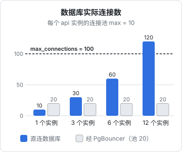
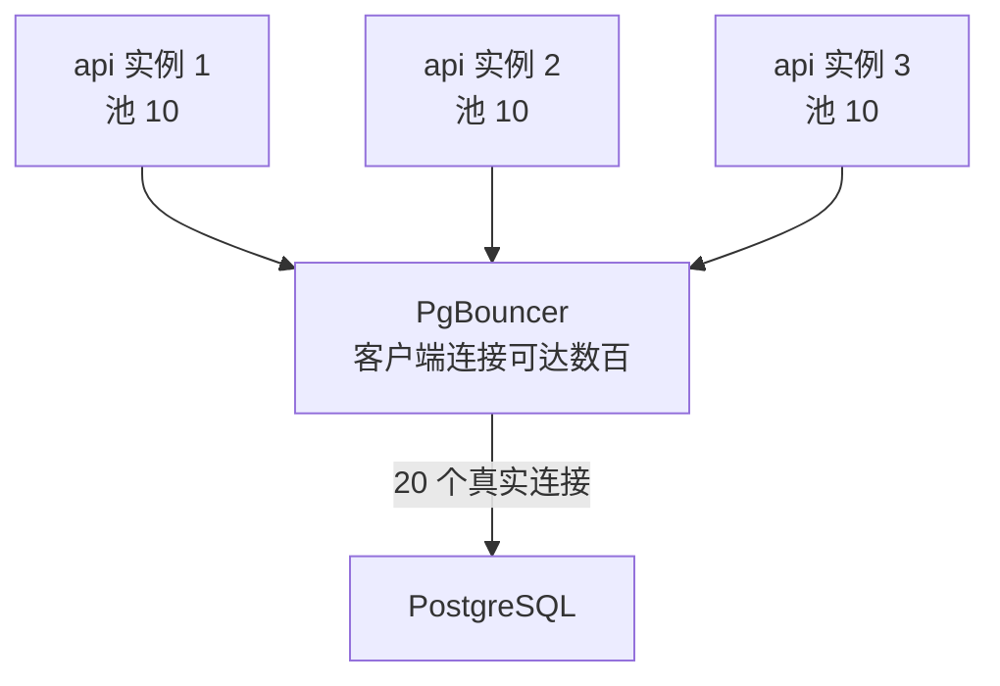

# 连接池：PgBouncer

第 1 章说过，Postgres 每个连接对应一个进程。连接数少的时候这不是问题，但服务一旦横向扩展，比如从一个 api 容器变成三个、或者上了按请求起实例的平台，连接数会成倍增长，很快就撞上 `max_connections`，报 `sorry, too many clients already`。本章讲为什么不能靠调大 `max_connections` 解决、PgBouncer 的三种池化模式、事务模式下哪些写法会出问题，然后把 PgBouncer 加进 hatch-counter 的 compose。

命令以 PostgreSQL 16、PgBouncer 1.21 及以上为准。

## 应用里已经有连接池了，为什么还要一个

hatch-counter 的服务端用 postgres.js 驱动，配置了 `max: 10`，也就是这个进程最多和数据库保持 10 个连接。这是**应用内的连接池**，它解决的是「每个请求都新建连接太慢」的问题。

但它管不了进程之间的事。每个进程各有一个池子，加起来的总数才是数据库看到的连接数：



为什么不直接把 `max_connections` 调到 1000？

- **每个连接都是一个进程**，空闲时也占几 MB 内存，加上每个查询的 `work_mem`（第 1 章那张最坏情况图）
- **活跃连接多于 CPU 核数时，吞吐不升反降**：进程之间争抢 CPU、锁和缓冲区，上下文切换的开销越来越大
- 绝大多数连接在绝大多数时间里是**空闲的**：一个 HTTP 请求可能花 50ms 处理，其中真正占用数据库的只有几毫秒

所以思路是反过来：让数据库只维持少量真实连接，在前面放一个轻量的代理，把大量客户端连接**复用**到这些真实连接上。PgBouncer 就是这个代理，单进程、事件驱动，一个客户端连接只占几 KB 内存。



### hatch-counter 现在需要吗

说实话，**现在不需要**。它只有一个 api 容器，最多 10 个连接，加上迁移、管理后台和偶尔的 psql，离 100 还很远。

需要 PgBouncer 的信号是：

- api 要横向扩展到多个实例，或者部署到按请求伸缩的平台
- 有定时任务、队列 worker 这类额外进程也要连库
- 监控里看到连接数长期接近 `max_connections`

本章把它讲清楚、配起来，是为了在这些信号出现时你能马上用上，而且现在就让代码保持「事务模式兼容」，将来接入时不用改代码。

## 三种池化模式

PgBouncer 什么时候把真实连接还回池子，决定了它的模式：

| 模式 | 真实连接何时归还 | 复用程度 | 兼容性 |
|---|---|---|---|
| `session` | 客户端断开时 | 低，客户端多久它就占多久 | 完全兼容 |
| `transaction` | 每个事务结束时 | **高** | 有限制，见下文 |
| `statement` | 每条语句结束时 | 最高 | 不允许多语句事务，基本没法用 |

应用自己已经有池子、连接长期不断开，用 `session` 模式几乎没有收益。**真正有用的是 `transaction` 模式**：同一个客户端连接上的两个事务，可能落在两个不同的真实连接上。

这就带来了限制：任何**跨事务保留在连接上的状态**都不可靠。

## 事务模式下会出问题的写法

| 写法 | 问题 | 替代 |
|---|---|---|
| `SET search_path = ...`、`SET timezone` | 下一个事务可能换了连接，设置丢失；更糟的是**污染**了别人拿到的连接 | `SET LOCAL`（只在事务内有效），或在角色上 `ALTER ROLE ... SET` |
| `pg_advisory_lock()` 会话级咨询锁 | 加锁和解锁可能在不同连接上 | `pg_advisory_xact_lock()`，事务结束自动释放 |
| `LISTEN` / `NOTIFY` 的监听端 | 监听需要一直占着同一个连接 | 监听用一条直连数据库的连接 |
| 临时表（跨事务使用） | 下个事务看不到 | 在同一个事务内用完，或改用普通表 |
| `WITH HOLD` 游标 | 跨事务保留 | 在事务内用完 |
| SQL 级 `PREPARE` | 预备语句绑定在连接上 | 驱动的协议级预备语句（见下文） |

### hatch-counter 恰好是兼容的

hatch-counter 用 RLS 做多租户隔离，每个业务事务开始时要告诉数据库「当前是哪家门店」。它的写法是：

```sql
select set_config('app.store_id', $1, true),
       set_config('app.actor_account', $2, true);
```

`set_config` 的第三个参数 `true` 等价于 `SET LOCAL`：只在当前事务里有效，事务结束自动清除。这在事务模式下是完全正确的。

如果当初写成 `false`（会话级），在直连时一切正常，接入 PgBouncer 事务模式后，**门店 A 的请求可能在一个残留着门店 B 上下文的连接上执行**。这类 bug 不报错、不崩溃，只是数据串了。这正是「现在就保持事务模式兼容」的意义：会话级状态和 RLS 放在一起，是一个随时会炸的组合。

### 预备语句

postgres.js 默认会把查询作为**协议级预备语句**发送，以便重复执行时省去解析和规划。早期 PgBouncer 在事务模式下不支持这一点，常见的做法是在驱动里关闭（postgres.js 的 `prepare: false`）。

PgBouncer 1.21 起支持在事务模式下跟踪协议级预备语句，只要设置 `max_prepared_statements` 为大于 0 的值。所以：

- PgBouncer ≥ 1.21 且设置了 `max_prepared_statements`：驱动保持默认即可
- 更老的版本：在驱动里设 `prepare: false`

SQL 级的 `PREPARE ... ; EXECUTE ...` 仍然不支持，不过用 ORM 时一般不会手写这种语句。

## 把 PgBouncer 加进 compose

### 镜像

PgBouncer 没有官方的 Docker 镜像。社区镜像不少，但维护状况参差不齐。最省心的是基于 Alpine 自己打一个，Dockerfile 只有几行：

```dockerfile
FROM alpine:3.20
RUN apk add --no-cache pgbouncer \
 && (id pgbouncer >/dev/null 2>&1 || adduser -D -H pgbouncer)
USER pgbouncer
EXPOSE 6432
CMD ["pgbouncer", "/etc/pgbouncer/pgbouncer.ini"]
```

构建后先确认版本不低于 1.21：

```bash
docker build -t counter-pgbouncer ./pgbouncer
docker run --rm counter-pgbouncer pgbouncer --version
```

### pgbouncer.ini

```ini
[databases]
; 客户端连 pgbouncer:6432/counter，转发到 postgres:5432/counter
counter = host=postgres port=5432 dbname=counter

[pgbouncer]
listen_addr = 0.0.0.0
listen_port = 6432

auth_type = scram-sha-256
auth_file = /etc/pgbouncer/userlist.txt

pool_mode = transaction
; 每个「用户 + 数据库」组合的真实连接数
default_pool_size = 20
; 突发时额外允许的连接，等待超过 reserve_pool_timeout 才动用
reserve_pool_size = 5
; PgBouncer 自己能接受的客户端连接上限
max_client_conn = 500

; 事务模式下支持协议级预备语句（1.21+）
max_prepared_statements = 200

; 管理控制台：允许这个用户执行 SHOW POOLS 等
admin_users = counter
```

### userlist.txt

`auth_file` 里放用户名和密码。不必放明文：PgBouncer 能直接使用 Postgres 里存的 SCRAM 哈希。在主库上查出来：

```bash
docker compose exec postgres psql -U counter -d counter -At -c \
  "SELECT format('\"%s\" \"%s\"', rolname, rolpassword) FROM pg_authid WHERE rolname IN ('counter', 'counter_app');"
```

把输出写进 `userlist.txt`，每行形如：

```text
"counter_app" "SCRAM-SHA-256$4096:...."
```

这个文件和第 2 章的 `roles.sql` 一样，是要当密钥保管的：权限 600，不进 Git。数据库里改了角色密码之后，这里也要同步更新。

用户多了维护 `auth_file` 很麻烦，可以改用 `auth_query`，让 PgBouncer 用一个专门的低权限角色去数据库里查哈希。一两个用户时，文件更简单直观。

### compose 服务

```yaml
services:
  pgbouncer:
    build: ./pgbouncer
    restart: unless-stopped
    volumes:
      - ./pgbouncer/pgbouncer.ini:/etc/pgbouncer/pgbouncer.ini:ro
      - ./pgbouncer/userlist.txt:/etc/pgbouncer/userlist.txt:ro
    depends_on:
      postgres:
        condition: service_healthy
    # 同样不映射端口，只在 compose 内网可达

  api:
    depends_on:
      - pgbouncer
```

然后把 api 的业务连接串从 `postgres:5432` 改到 `pgbouncer:6432`：

```text
postgres://counter_app:<密码>@pgbouncer:6432/counter
```

**迁移、`pg_dump`、`pg_basebackup` 继续直连 `postgres:5432`**。迁移里有 DDL 和长事务，备份需要复制协议或长时间的快照，都不适合经过事务模式的池子。hatch-counter 的部署脚本里迁移用的就是单独一条连接串，正好分开。

`userlist.txt` 挂载进容器后，文件属主是宿主机上的用户；如果 PgBouncer 报读不到，把文件改成容器内 `pgbouncer` 用户可读（`docker compose exec pgbouncer id` 查 uid 后 `chown`）。

## 池子开多大

经验起点是 PostgreSQL 社区维基里流传的公式：

$$
\text{连接数} \approx \text{CPU 核数} \times 2 + \text{有效磁盘数}
$$

一台 2 核 SSD 的机器，算出来大约是 5。这只是起点，因为很多查询会等 I/O、等锁，实际最优值往往比这略大。从 `default_pool_size = 20` 起步，观察下面的指标再调。

要点：池子小一些、让请求在 PgBouncer 里排队几毫秒，通常比让几十个连接在数据库里抢 CPU 更快。

## 观察 PgBouncer

PgBouncer 自带一个管理控制台，连接一个叫 `pgbouncer` 的虚拟数据库。上面那个 Alpine 镜像里没有装 `psql`，借 postgres 容器里的客户端去连：

```bash
docker compose exec postgres psql -h pgbouncer -p 6432 -U counter pgbouncer
```

```sql
SHOW POOLS;   -- 每个池子的活跃、空闲、等待中的客户端和服务端连接
SHOW STATS;   -- 每秒事务数、查询数、平均等待时间
SHOW CLIENTS;
SHOW SERVERS;
```

最该关注 `SHOW POOLS` 里的 `cl_waiting`（在排队的客户端）和 `maxwait`（排得最久的等了几秒）。偶尔有排队正常；`maxwait` 持续大于 1 秒，说明要么池子太小，要么有慢查询长时间占着连接，先去看第 6 章的慢查询。

改了 `pgbouncer.ini` 之后可以在控制台里执行 `RELOAD;` 热加载，不必重启、不会断开客户端。

## 本章要点

- 应用内连接池管不了多个进程的总数；连接数 = 实例数 × 每个实例的池大小
- 不要靠调大 `max_connections` 解决，活跃连接多于核数时吞吐反而下降
- PgBouncer 有用的是 **transaction 模式**，代价是不能依赖会话级状态
- 用 `SET LOCAL` / `set_config(..., true)`、`pg_advisory_xact_lock`；RLS 上下文必须是事务级的
- PgBouncer ≥ 1.21 设 `max_prepared_statements` 后支持驱动的协议级预备语句，更老的版本要在驱动里关掉
- 业务连接走 PgBouncer，迁移和备份直连；关注 `SHOW POOLS` 的 `cl_waiting` 和 `maxwait`
