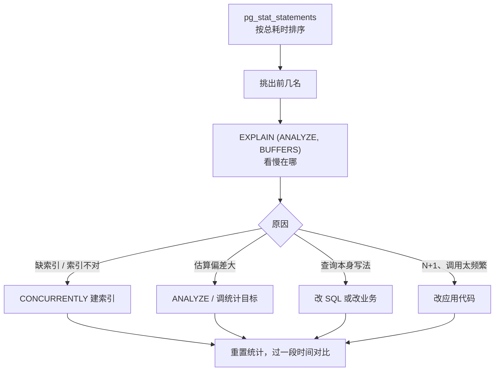

# 慢查询治理

「某个页面突然变慢了」是数据库问题里最常见的一类。凭感觉猜是哪条 SQL、加个索引试试，有时能蒙对，更多时候是白忙。本章给出一套固定流程：先用 `pg_stat_statements` 找出**总耗时**最大的查询，再用 `EXPLAIN (ANALYZE, BUFFERS)` 看它为什么慢，然后对症处理，最后用同样的数据确认改善。也讲正在发生的慢：怎么找到卡住的查询和挡路的锁。

命令以 PostgreSQL 16 为准。索引原理、执行计划的基础读法在[《数据库原理与实战》](../database-practice/)里，这里侧重线上的发现和处置。

## 治理流程



## pg_stat_statements：先看全局

慢查询日志只能看到单次很慢的语句，但真正拖垮数据库的，往往是**单次 5ms、每秒执行 2000 次**的查询。`pg_stat_statements` 把同一类查询（参数不同但结构相同）归并起来，累计次数、总耗时、读了多少块。

### 开启

它需要预加载，要重启。在 compose 的 `command` 里加：

```yaml
    command:
      - postgres
      - -c
      - shared_preload_libraries=pg_stat_statements
      - -c
      - pg_stat_statements.track=top
      - -c
      - track_io_timing=on
```

```bash
docker compose up -d postgres
docker compose exec postgres psql -U counter -d counter -c "CREATE EXTENSION IF NOT EXISTS pg_stat_statements;"
```

`track_io_timing = on` 让统计里带上读写磁盘的耗时，能区分「慢在 CPU」还是「慢在 I/O」。它在部分虚拟机上计时开销较大，官方提供了 `pg_test_timing` 工具测量，云服务器上一般可以放心打开。

### 找出最该优化的查询

```sql
SELECT
  round(total_exec_time::numeric / 1000, 1)        AS total_s,
  calls,
  round(mean_exec_time::numeric, 2)                AS mean_ms,
  round((100 * total_exec_time / sum(total_exec_time) OVER ())::numeric, 1) AS pct,
  rows / NULLIF(calls, 0)                          AS rows_per_call,
  shared_blks_hit + shared_blks_read               AS blks,
  left(regexp_replace(query, '\s+', ' ', 'g'), 120) AS query
FROM pg_stat_statements
WHERE dbid = (SELECT oid FROM pg_database WHERE datname = current_database())
ORDER BY total_exec_time DESC
LIMIT 10;
```

这几列怎么读：

| 列 | 关注什么 |
|---|---|
| `total_s` / `pct` | 排序依据。前三名通常占了一大半，优化它们收益最大 |
| `calls` | 次数异常多（比如是页面访问量的几十倍），多半是应用里的 N+1 |
| `mean_ms` | 单次耗时。高的话看执行计划 |
| `rows_per_call` | 每次返回很多行，可能是没分页 |
| `blks` | 读的数据块多，说明扫描范围大，常见于缺索引 |

### 建立基线

第 1 章说调参要有基线，这就是基线：

```sql
SELECT pg_stat_statements_reset();
```

重置后让系统正常跑一段时间（比如一个完整的营业日），记下上面那条查询的结果。之后每次加索引、调参数、发版，都用同样的时长再取一次对比。没有前后对比的优化，你无法确认它到底起没起作用。

## 慢查询日志和 auto_explain

`pg_stat_statements` 告诉你哪类查询总体最贵，但归并之后看不到具体参数。有些查询只在特定参数下才慢，比如某家数据特别多的门店。这时靠日志：

```yaml
      - -c
      - log_min_duration_statement=500ms
```

日志里会出现完整的语句和参数。再进一步，可以让 Postgres 把慢查询的**执行计划**也自动记下来：

```yaml
      - -c
      - shared_preload_libraries=pg_stat_statements,auto_explain
      - -c
      - auto_explain.log_min_duration=1s
      - -c
      - auto_explain.log_analyze=on
      - -c
      - auto_explain.log_buffers=on
```

`auto_explain.log_analyze` 会给所有查询加上计时开销，不只是慢的那些。流量大时先开一段时间抓问题，抓到后关掉，或者用 `auto_explain.sample_rate` 抽样。

## 读懂 EXPLAIN (ANALYZE, BUFFERS)

拿到可疑的查询后，用真实参数执行一次：

```sql
EXPLAIN (ANALYZE, BUFFERS)
SELECT * FROM stock_movements
WHERE store_id = '...' AND occurred_at >= current_date - 30
ORDER BY occurred_at DESC
LIMIT 50;
```

`ANALYZE` 会**真的执行**这条语句。对 `UPDATE` / `DELETE` 要包在事务里回滚：

```sql
BEGIN;
EXPLAIN (ANALYZE, BUFFERS) UPDATE ...;
ROLLBACK;
```

PostgreSQL 18 起 `EXPLAIN ANALYZE` 默认就带 `BUFFERS`；16、17 上要显式写。

hatch-counter 的库存流水表在 schema 里已经声明了 `(store_id, occurred_at)` 索引。假设当初漏了它，会得到这样一个典型的缺索引输出（示意，数字是为说明而构造的）：

```text
Limit  (cost=48211.20..48211.32 rows=50 width=96) (actual time=812.4..812.5 rows=50 loops=1)
  Buffers: shared hit=1204 read=30877
  ->  Sort  (cost=48211.20..48230.85 rows=7860 width=96) (actual time=812.4..812.4 rows=50 loops=1)
        Sort Key: occurred_at DESC
        Sort Method: top-N heapsort  Memory: 39kB
        ->  Seq Scan on stock_movements  (cost=0.00..47950.10 rows=7860 width=96) (actual time=0.03..809.7 rows=8122 loops=1)
              Filter: ((store_id = '...') AND (occurred_at >= (CURRENT_DATE - 30)))
              Rows Removed by Filter: 1991878
Planning Time: 0.2 ms
Execution Time: 812.6 ms
```

从里往外读，抓住四个信号：

| 信号 | 本例 | 含义 |
|---|---|---|
| 节点类型 | `Seq Scan` | 全表扫描了 200 万行 |
| `Rows Removed by Filter` | 1991878 | 扫了大量行又扔掉，典型的缺索引 |
| `Buffers: read` | 30877 | 约 241MB（每块 8KB）从磁盘或页缓存读入，`hit` 才是命中 `shared_buffers` |
| 估算 vs 实际 | `rows=7860` vs `rows=8122` | 接近，说明统计信息是准的 |

加一个匹配查询条件和排序的复合索引：

```sql
CREATE INDEX CONCURRENTLY stock_occurred_idx
  ON stock_movements (store_id, occurred_at);
```

之后同一个查询会变成 `Index Scan Backward`（B 树可以反向扫描，不用专门建 `DESC` 索引），只读几十个块，直接按顺序取前 50 行，连排序都省了。

### 估算偏差大怎么办

如果 `rows=` 的估算和 `actual ... rows=` 差了几十倍，优化器就可能选错计划（比如以为只有 10 行而选了嵌套循环）。先手动更新统计：

```sql
ANALYZE stock_movements;
```

还不准的话，对分布不均匀的列调高统计目标（默认 100）：

```sql
ALTER TABLE stock_movements ALTER COLUMN store_id SET STATISTICS 500;
ANALYZE stock_movements;
```

多租户系统里这很常见：几家大店占了大部分数据，平均值对它们完全不适用。

### RLS 与索引

hatch-counter 用 RLS 隔离门店，策略会给每个查询自动加上类似 `store_id = current_setting('app.store_id')` 的条件。这意味着**几乎所有业务表的索引都应该以 `store_id` 开头**，否则 RLS 追加的条件只能靠全表扫描后过滤。看执行计划时，`Filter` 里出现了策略条件，就是在提醒你这一点。

## 线上建索引

普通的 `CREATE INDEX` 会持有锁，挡住这张表的所有写入，直到索引建完。大表上可能是几分钟的写入中断。线上要用 `CONCURRENTLY`：

- 不阻塞读写，但建得更慢，而且要扫描两遍表
- **不能在事务块里执行**。不少迁移工具会把迁移包在事务里，Drizzle 的迁移器也是如此，`CONCURRENTLY` 会直接报 `cannot run inside a transaction block`。请以你所用版本的行为为准
- 失败时会留下一个 `INVALID` 状态的索引，要手动删掉重建：

```sql
SELECT indexrelid::regclass FROM pg_index WHERE NOT indisvalid;
DROP INDEX CONCURRENTLY stock_occurred_idx;
```

小表（几万行以内）直接在迁移里普通建索引，锁的时间可以忽略。大表的做法是：在低峰期手动用 `CONCURRENTLY` 建好，迁移文件里写 `CREATE INDEX IF NOT EXISTS` 同名索引，这样迁移跑到时是空操作，而开发环境和新环境也能得到同样的索引。

### 别忘了清理没用的索引

每个索引都会拖慢写入、占用空间和缓存。找出从没被用过的：

```sql
SELECT relname AS table, indexrelname AS index, idx_scan,
       pg_size_pretty(pg_relation_size(indexrelid)) AS size
FROM pg_stat_user_indexes
WHERE idx_scan = 0
ORDER BY pg_relation_size(indexrelid) DESC;
```

`idx_scan` 从统计上次重置后开始计数，要确认统计已经积累了足够长的时间（覆盖月底结账这类低频场景），并且排除主键和唯一约束背后的索引，再考虑删除。

## 正在发生的慢

页面现在就卡住了，要看的是此刻在执行什么：

```sql
SELECT pid, usename, state,
       now() - xact_start  AS xact_age,
       now() - query_start AS query_age,
       wait_event_type, wait_event,
       pg_blocking_pids(pid) AS blocked_by,
       left(query, 80) AS query
FROM pg_stat_activity
WHERE datname = 'counter' AND state <> 'idle'
ORDER BY xact_start NULLS LAST;
```

常见的三种情形：

| 现象 | 说明 | 处置 |
|---|---|---|
| `state = active`，`query_age` 很长 | 一条查询在跑 | 看执行计划；必要时取消 |
| `wait_event_type = Lock`，`blocked_by` 非空 | 在等别人的锁 | 顺着 `blocked_by` 找到源头 |
| `state = idle in transaction`，`xact_age` 很长 | 开了事务不提交 | 多半是应用 bug；它同时挡着 VACUUM（第 7 章） |

处置命令：

```sql
SELECT pg_cancel_backend(12345);     -- 取消当前查询，连接保留
SELECT pg_terminate_backend(12345);  -- 断开整个连接，事务回滚
```

先用 `cancel`，不行再 `terminate`。

### 迁移导致的锁等待

一个特别隐蔽的情形：发版时迁移执行 `ALTER TABLE ... ADD COLUMN`，它需要表上的排他锁，而这张表上恰好有一个长查询在跑。迁移排队等锁，**之后所有访问这张表的查询都排在迁移后面**，整个服务看起来就像挂了。

防法是在迁移连接上设置锁等待超时，拿不到锁就快速失败，而不是把所有人堵住：

```sql
SET lock_timeout = '5s';
ALTER TABLE stock_movements ADD COLUMN note text;
```

失败了过几分钟重试即可。这和第 1 章给业务角色设 `lock_timeout` 是同一个道理。

## 本章要点

- 治理流程：`pg_stat_statements` 按总耗时排序 → `EXPLAIN (ANALYZE, BUFFERS)` → 对症处理 → 重置统计后对比
- 高频的小查询和单次很慢的查询一样危险，按 `total_exec_time` 排序而不是按平均值
- 读计划抓四个信号：节点类型、`Rows Removed by Filter`、`Buffers read`、估算与实际的偏差
- 多租户 + RLS 的表，索引以 `store_id` 开头
- 线上建索引用 `CONCURRENTLY`，注意它不能在事务里执行，失败会留下 INVALID 索引
- 正在发生的慢看 `pg_stat_activity` 和 `pg_blocking_pids`；迁移连接设 `lock_timeout` 防止堵死全站
