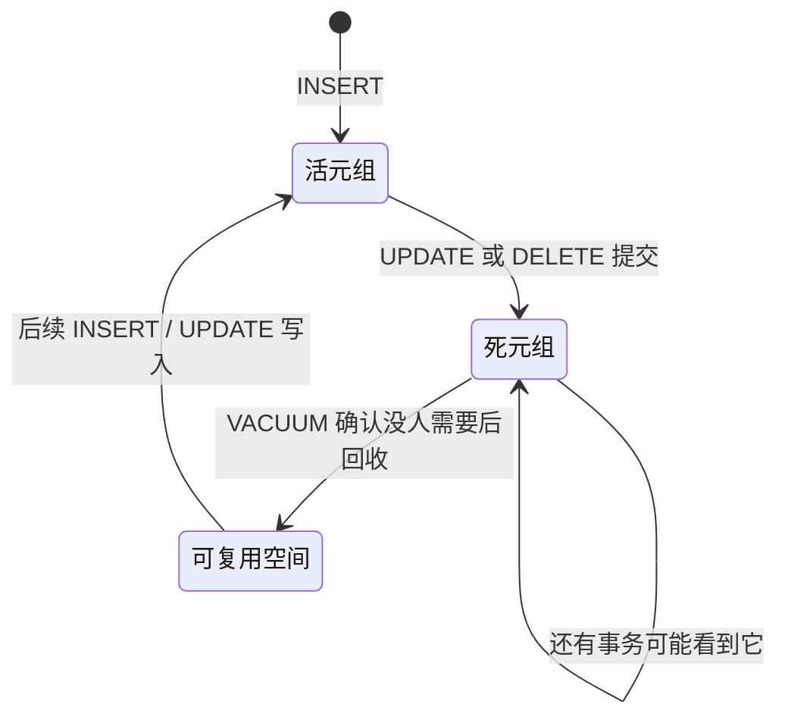

# VACUUM 与表膨胀

用 Postgres 久了，你可能会遇到这样的现象：一张表只有几万行，却占了几个 GB；删了一半数据，磁盘一点没少；某个查询越来越慢，`EXPLAIN` 看计划没变。这些背后是同一个机制：MVCC 留下的死元组，以及负责清理它们的 VACUUM。本章讲清死元组从哪来、autovacuum 什么时候触发、什么会挡住清理、膨胀了怎么修，以及必须了解的事务 ID 回卷。

命令以 PostgreSQL 18 为准。MVCC 的原理在[《数据库原理与实战》](../database-practice/)里有详细讲解，这里只回顾运维需要的部分。

## 死元组从哪来

Postgres 的 MVCC 不在原地修改行。一条 `UPDATE` 实际上是：写一个新版本的行，把旧版本标记为「从某个事务起失效」。`DELETE` 也只是做标记。旧版本不会马上消失，因为可能还有更早开始的事务需要看到它。



**当没有任何事务还需要某个旧版本时**，它才成为真正可以清理的死元组。VACUUM 做的事情是：

1. 找出这些死元组，把它们占的空间登记到空闲空间映射（FSM），后续写入可以复用
2. 清理索引里指向这些死元组的条目
3. 更新可见性映射（visibility map），让仅索引扫描（index-only scan）可以跳过回表
4. 冻结足够老的行，防止事务 ID 回卷（本章最后讲）

关键点：**普通 VACUUM 不把空间还给操作系统**（除了表末尾整页空出来的部分），只是让表内部可以复用。表一旦膨胀到 10GB，VACUUM 之后它还是 10GB，只是里面有很多空洞可以写。

### 什么是膨胀

如果死元组产生的速度长期快于回收的速度，表和索引就会不断变大，这就是膨胀（bloat）。后果是：

- 顺序扫描要读更多的页，变慢
- 缓存里装的有效数据变少，命中率下降
- 磁盘占用远大于实际数据量，备份也随之变大、变慢

## autovacuum 什么时候触发

> [!WARNING]
> 本节的默认值和触发公式按 2026 年 11 月 PostgreSQL 18 官方文档（Automatic Vacuuming 参数一节）整理；`autovacuum_vacuum_max_threshold`、`autovacuum_worker_slots` 是 18 新增的，16、17 没有。以你所用大版本的官方文档为准。

autovacuum 后台进程定期检查每张表，满足条件就对它执行 VACUUM 或 ANALYZE。默认的触发条件（16 到 18 相同）：

$$
\text{死元组数} > 50 + 0.2 \times \text{表行数}
$$

ANALYZE 的条件类似：自上次分析以来变更的行数超过 $50 + 0.1 \times \text{表行数}$。另外从 13 开始，只插入不更新的表也会按插入行数触发 VACUUM（用于更新可见性映射和冻结）。

18 在这个公式上加了一个封顶：阈值最多是 `autovacuum_vacuum_max_threshold`，默认 1 亿个死元组，避免几十亿行的超大表永远等不到触发。对一人公司的库，这个上限基本碰不到，按比例触发的问题仍然在：

按比例触发的问题在大表上很明显：

| 表行数 | 默认触发阈值（死元组） | scale_factor 改成 0.02 后 |
|---|---|---|
| 10 万 | 20,050 | 2,050 |
| 100 万 | 200,050 | 20,050 |
| 1000 万 | 2,000,050 | 200,050 |

一张 1000 万行的流水表，要攒够 200 万个死元组才会被清理一次。对更新频繁的大表，单独调低比例：

```sql
ALTER TABLE stock_movements SET (
  autovacuum_vacuum_scale_factor = 0.02,
  autovacuum_analyze_scale_factor = 0.01
);
```

这个设置存在表的元数据里，可以写进迁移文件，随代码走。

### 让 autovacuum 跑得动

autovacuum 默认很「温和」：做一定量的 I/O 后就暂停一下，避免影响业务。在 SSD 上，这个节奏往往太保守，导致它清理不过来。几个相关参数：

| 参数 | 默认值 | 说明 |
|---|---|---|
| `autovacuum_max_workers` | 3 | 同时清理几张表。16、17 改它要重启；18 起在 `autovacuum_worker_slots`（通常是 16）以内调整只需重载 |
| `autovacuum_vacuum_cost_limit` | -1（沿用 `vacuum_cost_limit` = 200） | 每轮可做的 I/O 量 |
| `autovacuum_vacuum_cost_delay` | 2ms | 每轮之后暂停多久 |
| `autovacuum_naptime` | 1min | 多久检查一轮 |

SSD 上常见的调整是把 `autovacuum_vacuum_cost_limit` 调到 1000–2000，让它每轮多做一些。注意这个额度是所有 worker 共享的，加 worker 数不加额度，每个 worker 反而更慢。

一个原则：**不要关掉 autovacuum**，哪怕是对某张表。它慢的时候要让它更快，而不是让它停。

## 什么会挡住清理

autovacuum 在跑、日志里也有记录，表却还是在膨胀，十有八九是清理被挡住了。VACUUM 只能清理「所有事务都不再需要」的死元组，判断依据是全局最老的那个事务快照（xmin horizon）。任何让这个快照停在过去的东西，都会让清理停下：

| 挡路者 | 怎么发现 |
|---|---|
| 长时间运行的查询或事务 | `pg_stat_activity` 的 `xact_start` |
| `idle in transaction` 的连接 | `pg_stat_activity` 的 `state` |
| 不活跃的复制槽 | `pg_replication_slots` 的 `xmin`、`catalog_xmin` |
| 从库开了 `hot_standby_feedback` 且有长查询 | 从库的 `pg_stat_activity` |
| 遗留的两阶段提交事务 | `pg_prepared_xacts` |

一条查询把这些都列出来，按年龄排序：

```sql
SELECT 'activity' AS src, pid::text AS id, age(backend_xmin) AS xmin_age, state
FROM pg_stat_activity WHERE backend_xmin IS NOT NULL
UNION ALL
SELECT 'slot', slot_name, age(xmin), active::text
FROM pg_replication_slots WHERE xmin IS NOT NULL
UNION ALL
SELECT 'prepared', gid, age(transaction), 'prepared'
FROM pg_prepared_xacts
ORDER BY xmin_age DESC
LIMIT 10;
```

`xmin_age` 是这个快照落后了多少个事务。正常情况下应该很小；某一行比其他行大出几个数量级，就是它在挡路。这也是第 1 章建议设置 `idle_in_transaction_session_timeout` 的原因。

## 观察膨胀

### 死元组统计

```sql
SELECT relname,
       n_live_tup, n_dead_tup,
       round(100.0 * n_dead_tup / NULLIF(n_live_tup + n_dead_tup, 0), 1) AS dead_pct,
       last_autovacuum, last_autoanalyze, autovacuum_count
FROM pg_stat_user_tables
ORDER BY n_dead_tup DESC
LIMIT 15;
```

`dead_pct` 长期高于 20%、`last_autovacuum` 很久以前或为空，就要看看是触发阈值太高，还是清理被挡住了。

### 实际膨胀程度

`pg_stat_user_tables` 是估算。要精确测量，用 `pgstattuple` 扩展，它随 contrib 一起发布，官方镜像里就有：

```sql
CREATE EXTENSION IF NOT EXISTS pgstattuple;

-- 近似版本，速度快，适合大表
SELECT * FROM pgstattuple_approx('stock_movements');

-- 索引的膨胀
SELECT avg_leaf_density, leaf_fragmentation FROM pgstatindex('stock_occurred_idx');
```

`pgstattuple_approx` 返回的 `dead_tuple_percent` 和 `approx_free_percent` 加起来，大致就是这张表有多少比例是「空洞」。B 树索引的 `avg_leaf_density` 刚建好时约为 90%（默认填充因子），远低于这个值说明索引膨胀了。

### hatch-counter 里值得盯的表

膨胀最容易发生在**高频写入又定期删除**的表上。在 hatch-counter 的表结构里，这类表包括：

- `idempotent_requests`：幂等键记录，每次写入时顺带删掉超过保留时长的旧记录
- `qr_logins`：扫码登录的短期记录，按时间窗口清理
- 其他「生成、失效、清理」循环的短期凭证类表

对这类表，给它们单独设置更低的 `autovacuum_vacuum_scale_factor`。清理过期数据时分批删除（每次几千行，循环直到删完），而不是一次删几百万行；一次大删除会瞬间制造海量死元组，还会产生一个长事务挡住其他表的清理。数据量真的很大、并且按时间过期时，按时间分区、直接 `DROP` 旧分区是最干净的做法，删除分区不产生任何死元组。

## 膨胀了怎么修

| 方法 | 效果 | 锁 | 适用 |
|---|---|---|---|
| `VACUUM` | 回收空间供表内复用，不缩小文件 | 不阻塞读写 | 日常，解决「还在继续涨」 |
| `VACUUM FULL` | 重写整张表，文件缩到实际大小 | **排他锁，读写全部阻塞** | 小表，或可以停服的维护窗口 |
| `REINDEX INDEX CONCURRENTLY` | 重建索引 | 不阻塞读写 | 索引膨胀（12 起提供） |
| `pg_repack` 扩展 | 在线重写表 | 只在开始和结束短暂加锁 | 大表、不能停服 |

`VACUUM FULL` 期间需要额外一份表大小的磁盘空间，磁盘快满时做不了。`pg_repack` 不在官方镜像里，要自己构建带它的镜像，而且扩展版本必须与服务器大版本匹配。

对一人公司的规模，最实际的顺序是：

1. 先找出并消除挡住清理的东西，调低热表的触发比例，让膨胀**停止增长**
2. 索引膨胀用 `REINDEX ... CONCURRENTLY` 修
3. 表本身的膨胀，如果不影响性能和磁盘，可以不管，表内空洞会被后续写入逐渐复用
4. 真要缩小，小表在低峰期 `VACUUM FULL`，大表考虑 `pg_repack`

## 事务 ID 回卷

最后讲一个不常见、但一旦发生就很严重的问题。

Postgres 的事务 ID 是 32 位的，大约 42 亿个，并且循环使用。判断一行对某个事务是否可见，要比较事务 ID 的新旧，而循环空间里「新旧」只在约 21 亿的距离内有意义。如果一行的事务 ID 老到超过这个距离，它会突然被当作「未来的事务」写的，变得不可见，看起来就像数据凭空消失了。

VACUUM 的冻结（freeze）操作把足够老的行标记为「对所有事务都可见」，从而让它脱离事务 ID 比较。只要 VACUUM 正常运行，冻结就会持续进行。当某张表最老的未冻结事务 ID 年龄超过 `autovacuum_freeze_max_age`（默认 2 亿）时，autovacuum 会强制对它执行防回卷 VACUUM，而且这种 VACUUM 不会因为锁冲突而让步。

如果冻结一直跟不上（通常是因为上一节那些挡路者长期存在），Postgres 会在接近极限时在日志里不断告警，再往后会**拒绝执行新的写事务**，以保护数据，直到你手动完成 VACUUM。这对线上服务就是停机。

定期看一眼各库和各表的年龄：

```sql
SELECT datname, age(datfrozenxid) AS xid_age,
       round(100.0 * age(datfrozenxid) / 2000000000, 1) AS pct_to_limit
FROM pg_database ORDER BY xid_age DESC;

SELECT relname, age(relfrozenxid) AS xid_age
FROM pg_class WHERE relkind = 'r'
ORDER BY age(relfrozenxid) DESC LIMIT 10;
```

`xid_age` 在 2 亿上下波动是正常的，说明防回卷 VACUUM 在按时工作。如果它持续攀升到 5 亿、10 亿，立刻排查挡路者。这条查询值得放进[《可观测性与性能》](../observability-performance/)里讲的监控。

hatch-counter 这样的业务量，一天可能也就几万到几十万个事务，离回卷很远。但「长事务挡住清理」这个病根，在小系统里一样会发生。

## 本章要点

- MVCC 的 `UPDATE` / `DELETE` 留下旧版本，没有事务需要后才成为可清理的死元组
- 普通 VACUUM 让空间可复用但不缩小文件；`VACUUM FULL` 缩小文件但锁全表
- 默认触发条件是死元组超过 50 + 20% 行数，大表要单独调低 `autovacuum_vacuum_scale_factor`
- 清理不动时先找挡路者：长事务、`idle in transaction`、不活跃的复制槽、遗留的预备事务
- 用 `pg_stat_user_tables` 看趋势，`pgstattuple` 测实际膨胀；索引膨胀用 `REINDEX CONCURRENTLY`
- 高频写入又定期删除的表最容易膨胀：分批删除，或按时间分区后 `DROP` 旧分区
- 事务 ID 回卷靠 VACUUM 冻结来防，监控 `age(datfrozenxid)`

## 动手练习

在一次性容器里做，做完 `docker rm -f vac` 清理：

```bash
docker run -d --name vac -e POSTGRES_PASSWORD=x postgres:18-alpine
sleep 5
docker exec -it vac psql -U postgres
```

1. **VACUUM 不还空间，VACUUM FULL 还**：建表并关掉这张表的 autovacuum（仅为了让实验可控，生产上不要这样做）：`CREATE TABLE t (id int, v text) WITH (autovacuum_enabled = false); INSERT INTO t SELECT g, 'x' FROM generate_series(1, 1000000) g;`。记下 `SELECT pg_size_pretty(pg_relation_size('t'));`，然后执行两次 `UPDATE t SET v = v || 'y';`，依次在 `VACUUM t;` 和 `VACUUM FULL t;` 之后再看大小。

   验证：两次 `UPDATE` 后表明显变大（两到三倍，取决于页内清理复用了多少）；`VACUUM` 之后大小基本不变，但 `pg_stat_user_tables` 里 `n_dead_tup` 归零；`VACUUM FULL` 之后回到接近原始大小。

   参考答案：`UPDATE` 写新版本、旧版本变成死元组；普通 VACUUM 只把空间登记为可复用，`VACUUM FULL` 重写整张表才缩小文件，代价是全程排他锁。再执行一次 `UPDATE`，会看到普通 VACUUM 过的表几乎不再变大，因为空洞被复用了。

2. **长事务挡住清理**：终端 A 执行 `BEGIN ISOLATION LEVEL REPEATABLE READ; SELECT count(*) FROM t;`，保持不提交。终端 B 执行 `UPDATE t SET v = 'z';` 和 `VACUUM (VERBOSE) t;`，并跑本章「什么会挡住清理」那条查询。然后 A 执行 `COMMIT`，B 再 `VACUUM (VERBOSE) t;` 一次。

   验证：第一次 VACUUM 的输出里，`tuples:` 一行显示 `0 removed`，以及约 100 万个 `are dead but not yet removable`；挡路者查询里 A 的那一行 `xmin_age` 明显最大。A 提交后第二次 VACUUM 显示约 100 万行 `removed`。

   参考答案：A 持有的快照可能还要看到旧版本，全局 xmin horizon 停在 A 开始的时刻，VACUUM 只能跳过。用读已提交级别时语句结束就释放快照，所以这里用可重复读来模拟一个长事务。在 A 的会话里先 `SET idle_in_transaction_session_timeout = '10s';` 重做，A 会在空闲 10 秒后被断开，挡路自动解除。

3. **算一算触发阈值**：一张 300 万行、每天更新 5 万行的表，按默认参数，autovacuum 大约几天触发一次？把 `autovacuum_vacuum_scale_factor` 设成 0.01 之后呢？

   验证：用 `SELECT 50 + 0.2 * 3000000, 50 + 0.01 * 3000000;` 算出两个阈值，再除以每天 5 万。

   参考答案：默认阈值 600,050，约 12 天才清理一次，期间死元组一直堆着；调到 0.01 后阈值 30,050，不到一天一次。热表按表单独调比例，写进迁移文件。
