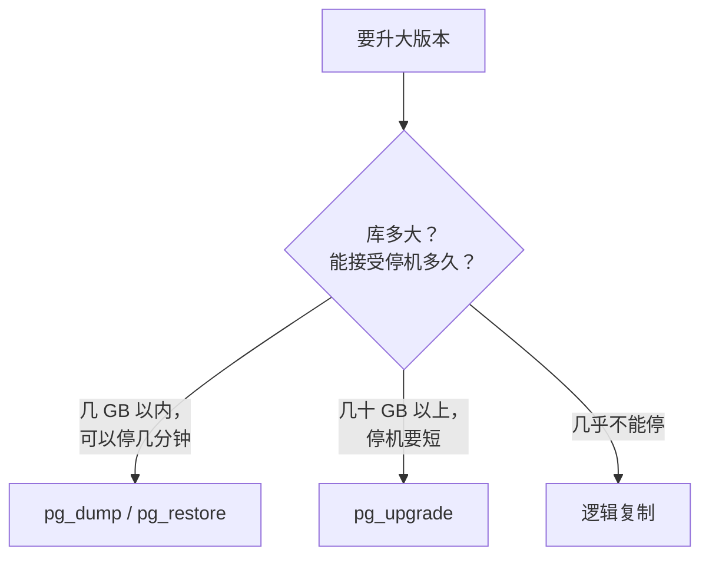

# 大版本升级

PostgreSQL 每年发布一个大版本，每个大版本官方支持 5 年。hatch-counter 现在用的 16 是 2023 年发布的，按这个周期，2028 年底前总要升一次。大版本之间数据文件格式不兼容，不能像升级 Node 依赖那样改个版本号就完事。本章先区分小版本和大版本升级，比较三种大版本升级方式，然后给出一份在 docker compose 上从 16 直接升到 18（本书的基线）的完整手册，最后列出 18 带来的、和本书操作相关的变化，以及 19 的情况。

## 小版本和大版本

从 10 开始，Postgres 的版本号是「大版本.小版本」：`16.4` 的大版本是 16，小版本是 4。

| | 小版本（16.3 → 16.4） | 大版本（16 → 17） |
|---|---|---|
| 发布节奏 | 大约每季度一次 | 每年一次 |
| 内容 | 缺陷修复、安全修复 | 新功能、行为变化 |
| 数据文件 | 兼容 | **不兼容** |
| 怎么升 | 换镜像、重启 | 需要迁移数据 |
| 该不该及时升 | **应该**，官方建议始终跑最新小版本 | 规划好再升 |

### 小版本：换镜像重启

`postgres:16-alpine` 这个标签会随小版本更新而指向新镜像。小版本升级只是重新拉镜像、重建容器：

```bash
docker compose pull postgres
docker compose up -d postgres
docker compose exec postgres psql -U counter -d counter -c "SELECT version();"
```

但「只是重启」之前，还是要读一下这个小版本的发布说明。偶尔会有「升级后需要重建某类索引」这样的附加步骤，通常是因为修复了一个可能导致索引损坏的缺陷。

hatch-counter 的镜像是先转存到自己的私有镜像仓库再拉取的（境内服务器拉不动 Docker Hub）。浮动标签意味着「转存那一刻的 16.x」，想精确控制版本，可以改用 `16.4-alpine` 这样的完整标签，升级时显式改它。两种都可以，关键是知道自己跑的是哪个版本。

### 大版本：为什么不能直接换标签

把 compose 里的 `16-alpine` 改成 `17-alpine` 直接启动，容器会立刻退出，日志里是：

```text
FATAL:  database files are incompatible with server
DETAIL:  The data directory was initialized by PostgreSQL version 16, which is not compatible with this version 17.x.
```

这是好事：Postgres 拒绝用新版本打开旧格式的数据，不会把数据弄坏。改回 `16-alpine` 就能恢复。

换成 `18-alpine` 时报错会更早：18 的镜像发现 `/var/lib/postgresql/data` 上挂着一个卷，就直接拒绝启动、提示挂载点变了，根本走不到版本检查（见[下文](#18-带来的变化以及-19)）。

## 三种升级方式



| 方式 | 停机时间 | 复杂度 | 说明 |
|---|---|---|---|
| dump / restore | 与数据量成正比 | 低 | 逻辑导出再导入新版本；顺带整理掉所有膨胀 |
| `pg_upgrade` | 分钟级（`--link` 模式更快） | 中 | 直接转换数据目录，需要新旧两套程序同时存在 |
| 逻辑复制 | 秒级切换 | 高 | 新版本实例订阅旧库的变更，追平后切换 |

hatch-counter 这样的业务库，数据量在几 GB 以内，dump / restore 几分钟就能完成。在夜里停服务几分钟完全可以接受，**简单、可靠、好回滚**比停机时间短更重要。下面的手册就用这种方式。

`pg_upgrade` 在容器里用起来不太方便：它需要同时访问旧版本和新版本的程序，而官方镜像每个只带一个版本。社区有专门把两个版本打包在一起的升级镜像，库大到 dump / restore 太慢时可以考虑，使用前请仔细阅读它的说明并先在副本上演练。

## 升级前的准备

升级当天之前要完成的事：

1. **读发布说明里的「不兼容变更」**（Migration to Version 18 一节；从 16 跨过 17 直接升到 18，要把 17 和 18 两个版本的这一节都读一遍）。重点看是否有你用到的函数、参数被删除或改了行为
2. **检查扩展**：`SELECT extname, extversion FROM pg_extension;`，确认每个扩展在新版本都可用。官方镜像自带的 contrib 扩展（如 `pg_stat_statements`、`pgstattuple`）没有问题，自己装的第三方扩展要确认有对应新版本的构建
3. **检查应用依赖**：驱动、ORM 是否支持新版本。主流驱动对新版本的支持一般都很及时
4. **准备好镜像**：hatch-counter 需要先把 `postgres:18-alpine` 转存到自己的镜像仓库，否则升级当天才发现拉不到
5. **完整彩排一次**：按第 2 章的方法，把最新的 dump 恢复进一个 `postgres:18-alpine` 临时容器，在它上面跑一遍迁移和服务端的测试，记下导出和恢复各用了多久。这个时间就是升级当天的停机时间

## 手册：compose 上从 16 升到 18

前提：项目名 `counter`，compose 网络 `counter_default`，现有数据卷 `pgdata`，密码在 `postgres.env`。

### 1. 停服务

```bash
cd /srv/counter
docker compose stop api
```

nginx 这时会对 api 的请求返回 502。更友好的做法是事先配好维护页，见[《Nginx 与反向代理》](../nginx-gateway/)。

### 2. 用新版本的 pg_dump 导出

官方建议用**新版本**的 `pg_dump` 去导出旧版本的库，它知道怎样生成新版本最能接受的输出。在 compose 网络里起一个 18 的临时容器去连旧库：

```bash
mkdir -p /srv/pg-backups/upgrade

docker run --rm --network counter_default --env-file postgres.env postgres:18-alpine \
  sh -c 'PGPASSWORD="$POSTGRES_PASSWORD" pg_dump -h postgres -U counter -d counter -Fc' \
  > /srv/pg-backups/upgrade/counter-pg16.dump

docker run --rm --network counter_default --env-file postgres.env postgres:18-alpine \
  sh -c 'PGPASSWORD="$POSTGRES_PASSWORD" pg_dumpall -h postgres -U counter --roles-only' \
  > /srv/pg-backups/upgrade/roles-pg16.sql

ls -lh /srv/pg-backups/upgrade/
```

`--env-file postgres.env` 把密码以环境变量传进临时容器，命令行和 shell 历史里都不会出现密码。镜像名请换成你实际使用的仓库地址。

### 3. 停旧库，改 compose

```bash
docker compose stop postgres
```

编辑 `docker-compose.yml`：

```yaml
services:
  postgres:
    image: registry.example.com/counter/postgres:18-alpine
    volumes:
      - pgdata18:/var/lib/postgresql   # 新卷；18 起挂载点不再是 .../data

volumes:
  pgdata:      # 旧卷保留，不要删，它是回滚的后路
  pgdata18:
```

**用新卷，不要动旧卷**。旧卷原封不动地保留着，回滚只需要把这两行改回去。注意挂载点也跟着变了：18 的镜像把卷挂在 `/var/lib/postgresql`，数据目录是卷里的 `18/docker`；照旧写成 `pgdata18:/var/lib/postgresql/data`，18 的镜像会拒绝启动。

### 4. 启动新库

```bash
docker compose up -d --wait postgres
docker compose exec postgres psql -U counter -d postgres -c "SELECT version();"
```

新卷是空的，镜像会按 `postgres.env` 执行初始化，建出 `counter` 超级用户和空的 `counter` 库。

### 5. 恢复

```bash
# 角色。会有一行 role "counter" already exists 的报错，忽略
docker compose exec -T postgres psql -U counter -d postgres < /srv/pg-backups/upgrade/roles-pg16.sql

# 删掉初始化建的空库，让 pg_restore 按原样重建
docker compose exec postgres psql -U counter -d postgres -c "DROP DATABASE counter;"

time docker compose exec -T postgres \
  pg_restore -U counter -d postgres --create --exit-on-error \
  < /srv/pg-backups/upgrade/counter-pg16.dump
```

角色文件里带着 `counter_app`、`counter_admin` 的密码哈希，恢复后它们的密码与升级前相同，服务端的连接串不用改。

### 6. 重新收集统计信息

dump / restore 不带优化器统计信息。不做这一步，升级后的头几分钟到几小时里，很多查询会因为缺统计而选错执行计划：

```bash
docker compose exec postgres vacuumdb -U counter --all --analyze-in-stages
```

`--analyze-in-stages` 先用很低的统计精度快速过一遍，让优化器尽快有数据可用，再逐步提高精度。

### 7. 验证并恢复服务

```bash
docker compose exec postgres psql -U counter -d counter -c "\dt" | head
docker compose exec postgres psql -U counter -d counter -c "SELECT count(*) FROM stores;"

docker compose up -d --wait api
curl -fsS http://127.0.0.1:3000/v1/health
```

把关键表的行数和升级前对比（升级前先记下来）。服务端起来后，用店主账号登录走一遍核心流程。

### 8. 回滚预案

如果验证发现问题：

```bash
docker compose stop api postgres
# 把 compose 里的镜像改回 16-alpine，卷改回 pgdata:/var/lib/postgresql/data
docker compose up -d --wait postgres api
```

注意，回滚后升级之后写入的数据会丢失。所以**验证要在恢复对外服务之前做完**，一旦放开写入，回滚的代价就会越来越大。

### 9. 收尾

- 观察一周，确认 `pg_stat_statements` 里没有明显变慢的查询（第 6 章）
- 立即做一次新的基础备份和 dump。如果配了 WAL 归档（第 3 章），**旧版本的基础备份和 WAL 不能用来恢复新版本的库**，归档目录要换一个新的
- 一两周后确认无误，再删除旧卷：`docker volume rm counter_pgdata`

## 18 带来的变化，以及 19

> [!WARNING]
> 本节按 2026 年 11 月 PostgreSQL 18 官方 Release Notes、docker-library/postgres 的 18 镜像 Dockerfile 和 postgresql.org 版本支持页整理。只列与本书操作直接相关的几条，完整变化以官方 Release Notes 为准。

PostgreSQL 18.0 于 2025 年 9 月 25 日发布。从 16 升上来，上面的手册已经处理了挂载点，另外几处差异：

- **官方镜像的数据目录变了**。18 起，镜像的 `PGDATA` 默认是 `/var/lib/postgresql/18/docker`，声明的卷挂载点改成了 `/var/lib/postgresql`。改动的意图是方便以后用 `pg_upgrade` 在同一个卷里放多个版本的目录。备份脚本、恢复步骤里写死的 `/var/lib/postgresql/data` 都要跟着改（第 3 章的恢复步骤已按 18 写）
- **新集群默认开启数据校验和**。`initdb` 在 18 默认启用 data checksums（`--no-data-checksums` 关闭）。dump / restore 不受影响；用 `pg_upgrade` 从未开启校验和的旧集群升级时，新旧两边要一致
- **`pg_upgrade` 会保留优化器统计信息**，升级后不用马上 ANALYZE。dump / restore 方式仍然需要第 6 步
- **`EXPLAIN ANALYZE` 默认带上 `BUFFERS`**（第 6 章）
- **I/O 相关的默认值**：新增异步 I/O（`io_method`），`effective_io_concurrency` 和 `maintenance_io_concurrency` 的默认值都改成了 16。用默认值的不用动；以前手动调过这两个参数的，升级后重新评估
- **MD5 密码开始告警**：用 `CREATE ROLE` / `ALTER ROLE` 设置 MD5 密码时会给出弃用警告。角色文件里如果还有 `md5` 开头的哈希，趁升级改成 SCRAM：先把 `password_encryption` 保持默认的 `scram-sha-256`，再给这些角色重设一次密码
- **`pg_verifybackup` 能校验 tar 格式的备份**（第 3 章）

**19 呢？** 写作时 19 在 2026 年 10 月发布了 RC1，还没有正式版。一个人维护的生产库没有必要赶第一时间：等正式版发布、出过一两个小版本、你用到的扩展和驱动都声明支持之后再按本章的流程升。16 的社区支持到 2028 年 11 月，时间是够的。

## 逻辑复制：几乎不停机的升级

当停机几分钟都不可接受时，可以用逻辑复制：新版本实例作为订阅者，持续接收旧库的行变更，追平后把应用切过去。大致步骤：

1. 起一个新版本的实例，用 `pg_dump --schema-only` 把表结构导过去
2. 旧库上 `CREATE PUBLICATION upgrade_pub FOR ALL TABLES;`
3. 新库上 `CREATE SUBSCRIPTION upgrade_sub CONNECTION '...' PUBLICATION upgrade_pub;`，它会先复制存量数据，再持续同步增量
4. 追平后，停止应用写入，同步**序列**的当前值（逻辑复制不复制序列），把应用切到新库

限制也不少：DDL 不会复制，升级期间不能改表结构；每张表要有主键或设置了 replica identity；大对象不复制。对一人公司来说，这套流程的复杂度和风险往往大于几分钟的停机，了解即可，真到需要时再详细研究。

## 本章要点

- 小版本兼容，应该及时升，换镜像重启并读发布说明；大版本数据格式不兼容
- 三种大版本升级方式：dump / restore（简单）、`pg_upgrade`（快）、逻辑复制（几乎不停机）
- 数据量小的业务库优先 dump / restore：彩排一次，知道停机时间
- 用**新版本**的 `pg_dump` 导出；**用新卷、保留旧卷**作为回滚后路
- 恢复后必须 `vacuumdb --analyze-in-stages`；验证完成再放开写入
- 升级后旧的物理备份和 WAL 归档作废，立即做新备份
- 升到 18 注意官方镜像的挂载点变成 `/var/lib/postgresql`，数据目录是 `18/docker`；19 等正式版和小版本稳定后再升

## 动手练习

全部用一次性容器和卷，做完执行 `docker rm -f old new; docker volume rm up16 up18; docker network rm upnet` 清理。先准备一个 16 的「旧库」：

```bash
docker network create upnet
docker run -d --name old --network upnet -e POSTGRES_PASSWORD=x -v up16:/var/lib/postgresql/data \
  postgres:16-alpine -c wal_level=logical
sleep 5
docker exec old psql -U postgres -c "CREATE TABLE t (id serial PRIMARY KEY, v text)" \
  -c "INSERT INTO t (v) SELECT 'row' FROM generate_series(1, 10000)"
```

1. **直接换标签会怎样**：`docker stop old`，用同一个卷先起 17：`docker run --rm -v up16:/var/lib/postgresql/data postgres:17-alpine`，再起 18：`docker run --rm -v up16:/var/lib/postgresql/data postgres:18-alpine`。然后 `docker start old`。

   验证：17 的容器立刻退出，日志里有 `database files are incompatible with server`，并说明数据目录由 16 初始化；18 的容器也立刻退出，但报的是镜像入口脚本的错误：在 `/var/lib/postgresql/data` 发现了旧数据，建议 18 起只在 `/var/lib/postgresql` 挂一个卷。`docker start old` 之后 `SELECT count(*) FROM t` 仍然是 `10000`。

   参考答案：大版本数据文件格式不兼容，Postgres 拒绝打开而不是改写，所以改回旧标签就能恢复。18 的镜像在更早一步就拦下了：挂载点变了，它不会去碰 `.../data` 里的旧数据。

2. **dump / restore 彩排**：起一个用新卷的 18（注意挂载点）：`docker run -d --name new --network upnet -e POSTGRES_PASSWORD=x -v up18:/var/lib/postgresql postgres:18-alpine`，用 **18 的** `pg_dump` 从 `old` 导出、恢复进 `new`，再执行 `vacuumdb --all --analyze-in-stages`，给每一步计时。

   验证：`new` 上 `SHOW server_version;` 以 `18.` 开头，`SELECT count(*) FROM t` 是 `10000`；`vacuumdb` 之后 `SELECT last_analyze FROM pg_stat_user_tables WHERE relname = 't';` 有值；卷 `up16` 原封不动，随时可以换回去。

   参考答案：

   ```bash
   docker exec new sh -c 'PGPASSWORD=x pg_dump -h old -U postgres -d postgres -Fc' > up.dump
   docker exec -i new pg_restore -U postgres -d postgres --clean --if-exists --exit-on-error < up.dump
   docker exec new vacuumdb -U postgres --all --analyze-in-stages
   ```

   记下的耗时就是真实升级的停机时间下限。

3. **逻辑复制不复制序列**：接着上一题，把 `new` 里的表清空后订阅 `old`：`old` 上执行 `CREATE PUBLICATION up FOR ALL TABLES;`；`new` 上执行 `TRUNCATE t RESTART IDENTITY;`（模拟只导了表结构、序列从 1 开始的新库）和 `CREATE SUBSCRIPTION up CONNECTION 'host=old user=postgres password=x dbname=postgres' PUBLICATION up;`。等数据追平后，在 `new` 上执行 `INSERT INTO t (v) VALUES ('after-switch');`。

   验证：订阅后 `new` 上 `count(*)` 追到 `10000`；在 `old` 上新插入的行几秒内出现在 `new`；但在 `new` 上直接插入报 `duplicate key value violates unique constraint "t_pkey"`。

   参考答案：逻辑复制只同步行，不同步序列，`new` 上 `t_id_seq` 还停在 1。切换前要按 `SELECT setval('t_id_seq', (SELECT max(id) FROM t));` 把每个序列推到当前最大值。
