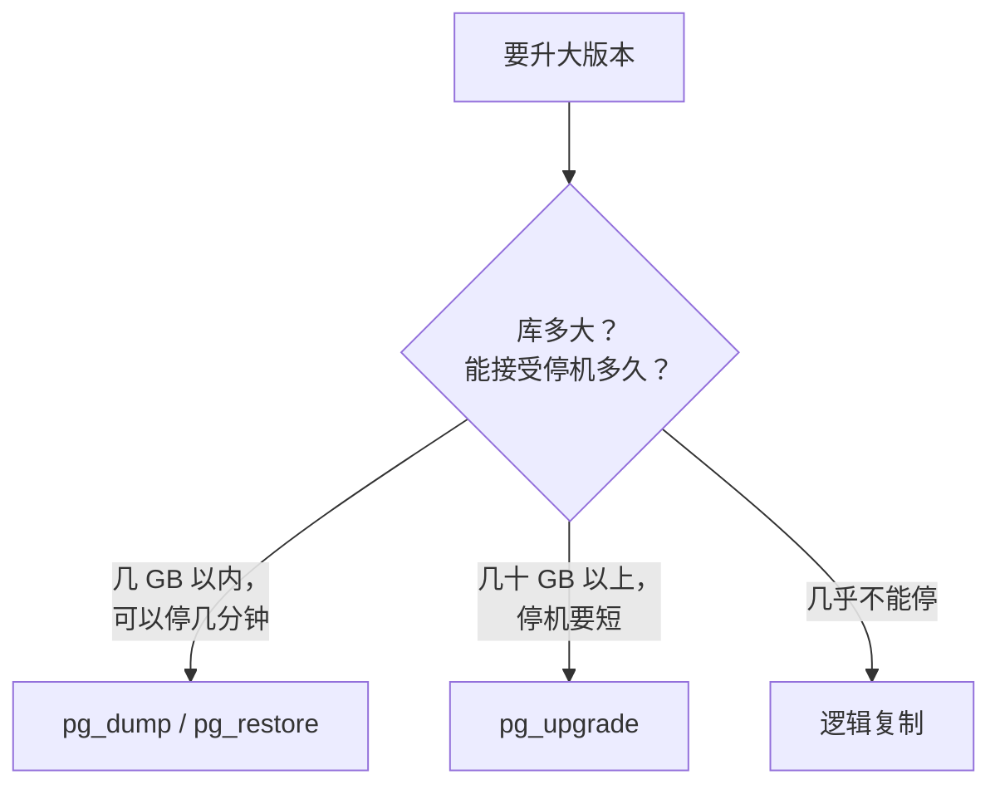

# 大版本升级

PostgreSQL 每年发布一个大版本，每个大版本官方支持 5 年。hatch-counter 现在用的 16 是 2023 年发布的，按这个周期，2028 年底前总要升一次。大版本之间数据文件格式不兼容，不能像升级 Node 依赖那样改个版本号就完事。本章先区分小版本和大版本升级，比较三种大版本升级方式，然后给出一份在 docker compose 上从 16 升到 17 的完整手册，最后说明升到 18 时要额外注意的地方。

## 小版本和大版本

从 10 开始，Postgres 的版本号是「大版本.小版本」：`16.4` 的大版本是 16，小版本是 4。

| | 小版本（16.3 → 16.4） | 大版本（16 → 17） |
|---|---|---|
| 发布节奏 | 大约每季度一次 | 每年一次 |
| 内容 | 缺陷修复、安全修复 | 新功能、行为变化 |
| 数据文件 | 兼容 | **不兼容** |
| 怎么升 | 换镜像、重启 | 需要迁移数据 |
| 该不该及时升 | **应该**，官方建议始终跑最新小版本 | 规划好再升 |

### 小版本：换镜像重启

`postgres:16-alpine` 这个标签会随小版本更新而指向新镜像。小版本升级只是重新拉镜像、重建容器：

```bash
docker compose pull postgres
docker compose up -d postgres
docker compose exec postgres psql -U counter -d counter -c "SELECT version();"
```

但「只是重启」之前，还是要读一下这个小版本的发布说明。偶尔会有「升级后需要重建某类索引」这样的附加步骤，通常是因为修复了一个可能导致索引损坏的缺陷。

hatch-counter 的镜像是先转存到自己的私有镜像仓库再拉取的（境内服务器拉不动 Docker Hub）。浮动标签意味着「转存那一刻的 16.x」，想精确控制版本，可以改用 `16.4-alpine` 这样的完整标签，升级时显式改它。两种都可以，关键是知道自己跑的是哪个版本。

### 大版本：为什么不能直接换标签

把 compose 里的 `16-alpine` 改成 `17-alpine` 直接启动，容器会立刻退出，日志里是：

```text
FATAL:  database files are incompatible with server
DETAIL:  The data directory was initialized by PostgreSQL version 16, which is not compatible with this version 17.x.
```

这是好事：Postgres 拒绝用新版本打开旧格式的数据，不会把数据弄坏。改回 `16-alpine` 就能恢复。

## 三种升级方式



| 方式 | 停机时间 | 复杂度 | 说明 |
|---|---|---|---|
| dump / restore | 与数据量成正比 | 低 | 逻辑导出再导入新版本；顺带整理掉所有膨胀 |
| `pg_upgrade` | 分钟级（`--link` 模式更快） | 中 | 直接转换数据目录，需要新旧两套程序同时存在 |
| 逻辑复制 | 秒级切换 | 高 | 新版本实例订阅旧库的变更，追平后切换 |

hatch-counter 这样的业务库，数据量在几 GB 以内，dump / restore 几分钟就能完成。在夜里停服务几分钟完全可以接受，**简单、可靠、好回滚**比停机时间短更重要。下面的手册就用这种方式。

`pg_upgrade` 在容器里用起来不太方便：它需要同时访问旧版本和新版本的程序，而官方镜像每个只带一个版本。社区有专门把两个版本打包在一起的升级镜像，库大到 dump / restore 太慢时可以考虑，使用前请仔细阅读它的说明并先在副本上演练。

## 升级前的准备

升级当天之前要完成的事：

1. **读发布说明里的「不兼容变更」**（Migration to Version 17 一节）。重点看是否有你用到的函数、参数被删除或改了行为
2. **检查扩展**：`SELECT extname, extversion FROM pg_extension;`，确认每个扩展在新版本都可用。官方镜像自带的 contrib 扩展（如 `pg_stat_statements`、`pgstattuple`）没有问题，自己装的第三方扩展要确认有对应新版本的构建
3. **检查应用依赖**：驱动、ORM 是否支持新版本。主流驱动对新版本的支持一般都很及时
4. **准备好镜像**：hatch-counter 需要先把 `postgres:17-alpine` 转存到自己的镜像仓库，否则升级当天才发现拉不到
5. **完整彩排一次**：按第 2 章的方法，把最新的 dump 恢复进一个 `postgres:17-alpine` 临时容器，在它上面跑一遍迁移和服务端的测试，记下导出和恢复各用了多久。这个时间就是升级当天的停机时间

## 手册：compose 上从 16 升到 17

前提：项目名 `counter`，compose 网络 `counter_default`，现有数据卷 `pgdata`，密码在 `postgres.env`。

### 1. 停服务

```bash
cd /srv/counter
docker compose stop api
```

nginx 这时会对 api 的请求返回 502。更友好的做法是事先配好维护页，见《Nginx 与反向代理》。

### 2. 用新版本的 pg_dump 导出

官方建议用**新版本**的 `pg_dump` 去导出旧版本的库，它知道怎样生成新版本最能接受的输出。在 compose 网络里起一个 17 的临时容器去连旧库：

```bash
mkdir -p /srv/pg-backups/upgrade

docker run --rm --network counter_default --env-file postgres.env postgres:17-alpine \
  sh -c 'PGPASSWORD="$POSTGRES_PASSWORD" pg_dump -h postgres -U counter -d counter -Fc' \
  > /srv/pg-backups/upgrade/counter-pg16.dump

docker run --rm --network counter_default --env-file postgres.env postgres:17-alpine \
  sh -c 'PGPASSWORD="$POSTGRES_PASSWORD" pg_dumpall -h postgres -U counter --roles-only' \
  > /srv/pg-backups/upgrade/roles-pg16.sql

ls -lh /srv/pg-backups/upgrade/
```

`--env-file postgres.env` 把密码以环境变量传进临时容器，命令行和 shell 历史里都不会出现密码。镜像名请换成你实际使用的仓库地址。

### 3. 停旧库，改 compose

```bash
docker compose stop postgres
```

编辑 `docker-compose.yml`：

```yaml
services:
  postgres:
    image: registry.example.com/counter/postgres:17-alpine
    volumes:
      - pgdata17:/var/lib/postgresql/data   # 新卷

volumes:
  pgdata:      # 旧卷保留，不要删，它是回滚的后路
  pgdata17:
```

**用新卷，不要动旧卷**。旧卷原封不动地保留着，回滚只需要把这两行改回去。

### 4. 启动新库

```bash
docker compose up -d --wait postgres
docker compose exec postgres psql -U counter -d postgres -c "SELECT version();"
```

新卷是空的，镜像会按 `postgres.env` 执行初始化，建出 `counter` 超级用户和空的 `counter` 库。

### 5. 恢复

```bash
# 角色。会有一行 role "counter" already exists 的报错，忽略
docker compose exec -T postgres psql -U counter -d postgres < /srv/pg-backups/upgrade/roles-pg16.sql

# 删掉初始化建的空库，让 pg_restore 按原样重建
docker compose exec postgres psql -U counter -d postgres -c "DROP DATABASE counter;"

time docker compose exec -T postgres \
  pg_restore -U counter -d postgres --create --exit-on-error \
  < /srv/pg-backups/upgrade/counter-pg16.dump
```

角色文件里带着 `counter_app`、`counter_admin` 的密码哈希，恢复后它们的密码与升级前相同，服务端的连接串不用改。

### 6. 重新收集统计信息

dump / restore 不带优化器统计信息。不做这一步，升级后的头几分钟到几小时里，很多查询会因为缺统计而选错执行计划：

```bash
docker compose exec postgres vacuumdb -U counter --all --analyze-in-stages
```

`--analyze-in-stages` 先用很低的统计精度快速过一遍，让优化器尽快有数据可用，再逐步提高精度。

### 7. 验证并恢复服务

```bash
docker compose exec postgres psql -U counter -d counter -c "\dt" | head
docker compose exec postgres psql -U counter -d counter -c "SELECT count(*) FROM stores;"

docker compose up -d --wait api
curl -fsS http://127.0.0.1:3000/v1/health
```

把关键表的行数和升级前对比（升级前先记下来）。服务端起来后，用店主账号登录走一遍核心流程。

### 8. 回滚预案

如果验证发现问题：

```bash
docker compose stop api postgres
# 把 compose 里的镜像改回 16-alpine，卷改回 pgdata
docker compose up -d --wait postgres api
```

注意，回滚后升级之后写入的数据会丢失。所以**验证要在恢复对外服务之前做完**，一旦放开写入，回滚的代价就会越来越大。

### 9. 收尾

- 观察一周，确认 `pg_stat_statements` 里没有明显变慢的查询（第 6 章）
- 立即做一次新的基础备份和 dump。如果配了 WAL 归档（第 3 章），**旧版本的基础备份和 WAL 不能用来恢复新版本的库**，归档目录要换一个新的
- 一两周后确认无误，再删除旧卷：`docker volume rm counter_pgdata`

## 升到 18 时要额外注意

PostgreSQL 18 于 2025 年发布。如果你从 16 直接升到 18，流程同上，另有几处差异：

- **官方镜像的数据目录变了**。18 起，镜像的 `PGDATA` 默认是 `/var/lib/postgresql/18/docker`，声明的卷挂载点改成了 `/var/lib/postgresql`。compose 里要写成 `pgdata18:/var/lib/postgresql`，照抄旧的 `/var/lib/postgresql/data` 会出问题。这个改动的意图正是方便以后用 `pg_upgrade` 在同一个卷里放多个版本的目录。具体以官方镜像说明为准
- **新集群默认开启数据校验和**。`initdb` 在 18 默认启用 data checksums。dump / restore 不受影响；用 `pg_upgrade` 从未开启校验和的旧集群升级时，新旧两边要一致
- **`pg_upgrade` 会保留优化器统计信息**，升级后不用马上 ANALYZE。dump / restore 方式仍然需要第 6 步
- `EXPLAIN ANALYZE` 默认带上 `BUFFERS` 信息

每个大版本的完整变化请读官方发布说明，上面只列了与本书操作直接相关的几条。

## 逻辑复制：几乎不停机的升级

当停机几分钟都不可接受时，可以用逻辑复制：新版本实例作为订阅者，持续接收旧库的行变更，追平后把应用切过去。大致步骤：

1. 起一个新版本的实例，用 `pg_dump --schema-only` 把表结构导过去
2. 旧库上 `CREATE PUBLICATION upgrade_pub FOR ALL TABLES;`
3. 新库上 `CREATE SUBSCRIPTION upgrade_sub CONNECTION '...' PUBLICATION upgrade_pub;`，它会先复制存量数据，再持续同步增量
4. 追平后，停止应用写入，同步**序列**的当前值（逻辑复制不复制序列），把应用切到新库

限制也不少：DDL 不会复制，升级期间不能改表结构；每张表要有主键或设置了 replica identity；大对象不复制。对一人公司来说，这套流程的复杂度和风险往往大于几分钟的停机，了解即可，真到需要时再详细研究。

## 本章要点

- 小版本兼容，应该及时升，换镜像重启并读发布说明；大版本数据格式不兼容
- 三种大版本升级方式：dump / restore（简单）、`pg_upgrade`（快）、逻辑复制（几乎不停机）
- 数据量小的业务库优先 dump / restore：彩排一次，知道停机时间
- 用**新版本**的 `pg_dump` 导出；**用新卷、保留旧卷**作为回滚后路
- 恢复后必须 `vacuumdb --analyze-in-stages`；验证完成再放开写入
- 升级后旧的物理备份和 WAL 归档作废，立即做新备份
- 升到 18 注意官方镜像的挂载点变成 `/var/lib/postgresql`
