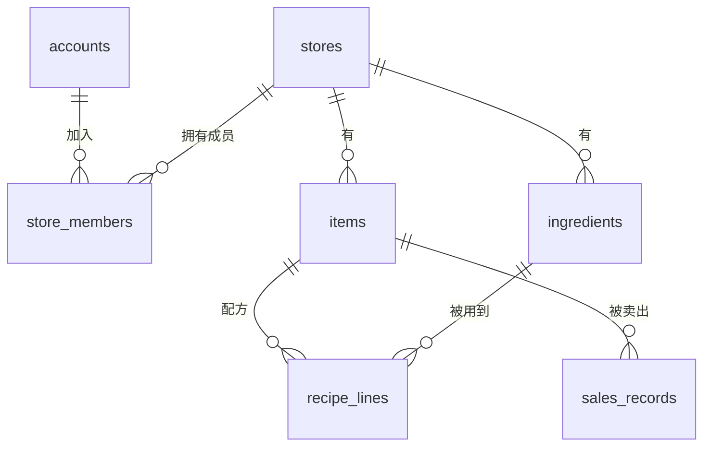

# 关系建模与范式

一张表怎么拆、主键用什么、钱存成什么类型，这些决定做得早、改得晚：上线之后每改一次都是一份迁移，外加一次数据回填。这一章从「需求里有哪些东西」讲到「库里写下哪些规矩」，用的例子是 hatch-counter 的门店数据。

## 关于这本书

> [!WARNING]
> 书中的执行计划、输出和版本差异（如 `uuidv7()`、B 树跳跃扫描）按 PostgreSQL 16 实测、对照 PostgreSQL 18 发布说明整理，截至 2026-11；更新的大版本在优化器和默认值上可能有变化，以 PostgreSQL 官方文档对应版本的 Release Notes 为准。

这本书只讲**开发视角**的数据库：你写的表结构、SQL 和 ORM 代码，在数据库里到底怎么执行，什么写法快、什么写法会在并发下出错。运维那一侧（参数调优、备份恢复、复制、连接池、VACUUM 调参、大版本升级）在[《PostgreSQL 运维》](../database-ops/)里，向量检索在[《RAG 与知识系统》](../rag-systems/)里，这里都不重复。

适合谁：每天在写 NestJS + Drizzle + PostgreSQL 或 Expo + SQLite，能写出能跑的 SQL，但说不清「这个索引为什么没用上」「这两个请求同时来会怎样」的开发者。

怎么读：

| 章 | 解决什么问题 |
|---|---|
| 1 关系建模与范式 | 表怎么拆、约束写在哪 |
| 2 索引原理 | B+ 树长什么样，联合索引的顺序为什么重要 |
| 3 执行计划 | 读懂 `EXPLAIN`，知道慢在哪 |
| 4 事务与隔离级别 | 并发下的丢失更新、写偏斜怎么防 |
| 5 MVCC | 一次 UPDATE 在磁盘上做了什么 |
| 6 Drizzle 与迁移 | schema 即代码，迁移怎么写不出事 |
| 7 常见反模式 | N+1、OFFSET 分页、NOT IN 陷阱…… |
| 8 SQLite 与本地优先 | 手机上的库怎么设计、怎么迁移 |
| 9 JSON 与全文检索 | jsonb 什么时候用，中文搜索怎么做 |

前五章是原理，后四章是实战，建议按顺序读。书里的 SQL 大多在 PostgreSQL 16 的容器和 sqlite3 3.54 上实际跑过，贴出的输出是真实结果；时间数字来自一台开发机，只看量级。想跟着跑，起一个一次性的容器就够：

```bash
docker run --rm -d --name pg-lab -e POSTGRES_PASSWORD=lab postgres:16-alpine
docker exec -it pg-lab psql -U postgres
```

## 从需求里找出实体

建模的第一步不是画表，而是把需求里的**名词**和它们之间的**关系**找出来。拿门店管理举例：

- 一个**账号**可以是多家**门店**的成员，一家门店有多个成员 → 多对多
- 一家门店有很多**菜品**、**食材** → 一对多
- 一道菜用到几样食材、每份用多少 → 菜品和食材之间的多对多，而且关系本身带属性（用量）
- 每卖出一道菜记一行**销售流水** → 一对多，数量最大的表



两条经验：

1. **带属性的关系就是一张表**。`store_members` 不只是「谁在哪家店」，还有身份（店主 / 店长 / 会计 / 员工）和一组权限；`recipe_lines` 带着每份用量。凡是关系上要挂数据，就给它单独一张表，别塞进任何一边。
2. **区分「事实」和「推出来的东西」**。销售流水和库存流水是事实；某样食材现在还剩多少，是把流水按日期重放一遍算出来的。后者可以缓存，但要清楚它不是真相（后面「反范式」一节再说）。

## 主键：代理键还是自然键

| 方案 | 例子 | 优点 | 缺点 |
|---|---|---|---|
| 自然键 | 手机号、书的 id | 有业务含义，不用额外列 | 业务含义会变（换号），变了要级联改所有引用 |
| 自增整数 | `bigserial` | 小、有序、插入集中在索引尾部 | 暴露数量和顺序；多端离线生成会撞 |
| UUID v4 | `gen_random_uuid()` | 任何一端都能生成，不撞，不泄露数量 | 16 字节；完全随机，插入落在索引各处 |
| UUID v7 | 时间戳前缀 + 随机 | 兼顾全局唯一和大致有序 | PostgreSQL 18 起才内置 `uuidv7()`，16 上要应用层生成 |

hatch-counter 的规矩是「主键一律 uuid（`gen_random_uuid()`）」，例外只有三种：

- **由几样东西共同决定一行的，用联合主键**：每家店每一块数据的版本号 `store_versions` 主键是（门店, 块）；写请求的回执 `idempotent_requests` 主键是（门店, 设备, 请求号）。这种表天然不会有第二行同样的组合，用联合主键等于把「唯一」写进了库。
- **变更流水用自增 `bigint`**：只追加、量大、按时间读，有序的整数正合适。
- **单行表把主键钉死**：短信配置只能有一行，主键固定为 `'sms'`，再加一条 `CHECK`。

```sql
create table sms_config (
  id text primary key default 'sms' check (id = 'sms'),
  channel text not null
);
insert into sms_config(channel) values ('console');          -- 成功
insert into sms_config(id, channel) values ('sms2', 'x');     -- 失败
```

```text
ERROR:  new row for relation "sms_config" violates check constraint "sms_config_id_check"
```

「只有一行」从此是库里的事实，不靠哪段代码记着。随机 UUID 对 B+ 树插入的影响，第 2 章再算账；对一人公司的数据量来说，它通常不是瓶颈。

hatch-shelf 则是另一种选择：`books` 表的主键是书的 `id`（`database-practice` 这种字符串），这是自然键。它成立的原因是书的 id 被规定为全局唯一、不可变（同 id 再导入就是更新），而且它本来就是文件夹的名字。自然键只在「真的永远不变」时才用。

## 范式：每个事实只写一次

范式听起来学院派，核心其实一句话：**同一个事实只存在一个地方**，这样改一次就改对了。看一张「图省事」的销售表：

| order_no | sale_date | item_name | category_name | qty | amount_cents |
|---|---|---|---|---|---|
| A001 | 2026-03-01 | 红烧牛肉面 | 面食 | 2 | 5600 |
| A001 | 2026-03-01 | 酸梅汤 | 饮品 | 1 | 800 |
| A002 | 2026-03-01 | 红烧牛肉面 | 面食 | 1 | 2800 |

问题：

- 把「红烧牛肉面」改名成「招牌牛肉面」，要改历史上每一行；漏改一行，报表就分成两道菜
- 把它从「面食」挪到「主食」分类，同样要改所有行
- 一道菜还没卖过，它属于哪个分类无处可存

按范式拆开：

| 范式 | 要求 | 这个例子里的含义 |
|---|---|---|
| 1NF | 每格一个原子值 | 不要在一格里写「牛肉面,酸梅汤」 |
| 2NF | 非键列依赖整个主键 | 若主键是（单号, 菜），`sale_date` 只依赖单号，应移到订单表 |
| 3NF | 非键列不依赖其他非键列 | `category_name` 依赖 `item_name` 而不是这一行，应移到菜品表 |

拆完就是 `categories`、`items`、`sales_records` 三张表，销售流水只存 `item_id`。改名、换分类都只动一行。

```sql
create table items (
  id uuid primary key default gen_random_uuid(),
  store_id uuid not null references stores(id) on delete cascade,
  category_id uuid references categories(id) on delete set null,
  name text not null,
  unique (store_id, name)
);
```

实际工作里，做到 3NF 就够了，更高的范式（BCNF、4NF）很少成为问题。真正要动脑的是下一节：什么时候故意违反它。

## 反范式：故意存两份

有两类重复是值得的。

**一是缓存推出来的值，为了读得快。** hatch-counter 的 `ingredients.stock_qty` 是「流水按日期重放到最后的缓存，不是事实」。每次打开库存页都去重放全部流水太慢，于是存一份结果；但文档里写明了谁是真相：流水改了，就重放、刷新这一列。缓存列的纪律是：

- 写清它从哪来、谁负责更新，最好只有一处代码写它
- 能整列重算，坏了不怕
- 读它的地方能接受它短暂落后

**二是历史快照，为了「当时是多少就是多少」。** 工资单的每一行把姓名、计薪方式、岗位、每月天数这些都复制了一份。这不是冗余，而是**业务语义**：员工下个月涨薪了，上个月已经确认的工资单不该跟着变。订单里存商品名和单价快照、发票里存抬头快照，都是同一个道理。

判断方法：如果「源头变了，这里也该跟着变」，那就是冗余，应该引用；如果「源头变了，这里应该保持原样」，那就是快照，应该复制。

## 约束：把规矩写进库里

代码会有 bug、会有新人、会有你凌晨三点写的脚本，而库里的约束对所有写入者一视同仁。能写成约束的规矩，尽量写成约束：

| 约束 | 防什么 | 例子 |
|---|---|---|
| `NOT NULL` | 漏填 | 每张业务表的 `store_id` |
| `UNIQUE` | 重复 | 同一家店里菜名不重复：`unique (store_id, name)` |
| `CHECK` | 非法值 | 单行表的 `id = 'sms'`；`qty >= 0` |
| 外键 | 指向不存在的行 | `sales_records.item_id` |
| 部分唯一索引 | 有条件的唯一 | 在职员工的手机号不重复，离职的不管 |

部分唯一索引经常被忘记，它能表达「只在某种状态下唯一」：

```sql
create unique index employees_active_phone
  on employees (store_id, phone) where status = 'active';
```

一个离职员工和一个在职员工可以用同一个号码，两个在职的就会被拒绝：

```text
ERROR:  duplicate key value violates unique constraint "employees_active_phone"
```

### 外键的删除行为

外键最容易被忽略的是 `ON DELETE`。hatch-counter 里三种都用上了，各有理由：

| 行为 | 语义 | hatch-counter 里的例子 |
|---|---|---|
| `CASCADE` | 父没了，子跟着没 | 门店删了，它的所有业务行跟着删 |
| `SET NULL` | 父没了，子保留，引用置空 | 分类删了，菜品还在，只是没分类；录单人账号删了，流水还在 |
| `RESTRICT` | 有子就不许删父 | 有门店的账号不能直接删 |

选哪种，问一句：「父行消失后，子行还有没有独立的意义？」流水没了录入人仍然是一笔账，所以置空；门店没了，那家店的菜品毫无意义，所以级联。

注意 PostgreSQL **不会**自动给外键列建索引。删一家店要级联扫描所有引用它的表，删一个分类要找出所有引用它的菜品，这些都需要外键列上有索引，否则就是全表扫描。hatch-counter 的 `recipe_lines` 在 `item_id` 和 `ingredient_id` 上各有一个索引，就是这个原因。

## 类型选择：存储约定

类型一旦定下，改起来就是全表重写。hatch-counter 在文档里专门列了一节「存储约定」，几条都值得借鉴：

- **金额存「分」的整数**。浮点数算钱会出现 0.1 + 0.2 ≠ 0.3，加着加着差出一分。另一种做法是 `numeric`，精确但慢一些，和 JS 交互时要处理字符串；整数分最简单。
- **业务日期用 `date`，进出都是 `YYYY-MM-DD` 字符串**。让驱动把 `date` 转成 JS 的 `Date` 再转回来，会在时区边界挪一天（第 7 章细说）。
- **「什么时候录的」用 `timestamptz`**，和业务日期分开。一笔货哪天到（业务日期）和哪天录进系统（时间戳）是两回事，分析认前者，审计认后者。
- **营业日里的时刻存「0 点起的分钟数」**，因为它是一个偏移，不是绝对时刻；跨零点的班次由使用方补一天。
- **数量用 `double precision`**，并且写明了理由：库存是按流水重放出来的账，精度规则统一在重放那一处，换类型会让同一批流水重放出不同的余额。这说明类型选择没有标准答案，**关键是写下理由，让后来的人（包括 agent）不要好心改掉**。
- **`jsonb` 只放整份读写、从不进 `where` 的东西**。要按它查，就该是一列或另一张表（第 9 章）。

## 多租户：每张业务表都带 store_id

一人公司做 SaaS，几乎一定是多租户。hatch-counter 的做法：

- 每张业务表都带 `store_id`（非空、随门店级联删）、`created_at`、`updated_at`，在 Drizzle 里用一个 `storeCols()` 函数统一展开，不会漏
- 唯一约束都以 `store_id` 开头：`unique (store_id, name)`，不同店可以有同名的菜
- 索引也以 `store_id` 开头，因为几乎所有查询都限定在一家店里（第 2 章会看到这有多重要）
- 隔离不靠应用层每条查询写 `where store_id = ?`，而是靠 PostgreSQL 的行级安全（RLS）——这一点放到第 7 章「反模式」里讲为什么

这套结构的好处是，将来某家店要单独导出、迁走、删除，都只是「按 `store_id` 筛」这一件事。

## 本章要点

- 先找名词和关系；带属性的关系单独成表
- 主键默认用 UUID，由多样东西决定的行用联合主键，单行表把主键钉死
- 范式的本质是「一个事实只存一处」；做到 3NF 通常就够
- 反范式只有两种正当理由：可重算的缓存、有业务语义的快照
- 能写成约束的规矩写进库里；外键想清楚 `ON DELETE`，并给外键列建索引
- 类型选择写成「存储约定」并记下理由，钱用整数分，日期和时间戳分开
