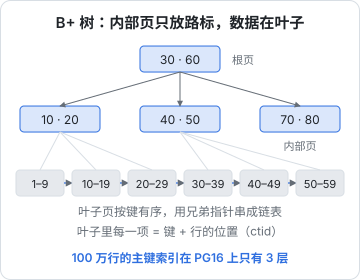
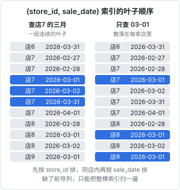
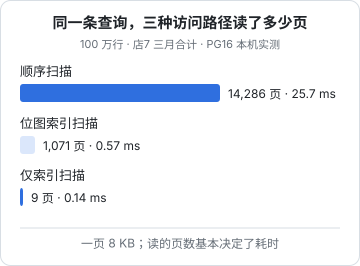

# 索引原理（B+ 树）

「加个索引」是最常见的性能建议，也是最常被用错的。索引不是开关，而是一份按某种顺序排好的副本：查询能不能用上它、用上之后快多少、写入要多付多少代价，全由「它按什么排」决定。这一章先看 B+ 树长什么样，再用一张 100 万行的销售表实测联合索引、覆盖索引、部分索引和表达式索引。

## 为什么是树，为什么是页

数据库按**页**读写磁盘和内存，PostgreSQL 一页 8 KB，SQLite 默认 4 KB。不管你只要一行还是一百行，最小的读取单位都是一页。所以衡量一次查询的成本，最直接的指标是**读了多少页**。

在 100 万行里找一行，如果数据没有顺序，只能一页页翻完（顺序扫描）。如果有一份按键排好的目录，就能像查字典一样跳过大部分页。B+ 树就是这份目录：



它的几个特点决定了索引的所有用法：

- **内部页只放分隔键和子页指针**，所以一页能放几百项，树非常矮
- **叶子页按键有序**，并用兄弟指针串成链表：找到范围的起点后，顺着链表往后读即可，这就是范围查询快的原因
- **叶子里存的是键和行的位置**（PostgreSQL 叫 ctid，即「第几页第几项」），要拿其他列还得回表

### 树有多高

一个 uuid 键加上项的开销约 30 字节，一页 8 KB 能放两三百项。按 250 估算：

| 层数 | 能索引的行数（约） |
|---|---|
| 2 | 6 万 |
| 3 | 1500 万 |
| 4 | 39 亿 |

用 `pageinspect` 扩展可以看真实的树高。在 100 万行的销售表上：

```sql
create extension if not exists pageinspect;
select level as root_level from bt_metap('sales_records_pkey');
```

```text
 root_level
------------
          2
```

根在第 2 层，往下是第 1 层和叶子（第 0 层），一共 3 层。也就是说，按主键找任何一行只要读 3 个索引页再加 1 个表页，而且根页和上层几乎总在内存里。**这就是为什么一人公司的数据量下，用上索引的点查几乎永远是快的**，慢查询基本都出在「没用上索引」或「用上了但要扫一大片」。

## 实验环境

后面的例子都基于这张表，100 万行，50 家店，每店 40 道菜，日期分布在 2025-01 到 2026-08：

```sql
create table sales_records (
  id uuid primary key default gen_random_uuid(),
  store_id uuid not null references stores(id) on delete cascade,
  item_id uuid not null references items(id) on delete cascade,
  sale_date date not null,
  quantity double precision not null,
  amount_cents integer not null,
  order_no text,
  created_at timestamptz not null default now()
);
```

要回答的问题是 hatch-counter 里最典型的一类：**某家店某个月卖了多少钱**。

```sql
select sum(amount_cents) from sales_records
where store_id = $1 and sale_date between '2026-03-01' and '2026-03-31';
```

## 联合索引：顺序就是一切

没有索引时，PostgreSQL 只能并行顺序扫描全表，读了 14286 页（112 MB），过滤掉 99.9% 的行。建一个联合索引：

```sql
create index sales_date_idx on sales_records (store_id, sale_date);
```

同一条查询变成位图索引扫描，读 1071 页，耗时从 25.7 ms 降到不到 1 ms。hatch-counter 的 `sales_records` 上正有这样一个索引 `sales_date_idx (store_id, sale_date)`。

为什么是 `(store_id, sale_date)` 而不是反过来？看叶子里的顺序：



联合索引就像电话簿先按姓、再按名排。由此得出三条规则：

1. **最左前缀**：`(a, b)` 的索引能服务 `where a = ?` 和 `where a = ? and b = ?`，单独 `where b = ?` 就用不好
2. **等值在前，范围在后**：`store_id = ?` 是等值，`sale_date between` 是范围。等值列放前面，范围列放后面，命中的就是一段连续的叶子；反过来放，范围内每一天都要跳到不同的店
3. **范围列之后的列不再参与定位**：`(store_id, sale_date, item_id)` 查 `store_id = ? and sale_date between ? and ? and item_id = ?` 时，`item_id` 只能在扫描时过滤，不能缩小扫描范围

缺了前导列也不一定完全用不上。只查某一天：

```sql
explain (analyze, buffers, costs off, timing off)
select count(*) from sales_records where sale_date = '2026-03-01';
```

```text
 Aggregate (actual rows=1 loops=1)
   Buffers: shared hit=4 read=967
   ->  Index Only Scan using sales_date_idx on sales_records (actual rows=1741 loops=1)
         Index Cond: (sale_date = '2026-03-01'::date)
```

它用了索引，但读了 971 页，几乎是把整棵索引扫了一遍（索引比表小，所以还是比扫表划算）。PostgreSQL 18 加入了 B 树的跳跃扫描（skip scan），在前导列取值少时能跳着扫，但别依赖它：查询模式确定的话，就按查询建索引。

## 覆盖索引与仅索引扫描

位图扫描读的 1071 页里，索引只占 4 页，剩下的都是回表：为了拿 `amount_cents`，要去 1067 个表页里各取一行。如果索引里直接带上这一列，就不用回表了：

```sql
create index sales_cover_idx on sales_records (store_id, sale_date) include (amount_cents);
vacuum analyze sales_records;
```

```text
 Aggregate (actual rows=1 loops=1)
   Buffers: shared hit=1 read=8
   ->  Index Only Scan using sales_cover_idx on sales_records (actual rows=1081 loops=1)
         Index Cond: ((store_id = '906f...'::uuid) AND (sale_date >= '2026-03-01'::date) AND (sale_date <= '2026-03-31'::date))
         Heap Fetches: 0
```

9 页，0.14 ms。`Heap Fetches: 0` 表示一次都没回表。三种路径放在一起：



两个要注意的地方：

- **仅索引扫描依赖可见性映射**。PostgreSQL 的索引里不记录行对哪些事务可见（第 5 章），只有当表页被 VACUUM 标记为「全部可见」时才能跳过回表。刚大量写过的表，`Heap Fetches` 会很高，仅索引扫描退化成普通索引扫描。上面先跑 `vacuum analyze` 就是这个原因
- **覆盖索引有代价**。实测 `sales_date_idx` 只有 7.8 MB，带 `INCLUDE` 的版本有 39 MB。差这么多，是因为 PostgreSQL 13 起 B 树会对重复键做去重压缩（同一店同一天平均 30 多行，压缩效果很好），而带 `INCLUDE` 的索引不能去重

覆盖索引适合「极高频、列很少」的查询，比如概览页上每次都要算的合计。不要给每个查询都配一个。

## 索引的写入代价

每个索引都是一份要同步维护的副本。插入一行，每个索引都要插一项；更新一个被索引的列，相关索引也要改（第 5 章会看到它还会阻止 HOT 更新）。

键的分布也影响写入。实测往三种主键里各插入 100 万行后的索引大小：

| 主键 | 插入顺序 | 索引大小 |
|---|---|---|
| `bigint` | 递增 | 21 MB |
| `uuid` | 按值排好序插入 | 30 MB |
| `uuid` | 随机（`gen_random_uuid()`） | 38 MB |

`bigint` 比 `uuid` 小，是因为键本身 8 字节对 16 字节。同样是 uuid，随机插入比顺序插入大四分之一：顺序插入总是追加在最右边的叶子，页写满再开新页；随机插入落在任意叶子，叶子满了就对半分裂，留下很多半空的页，而且每次插入碰到的页都不同，缓存命中更差。

对一人公司的规模，这点差别通常可以接受，换来的是任何一端都能生成主键。真到了写入密集的大表，再考虑 UUID v7 这类有时间前缀的方案。

## 部分索引与表达式索引

**部分索引**只索引满足条件的行。待办类查询往往只关心一小部分行：

```sql
-- 只有少数开支「金额待填」，首页要列出来
create index expenses_pending_idx on expenses (store_id, expense_date)
  where amount_cents is null;
```

索引小、维护便宜，查询条件里带上 `amount_cents is null` 就能用上。上一章的部分唯一索引也是它的一种用法。

**表达式索引**索引的是计算结果。查询里对列做了运算，普通索引就用不上了：

```sql
explain (analyze, buffers, costs off, timing off)
select count(*) from sales_records
where store_id = $1 and to_char(sale_date, 'YYYY-MM') = '2026-03';
```

```text
   ->  Index Only Scan using sales_date_idx on sales_records (actual rows=1081 loops=1)
         Index Cond: (store_id = '906f...'::uuid)
         Filter: (to_char((sale_date)::timestamp with time zone, 'YYYY-MM'::text) = '2026-03'::text)
         Rows Removed by Filter: 18919
```

`sale_date` 被函数包住后只能当过滤条件，于是扫了这家店的全部两万行，再丢掉 18919 行。正确的改法通常不是建表达式索引，而是**把条件改写成对列本身的范围**：

```sql
where store_id = $1 and sale_date >= '2026-03-01' and sale_date < '2026-04-01'
```

表达式索引留给改写不了的情况，比如大小写不敏感的查找 `lower(email)`，或第 9 章里 jsonb 某个键的查询。

## 索引类型一览

B 树是默认，也是九成情况下的正确选择。其他类型各有专长：

| 类型 | 擅长 | 典型用途 |
|---|---|---|
| B-tree | 等值、范围、排序、前缀 `LIKE 'abc%'` | 几乎所有列 |
| Hash | 只有等值 | 很少需要，B 树基本能替代 |
| GIN | 一个值里包含多个元素 | jsonb、数组、全文检索、`pg_trgm`（第 9 章） |
| GiST | 几何、范围类型、最近邻 | 地理位置、时间段不重叠约束 |
| BRIN | 物理顺序与值高度相关的大表 | 只追加的日志表按时间查 |

## 聚簇与非聚簇

PostgreSQL 的表是**堆**：行按插入的先后放，所有索引（包括主键）都是另外一棵树，叶子指向堆里的位置。SQLite 和 MySQL 的 InnoDB 不一样，表本身就是一棵按主键排序的 B 树（SQLite 普通表按隐藏的 `rowid` 排，`WITHOUT ROWID` 表按主键排）。

对开发者的影响：

- 在 PostgreSQL 里，主键和二级索引地位平等，回表都是一次跳转
- 在 InnoDB 和 SQLite 的 `WITHOUT ROWID` 表里，按主键范围读数据是物理连续的，二级索引的叶子存的是主键值，回表要再走一次主键树
- 所以 InnoDB 圈子里「主键要短、要递增」的建议更强烈；在 PostgreSQL 里这条建议弱一些

## 建索引的检查清单

拿到一条慢查询，按这个顺序想：

1. 它的 `where` 里哪些是等值、哪些是范围？`order by` 是什么？
2. 有没有一个索引的前缀恰好是「等值列 + 范围列」或「等值列 + 排序列」？
3. 条件里有没有对列做运算、隐式类型转换？能不能改写？
4. 结果集是不是很大？命中一半的表，用索引反而更慢，优化器会选顺序扫描
5. 新索引会让哪些写入变慢？已有的索引里有没有被它取代的（`(a)` 被 `(a, b)` 覆盖）？

建好之后，用下一章的 `EXPLAIN` 验证它真的被用上了。

## 本章要点

- 数据库按页读写，查询成本主要看读了多少页
- B+ 树极矮：100 万行的主键索引只有 3 层，点查几乎总是快的
- 联合索引遵循最左前缀，等值列在前、范围列在后
- 覆盖索引能免掉回表，但依赖 VACUUM 维护的可见性映射，而且不能去重、体积大
- 每个索引都有写入代价；随机 UUID 比递增键让索引更大
- 条件里别对列做运算，先改写成范围；改写不了再用表达式索引
