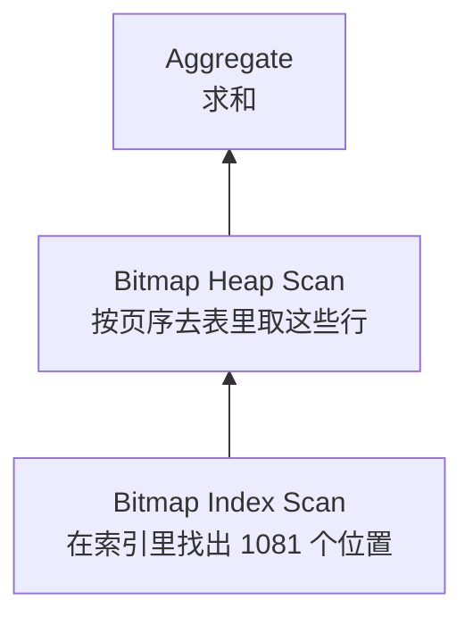

# 执行计划

SQL 只说「要什么」，不说「怎么拿」。怎么拿由优化器决定：先用哪张表、走哪个索引、用哪种连接方式。`EXPLAIN` 把这个决定摊开给你看，它是判断一条查询为什么慢的唯一可靠依据。这一章教你读懂执行计划、理解优化器为什么这么选，以及选错时怎么办。

线上怎么找出慢查询（`pg_stat_statements`、慢查询日志、`auto_explain`）属于运维，在[《PostgreSQL 运维》](../database-ops/)的「慢查询治理」一章。这里只关心：手上有一条 SQL，怎么分析它。

## 三种 EXPLAIN

| 写法 | 做什么 | 什么时候用 |
|---|---|---|
| `EXPLAIN` | 只生成计划，不执行 | 看优化器打算怎么做；查询会改数据或很慢时 |
| `EXPLAIN ANALYZE` | 真的执行，并记下每一步的实际行数和耗时 | 对比估算和实际，定位慢在哪 |
| `EXPLAIN (ANALYZE, BUFFERS)` | 再加上每一步读了多少页 | 默认就用这个 |

`ANALYZE` 会真的执行语句。分析 `UPDATE` / `DELETE` 时包在事务里，看完回滚：

```sql
begin;
explain (analyze, buffers) delete from sales_records where batch_id = $1;
rollback;
```

## 读懂一个计划

计划是一棵树，**从最里层、最下面开始读**，每个节点把结果交给它的上一层。上一章那条「某店三月合计」的完整输出：

```text
 Aggregate  (cost=3210.45..3210.46 rows=1 width=8) (actual time=0.551..0.551 rows=1 loops=1)
   Buffers: shared hit=1071
   ->  Bitmap Heap Scan on sales_records  (cost=17.47..3207.90 rows=1023 width=4) (actual time=0.188..0.499 rows=1081 loops=1)
         Recheck Cond: ((store_id = '906f...'::uuid) AND (sale_date >= '2026-03-01'::date) AND (sale_date <= '2026-03-31'::date))
         Heap Blocks: exact=1067
         Buffers: shared hit=1071
         ->  Bitmap Index Scan on sales_date_idx  (cost=0.00..17.21 rows=1023 width=0) (actual time=0.114..0.114 rows=1081 loops=1)
               Index Cond: ((store_id = '906f...'::uuid) AND (sale_date >= '2026-03-01'::date) AND (sale_date <= '2026-03-31'::date))
               Buffers: shared hit=4
 Planning Time: 0.034 ms
 Execution Time: 0.574 ms
```



每个字段的含义：

| 字段 | 含义 |
|---|---|
| `cost=17.47..3207.90` | 估算成本：启动成本..总成本。单位是抽象的「读一个顺序页 = 1」，只用于比较，不是毫秒 |
| `rows=1023` | **估算**这一步输出多少行 |
| `width=4` | 估算每行多少字节 |
| `actual time=0.188..0.499` | 实际耗时：第一行出来的时刻..最后一行出来的时刻，毫秒 |
| `rows=1081` | **实际**输出行数 |
| `loops=1` | 这个节点执行了几次。实际总量是 `rows × loops`、`time × loops` |
| `Buffers: shared hit=1071` | 在共享缓存里命中 1071 页；`read=` 是从磁盘（或系统页缓存）读的页数 |
| `Index Cond` | 用索引定位的条件 |
| `Filter` / `Rows Removed by Filter` | 取出行之后再过滤的条件，以及被丢掉的行数 |

读计划时最该盯的三样东西：

1. **估算行数和实际行数差多少**。差一个数量级以上，优化器就可能选错方案
2. **`Rows Removed by Filter` 是不是很大**。读了一大堆再扔掉，说明缺一个能把条件放进 `Index Cond` 的索引
3. **哪个节点的 `actual time` 和 `Buffers` 占了大头**。优化从最贵的那一步开始

## 扫描方式

| 节点 | 做什么 | 什么时候出现 |
|---|---|---|
| `Seq Scan` | 从头到尾读整张表 | 没有可用索引，或要读的行占比很大 |
| `Index Scan` | 沿索引找到位置，逐行回表 | 命中行少，或需要按索引顺序输出 |
| `Index Only Scan` | 只读索引，不回表 | 需要的列都在索引里，且表页大多已标记全部可见 |
| `Bitmap Index Scan` + `Bitmap Heap Scan` | 先在索引里收集所有位置，排序后按页序回表 | 命中行数中等：太多了逐行回表随机读太贵，太少了不值得扫全表 |

**用不用索引是按比例决定的**。在 `amount_cents` 上建一个索引，两条只差一个常数的查询：

```sql
explain select id from sales_records where amount_cents > 1000;
explain select id from sales_records where amount_cents > 5795;
```

```text
 Seq Scan on sales_records  (cost=0.00..28948.00 rows=957693 width=16)
   Filter: (amount_cents > 1000)

 Bitmap Heap Scan on sales_records  (cost=11.68..3024.18 rows=936 width=16)
   Recheck Cond: (amount_cents > 5795)
   ->  Bitmap Index Scan on amount_idx  (cost=0.00..11.45 rows=936 width=0)
```

第一条要拿走 96% 的行，走索引意味着几乎每一页都要跳着读一遍，还不如顺序读完；第二条只要 0.1%，索引划算。所以「有索引却没用上」不一定是错，先看它要拿多少行。

## 连接方式

| 节点 | 原理 | 适合 |
|---|---|---|
| `Nested Loop` | 外层每一行，去内层查一次 | 外层行很少，内层能走索引 |
| `Hash Join` | 把小的一边建成哈希表，扫大的一边去探测 | 两边都不小、等值连接 |
| `Merge Join` | 两边都按连接键排好序，像拉拉链一样合并 | 两边都已有序（比如都走索引） |

嵌套循环的典型样子：先找出某家店的两道菜，再对每道菜去销售表里查八月以后的流水。

```text
 Nested Loop  (cost=4.64..220.83 rows=41 width=17) (actual rows=39 loops=1)
   ->  Seq Scan on items i  (cost=0.00..47.00 rows=2 width=21) (actual rows=2 loops=1)
         Filter: ((name = ANY ('{菜3,菜4}'::text[])) AND (store_id = '906f...'::uuid))
         Rows Removed by Filter: 1998
   ->  Bitmap Heap Scan on sales_records s  (cost=4.64..86.70 rows=21 width=28) (actual rows=20 loops=2)
         Recheck Cond: ((i.id = item_id) AND (sale_date >= '2026-08-01'::date))
         ->  Bitmap Index Scan on sales_item_date_idx  (cost=0.00..4.63 rows=21 width=0) (actual rows=20 loops=2)
               Index Cond: ((item_id = i.id) AND (sale_date >= '2026-08-01'::date))
```

注意内层 `loops=2`：外层出了 2 行，内层就执行 2 次。内层能用 `(item_id, sale_date)` 索引，所以每次都很便宜。hatch-counter 的 `sales_records` 上正有 `sales_item_date_idx (item_id, sale_date)`，服务的就是「某道菜的走势」这类查询。

嵌套循环的危险在于估错外层行数：优化器以为外层 2 行，实际 2 万行，内层就要执行 2 万次。这是下一节的话题。

同一个连接，范围放宽到整家店一周，优化器就换成了哈希连接：把 2000 行的 `items` 建成哈希表（122 kB），再扫销售那一边去探测。哪种更好不需要你判断，你只需要保证优化器拿到的估算是对的。

## 估算从哪来：统计信息

优化器靠 `ANALYZE` 收集的统计信息估算行数：每列的不同值个数、最常见的值及其频率、值分布的直方图。autovacuum 会定期自动 `ANALYZE`，但有几种情况它会估错。

### 列之间有相关性

优化器默认假设各列互相独立。准备一张城市和仓库一一对应的表：

```sql
create table orders_demo as
  select g as id, (g % 100) as city_id, (g % 100) as warehouse_id
  from generate_series(1, 200000) g;
analyze orders_demo;
explain analyze select * from orders_demo where city_id = 5 and warehouse_id = 5;
```

```text
 Gather  (cost=1000.00..3854.71 rows=20 width=12) (actual time=0.110..4.972 rows=2000 loops=1)
```

估算 20 行，实际 2000 行。优化器的算法是 $200000 \times \frac{1}{100} \times \frac{1}{100} = 20$，它不知道两个条件说的是同一件事。告诉它：

```sql
create statistics od_stats (dependencies) on city_id, warehouse_id from orders_demo;
analyze orders_demo;
```

```text
 Seq Scan on orders_demo  (cost=0.00..4088.00 rows=2160 width=12) (actual time=0.006..5.438 rows=2000 loops=1)
```

估算变成 2160，接近实际。业务里这种相关性很常见：门店和城市、菜品和分类、订单状态和支付时间。

### 其他常见原因

| 原因 | 表现 | 处理 |
|---|---|---|
| 刚批量导入，还没 ANALYZE | 估算极小，选了嵌套循环 | 导入后手动 `analyze 表名` |
| 条件里对列做了运算 | 估算用默认选择率（往往离谱） | 改写成对列本身的条件 |
| 数据严重倾斜 | 大客户和小客户共用一个计划 | 提高该列统计目标 `alter table ... alter column ... set statistics 1000` |
| 预备语句的通用计划 | 前几次快，之后某些参数变慢 | 见下一节 |

### 预备语句与通用计划

ORM 和驱动通常用参数化查询，PostgreSQL 会缓存计划。对同一条预备语句，前 5 次执行按具体参数各规划一次（custom plan），之后如果「不看参数的通用计划」估算成本不比它们差，就改用通用计划。数据分布均匀时这没问题；分布倾斜时，通用计划可能对大租户很糟。

遇到「同一条查询在 psql 里快、在应用里慢」，先怀疑这个。可以在会话或角色级别设 `plan_cache_mode = force_custom_plan` 来验证。

## 从 Drizzle 拿到 SQL 去分析

在应用里，先把 ORM 生成的 SQL 拿出来，再拿到 psql 里 `EXPLAIN`：

```ts
const q = db
  .select({ total: sql<number>`sum(${salesRecords.amountCents})` })
  .from(salesRecords)
  .where(and(eq(salesRecords.storeId, storeId), between(salesRecords.saleDate, from, to)));

console.log(q.toSQL()); // { sql: 'select sum("amount_cents") from "sales_records" where ...', params: [...] }
```

或者给 `drizzle()` 传一个 `logger`，打印所有查询。拿到 SQL 后把 `$1`、`$2` 换成真实参数再分析。注意 hatch-counter 的业务查询跑在开了 RLS 的事务里，策略条件会被并进计划（会多出一个 `store_id = ...` 的过滤），分析时最好也用同一个角色、设好同样的上下文：

```sql
begin;
set local role counter_app;
select set_config('app.store_id', '<门店 id>', true);
explain (analyze, buffers) select ...;
rollback;
```

## 怎么修：从计划到改动

| 计划里看到 | 可能的原因 | 改法 |
|---|---|---|
| 大表 `Seq Scan` + 很大的 `Rows Removed by Filter` | 缺索引 | 按第 2 章的规则建索引 |
| 有索引但条件出现在 `Filter` 里 | 对列做了运算、类型不一致、不满足最左前缀 | 改写条件或调整索引列顺序 |
| `Sort` 节点，`Sort Method: external merge` | 排序超出 `work_mem` 落了盘 | 让索引提供顺序；或减少要排序的行 |
| `Nested Loop` 内层 `loops` 极大 | 外层估算偏小 | 修统计信息；检查连接条件上有无索引 |
| `Index Scan` 但 `Heap Fetches` 很大 | 可见性映射没更新 | 表刚大量写过，等 autovacuum 或手动 VACUUM |
| 计划很好，执行仍慢 | 锁等待、网络、返回行太多 | 不是计划的问题，看 `pg_stat_activity` 和返回量 |

改完再跑一遍 `EXPLAIN (ANALYZE, BUFFERS)`，比较页数，而不只是比较毫秒：毫秒受缓存冷热影响很大，页数更稳定。

## SQLite 的执行计划

SQLite 有一个简化版的 `EXPLAIN QUERY PLAN`，只告诉你用了哪个索引，不给成本：

```sql
EXPLAIN QUERY PLAN
SELECT chapter_file FROM progress WHERE book_id = 'x' ORDER BY updated_at DESC LIMIT 1;
```

```text
QUERY PLAN
|--SEARCH progress USING INDEX sqlite_autoindex_progress_1 (book_id=?)
`--USE TEMP B-TREE FOR ORDER BY
```

`SEARCH` 是走索引，`SCAN` 是全表扫描，`USE TEMP B-TREE` 是额外排序。第 8 章会用它检查 hatch-shelf 的查询。

## 本章要点

- 默认用 `EXPLAIN (ANALYZE, BUFFERS)`；改数据的语句包在事务里回滚
- 计划从最里层往外读；`rows × loops` 才是总量
- 盯三样：估算与实际的偏差、被过滤掉的行数、最贵的那一步
- 用不用索引按比例决定，「有索引没用上」未必是错
- 估算错是选错计划的主因：多列相关用 `CREATE STATISTICS`，批量导入后手动 `ANALYZE`
- 比较优化效果看页数，不只看毫秒
