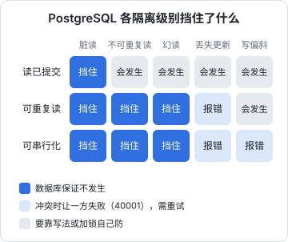

# 事务与隔离级别

单个请求在本地测试里永远是对的，问题出在两个请求同时到达的时候：两个店员同时补仓，库存少记了一笔；两个财务同时确认同一家店的两张订单，到期日只延长了一次。这类 bug 测试很难覆盖，复现全靠运气。这一章讲事务到底保证了什么、PostgreSQL 的隔离级别各挡住了哪些并发问题，以及挡不住的那些怎么用写法和锁来防。

## 事务保证什么

ACID 四个字母，从开发者的角度翻译一下：

| 字母 | 含义 | 你能依赖的事 |
|---|---|---|
| A 原子性 | 要么全做，要么全不做 | 中途抛异常，前面的写入全部撤销 |
| C 一致性 | 事务前后约束都成立 | 外键、唯一、CHECK 在提交时一定满足 |
| I 隔离性 | 并发事务互相看不到中间状态 | **程度由隔离级别决定**，这是本章的重点 |
| D 持久性 | 提交了就不会丢 | `COMMIT` 返回之后，断电也不丢（WAL 已落盘） |

原子性是最容易用好的。hatch-counter 撤销一次销量导入：要删掉这批的销售流水、删掉它扣的库存消耗、把批次标成 `reverted`、重放受影响食材的库存。这几步必须在一个事务里，否则中途失败就会留下「流水删了、库存没回来」的半截状态。

在 Drizzle 里，事务就是一个回调，回调抛错就回滚：

```ts
await db.transaction(async (tx) => {
  await tx.delete(salesRecords).where(eq(salesRecords.batchId, batchId));
  await tx.delete(stockMovements).where(eq(stockMovements.batchId, batchId));
  await tx.update(importBatches).set({ status: "reverted" }).where(eq(importBatches.id, batchId));
  // 任何一步抛错，前面的都会撤销
});
```

hatch-counter 把所有业务读写都放进 `DbService.withStore(storeId, fn)` 开的事务里：开事务、用 `set_config(..., true)`（即 `SET LOCAL`）设好门店上下文，再执行业务回调。事务级的设置在提交后自动消失，池化连接被下一个请求拿到时是干净的。**事务的边界同时也是上下文的边界**，这是一个很好的设计习惯。

## 并发会出什么问题

| 现象 | 描述 |
|---|---|
| 脏读 | 读到别人还没提交的数据 |
| 不可重复读 | 同一事务里两次读同一行，结果不同 |
| 幻读 | 同一事务里两次按条件查，行数不同 |
| 丢失更新 | 两个事务都「读出来、算好、写回去」，后写的覆盖了先写的 |
| 写偏斜 | 两个事务各自读到满足条件的状态，各写不同的行，合起来违反了规则 |

SQL 标准定义了四个隔离级别，PostgreSQL 实际只有三个（读未提交的行为和读已提交完全一样）。它们各自挡住了什么：



PostgreSQL 的默认级别是**读已提交**：每条语句开始时取一个快照，只能看到在那之前已提交的数据。下面用两个并发会话把三种典型问题逐个跑出来。

## 丢失更新：读出来、算好、写回去

库存 10，两个店员同时出库，一个出 3，一个出 2。代码写成「先查再写」：

```ts
const [row] = await tx.select({ qty: stock.qty }).from(stock).where(eq(stock.id, id));
await tx.update(stock).set({ qty: row.qty - n }).where(eq(stock.id, id));
```

在读已提交下并发执行（会话 A 读完后停 1 秒，会话 B 在这期间完成）：

```text
A: begin; select qty → 10
B: begin; select qty → 10; update set qty = 8; commit
A: update set qty = 7; commit
最终 qty = 7
```

正确答案是 5，B 的出库丢了。两个事务都没出错，数据库也没报任何错。

### 修法一：让数据库做算术

```sql
update stock set qty = qty - 3 where id = 1;
```

`UPDATE` 会对行加锁，第二个 `UPDATE` 等第一个提交后，基于**最新已提交的值**重新计算。读已提交下这样写就不会丢更新。Drizzle 里：

```ts
await tx.update(stock).set({ qty: sql`${stock.qty} - ${n}` }).where(eq(stock.id, id));
```

能写成单条 `UPDATE` 的，都这么写。这也是最快的写法。

### 修法二：条件更新（乐观并发）

状态流转类的写入，把「期望的旧状态」写进 `WHERE`，然后检查影响行数：

```ts
const rows = await tx
  .update(orders)
  .set({ status: "refunded", refundedAt: now })
  .where(and(eq(orders.id, id), eq(orders.status, "paid")))
  .returning({ id: orders.id });
if (rows.length === 0) throw new AppError("这张订单已经作废或退过款了");
```

hatch-counter 后台退款就是这么写的：只有仍是 `paid` 的订单才能退。两个人同时点退款，第二个人的 `UPDATE` 等第一个提交后重新检查条件，此时状态已经是 `refunded`，影响 0 行，直接报错。也可以加一个 `version` 列，每次更新 `version = version + 1 where version = 读到的值`，这就是常说的乐观锁。

条件不满足时，「影响 0 行」只告诉你没改成，不告诉你现在是什么状态。要给用户一句准确的话（「已经退过了」还是「已经作废了」），以前得再查一次，而这次查询和刚才的 `UPDATE` 之间又可能有人改。PostgreSQL 18 起 `RETURNING` 可以用 `old` / `new` 两个别名，一条语句同时拿到改前和改后的值：

```sql
update stock set qty = qty - 3
where ingredient_id = $1
returning old.qty as before, new.qty as after;
```

这对「扣减后要记一条流水、流水里要写扣减前余额」这类写法很顺手，不用先 `SELECT ... FOR UPDATE` 再 `UPDATE`。按 2026 年 11 月的 PostgreSQL 18 Release Notes 整理；16 及更早不支持这个语法，Drizzle 0.45 的 `.returning()` 也还没有对应的写法，要用 `sql` 模板手写，以官方文档为准。

### 修法三：SELECT ... FOR UPDATE（悲观锁）

当「读」和「写」之间有复杂的计算、甚至要读好几张表时，先把关键行锁住：

```ts
const [store] = await tx.select().from(stores).where(eq(stores.id, storeId)).for("update").limit(1);
// 在这之后，别的事务要锁这一行就得等我提交
const next = projectExpiry(store.expiresAt, order);
await tx.update(stores).set({ expiresAt: next }).where(eq(stores.id, storeId));
```

hatch-counter 确认订单延长到期日时就是这样，代码注释写得很清楚：两个财务同时确认同一家店的两张单，各自读到同一个原到期日、各自往后接，就有一张白收了钱。锁住门店那一行，第二个人就会读到第一个人延长后的到期日。

`FOR UPDATE` 还有两个变体：`NOWAIT`（锁不到立刻报错）和 `SKIP LOCKED`（跳过被锁的行）。后者是用数据库表做任务队列的标准写法：多个 worker 各自 `select ... for update skip locked limit 10`，不会抢到同一批任务。

## 可重复读：冲突时让你失败

把同样的「先查再写」放进可重复读，并且用 `qty = qty - 3` 写：

```text
A: begin isolation level repeatable read; select qty → 10
B: update stock set qty = qty - 2 （自动提交）
A: update stock set qty = qty - 3
ERROR:  could not serialize access due to concurrent update
```

可重复读在事务的**第一条语句**取快照，整个事务都看这个快照。A 要更新的行在快照之后被 B 改过，PostgreSQL 不会让 A 基于过时的数据写入，而是直接报错（SQLSTATE `40001`）。最终 `qty = 8`，A 需要重试。

可重复读适合「一个事务里要读多次、要求前后一致」的场景，比如生成一份报表要跑好几条聚合，希望它们看到同一时刻的数据。代价是要处理 `40001` 并重试。

## 写偏斜：只有可串行化挡得住

规则：至少要有一个人在岗。现在两人都在岗，各自请假：

```sql
begin isolation level repeatable read;
select count(*) from duty where on_duty;   -- 2，够了，我可以走
update duty set on_duty = false where name = '阿琳';   -- 另一个会话改的是「建华」
commit;
```

两个会话并发执行，在可重复读下都成功提交，结果在岗人数为 0。两个事务改的是**不同的行**，没有写冲突，但它们各自依据的「读」被对方的写推翻了。

换成可串行化，第二个提交的会话会失败：

```text
ERROR:  could not serialize access due to read/write dependencies among transactions
DETAIL:  Reason code: Canceled on identification as a pivot, during commit attempt.
HINT:  The transaction might succeed if retried.
```

最终在岗 1 人。可串行化（PostgreSQL 的实现叫 SSI）跟踪事务之间的读写依赖，发现可能形成「不可能按任何串行顺序得到」的结果时，就中止其中一个。

写偏斜在业务里比想象的常见：排班要求最少人数、同一时段的预约不能重叠、余额校验分散在多行上。除了用可串行化，也可以：

- 把规则变成约束：时间段不重叠用 `EXCLUDE` 约束，名额用唯一约束
- 人为制造冲突：先 `FOR UPDATE` 锁住一个共同的父行（比如门店那一行），把并发串行化

## 重试：用了高隔离级别就必须写

可重复读和可串行化都靠「失败 + 重试」保证正确，所以事务代码必须能整体重放：

```ts
const RETRYABLE = new Set(["40001", "40P01"]); // 序列化失败、死锁

async function withRetry<T>(fn: () => Promise<T>, attempts = 3): Promise<T> {
  for (let i = 1; ; i++) {
    try {
      return await fn();
    } catch (err) {
      if (i >= attempts || !RETRYABLE.has(pgErrorCode(err) ?? "")) throw err;
      await new Promise((r) => setTimeout(r, 20 * i + Math.random() * 30));
    }
  }
}

await withRetry(() =>
  db.transaction(async (tx) => { /* 读、算、写 */ }, { isolationLevel: "serializable" }),
);
```

两个细节：

- **错误码要顺着 `cause` 找**。Drizzle 0.45 会把驱动的错误包成 `DrizzleQueryError`，SQLSTATE 在 `err.cause.code` 上。hatch-counter 的 `pgErrorCode()` 就是沿 `cause` 链往下找五层，而且坚持按错误码判断，不匹配错误消息（消息会随服务器的 `lc_messages` 变成中文）
- **事务里不要有外部副作用**。发短信、调第三方 API、写文件，重试时会再做一遍。把副作用放到事务提交之后，或者用幂等键保护

## 死锁

两个事务以相反的顺序锁两样东西，就会互相等待。PostgreSQL 会检测到死锁（默认等 1 秒后检查），中止其中一个，报 `40P01`。

hatch-counter 踩过两次：

- 版本号表：如果每次写业务数据时就去更新 `store_versions` 里对应的那一行，这行锁要一直占到提交；两个事务按相反顺序碰两块数据就是死锁。最后的方案是写的当下只往一张临时表记一笔「动了哪一块」，提交时由一个可延迟的约束触发器**按（门店, 块）的固定顺序**一次加完
- 测试清库：后台定时落库先锁 `admin.store_usage_daily` 再读 `stores`，测试的 `TRUNCATE` 先锁 `stores` 再级联到 `store_usage_daily`，八百条用例里偶尔红一条

防死锁的通用办法：

1. **固定加锁顺序**：要锁多行时按主键排序后再锁
2. **事务尽量短**：锁持有的时间越短，撞上的概率越低
3. **把热点行的更新推迟到事务末尾**，或像上面那样在提交时集中处理
4. 死锁无法完全避免时，把 `40P01` 也纳入重试

## 事务要短

长事务的危害不止于锁：

- 它持有的行锁会让其他写入排队
- 它的快照会阻止 VACUUM 清理死元组，导致表膨胀（下一章和[《PostgreSQL 运维》](../database-ops/)的 VACUUM 一章）
- 占着一个数据库连接，连接池耗尽后整个服务卡住

最常见的长事务来源是**在事务里等网络**。hatch-counter 的幂等层专门把「占行」和「记回执」各做成一个短事务，跟业务事务分开；识别进货单要调视觉模型，几秒到几十秒，显然不能在事务里调。正确的形状是：


另一个来源是 `idle in transaction`：代码开了事务，中途异常没有回滚、连接被还回池子之前一直挂着。用 ORM 的回调式事务能避免手写 `begin` / `commit` 时漏掉的分支。

## 保存点

事务里想「这一步失败了就算了，继续后面的」，用保存点。Drizzle 里在事务对象上再调一次 `transaction` 就是嵌套事务，底层用 `SAVEPOINT` 实现：

```ts
await db.transaction(async (tx) => {
  await tx.insert(importBatches).values(batch);
  for (const row of rows) {
    try {
      await tx.transaction(async (sp) => {
        await sp.insert(salesRecords).values(row);
      });
    } catch {
      skipped.push(row); // 只回滚这一行，批次和前面的行都保留
    }
  }
});
```

逐行保存点有开销，几千行以上更好的做法是先在应用里校验，再一次性批量插入。

## 怎么选

| 场景 | 推荐 |
|---|---|
| 普通 CRUD | 读已提交（默认） |
| 计数、扣减、累加 | 读已提交 + `SET col = col ± n` |
| 状态流转（待付 → 已付 → 已退） | 读已提交 + 条件更新，检查影响行数 |
| 读出来要复杂计算再写回 | 读已提交 + `FOR UPDATE` |
| 一个事务里多次读要前后一致的报表 | 可重复读（只读事务不会有写冲突） |
| 跨多行的业务规则，难以用约束表达 | 可串行化 + 重试 |

对一人公司来说，默认用读已提交，把关键的并发写入用前三种写法守住，基本就够了。只有当规则真的跨越多行、又不方便用锁时，才上可串行化。

## 本章要点

- 原子性最容易用好：相关的写入放进同一个事务；事务边界也可以是上下文边界
- PostgreSQL 默认读已提交，它挡不住丢失更新和写偏斜
- 防丢失更新：让数据库做算术、条件更新、`FOR UPDATE`，三选一
- 可重复读和可串行化靠报错 + 重试，事务代码要能整体重放、不含外部副作用
- 错误按 SQLSTATE 判断（`40001`、`40P01`、`23505`），并沿 `cause` 链查找
- 固定加锁顺序防死锁；事务要短，绝不在事务里等网络
