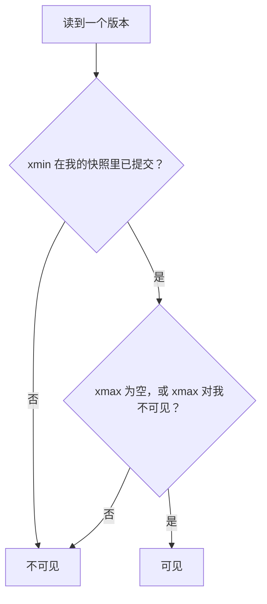
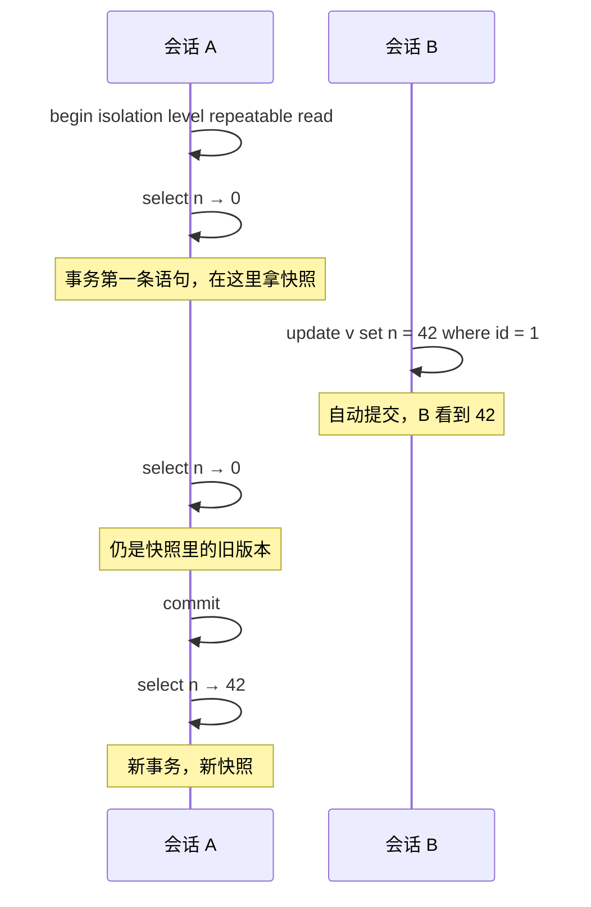

# MVCC

上一章的隔离级别是「承诺」，这一章看「实现」。PostgreSQL 用多版本并发控制（MVCC）兑现这些承诺：更新一行时不覆盖旧数据，而是写一个新版本，让不同的事务各自看到属于自己时刻的那个版本。理解了这一点，很多看似无关的现象都能解释：为什么读不阻塞写、为什么频繁更新的表会膨胀、为什么长事务是祸害、为什么更新一个被索引的列更贵。

VACUUM 怎么调参、膨胀怎么修、事务 ID 回卷怎么防，是[《PostgreSQL 运维》](../database-ops/)的内容。这里只讲 MVCC 本身，以及它对你写代码、设计表结构的影响。

## 读写为什么不互相阻塞

如果只有一份数据，读和写就必须互斥：写到一半的时候不能让人读到。传统的做法是加锁，读加共享锁、写加排他锁，读多写多时大家互相等。

MVCC 的思路是：**写的时候不改旧的，另写一份新的**。

- 正在读的事务继续看旧版本，不受影响
- 写的事务创建新版本，提交后，之后开始的事务看新版本
- 只有「两个事务写同一行」才需要等待

所以在 PostgreSQL 里，`SELECT` 永远不会因为别人在 `UPDATE` 而卡住，反过来也一样。这对 Web 应用很友好：报表查询跑几秒，不会挡住前台的写入。

## 一行数据长什么样

每一行（PostgreSQL 叫元组）都带着几个隐藏列，可以直接查出来：

| 隐藏列 | 含义 |
|---|---|
| `xmin` | 创建这个版本的事务 ID |
| `xmax` | 删除（或更新掉）这个版本的事务 ID；0 表示还活着 |
| `ctid` | 这个版本的物理位置：（页号, 页内序号） |

动手看一下：

```sql
create table t (id int primary key, qty int, note text);
insert into t values (1, 10, 'a'), (2, 20, 'b');
select ctid, xmin, xmax, * from t;
```

```text
 ctid  | xmin | xmax | id | qty | note
-------+------+------+----+-----+------
 (0,1) |  820 |    0 |  1 |  10 | a
 (0,2) |  820 |    0 |  2 |  20 | b
```

两行都是事务 820 插入的，都还活着。现在更新第一行：

```sql
begin;
update t set qty = 11 where id = 1;
select txid_current();          -- 821
commit;
select ctid, xmin, xmax, * from t;
```

```text
 ctid  | xmin | xmax | id | qty | note
-------+------+------+----+-----+------
 (0,2) |  820 |    0 |  2 |  20 | b
 (0,3) |  821 |    0 |  1 |  11 | a
```

`id = 1` 的行搬到了 `(0,3)`，`xmin` 变成 821。原来 `(0,1)` 那个版本并没有消失，只是对普通查询不可见了。用 `pageinspect` 直接看页里的内容：

```sql
create extension if not exists pageinspect;
select lp, t_xmin, t_xmax, t_ctid from heap_page_items(get_raw_page('t', 0));
```

```text
 lp | t_xmin | t_xmax | t_ctid
----+--------+--------+--------
  1 |    820 |    821 | (0,3)
  2 |    820 |      0 | (0,2)
  3 |    821 |      0 | (0,3)
```

第 1 项还在，`t_xmax = 821` 表示它被事务 821 删掉了，`t_ctid` 指向新版本 `(0,3)`。**一次 UPDATE 等于一次 DELETE 加一次 INSERT**：旧版本标记为死亡，新版本写在别处。

## 快照：我能看到哪些版本

事务读数据时会拿一个**快照**，记录「此刻哪些事务已经提交、哪些还在进行」。判断一个版本对我是否可见，简化后的规则是：

1. `xmin` 对应的事务在我的快照里已提交（或者就是我自己），这个版本才可能可见
2. 并且 `xmax` 为空，或者 `xmax` 对应的事务在我的快照里还没提交（或已回滚），这个版本才没被删掉



隔离级别的差别就在于**什么时候拿快照**：

- 读已提交：每条语句拿一个新快照，所以同一事务里两次读可能不同
- 可重复读和可串行化：事务第一条语句拿快照，之后一直用它

实测：会话 A 在可重复读事务里读一行，会话 B 把它改成 42 并提交，A 再读：



A 看到的「0」那个版本物理上还躺在页里，这就是 A 能读到它的原因。

## 死元组与 VACUUM

旧版本总得有人清理。当一个死亡版本对**所有**进行中的事务都不可见时，它就成了可以回收的死元组。VACUUM 负责回收它们占的空间，供后续插入复用（一般不还给操作系统），autovacuum 会在后台自动做这件事。

关键在于「对所有进行中的事务都不可见」。只要有一个老事务还开着，它的快照可能还需要那些旧版本，VACUUM 就不敢删。实测：开一个可重复读事务挂着不动，另一边把 1 万行全部更新一遍，然后 VACUUM：

```text
tuples: 0 removed, 20000 remain, 10000 are dead but not yet removable
```

1 万个死元组一个都没清掉。等那个事务结束后再 VACUUM：

```text
tuples: 10000 removed, 10000 remain, 0 are dead but not yet removable
```

这就是上一章说「长事务是祸害」的深层原因。一个忘了提交的事务、一个跑了几小时的分析查询、一个连接上挂着的 `idle in transaction`，都会让整个库的清理停摆，频繁更新的表越涨越大，查询要扫的页越来越多。

对开发者的要求：

- 事务要短，不在事务里等网络
- 应用里设置 `idle_in_transaction_session_timeout`，给忘记提交的连接兜底
- 大的分析查询可以放到只读从库上（复制见《PostgreSQL 运维》）

## HOT：不动索引的更新

既然每次 UPDATE 都写一个新版本，新版本的位置变了，那所有索引是不是都要更新指向它？默认是的，这让更新一个有五个索引的表代价很高。

PostgreSQL 有一个优化叫 **HOT**（Heap-Only Tuple）：如果

1. 更新没有改动任何被索引的列，并且
2. 新版本能放进同一页

那么索引不用动，索引仍指向旧版本的位置，旧版本再链到同页的新版本。接着上面的表，给 `qty` 建一个索引，然后分别更新一个没索引的列和一个有索引的列：

```sql
create index t_qty_idx on t (qty);
update t set note = 'b2' where id = 2;   -- 改的列没有索引
update t set qty = 21 where id = 2;      -- 改的列有索引
select lp, t_xmin, t_xmax, t_ctid, (t_infomask2 & 16384) > 0 as hot_updated
from heap_page_items(get_raw_page('t', 0));
```

```text
 lp | t_xmin | t_xmax | t_ctid | hot_updated
----+--------+--------+--------+-------------
  1 |    820 |    821 | (0,3)  | t
  2 |    820 |    823 | (0,4)  | t
  3 |    821 |      0 | (0,3)  | f
  4 |    823 |    824 | (0,5)  | f
  5 |    824 |      0 | (0,5)  | f
```

第 2 项到第 4 项是 HOT 更新（改 `note`）；第 4 项到第 5 项不是（改了有索引的 `qty`），所有索引都要为第 5 项插入新条目。`pg_stat_user_tables` 里也能看到统计：

```text
 n_tup_upd | n_tup_hot_upd | n_dead_tup
-----------+---------------+------------
         3 |             2 |          3
```

这给表设计带来两条启示：

- **频繁更新的列不要随便建索引**。比如「最后活跃时间」「浏览次数」，每次更新都会变成非 HOT 更新，还要维护索引
- **频繁更新的表可以降低 `fillfactor`**（比如 `with (fillfactor = 80)`），给每页留空位，让新版本更容易留在同一页

## MVCC 对设计的影响

### 热点行

所有事务都更新同一行（全局计数器、每家店一行的「最新版本号」），会产生两个问题：写写冲突让它们串行排队；每次更新都留下一个死版本，这一行所在的页反复膨胀。

hatch-counter 的版本号设计正好绕开了它：每次业务写入不直接改 `store_versions`，而是由行级触发器往一张事务内的临时表记一笔「这个事务动了哪家店的哪一块」（一次导入八千行只记一笔），提交时才由约束触发器一次性加版本号。热点行的锁只在提交那一瞬间持有，每个事务也只产生一个新版本。

更一般的做法：

- 计数类需求改成追加明细，读的时候聚合；或者按时间分桶（每天一行）
- 必须维护的汇总值，用批处理定期刷新，而不是每笔写入都更新

### updated_at 不会自己变

很多人以为数据库会自动维护「更新时间」。PostgreSQL 不会，MVCC 记的 `xmin` 是事务 ID，不是时间。hatch-counter 的文档特意写了：Drizzle 没挂 `$onUpdate`、库里也没有触发器，改一行时要自己写上 `updatedAt: new Date()`。要么约定在代码里写，要么挂触发器，选一种并写进规范。

### 大批量更新和删除

更新 100 万行就是写 100 万个新版本、留下 100 万个死版本，表的体积在 VACUUM 之前接近翻倍，所有索引都要插入 100 万项（非 HOT 时）。所以：

- 回填数据分批做，每批几千行，各自提交，给 autovacuum 喘息的机会
- 要清空整张表用 `TRUNCATE`，它直接换掉文件，不产生死元组
- 定期清理的历史数据（hatch-counter 的变更流水只保留 90 天），按日期索引分批删；量大时考虑按时间分区，直接删分区

### 加列不一定重写表

在 MVCC 下改表结构，有的操作只改元数据，有的要重写整张表。实测在 100 万行的表上：

```sql
alter table sales_records add column channel text not null default 'pos';   -- 1.4 ms
alter table sales_records add column rnd double precision default random(); -- 3000 ms
```

PostgreSQL 11 起，加一个默认值是常量（准确说是非易变表达式）的列只记在元数据里，老行读的时候补上；默认值是 `random()`、`clock_timestamp()` 这类易变（volatile）函数时，每行的值不同，只能重写整张表，期间持有排他锁。`now()` 不算：它在一个事务里取同一个值，加列时算一次存进元数据，照样不重写。生成列同理：`STORED` 的要给每一行算出值写进去，会重写整表；PostgreSQL 18 起的虚拟生成列不落盘，加列只改元数据（见[第 1 章](01-modeling.md#生成列让库替你算)）。第 6 章写迁移时会再用到这条。

## SQLite 怎么做

SQLite 没有行级的多版本，它在 WAL 模式下实现的是**页级**的快照：

- 写入追加到 `-wal` 文件，不直接改主库文件
- 读事务开始时记下 WAL 的位置，之后只看到这个位置之前的页
- 同一时刻只能有一个写事务，但读和写可以并发

效果上，读不阻塞写、写不阻塞读，这一点和 PostgreSQL 相同；不同的是写和写之间是整库串行的。对单用户的手机 App，这完全够用。第 8 章会讲 hatch-shelf 为什么一打开库就设 `PRAGMA journal_mode = WAL`。

## 本章要点

- MVCC 让每次更新写一个新版本，读和写互不阻塞
- 每个版本带 `xmin` / `xmax`，配合事务快照决定对谁可见；隔离级别的差别在于何时拿快照
- 死元组要等所有可能需要它的事务结束才能清理，长事务会让 VACUUM 停摆
- HOT 更新不动索引，前提是不改被索引的列且同页有空间：频繁更新的列别乱建索引
- 热点行要拆成追加明细或集中在提交时处理；大批量改动要分批
- 加常量默认值的列只改元数据，易变默认值会重写整表

## 动手练习

1. **一次 UPDATE 写了一个新版本**：在 `pg-lab` 里照本章建表 `t` 并插入两行，执行 `select ctid, xmin, xmax, * from t;`；然后 `update t set qty = 11 where id = 1;` 再查一次。

   验证：`id = 1` 那行的 `ctid` 从 `(0,1)` 变成了 `(0,3)`，`xmin` 变成一个更大的事务号；`id = 2` 那行不变。事务号的具体数值每台机器不同。

   参考答案：更新不覆盖原地，而是把旧版本标记死亡（写上 `xmax`）、在别处写一个新版本，所以物理位置和创建事务都变了。想看旧版本还在页里，用本章的 `heap_page_items(get_raw_page('t', 0))`。

2. **长事务挡住 VACUUM**：建 `create table big as select g as id, 0 as n from generate_series(1, 10000) g;`。会话 A 执行 `begin isolation level repeatable read; select count(*) from big;` 后挂着不动；会话 B 执行 `update big set n = n + 1;` 和 `vacuum verbose big;`。然后 A `commit`，B 再 `vacuum verbose big;`。

   验证：第一次 VACUUM 输出的 `tuples:` 一行里 `10000 are dead but not yet removable`；A 提交后再 VACUUM，变成 `10000 removed`、`0 are dead but not yet removable`。

   参考答案：A 的快照可能还要看那 1 万个旧版本，VACUUM 不能删；只要有一个老事务开着，整个库的清理都会被它拖住。

3. **HOT 更新**：新建 `create table h (id int primary key, qty int, note text); insert into h select g, g, 'x' from generate_series(1, 100) g; create index on h (qty);`，执行 `update h set note = 'y' where id <= 10;` 和 `update h set qty = qty + 1000 where id > 90;`，然后查 `select n_tup_upd, n_tup_hot_upd from pg_stat_user_tables where relname = 'h';`。

   验证：`n_tup_upd` 是 `20`，`n_tup_hot_upd` 接近 `10`（统计在事务结束后才汇总，刚执行完看不到就过一两秒再查）。

   参考答案：只改无索引的 `note` 且同页有空位时是 HOT 更新，索引不用动；改了有索引的 `qty`，每个索引都要为新版本插一项。
