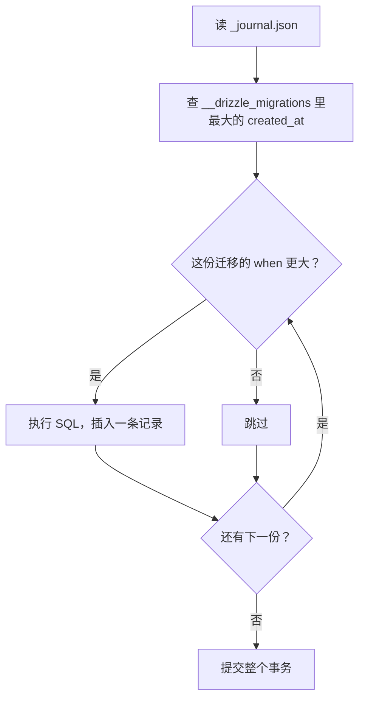
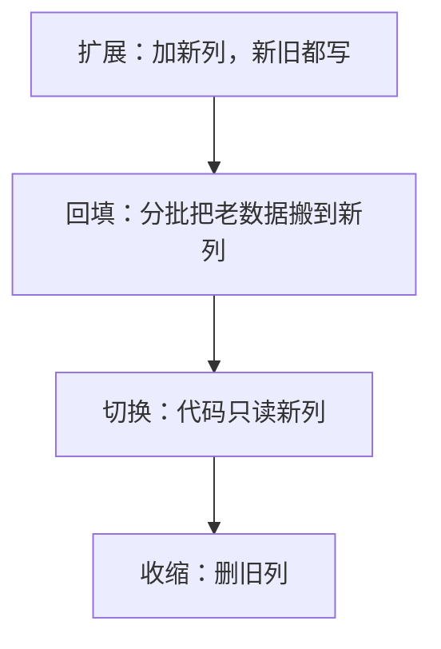

# Drizzle 与迁移

前五章讲的是数据库本身，这一章回到每天写的代码：用 Drizzle 定义表结构、写查询，用 drizzle-kit 生成迁移。ORM 的用法文档里都有，这里关心的是那些文档不太强调、却会在生产上出事的地方：迁移是怎么被记账和执行的，哪些操作会锁表，哪些东西 Drizzle 根本不知道。

版本以 hatch-counter 当前用的为准：`drizzle-orm` 0.45、`drizzle-kit` 0.31、驱动 `postgres`（postgres.js）3.4。Drizzle v1 还在候选版阶段，和 0.45 不同的地方在[「Drizzle v1 改了什么」](#drizzle-v1-改了什么)一节集中说明。

> [!WARNING]
> 本章的 API、drizzle-kit 命令和迁移目录结构按 drizzle-orm 0.45 / drizzle-kit 0.31 整理。截至 2026-11-04，npm 上 `drizzle-orm` 的 `latest` 是 0.45.4、`drizzle-kit` 是 0.31.11，v1 在 `rc` 标签下（1.0.0-rc.5）。v1 的说法按 Drizzle 官方《Upgrading to Drizzle v1》和 1.0.0-rc.5 的迁移器源码整理，正式版可能还会变；以 Drizzle 官方文档（orm.drizzle.team）和 releases 说明为准。

## schema 即代码

Drizzle 的表结构写在 TypeScript 里，同时是三样东西：查询构造器的类型来源、drizzle-kit 生成迁移的依据、团队（和 agent）阅读表结构的文档。

```ts
import { sql } from "drizzle-orm";
import { date, doublePrecision, index, integer, pgTable, text, timestamp, uuid } from "drizzle-orm/pg-core";

/** 每张业务表都带的三列。没有 deleted_at：业务行一律硬删 */
const storeCols = () => ({
  storeId: uuid("store_id").notNull().references(() => stores.id, { onDelete: "cascade" }),
  createdAt: timestamp("created_at", { withTimezone: true }).notNull().defaultNow(),
  updatedAt: timestamp("updated_at", { withTimezone: true }).notNull().defaultNow(),
});

export const salesRecords = pgTable(
  "sales_records",
  {
    id: uuid("id").primaryKey().defaultRandom(),
    saleDate: date("sale_date").notNull(),
    itemId: uuid("item_id").notNull().references(() => items.id, { onDelete: "cascade" }),
    quantity: doublePrecision("quantity").notNull(),
    amountCents: integer("amount_cents").notNull(),
    /** 当天 0 点起的分钟数，不是时刻 */
    orderMin: integer("order_min"),
    ...storeCols(),
  },
  (t) => [
    index("sales_date_idx").on(t.storeId, t.saleDate),
    index("sales_item_date_idx").on(t.itemId, t.saleDate),
  ],
);

export type SaleRow = typeof salesRecords.$inferSelect;   // 查出来的行
export type NewSale = typeof salesRecords.$inferInsert;   // 插入时要给的字段
```

这是 hatch-counter `schema.ts` 的简化版。几个值得学的习惯：

- **公共列用函数展开**（`storeCols()`），新表不会漏掉 `store_id` 或时间戳
- **列的口径写在注释里**。「分钟数不是时刻」「数量为什么用 double」这种信息，写在 schema 旁边，比写在任何别的地方都更容易被看到
- **索引在 schema 里定义**，和第 2 章的分析一一对应：每个索引服务哪类查询，一眼能看出来
- **`$inferSelect` / `$inferInsert` 派生类型**，不要手写一份接口再去同步

要注意 `jsonb("permissions").$type<Record<string, string>>()` 里的 `$type` **只是 TypeScript 类型**，库里不做任何校验。jsonb 的内容需要在写入前用 zod 之类的工具校验（第 9 章）。

## 查询：构造器与 sql 模板

Drizzle 的查询构造器贴近 SQL，生成的语句基本可以预期：

```ts
const rows = await tx
  .select({ itemId: salesRecords.itemId, total: sql<number>`sum(${salesRecords.amountCents})::int` })
  .from(salesRecords)
  .where(and(eq(salesRecords.storeId, storeId), gte(salesRecords.saleDate, from), lt(salesRecords.saleDate, to)))
  .groupBy(salesRecords.itemId);
```

复杂的分析查询（窗口函数、CTE、区间聚合）直接用 `sql` 模板写更清楚。模板里的 `${}` 会变成参数，不会拼接字符串，所以是防注入的：

```ts
const result = await tx.execute(sql`
  select sale_date, sum(amount_cents) as total,
         sum(sum(amount_cents)) over (order by sale_date) as running
  from sales_records
  where sale_date >= ${from} and sale_date < ${to}
  group by sale_date order by sale_date
`);
```

真正危险的是 `sql.raw()` 和驱动的 `unsafe()`，它们原样拼接。只在标识符来自代码常量时用，绝不接用户输入。

### 类型的边界

手写 SQL 时，返回值的类型由驱动决定，`sql<number>` 只是你的声明：

- `sum()`、`count()` 在 PostgreSQL 里返回 `bigint` / `numeric`，postgres.js 按**字符串**交回来，因为 JS 的 number 装不下所有 64 位整数。hatch-counter 用一个 `num()` 辅助函数统一转换，或者在 SQL 里 `::int` 显式转换（确定不会溢出时）
- `date` 列默认会被一些驱动转成 JS `Date`，在时区边界上挪一天。hatch-counter 在 `postgres()` 的 `types` 配置里把 `date` 钉成原样字符串，Drizzle 的 `date()` 列默认也是按字符串读写

把这些规则写进项目的「存储约定」，比每次靠记忆可靠。

## drizzle-kit：generate 与 push

| 命令 | 做什么 | 用在哪 |
|---|---|---|
| `drizzle-kit generate` | 对比 schema 和上一次的快照，生成一份 SQL 迁移文件 | 所有要上生产的改动 |
| `drizzle-kit generate --custom` | 生成一份空的迁移，自己写 SQL | Drizzle 表达不了的改动 |
| `drizzle-kit migrate`，或代码里调 `migrate()` | 执行还没跑过的迁移 | 部署时 |
| `drizzle-kit push` | 直接把 schema 同步到库，不留迁移文件 | 只在原型阶段、可随时重建的库上 |

`push` 很方便，但它不留记录、可能为了「同步」删列，**绝不对有真实数据的库用**。从第一个生产版本开始，就只走 generate + migrate。

hatch-counter 的 `drizzle.config.ts`：

```ts
export default defineConfig({
  dialect: "postgresql",
  schema: "./src/db/schema.ts",
  out: "./drizzle",
  // 后台的表在单独的 admin schema 里。不列上这个名字，
  // drizzle-kit 只看 public，会把那几张表当成「要删掉的」
  schemaFilter: ["public", "admin"],
  strict: true,
  verbose: true,
});
```

`schemaFilter` 那条注释是踩过的坑：drizzle-kit 默认只看 `public`，其他 schema 里的表在它眼里是「schema 里没定义的表」，生成的迁移会试图删掉它们。`strict: true` 让 `push` 在执行每条语句前都要求确认，算是给误用 `push` 加了一道闸。

## 迁移是怎么记账的

> [!WARNING]
> 本节描述的 `meta/_journal.json` 账本、`__drizzle_migrations` 表结构和「按 `when` 时间戳判断跑没跑过」的逻辑出自 drizzle-orm 0.45 的 PostgreSQL 迁移器源码。Drizzle v1 去掉了账本、改成按迁移名记账，本节和下文「基线重置」「不要手工编辑 `_journal.json`」在 v1 下不再适用，差异见下一节「Drizzle v1 改了什么」；以 Drizzle 官方文档的迁移章节和 v1 升级说明为准。

`drizzle/` 目录下有两样东西：

- `NNNN_名字.sql`：要执行的 SQL，语句之间用 `--> statement-breakpoint` 分隔
- `meta/`：每份迁移对应的 schema 快照 `NNNN_snapshot.json`，以及账本 `_journal.json`

账本里每一条记录了序号、标签和一个时间戳 `when`：

```json
{ "idx": 2, "version": "7", "when": 1793439667448, "tag": "0002_admin_login_failures", "breakpoints": true }
```

执行迁移时，Drizzle 的迁移器（以 0.45 的 PostgreSQL 实现为例）做的事情是：

1. 确保 `drizzle` schema 下有一张 `__drizzle_migrations` 表（`id`、`hash`、`created_at`）
2. 读出这张表里 `created_at` 最大的那一条
3. 按账本顺序遍历迁移，**凡是 `when` 大于那个值的**，就执行，并插入一条记录
4. 第 3 步全部包在**同一个事务**里



从这个机制能推出几条规则：

- **判断「跑没跑过」靠时间戳，不靠文件名或哈希**。改一份已经跑过的迁移文件，库不会再跑它；手工往账本里塞一条时间戳更小的记录，它会被永远跳过
- **待跑的迁移在一个事务里**：一份失败，这一批全部回滚，库停在上一个版本，这是好事
- 但这也意味着**不能在迁移里执行不能放进事务的语句**，比如 `CREATE INDEX CONCURRENTLY`（下文）

hatch-counter 利用这个机制做过一次「基线重置」：把之前四十多份迁移压成两份基线，基线在账本里的 `when` 设成和旧链最后一份相同。于是空库会从基线建起；已经跑完旧链的库，最大 `created_at` 不小于基线的 `when`，基线被当作已经跑过。理解了记账方式，这种操作就不神秘了，但也要清楚它的前提：停在旧链半路的库接不上。

## Drizzle v1 改了什么

> [!WARNING]
> 本节按 2026 年 11 月的 Drizzle 官方《Upgrading to Drizzle v1》和 npm 上 `drizzle-orm` / `drizzle-kit` 1.0.0-rc.5 的源码整理。v1 尚未正式发布，命令、选项和记账细节在正式版里可能调整；hatch-counter 仍在 0.45，本书正文以 0.45 为准，这一节只作升级前的预习。

v1 动的正是上一节讲的那套记账。并排看：

| | 0.45 / drizzle-kit 0.31 | v1（rc） |
|---|---|---|
| 迁移目录 | `drizzle/0003_名字.sql` + `meta/0003_snapshot.json` + `meta/_journal.json` | 每份迁移一个文件夹：`drizzle/<14 位时间戳>_<名字>/migration.sql` 和同目录的 `snapshot.json`，没有账本 |
| 判断「跑没跑过」 | 库里最大的 `created_at` 和账本里的 `when` 比 | 按文件夹名比：库里没有这个名字的就跑 |
| `__drizzle_migrations` 表 | `id`、`hash`、`created_at` | 多了 `name`、`applied_at` 两列 |
| 待跑的迁移 | 同一个事务 | 仍是同一个事务 |
| 删一份没上线的迁移 | `drizzle-kit drop` | 命令去掉了，直接删那个文件夹 |
| `push` 前的确认 | 配置里 `strict: true` | `strict` 被弃用，改用 `--explain` 先看要执行的 SQL |

改按名字记账，解决了 0.45 的一个老问题：两个分支各生成一份迁移，合并后时间戳较早的那份会被「最大时间戳」规则永远跳过；v1 下只要名字不在库里就会跑。账本文件没了，合并时也就不会在 `_journal.json` 上起冲突，drizzle-kit 还会检查跨分支的迁移能不能交换先后顺序。

### 从 0.45 升上去

升级分两半：

1. **文件**：`drizzle-kit up` 把旧的 `meta/` 结构改写成新目录。v1 的迁移器读到 `meta/_journal.json` 会直接报错，提示先跑 `drizzle-kit up`
2. **库里的记录**：第一次用 v1 的迁移器跑迁移时，它发现 `__drizzle_migrations` 只有三列，会自动加上 `name` 和 `applied_at`，再把库里的每一行和本地的迁移对上号（按 `created_at` 精确到秒匹配文件夹名里的时间戳，同一秒有多份时再比哈希），把名字回填进去

第 2 步有一个要提前想到的地方：**库里有、本地找不到对应迁移的行，迁移器会报错停下**，说明「有迁移跑过了，但本地没有」。上一节的基线重置正好会撞上：已经跑完旧链的库里有四十多行记录，本地只剩两份基线，除了 `when` 和旧链最后一份相同的那行，其余都对不上（这是按 rc.5 迁移器源码推断的，没在 hatch-counter 上实际跑过）。所以做过基线重置的项目，升 v1 前要先决定怎么处理旧记录：比如在一个事务里把 `__drizzle_migrations` 清成只剩与基线对应的行，并先在库的副本上演练一遍。

### 对本章其他内容的影响

- 「不要手工编辑 `_journal.json`」在 v1 下没有对象了，但道理不变：快照链仍然靠每个文件夹里的 `snapshot.json` 串起来，不要手改快照
- `generate --custom` 仍然在，手写迁移的做法照旧
- 改名还是新建的歧义：v1 的 drizzle-kit 不再停在终端里等你选，而是把它们列成「未决项」，可以用 `--hints` / `--hints-file` 预先给出答案，CI 和 agent 环境里不会卡住
- 生成列：drizzle-kit 0.31 给 PostgreSQL 一律生成 `STORED`，v1 能区分 `STORED` 和 `VIRTUAL`（PostgreSQL 18 的默认是 `VIRTUAL`，见[第 1 章](01-modeling.md#生成列让库替你算)）
- 关系查询（`db.query`）在 v1 里换成了新版 API，用到它的代码升级时要按官方的 relations v1 → v2 指南改

## Drizzle 不知道的东西

schema.ts 不是库的全部。hatch-counter 的文档专门列了一份「只写在手写迁移里」的清单：

- 行级安全的启用和策略
- 触发器和函数（版本号、变更流水、回收站）
- 数据库角色和 `GRANT` / `REVOKE`
- 种子数据，比如单行配置表的那一行

做法是：先 `generate` 出建表的部分，再在同一份文件末尾追加手写段落，每段前面用醒目的注释隔开并写明原因：

```sql
CREATE TABLE "expense_images" ( ... );
--> statement-breakpoint
-- === 手写：RLS，多租户隔离只靠它 ===
ALTER TABLE "expense_images" ENABLE ROW LEVEL SECURITY;
--> statement-breakpoint
CREATE POLICY "expense_images_tenant" ON "expense_images"
  USING (store_id = nullif(current_setting('app.store_id', true), '')::uuid)
  WITH CHECK (store_id = nullif(current_setting('app.store_id', true), '')::uuid);
```

整份都是手写的（删触发器、改函数），用 `generate --custom --name <名字>` 生成空文件再写，这样快照和账本会一起生成，快照链不会断。**不要手工编辑 `_journal.json`**：快照链一断，下一次 `generate` 就会卡在一个需要终端交互的提问上。

改一个已经上线的函数或触发器，新建一份迁移写 `CREATE OR REPLACE`，不要回头改旧文件——跑过的库不会再跑它。

既然 Drizzle 不知道这些东西，就要用测试守住。hatch-counter 有一个测试扫描 `public` 下每张带 `store_id` 的表，检查它是否开了 RLS、是否挂着名为 `<表>_tenant` 的策略；漏了就红。新增表忘了写策略，跑起来一个错都不报，只有测试能发现。

## 安全的迁移

### 只能往前，要能在有数据的库上跑通

开发库是空的或者只有几行假数据，生产库有真实数据。典型的翻车：

- 给已有数据的表加 `NOT NULL` 列且没有默认值：直接失败
- 加唯一约束，但历史数据里已经有重复：直接失败
- 改列类型，有的值转不过去：直接失败

在本地用一份接近生产的数据（脱敏的导出或者种子脚本生成的大量数据）跑一遍迁移，是最便宜的保险。hatch-counter 的测试每次都从迁移现建模板库，新迁移一定会被跑到。

### 扩展与收缩

改名、拆列、换类型这类**不兼容**的改动，不要一步做完，而是分成几次发布：



原因是部署期间新旧两个版本的代码可能同时在跑，或者新版本出问题要回滚。每一步都要让「上一版代码」仍然能正常工作。hatch-counter 的数据模型文档里有两处「这一列代码不读不写，下一次删列时一起删」，就是收缩那一步攒着等批量做。

一人公司停机维护的成本往往可以接受，不是每个改动都必须零停机。但「先加后删」的习惯成本很低，值得保持。

### 哪些操作会锁表

| 操作 | 锁 | 大表上的后果 |
|---|---|---|
| 加列，默认值为常量（PG 11+） | 短暂排他锁 | 只改元数据，毫秒级 |
| 加列，默认值为 `random()` 等易变函数 | 排他锁 | 重写整表（第 5 章实测 100 万行 3 秒） |
| 改列类型（大多数情况） | 排他锁 | 重写整表和索引 |
| `SET NOT NULL` | 排他锁 | 扫全表验证 |
| 加 `NOT NULL` 约束 `NOT VALID`，再 `VALIDATE`（PG 18+） | 先短暂排他锁，验证时不挡读写 | 扫表移到不阻塞写入的第二步 |
| `CREATE INDEX` | 阻塞写入 | 建索引期间所有写入排队 |
| `CREATE INDEX CONCURRENTLY` | 不阻塞写入 | 慢一些，但**不能在事务里执行** |
| 加外键 / CHECK | 默认要扫全表验证 | 可以先 `NOT VALID` 再 `VALIDATE` 分两步 |

另一个隐患是**锁排队**：迁移的 `ALTER TABLE` 要等表上正在运行的长查询结束才能拿到排他锁，而在它排队期间，后来的所有查询都排在它后面。迁移里设一个 `SET lock_timeout = '5s'`，拿不到锁就失败重来，比卡住整个服务好。线上锁等待怎么观察，见[《PostgreSQL 运维》](../database-ops/)。

### CONCURRENTLY 与迁移事务

Drizzle 把待跑的迁移包在一个事务里，而 `CREATE INDEX CONCURRENTLY` 不能在事务中执行：

```text
ERROR:  CREATE INDEX CONCURRENTLY cannot run inside a transaction block
```

所以：

- 表不大（几十万行以内），直接 `CREATE INDEX`，几秒钟的写阻塞可以接受
- 表很大，在迁移之外手动执行 `CREATE INDEX CONCURRENTLY IF NOT EXISTS ...`，再发一份迁移用 `IF NOT EXISTS` 把它补进账本，让 schema 和快照保持一致

### 枚举值：加了不能马上用

PostgreSQL 12 起，`ALTER TYPE ... ADD VALUE` 可以在事务里执行，但新值在提交前不能使用：

```text
ERROR:  unsafe use of new value "c" of enum type kind
HINT:  New enum values must be committed before they can be used.
```

因为待跑的迁移在同一个事务里，「一份迁移加枚举值、下一份迁移用它」在本地分两次跑时没问题，上线时一起跑就会失败。hatch-counter 的规矩是干脆避开：要分种类又不想加枚举值，就用另一列区分。另外，枚举值只能加不能删，这也是很多项目宁可用 `text` + `CHECK` 的原因。

## 一份迁移的完整流程

1. 改 `schema.ts`
2. `drizzle-kit generate --name 有意义的名字`，打开生成的 SQL 逐行看
3. Drizzle 写不出来的部分（RLS、触发器、授权、回填），追加到同一份文件末尾，注释写清原因
4. 在开发库上执行迁移，跑全部测试
5. 对照上面的锁表格检查：这份迁移在生产数据量下会锁多久？
6. 迁移和代码一起提交；部署时先迁移，再起新代码（扩展型迁移对旧代码无害）

两个容易踩的坑：一份 diff 里不要同时删一张表又建一张，drizzle-kit 0.31 会问「是不是改名」，这个提问要终端，CI 或 agent 环境里会直接卡住（v1 改成了列出未决项、用 `--hints` 回答，见上文）；改了一份还没提交但已经灌进开发库的迁移，开发库要重置重来，否则改动永远不会生效。

## 本章要点

- schema.ts 是类型、迁移依据和文档三合一：公共列用函数展开，口径写在注释里
- `sql` 模板是参数化的；`sql.raw` 才危险。手写 SQL 的返回类型由驱动决定，`bigint` 是字符串
- 生产只用 generate + migrate，不用 push；多 schema 要配 `schemaFilter`
- Drizzle 0.45 按账本里的时间戳判断迁移跑没跑过，待跑的迁移在一个事务里执行；v1 去掉账本、按迁移名记账，做过基线重置的项目升级前要先处理旧记录
- RLS、触发器、授权、种子数据 Drizzle 不知道，手写在迁移里并用测试守住
- 不兼容的改动用扩展—回填—切换—收缩；注意哪些 DDL 会锁表、重写表
- `CREATE INDEX CONCURRENTLY` 进不了迁移事务；新枚举值提交前不能用

## 动手练习

> [!WARNING]
> 第 1 题按 drizzle-orm 0.45 / drizzle-kit 0.31 的行为编写；装到 v1 时目录结构不同（见上文「Drizzle v1 改了什么」）。以 Drizzle 官方文档为准。

1. **看 drizzle-kit 生成了什么**：在一个空目录里 `pnpm init`，`pnpm add drizzle-orm@0.45 && pnpm add -D drizzle-kit@0.31`，写一个只含一张表（`id` uuid 主键、`name` text）的 `src/schema.ts`，以及写明 `dialect: "postgresql"`、`schema: "./src/schema.ts"`、`out: "./drizzle"` 的 `drizzle.config.ts`，运行 `pnpm exec drizzle-kit generate --name init`。再给表加一列 `note: text("note").notNull()`，生成第二份；最后把 `name` 列改名成 `title`，再生成一次。

   验证：`drizzle/` 下出现 `0000_init.sql` 和 `meta/_journal.json`，账本里每条有 `idx`、`when`、`tag`；第二份 SQL 是一条 `ALTER TABLE ... ADD COLUMN "note" text NOT NULL`；改名那次，终端停下来问你是新建列还是改名。`generate` 不需要连接数据库。

   参考答案：第二份迁移在有数据的表上会直接失败（非空列没有默认值），这正是「本地空库跑得通、生产跑不通」的典型。改名提问需要终端交互，CI 和 agent 环境里会卡住，所以改名和删建不要混在一份 diff 里。

2. **CONCURRENTLY 进不了事务**：在 `pg-lab` 里执行 `create table t2 (qty int);`，再执行 `begin; create index concurrently t2_idx on t2 (qty);`。

   验证：报 `ERROR:  CREATE INDEX CONCURRENTLY cannot run inside a transaction block`；`rollback` 后不加 `begin` 单独执行同一句，成功。

   参考答案：Drizzle 0.45 把所有待跑的迁移包在一个事务里，所以这句写进迁移文件必然失败，要在迁移之外手动执行，再用 `IF NOT EXISTS` 补进迁移。

3. **新枚举值提交前不能用**：执行 `create type kind as enum ('a', 'b');`，然后 `begin; alter type kind add value 'c'; select 'c'::kind;`。

   验证：最后一句报 `unsafe use of new value "c" of enum type kind`，附 `HINT:  New enum values must be committed before they can be used.`；`rollback` 后把 `alter type` 单独执行（自动提交），再 `select 'c'::kind;` 成功。

   参考答案：这就是「一份迁移加枚举值、下一份迁移用它」上线时一起跑会失败的原因：两份迁移在同一个事务里。
