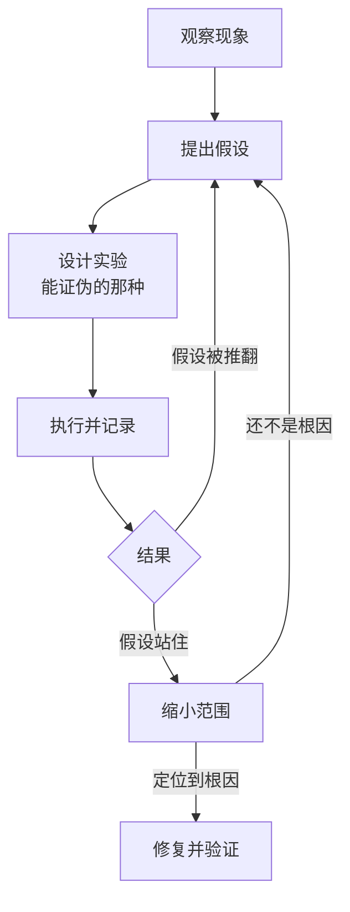

# 排查是一门科学方法

很多人把调试当成一种手感：盯着代码看，灵光一闪，改一行，再跑一次。运气好的时候这很快，运气不好的时候，一个下午过去了，改了七八处，问题消失了，却说不清是哪一处起的作用，更说不清它会不会回来。

这本书想讲的是另一种做法：**把排查当成一系列小实验**。每一步都先写下「我认为是什么」，再设计一个能证明它错的实验，看结果，记下来。这样做第一次会觉得慢，但它有两个好处是手感给不了的：一是不会绕圈子，排除过的东西不会再怀疑一遍；二是结束时你知道根因，而不只是知道「现在好了」。

这一章先讲这套方法的骨架，用 hatch-shelf 导入书籍时的一次真实故障走一遍完整流程，后面九章分别展开每一步的具体技术。

## 为什么靠直觉不够

直觉是有用的，有经验的人第一个猜测常常就是对的。问题出在猜错的时候：

- **确认偏误**：心里认定是 A，就只去找支持 A 的证据。日志里十行有一行像是 A 的迹象，就停下来改 A
- **同时改多处**：改了三个地方，问题没了，于是三处都留着。其中两处是无关的改动，以后会变成谁也不敢删的「神秘代码」
- **把巧合当因果**：重启之后好了，就认定是「内存问题」；其实是重启恰好清掉了一个过期的缓存
- **忘记排除过什么**：两小时后又回去怀疑一小时前已经排除的东西，因为当时没有记下来

这些不是能力问题，是人在压力下的默认行为。对付它们的办法也不是更聪明，而是**换一种流程**，让流程本身帮你挡住这些坑。

## 排查循环

科学方法用在排查上，是一个可以反复转的循环：



每一步都有讲究。

### 观察：先把现象说准

「导入失败了」不是一个可以排查的现象。可以排查的现象要回答这几个问题：

- **具体看到了什么**：报错原文、截图、错误码，不是你对它的转述
- **在什么条件下**：哪台设备、哪个版本、什么数据、做了什么操作
- **什么时候开始的**：一直这样，还是某次更新之后
- **频率**：每次都出，十次出一次，还是只见过一次

报错原文尤其重要。「找不到文件」和 `The file "book.yaml" doesn't exist` 是两条完全不同的线索：后者告诉你是哪个文件、是读还是写时报的、出自哪个 API。

### 假设：一次只提一个，而且要具体

好的假设是**具体到可以被证伪**的。比较一下：

| 不好的假设 | 好的假设 |
|---|---|
| 文件系统有问题 | 写 book.yaml 时它的父目录还不存在 |
| 可能是并发问题 | 两次导入同一本书时，第二次的 rename 覆盖了第一次还没写完的临时目录 |
| 网络不稳定 | 真机连的是 127.0.0.1，而服务只监听了本机回环 |

左边那一列无法被证明是错的，所以也就无法帮你缩小范围。右边每一条都能设计一个实验，几分钟内得到「是」或「不是」。

有多个候选假设时，按两个维度排序：**可能性**和**验证成本**。可能性高又便宜的先验；可能性低但验证只要十秒的也可以先做掉，它能迅速缩小空间。

### 实验：设计一个能推翻假设的实验

实验的价值在于它能告诉你「不是」。如果一个实验无论结果如何你都会觉得「嗯，还是有可能」，那它就没有设计好。

常见的实验手段，后面各章会展开：

- **加观测**：在关键位置打日志、下断点，看变量的实际值（第 4、5 章）
- **改变一个条件**：换一份数据、换一台设备、换一个版本，其他保持不变（第 2、3 章）
- **二分**：把可疑范围切一半，看问题在哪一半（第 3 章）
- **最小化**：删掉无关的部分，直到剩下能复现问题的最小代码（第 2 章）

关键纪律是**一次只改一个变量**。同时换了数据又换了版本，结果变了也不知道是哪个的功劳。

### 记录：写下来才算做过

每做一个实验，记一行：假设是什么、做了什么、看到了什么、结论是什么。不需要好看，一个文本文件就够。第 10 章会给出一个模板，这里先说为什么要记：

- 防止绕圈子：排除过的假设写在那里，不会再回头怀疑
- 中断后能接上：被叫去开会、第二天再看，不用从头想
- 交接时能说清：请别人（或者编码 agent）帮忙时，直接把记录给他
- 事后能复盘：根因找到后，回头看哪一步走了弯路

## 一次完整的排查：book.yaml 不存在

下面这个故障发生在 hatch-shelf 升级到 Expo SDK 58 之后。

> [!WARNING]
> 本节涉及 Expo SDK 58 中 `expo-file-system` 的 `File.write()` 与 `File.writeSync()` 的行为，是根据当时的项目代码和提交记录整理的。Expo 每个 SDK 都可能改动文件系统 API，以 docs.expo.dev 上对应版本的 FileSystem 文档为准。

> [!NOTE]
> 故障、根因和修复取自 hatch-shelf 的真实提交 b675971；下面的排查记录和函数的前后几行按提交信息重构，用来演示流程，不是当时的原样记录。

### 现象

通过局域网传书推一本新书，App 弹出导入失败，报错原文是：

```text
The file "book.yaml" doesn't exist.
```

同样的书在升级前导入正常。换一本书推，也失败，但报的文件名有时不同，偶尔是某个章节的 `.md`。

先把现象说准：

- 什么：写入阶段报某个文件不存在，文件名不固定
- 条件：SDK 58 的 dev client，模拟器和真机都有
- 开始时间：升级 SDK 之后
- 频率：几乎每次，但具体是哪个文件不固定

「文件名不固定」是一条很有价值的线索：如果是某个文件内容有问题，应该每次都是同一个文件。不固定意味着更像是**时序**问题。

### 理解相关代码

hatch-shelf 的导入管线最后一步是「原子写入」：先把所有文件写进一个临时目录，全部写完后把临时目录 rename 成正式目录。这样即使中途失败，书库里也不会出现写了一半的书。

```typescript
export function writeBookAtomically(id: string, files: BookFile[]) {
  const tmp = new Directory(Paths.cache, `import-${id}-${Date.now()}`);
  tmp.create({ intermediates: true });

  for (const f of files) {
    const file = new File(tmp, f.path);
    file.create({ intermediates: true, overwrite: true });
    if (f.bytes !== undefined) file.write(f.bytes);
    else if (f.base64 !== undefined) file.write(f.base64, { encoding: "base64" });
    else file.write(f.text ?? "");
  }

  const target = bookDir(id);
  if (target.exists) target.delete();
  tmp.move(target);
}
```

### 假设与实验

记录如下（这就是第 10 章要讲的排查记录的样子）：

```text
H1 写 book.yaml 时临时目录还没建好
   实验：在 for 循环前打印 tmp.exists
   结果：true
   结论：推翻

H2 解析出来的 files 里根本没有 book.yaml（spec 解析有回归）
   实验：打印 files.map(f => f.path)
   结果：book.yaml 在列表里，位置第一
   结论：推翻

H3 某个 write 在 move 之前还没真正完成
   依据：报错文件名不固定，像是时序问题；SDK 升级说明里提到文件 API 有改动
   实验：在 tmp.move 前打印临时目录里实际存在的文件列表
   结果：列表里缺了几个文件，每次缺的不一样
   结论：站住
```

H3 站住之后，需要再确认一步：是不是 `write()` 变成了异步？查 SDK 58 对应版本的文档和类型定义，`write()` 返回的是 Promise，同步版本是 `writeSync()`。原来的代码没有 `await`，循环一路发起写入，紧接着就 move 了目录，写入落地时目标路径已经不在了，于是报「文件不存在」。

报错发生在 `write` 内部而不是 `move`，这也解释了为什么报的文件名是随机的：哪几个写入在 move 之后才轮到执行，取决于调度。

### 修复与验证

改动只有三行：

```typescript
// SDK 58 起 write() 是异步的；必须同步写完，下面的 rename 才不会抢在写入之前
if (f.bytes !== undefined) file.writeSync(f.bytes);
else if (f.base64 !== undefined) file.writeSync(f.base64, { encoding: "base64" });
else file.writeSync(f.text ?? "");
```

选 `writeSync` 而不是给每个 `write` 加 `await`，是因为这个函数原本就是同步语义，调用方没有准备好处理 Promise；改成异步会让错误的传播路径也跟着变。

验证要回到最初的现象：连续推十本书，全部成功；把临时目录里的文件数和 `files.length` 对比，一致。然后在代码里留下注释说明为什么必须同步，免得以后有人「顺手优化」成异步。

### 回头看

这次排查里，真正起作用的是两点：**把「文件名不固定」当成线索**，以及 **H3 的实验直接看了 move 前那一刻的真实状态**，而不是继续猜。如果一开始就去翻 spec 的解析代码，可能会花一个小时证明一件不相关的事。

另一个值得注意的细节：项目开着 `no-floating-promises` 的 lint 规则，但这次没有拦住。原因是升级前 `write` 返回 `void`，代码写的时候没有 Promise；升级之后类型变了，但当时没有重新跑 lint。**依赖升级之后全量跑一遍类型检查和 lint**，本身就是一种便宜的实验。

## 先排除便宜的可能

科学方法不等于每次都从零开始推理。有一批「便宜检查」值得在动脑之前先过一遍，它们排除问题的成本只有几十秒：

| 检查 | 排除什么 |
|---|---|
| 跑的真的是新代码吗 | Metro 缓存、旧的 dev client、没重启的进程、浏览器缓存 |
| 连的是哪个环境 | 本地 / 测试 / 线上的数据库或接口地址弄混 |
| 依赖装对了吗 | lockfile 变了没 `pnpm install`，原生依赖变了没重新构建 |
| 构建产物是新的吗 | hatch-shelf 改了 `reader-web/` 没跑 `build:assets` |
| 报错是第一条吗 | 后面的报错常常是第一条的连锁反应 |
| 磁盘、内存满了吗 | 服务器上各种奇怪错误的共同来源 |

hatch-shelf 的项目说明里写着「改了 `reader-web/` 后要重新 `build:assets`」，这句话的存在本身就说明：曾经有人对着一个不会变的阅读器改了半天代码。

## 什么时候停下来换方法

循环转了几圈还没有进展，通常是以下几种情况之一：

- **现象没说准**：回到第一步，重新收集报错原文和条件。很多时候是把两个不同的问题当成了一个
- **复现不稳定**：每次实验的结果有随机性，结论就不可靠。先解决复现（第 2 章）
- **假设空间太大**：一个个猜猜不完，改用二分（第 3 章），它不需要你猜对
- **观测不够**：你看不到关键时刻的状态，再怎么推理都是猜。先加观测（第 4、5 章）
- **太累了**：这是真的。离开半小时，回来先读一遍记录，常常一眼看出漏了什么

## 修复也是一次实验

找到根因之后的修复同样要按实验对待：

1. **先写一个能复现问题的测试**，确认它在修复前失败
2. 修复
3. 确认测试通过，并且**原来的现象消失**（不是测试通过就算完）
4. 想一想同样的根因还可能出现在哪里。`write()` 变成异步这件事，项目里别的地方还有没有没 await 的调用

第 4 步常被省略，但它是一次排查最大的收益：同一个根因往往不止一处。

## 本章要点

- 排查是一系列小实验：观察、假设、实验、记录，循环到根因为止
- 现象要说准：报错原文、条件、开始时间、频率；「不固定」本身就是线索
- 假设要具体到能被证伪，一次只提一个、只改一个变量
- 实验的价值在于它能说「不是」；直接观察关键时刻的真实状态胜过推理
- 每一步写下来，防止绕圈子，也方便交接和复盘
- 动脑之前先过一遍便宜检查：跑的是不是新代码、连的是哪个环境
- 修复先写失败的测试，再找同一根因的其他出现位置
