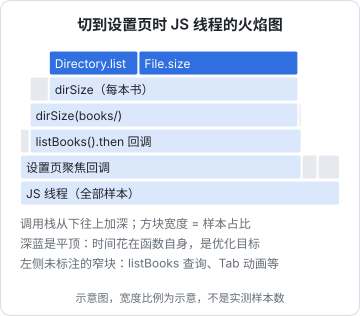

# 性能问题与火焰图

性能问题和功能问题的排查有一个本质区别：功能问题有明确的对错，性能问题只有快慢。「有点卡」「好像变慢了」不是可以排查的现象，所以第一步永远是**把慢变成数字**。

有了数字之后，排查的方法和前几章一样：假设、实验、记录。不同的是工具，性能问题最重要的工具是剖析器（profiler）和它画出来的火焰图。这一章讲怎么测量、怎么读火焰图，然后用 hatch-shelf 设置页的一次卡顿走一遍完整过程。

Node 剖析工具的细节在[《TS 与 Node 进阶》的性能剖析一章](../ts-node-advanced/08-profiling.md)，React 渲染性能在[《React 19 原理与模式》的性能排查一章](../react-internals/09-performance.md)，服务端分层定位在[《可观测性与性能》的瓶颈定位一章](../observability-performance/08-bottleneck-analysis.md)。这一章讲的是贯穿它们的方法。

## 先把慢变成数字

### 定义要测什么

「慢」要具体到一个可测量的区间：

| 现象 | 要测的区间 |
|---|---|
| 进书慢 | 从点击书封到第一屏文字显示 |
| 切 Tab 卡 | 从点击 Tab 到切换动画结束，期间的掉帧数 |
| 接口慢 | 服务端从收到请求到发出响应，按 p50 / p95 |
| 冷启动慢 | 从点开图标到首页可交互 |

定义清楚之后，在代码里打点：

```typescript
const t0 = performance.now();
await openBook(id);
console.log(`[perf] openBook ${id} ${(performance.now() - t0).toFixed(0)}ms`);
```

### 多测几次，看分布

单次测量的波动很大，尤其在手机上：JIT 预热、GC、系统后台任务都会影响结果。至少测五到十次，看中位数和最大值。

改动前后的对比要**在相同条件下**：同一台设备、同一份数据、同样的步骤、同样是 Release 或同样是 Debug 构建。Debug 构建比 Release 慢得多，而且慢的地方不一样，**性能结论最终要在 Release 构建上确认**。

### 先分清是哪一类慢

| 类型 | 特征 | 用什么看 |
|---|---|---|
| CPU 忙 | CPU 占满，单线程卡住 | CPU 剖析、火焰图 |
| 等 I/O | CPU 闲，在等磁盘、网络、数据库 | 链路追踪、请求瀑布图、慢查询日志 |
| 等锁或排队 | CPU 闲，请求在排队 | 连接池指标、队列长度 |
| 渲染多 | 前端或 RN 组件重复渲染 | React Profiler |
| 内存压力 | GC 频繁，伴随卡顿 | 内存时间线（第 7 章） |

火焰图主要回答第一类：**CPU 时间花在了哪里**。如果是在等 I/O，火焰图上会是一片空白或者很矮，这本身也是信息。

## 读火焰图

### 采样剖析器在做什么

剖析器每隔一小段时间（比如 1 毫秒）记一次「当前的调用栈是什么」。跑了一秒就有一千个调用栈样本。把相同的调用栈合并、按调用关系堆叠起来，就是火焰图。



### 读法

- **横轴是时间占比，不是时间顺序**：一个方块越宽，它（包括它调用的函数）在样本里出现得越多，花的 CPU 时间越多。左右顺序通常按字母排序或按调用顺序，没有含义
- **纵轴是调用栈深度**：下面的函数调用了上面的函数
- **看宽的「平顶」**：一个方块很宽、而它上面没有同样宽的子方块，说明时间花在这个函数**自身**（self time）。这是优化的目标
- **看重复的塔**：同一个函数在多个位置出现，说明它被很多地方调用，把各处加起来才是它的总成本

Chrome DevTools 和 React Native DevTools 的 Performance 面板显示的是另一种图：**火焰图表（flame chart）**，横轴是真实的时间顺序。两者用途不同：火焰图表看「什么时候发生了什么」，适合找某一次卡顿；火焰图看「总体上时间花在哪」，适合找热点。DevTools 里的 Bottom-Up 视图按自身时间排序，相当于火焰图的「平顶」列表。

## 案例：切到设置页时 Tab 栏卡一下

> [!NOTE]
> 问题和修复代码取自 hatch-shelf 的真实提交 3a27cbf；下面的耗时数字和火焰图是示例，用来演示测量和读图的过程，不是当时的实测数据。

### 现象

hatch-shelf 底部有三个 Tab：书架、传书、设置。在书库有一百多本书的设备上，从书架切到设置时，Tab 栏的选中滑块动画会明显顿一下，大约半秒后才滑过去。切到其他 Tab 没有这个问题。书少的时候也不明显。

### 测量

先把「顿一下」变成数字。在设置页的聚焦回调前后打点，同时打开 React Native DevTools 的 Performance 面板录一段：

```text
[perf] settings focus callback 412ms
[perf] settings focus callback 398ms
[perf] settings focus callback 431ms
```

（数字为示例。）切回书架再切过来，每次都是几百毫秒。录制里同一段时间 JS 线程被一个长任务占满。

### 假设

设置页聚焦时做了两件事：查 SQLite 拿书的数量，遍历书库目录统计占用空间，显示成「128 本 · 46.3 MB」。

- H1：SQLite 查询慢
- H2：遍历目录统计大小慢
- H3：设置页本身的渲染慢

### 实验

看火焰图（就是上面那张）：宽度几乎全部落在 `dirSize` 的递归里，`Directory.list` 和 `File.size` 是平顶。`listBooks` 是一条细线，渲染相关的帧也很窄。H2 站住，H1、H3 可以排除。

为了确认，把 `dirSize` 临时换成返回 0：聚焦回调降到几毫秒，Tab 栏不再顿。

### 根因

原来的代码是这样的：

```typescript
function dirSize(dir: Directory): number {
  return dir.list().reduce((sum, e) => sum + (e instanceof File ? (e.size ?? 0) : dirSize(e)), 0);
}

useFocusEffect(
  useCallback(() => {
    void listBooks().then((books) => {
      const size = booksDir.exists ? dirSize(booksDir) : 0;
      setLibrary(`${books.length} 本 · ${formatSize(size)}`);
    });
  }, []),
);
```

两个问题叠在一起：

1. **同步遍历上千个文件**：每本书有十来个章节和若干图片，一百多本就是上千个文件，每个文件的 `size` 都是一次同步的原生调用。整个过程在 JS 线程上同步执行
2. **每次聚焦都算**：`useFocusEffect` 在每次切到这个 Tab 时都会执行，而 Tab 栏滑块的动画也跑在 JS 线程上，于是被堵住了

书少的时候这段代码只要几十毫秒，所以开发时没有察觉。这也是第 2 章说的：**用接近真实规模的数据测试**。

### 修复

两处改动，分别针对两个问题：

```typescript
// 统计书库大小要走遍 books/ 下上千个文件，会卡住 JS 线程（Tab 栏滑块的动画也在 JS 线程上），
// 所以不在每次切过来时算：打开时算一次，之后只在导入、删除、重建索引后重算
const loadLibrary = useCallback(() => {
  void listBooks().then((books) => {
    const size = booksDir.exists ? (booksDir.size ?? 0) : 0;
    setLibrary(`${books.length} 本 · ${formatSize(size)}`);
  });
}, []);
useEffect(loadLibrary, [loadLibrary]);
useLibraryChanged(loadLibrary);
```

- 目录大小改用文件系统 API 自带的 `Directory.size`，由原生侧一次算完，不再在 JS 里逐个文件调用
- 不在每次聚焦时计算，只在页面挂载时和书库变化（导入、删除、重建索引）时计算

> [!WARNING]
> `Directory.size` 等 `expo-file-system` API 的行为按 Expo SDK 58 整理，以 docs.expo.dev 对应版本的 FileSystem 文档为准。

修复后再测：聚焦回调降到几毫秒，Tab 动画不再顿。录一次 Performance，长任务消失。

### 回头看

这次的关键是**没有凭直觉去优化**。直觉上 SQLite 查询更可疑（「数据库总是慢的」），如果先去给查询加缓存，会花一个小时得到零收益。火焰图在一分钟内就把注意力引到了正确的地方。

## Node 服务端的 CPU 剖析

hatch-counter 的某个接口慢时，先用日志或链路追踪确认是 CPU 忙还是在等数据库。如果是 CPU 忙，用 Node 自带的剖析：

```bash
# 启动时开启，进程退出时写出 .cpuprofile 文件
node --cpu-prof --cpu-prof-dir=/tmp/prof dist/main.js

# 用压测工具打几十秒流量，然后正常退出进程
```

> [!WARNING]
> `--cpu-prof` 等参数按 Node.js 22/24 整理，以 nodejs.org 对应版本的 CLI 文档为准。

生成的 `.cpuprofile` 文件可以拖进 Chrome DevTools 的 Performance 面板，或者 VS Code 直接打开，都能看火焰图。

对运行中的进程，用上一章的 inspector 连上去，在 DevTools 的 Performance 或 Profiler 面板里录一段。生产环境做这件事要谨慎：剖析本身有开销，选流量低的时候录几十秒就够。

服务端常见的 CPU 热点：

- **JSON 序列化大对象**：一次返回几万行数据
- **同步的加密和压缩**：`bcrypt` 的同步版本、`zlib` 的同步方法
- **正则回溯**：某些输入让正则表达式的匹配时间指数增长
- **在循环里做本该在数据库里做的事**：取出全部数据再在 JS 里过滤、聚合

最后一种在火焰图上看起来是 JS 热点，但正确的修复是改 SQL。

## 前端和 RN 的渲染性能

React 的性能问题多数不是某个函数慢，而是**渲染次数太多**。火焰图上会看到很多窄的、重复的组件渲染帧。这时用 React Profiler 更直接：它告诉你每次提交渲染了哪些组件、为什么渲染（props 变了、state 变了、父组件渲染了）。

RN 上还要区分两个线程：

- **JS 线程**卡：业务逻辑、React 渲染、JS 驱动的动画受影响。上面的案例就是这种
- **UI 线程**卡：原生渲染、滚动、原生驱动的动画受影响。通常是视图层级太深、图片解码太大

dev client 的开发菜单里有性能监视器，可以实时看两个线程的帧率，先判断是哪个线程的问题，再选工具。RN 动画性能见[《React Native 与 Expo》的性能一章](../rn-expo/09-performance-reanimated.md)。

## 测量本身会改变结果

剖析和打点都有开销，有时候开销大到足以改变结论：

- **Debug 构建**：RN 的 Debug 构建里 JS 没有经过优化编译，还开着各种开发期检查，某些代码可能比 Release 慢几倍，而另一些几乎不变。在 Debug 里看到的热点，到 Release 里可能就不是热点了
- **热路径里的日志**：在一个每秒执行几千次的函数里加 `console.log`，日志本身可能就成了最大的开销。RN 开发模式下的日志还要传到 Metro 终端，代价更高
- **剖析器的采样间隔**：采样太稀会漏掉短函数，太密开销大。默认值一般够用，只有在找毫秒级以下的热点时才需要调
- **DevTools 本身**：开着 React DevTools 时，每次渲染都要额外记录信息，渲染性能的绝对数字会偏慢

所以剖析的结论用来**找方向**，最终的「快了多少」要在 Release 构建、关掉剖析器、去掉临时日志之后重新测一次。

## 性能排查的几条纪律

- **先测量再优化**：没有数字的优化是猜
- **一次只改一处，改完重新测**：同时改三处，不知道哪一处有效，也不知道有没有哪一处让它变慢了
- **在接近真实的条件下测**：真实的数据量、真实的设备、Release 构建
- **优化最宽的那块**：一个函数占 5% 的时间，把它优化到零，整体也只快 5%
- **留下基准**：把测量方法和结果写进排查记录，下次退化时有对比

## 本章要点

- 性能问题先把慢变成数字：定义区间、打点、多测几次看分布，最终在 Release 构建上确认
- 先分清是 CPU 忙、等 I/O、排队还是渲染多，再选工具；火焰图回答 CPU 时间花在哪
- 火焰图横轴是时间占比不是时间顺序，找宽的平顶；flame chart 横轴才是时间
- hatch-shelf 设置页卡顿：每次聚焦在 JS 线程上同步遍历上千个文件，堵住了 Tab 动画
- 修复是让原生侧计算、并且只在书库变化时计算；直觉上可疑的 SQLite 查询其实只占一条细线
- Node 用 `--cpu-prof` 或 inspector 录制；React 用 Profiler 看渲染次数；RN 先分 JS 线程还是 UI 线程
