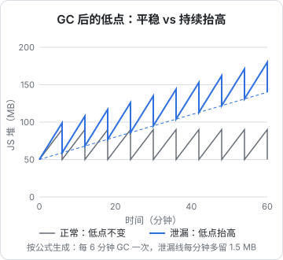

# 内存泄漏

内存泄漏是最考验排查方法的一类问题。它没有报错，也不在某一行代码上出错，表现只是「跑久了变慢」「过一阵就崩」。等到它真的崩溃时，留下的堆栈指向的是最后一次分配内存的地方，和泄漏的源头毫无关系。

这一章讲怎么确认是不是泄漏、怎么用堆快照对比找到泄漏的对象、怎么顺着引用链找到是谁拿着它不放。V8 的堆结构、分代回收和 Node 里的常见泄漏模式，在[《TS 与 Node 进阶》的内存一章](../ts-node-advanced/06-memory-gc-leaks.md)里有详细的讲解，这里侧重排查的过程，以及前端、Electron 渲染进程和 React Native 里的情况。

## 有垃圾回收，为什么还会泄漏

JavaScript 有垃圾回收，回收的标准是**可达性**：从根（全局对象、当前调用栈、活着的闭包）出发能顺着引用走到的对象，都不会被回收。

所以 JS 里的泄漏不是「忘了释放」，而是「**不再需要的对象，仍然被某个活着的东西引用着**」。常见的「活着的东西」：

- 模块级的 `Map`、数组、单例对象
- 全局事件总线、`ipcRenderer`、`window` 上的监听器
- 没有清除的定时器
- 一个长寿闭包，顺带捕获了一个大对象

找泄漏，就是找这条从根到泄漏对象的引用链。

## 先确认是不是泄漏

「内存很高」不等于泄漏。一个缓存了大量数据的服务内存高是正常的；一个页面打开大表格时内存涨上去也是正常的。泄漏的特征是：**同样的操作重复做，内存只涨不回**。



判断方法：

1. 找一个可以重复的操作：切换页面、打开关闭对话框、发一个请求
2. 重复做 N 次，每次做完手动触发一次 GC（DevTools 的 Memory 面板有垃圾桶按钮）
3. 看 GC 之后的内存是否回到基线

看的是**每次 GC 之后的低点**，而不是峰值。峰值高只说明一次分配得多；低点一路抬高，才说明有东西没被回收。

在 Node 里可以直接打印：

```typescript
setInterval(() => {
  const m = process.memoryUsage();
  console.log(
    `[mem] rss=${(m.rss / 1048576).toFixed(0)}MB heapUsed=${(m.heapUsed / 1048576).toFixed(0)}MB ` +
      `external=${(m.external / 1048576).toFixed(0)}MB`,
  );
}, 60_000).unref();
```

`heapUsed` 涨说明是 JS 对象泄漏；`heapUsed` 平稳但 `rss` 涨，问题可能在原生内存（Buffer、原生模块、图片解码），堆快照看不到它。

## 三快照法

确认是泄漏之后，用堆快照找到泄漏的对象。最有效的方法是**三快照对比**：

1. 先做一次那个操作让它预热（排除首次加载、懒初始化的干扰），然后 GC，拍**快照 1**
2. 重复操作若干次（比如 10 次），GC，拍**快照 2**
3. 再重复同样次数，GC，拍**快照 3**

然后在快照 3 里选「Objects allocated between Snapshot 1 and Snapshot 2」（快照 1 和 2 之间分配、到快照 3 还活着的对象）。这些对象在第一轮操作中被创建，经历了第二轮操作和多次 GC 还活着，几乎可以肯定是泄漏。

在这个视图里：

- 按 **Retained Size** 排序，找占内存多的
- 找**数量是操作次数整数倍**的构造函数：操作了 10 次，某个类型正好多了 10 个、20 个，这就是嫌疑对象
- 点开一个实例，看下面的 **Retainers** 面板：它是被谁引用着的，一路往上直到根

Retainers 面板里的那条链，就是泄漏的完整解释。

## 案例：桌面端开一整天越来越卡

> [!NOTE]
> 以下为示例场景：项目背景取自 hatch-counter 的 Electron 桌面端，故障、代码、内存数字和快照输出都是为演示三快照法编写的，不是真实发生过的排查。

### 现象

hatch-counter 的桌面端是 Electron 应用，店里的电脑一开就是一整天。假设店主反馈：早上开机时很流畅，到了晚上切页面明显变慢，有时候窗口会白一下。关掉重开就好了。

「重开就好」「越用越慢」，是泄漏的典型描述。

### 确认

在开发环境里打开渲染进程的 DevTools，进入 Memory 面板。选一个日常最常用的操作：在「库存」和「开支」两个页面之间来回切换。

每切 10 个来回手动 GC 一次，记录 JS 堆大小：

```text
基线（打开后）    48 MB
10 个来回后      61 MB
20 个来回后      74 MB
30 个来回后      88 MB
```

每 10 个来回涨 13 MB 左右，GC 后不回落。确认是泄漏，而且和页面切换有关。

### 三快照

按三快照法：切一次预热、GC、快照 1；切 10 个来回、GC、快照 2；再切 10 个来回、GC、快照 3。

在快照 3 里看快照 1 和 2 之间分配的对象，按 Retained Size 排序，排在前面的是：

```text
Constructor              Count   Retained Size
(closure)                  20       12.4 MB
Array                      40       12.1 MB
StockRow                 4860        9.8 MB
```

20 个闭包，正好是 10 个来回里进入库存页的次数的两倍。点开其中一个闭包看 Retainers：

```text
(closure) in StockPage
  ← [3] in listeners of EventEmitter
  ← _events.store-changed of ipcRenderer
  ← ipcRenderer in preload
  ← (global)
```

链条很清楚：`ipcRenderer` 上 `store-changed` 事件的监听器数组里，挂着库存页组件里的闭包，闭包又引用着整张库存表的数据。每进一次库存页加两个监听器，离开时没有移除。

示例里假设控制台早就有一条被忽略的警告：

```text
MaxListenersExceededWarning: Possible EventEmitter memory leak detected.
11 store-changed listeners added to [EventEmitter]. MaxListeners is 10.
```

> [!WARNING]
> 这个 `MaxListenersExceededWarning` 是否会出现、出现在哪个控制台，取决于 Electron 版本以及 preload 是否运行在沙箱里，写作时没有实测核实。以 electronjs.org 上 `ipcRenderer` 和进程沙箱的文档为准；不要因为没看到这条警告就排除监听器泄漏。

### 根因

preload 里暴露给页面的订阅接口是这样写的：

```typescript
contextBridge.exposeInMainWorld("api", {
  onStoreChanged(cb: (blocks: string[]) => void) {
    ipcRenderer.on("store-changed", (_e, blocks) => cb(blocks));
  },
});
```

页面里这样用：

```tsx
useEffect(() => {
  window.api.onStoreChanged((blocks) => {
    if (blocks.includes("stock")) void refetch();
  });
}, [refetch]);
```

两个问题：

1. preload 的接口**没有返回取消订阅的方法**，而且包了一层匿名函数，页面就算想移除也拿不到那个函数引用
2. 页面的 `useEffect` 没有清理函数；而 `refetch` 在每次数据变化后会换一个新引用，effect 重跑一次就又挂一个监听器，所以每进一次页面是两个而不是一个

### 修复

preload 返回取消函数：

```typescript
contextBridge.exposeInMainWorld("api", {
  onStoreChanged(cb: (blocks: string[]) => void) {
    const listener = (_e: Electron.IpcRendererEvent, blocks: string[]) => cb(blocks);
    ipcRenderer.on("store-changed", listener);
    return () => {
      ipcRenderer.removeListener("store-changed", listener);
    };
  },
});
```

页面在清理时调用它：

```tsx
useEffect(() => {
  return window.api.onStoreChanged((blocks) => {
    if (blocks.includes("stock")) void refetch();
  });
}, [refetch]);
```

修复后重复测量：30 个来回后 JS 堆回到 50 MB 左右，`ipcRenderer` 上的监听器数量稳定在 1。再把「preload 里所有 `on` 类接口必须返回取消函数」写进项目约定，并检查其他订阅接口有没有同样的问题。

### 回头看

那条 `MaxListenersExceededWarning` 其实已经指向了答案。**警告不是噪音**，尤其是名字里带着 leak 的警告。这也是为什么第 4 章说日志要从第一条看起。

## 前端和 RN 里常见的泄漏

| 模式 | 例子 | 修法 |
|---|---|---|
| effect 没有清理 | 订阅、`addEventListener`、`setInterval` 写在 `useEffect` 里没有返回清理函数 | 每个订阅类 effect 都返回清理函数 |
| 模块级缓存 | 组件外的 `const cache = new Map()`，按 id 存数据，只增不删 | 加上限，或改用组件状态 / 查询库的缓存 |
| 卸载后的异步回调 | 请求回来时组件已卸载，回调还拿着整个组件的闭包 | 用 `AbortController` 取消请求 |
| 分离的 DOM 节点 | 从页面移除的节点仍被 JS 变量引用 | 快照里搜 `Detached`，看谁引用着 |
| 第三方库实例 | 图表、编辑器、地图实例没有调用 `destroy()` | 在清理函数里销毁 |

### React Native

RN 上的 JS 堆在 Hermes 里，用 React Native DevTools 的 Memory 面板拍快照，方法和上面完全一样。另外几点要注意：

- **原生内存不在 JS 堆里**：图片解码后的位图、原生模块持有的缓冲区，在 JS 快照里看不到，要用 Xcode 的 Instruments（Allocations、Leaks）看
- **WebView 有自己的进程**：hatch-shelf 阅读器里的内存问题在 Safari Web Inspector 里看；WKWebView 的内容进程在内存紧张时会被系统杀掉，表现是白屏，处理方式见[《React Native 与 Expo》的 WebView 一章](../rn-expo/07-webview-bridge.md#webview-进程会被回收)
- **列表**：长列表不用虚拟化，所有行的组件都常驻内存。这不是泄漏，但表现很像

## 像泄漏但不是泄漏

内存上涨不一定是泄漏，排查前先排除这几种情况：

| 情况 | 特征 | 怎么区分 |
|---|---|---|
| 缓存在预热 | 启动后一段时间内上涨，然后稳定在某个水平 | 拉长观察时间，看是否趋于平稳 |
| 堆上限很高、GC 不着急 | 内存涨到一定程度才回收一次，峰值很高 | 手动 GC 后看低点 |
| 长列表没有虚拟化 | 内存与当前显示的数据量成正比 | 关掉页面后内存回落就不是泄漏 |
| 原生内存碎片 | `rss` 不回落，但 `heapUsed` 平稳 | 看 JS 堆，而不是进程总内存 |

只有「重复同样的操作，GC 之后的低点持续抬高」才是需要排查的泄漏。其他情况可能需要调优，但方法不同。

## Node 服务端

服务端泄漏的表现通常是容器内存一路上涨，直到被 OOM killer 杀掉重启，然后再涨。看监控里的内存曲线，是锯齿状的周期性重启就基本确定了。

> [!WARNING]
> 本节 `--heapsnapshot-signal`、`v8.writeHeapSnapshot()` 等参数和 API 按 Node.js 22/24 整理，以 nodejs.org 对应版本的文档为准。

线上拍快照的方法：

```bash
# 启动时注册信号，之后可以随时触发
node --heapsnapshot-signal=SIGUSR2 dist/main.js

# 需要时发送信号，快照写到进程的工作目录
kill -USR2 <pid>
```

或者在代码里提供一个只有管理员能调用的内部接口，调用 `v8.writeHeapSnapshot()`。

> [!CAUTION]
> 拍堆快照时进程会暂停，耗时与堆大小相关，几百 MB 的堆可能停顿数秒，而且需要额外的内存。生产环境在低峰时做，并确认容器的内存上限留有余量，否则拍快照本身就会触发 OOM。

拍两三个间隔一段时间的快照，下载到本地用 Chrome DevTools 打开对比，方法和三快照法一样。服务端最常见的泄漏是无上限的进程内缓存和每请求挂到全局对象上的监听器，具体的模式和修法见[《TS 与 Node 进阶》的内存一章](../ts-node-advanced/06-memory-gc-leaks.md)。

## 排查纪律

- **先确认再排查**：用重复操作加 GC 后的低点确认是泄漏，而不是正常的高内存
- **每次拍快照前手动 GC**：否则快照里全是还没来得及回收的垃圾
- **在开发构建里排查，在生产构建里确认**：开发构建有额外的对象（React DevTools、HMR），会干扰判断
- **看数量的整数倍**：操作 N 次多出 N 或 2N 个对象，是最强的信号
- **修完重新测量**：曲线变平才算修好

## 本章要点

- JS 的泄漏是不再需要的对象仍被活着的东西引用；找泄漏就是找从根到它的引用链
- 确认泄漏看 GC 后的低点：同样的操作重复做，低点持续抬高
- 三快照法：预热后拍 1，重复操作拍 2，再重复拍 3；看 1 和 2 之间分配、到 3 还活着的对象
- 找数量是操作次数整数倍的对象，用 Retainers 面板顺着引用链找到根
- Electron 案例：preload 订阅接口不返回取消函数，页面 effect 不清理，每次进页面挂两个监听器
- `MaxListenersExceededWarning` 不是噪音；`heapUsed` 平稳而 `rss` 涨要看原生内存
- 生产环境拍快照会暂停进程并占用额外内存，低峰时做

## 动手练习

1. **复现监听器泄漏**：下面的脚本模拟「每进一次页面挂一个监听器」。用 `node --expose-gc leak.mjs` 运行，看每轮 GC 后的 `heapUsed` 和监听器数量。

   ```javascript
   import { EventEmitter } from "node:events";
   const bus = new EventEmitter();
   function openPage() {
     const rows = new Array(100_000).fill(Math.random());
     bus.on("store-changed", () => rows.length);
   }
   for (let round = 1; round <= 5; round++) {
     for (let i = 0; i < 20; i++) openPage();
     globalThis.gc();
     const mb = (process.memoryUsage().heapUsed / 1048576).toFixed(0);
     console.log(`第 ${round} 轮 heapUsed=${mb}MB listeners=${bus.listenerCount("store-changed")}`);
   }
   ```

   验证：每轮 `heapUsed` 涨十几 MB、`listeners` 依次是 20、40、60……；stderr 里出现 `MaxListenersExceededWarning: Possible EventEmitter memory leak detected. 11 store-changed listeners added`。

   参考答案：让 `openPage` 返回 `() => bus.off("store-changed", listener)`，每轮结束时调用这些取消函数，`heapUsed` 就会停在同一水平、`listeners` 回到 0。GC 后的低点不再抬高，才算修好。

2. **三快照找到嫌疑对象**：把练习 1 改成每轮之间 `await new Promise((r) => setTimeout(r, 5000))`，用 `node --inspect --expose-gc leak.mjs` 运行，在 `chrome://inspect` 里连上，按本章的三快照法在第 1、2、3 轮之后各拍一张。

   验证：在快照 3 里选「Objects allocated between Snapshot 1 and Snapshot 2」，能看到数量是 20 的整数倍的 `(closure)` 和 `Array`；点开一个闭包，Retainers 一路通到 `EventEmitter` 的 `_events`。

   参考答案：数量是操作次数的整数倍，是最强的信号；Retainers 那条链就是泄漏的完整解释，和本章 `ipcRenderer` 的链条形状一样。

3. **区分 JS 堆和原生内存**：运行下面的脚本（`node --expose-gc native.mjs`），看三个数字各自怎么变。

   ```javascript
   const keep = [];
   for (let i = 1; i <= 5; i++) {
     keep.push(Buffer.alloc(50 * 1048576, 1));
     globalThis.gc();
     const m = process.memoryUsage();
     const f = (x) => (x / 1048576).toFixed(0);
     console.log(`heapUsed=${f(m.heapUsed)}MB external=${f(m.external)}MB rss=${f(m.rss)}MB`);
   }
   ```

   验证：`heapUsed` 一直只有几 MB，`external` 和 `rss` 每次涨约 50 MB。

   参考答案：Buffer 的内容在 V8 堆外，堆快照里只看得到一个很小的包装对象。只看 `heapUsed` 会以为没有泄漏；`rss` 涨而 `heapUsed` 平稳，就要去查 Buffer、原生模块、图片解码这类原生内存。
