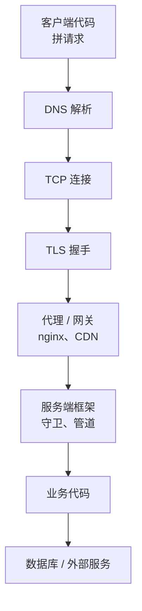

# 网络与跨端问题

全栈开发者的代码分布在好几个地方：手机上的 RN、手机里的 WebView、桌面上的 Electron、浏览器、服务器上的 NestJS、边缘的 Cloudflare Worker。一个功能出问题，原因可能在任何一端，也可能在它们之间的网络上。

这类问题排查起来最容易出现的情况是**互相怀疑**：前端觉得是接口的问题，后端觉得是前端传错了参数，而真正的原因是中间某一层。这一章讲的核心方法是**分层切开**：在每一层的边界上确认「到这里为止是对的」，把问题限定在一层之内，再用那一层的工具深入。

网络工具（dig、curl、mtr、tcpdump）的详细用法在[《计算机网络》的排障一章](../networking/09-troubleshooting.md)，这里讲怎么把它们和应用层的排查串起来。

## 分层切开

一个请求从 App 到服务端，要依次经过这些层：



排查时从两头往中间逼近，每一层问一个能明确回答的问题：

| 层 | 问题 | 怎么确认 |
|---|---|---|
| 客户端 | 请求真的发出去了吗？URL、方法、头、体对吗 | DevTools Network、日志里打印完整请求 |
| DNS | 域名解析到哪个 IP | `dig api.example.com` |
| TCP | 端口通吗 | `curl -v` 看是否 Connected、`nc -zv host port` |
| TLS | 证书对吗、握手成功吗 | `curl -v` 看证书信息 |
| 网关 | 请求到 nginx 了吗、转发了吗 | nginx 的 access log 和 error log |
| 框架 | 进了哪个路由、被哪个守卫拦了 | 应用日志里的请求 id |
| 业务 | 参数解析后是什么、返回了什么 | 日志、断点 |
| 下游 | 数据库查询是否执行、结果是什么 | 慢查询日志、`pg_stat_activity` |

最有用的单个技巧是**脱离客户端，用 curl 重放请求**。在 DevTools 的 Network 面板里右键请求，「Copy as cURL」，在终端里执行：

- 结果正常：问题在客户端（请求时机、状态、渲染）
- 结果异常：问题在服务端或网络，客户端可以不用看了

然后改 curl 的参数逐个排除：去掉某个头、换个参数值、直接打服务器 IP 绕过 CDN、在服务器本机打 `localhost` 绕过 nginx。每一次都是在把问题往一层里收。

## 案例：模拟器能连，真机连不上

> [!NOTE]
> 修复取自 hatch-recordwall 的真实提交 985b418（把本地 Worker 的启动命令改成 `wrangler dev --ip 0.0.0.0`）；该提交没有留下排查过程，下面的地址、假设和实验记录是按修复内容重构的示例。

### 现象

hatch-recordwall 的曲库服务是一个 Cloudflare Worker，开发时在 Mac 上用 wrangler 起本地版本，App 连本地曲库调试。在 iOS 模拟器里一切正常；换成真机，App 显示「连不上曲库」，请求超时。

### 分层

先说准现象：真机和 Mac 在同一个 Wi-Fi 下，App 里配置的曲库地址是 Mac 的局域网 IP，`http://192.168.1.23:8787`。

从客户端往服务端逐层确认：

```text
H1 App 拼的地址不对
   实验：在 App 里把请求 URL 打到日志
   结果：http://192.168.1.23:8787/v1/channels，与预期一致
   结论：推翻

H2 手机到 Mac 的网络不通
   实验：手机 Safari 打开 http://192.168.1.23:8787/v1/channels
   结果：转圈后「无法连接服务器」
   结论：网络层确实不通，问题与 App 无关

H3 Mac 的防火墙拦了
   实验：查看系统设置里的防火墙
   结果：防火墙是关的
   结论：推翻

H4 服务只监听了本机回环
   实验：在 Mac 上 lsof -iTCP:8787 -sTCP:LISTEN
   结果：localhost:8787 (LISTEN)，只在回环地址上
   结论：站住
```

H2 是这次排查的转折点：用手机自带的 Safari 访问同一个地址，一步就把 App 的嫌疑排除了。之后的问题就只剩「Mac 上的服务为什么不接受来自局域网的连接」。

`lsof` 的输出说明了一切：按写作时的 wrangler 版本，本地开发服务器默认只监听本机。模拟器跑在 Mac 上，访问的是 Mac 自己，所以能通；真机是从外部访问，连接被拒。

> [!WARNING]
> wrangler `dev` 的默认监听地址和 `--ip` 参数按写作时的 wrangler 版本整理，以 developers.cloudflare.com 上 Wrangler 命令文档为准。

### 修复

开发脚本里让本地 Worker 监听所有网卡：

```json
{
  "scripts": {
    "dev": "wrangler dev --ip 0.0.0.0"
  }
}
```

监听 `0.0.0.0` 意味着同一个局域网里的任何设备都能访问它。在家里的网络问题不大；在咖啡馆的公共 Wi-Fi 上要意识到这一点。项目后来还在 iOS 发版脚本里加了一道拦截（提交 4d2fc03）：真机调试时会在 `.env.local` 里用环境变量把曲库地址指向局域网的 Worker，发版时如果这个变量还在，脚本直接报错退出，免得家里那台机器的地址被写进正式包。

### 回头看

这个问题的根因很简单，但如果一开始就在 App 代码里找（请求库的超时设置、iOS 的网络权限、ATS 配置），可以花掉很长时间。**先用最简单的客户端（浏览器、curl）确认网络层是否通**，能直接排除一大块。

## 移动端特有的网络问题

手机上的网络比桌面复杂，几个常见的坑：

> [!WARNING]
> 本节 iOS 的 App Transport Security、本地网络权限、Android 的明文流量限制等平台规则按 iOS 26–27（Apple 从 2025 年起改用年份命名，iOS 18 之后是 iOS 26）/ Android 15–16 前后整理，以 developer.apple.com 和 developer.android.com 的最新文档为准。

- **明文 HTTP 被拦**：iOS 的 ATS 默认要求 HTTPS，Android 9 起默认禁止明文流量。开发时连局域网的 `http://` 地址需要在配置里放开，Expo 项目写在 `app.json` 或 config plugin 里
- **本地网络权限**：iOS 14 起，App 访问局域网设备会弹「允许查找本地网络上的设备」，用户拒绝之后局域网请求静默失败。hatch-shelf 的传书页面在手机上起了一个 HTTP 服务，也受这个权限影响
- **`localhost` 的含义**：在模拟器里是 Mac，在 Android 模拟器里是模拟器自己（访问宿主机要用 `10.0.2.2`），在真机上是手机自己
- **网络切换**：Wi-Fi 和蜂窝之间切换时，进行中的请求可能失败；长连接会断
- **后台限制**：App 进入后台后，网络请求和 WebView 的 JS 可能被挂起（第 9 章的案例与此有关）

### 抓手机上的包

需要看手机上 App 实际发出的请求时，用抓包代理：在 Mac 上运行 Proxyman 或 Charles，手机 Wi-Fi 设置里把 HTTP 代理指向 Mac，安装代理的根证书以解密 HTTPS。

几点注意：

- 只在测试设备上安装代理根证书，用完删除
- 做了证书锁定（pinning）的 App 抓不到 HTTPS 内容，这是预期行为
- 模拟器的流量走 Mac 的网络，在 Mac 上直接就能抓

## 重试与重复提交

网络不稳定带来的不只是失败，还有**重复**。这是跨端问题中很隐蔽的一类。

hatch-counter 的桌面端修过这样一个问题（提交 2d685aed）：断网后再点一次保存，账上会记成两笔。下面的分层分析是对这类问题的概括，不是那次排查的原样记录。

分层看：

- 客户端：第一次点击的请求可能已经到了服务端并处理成功，只是响应没能回到客户端，客户端报错
- 用户：看到报错，重新点保存
- 服务端：收到的是两个独立的请求，各记一笔

每一层单独看都没有错。问题在于**同一次提交的两次尝试，服务端无法识别它们是同一件事**。那次的修复是让同一次提交的重试沿用同一个请求号（幂等键），服务端认得出是同一次提交，只记一笔。

这类问题的复现方法值得记下来：在 DevTools 里把网络设为离线，点保存，再恢复网络重试；或者在服务端处理函数的最后、返回响应之前加一个长延迟，让客户端先超时。幂等的设计见[《软件架构与系统设计》的幂等一章](../system-design/06-idempotency-consistency.md)。

## 跨端差异

同一份代码在不同的运行环境里表现不同，是另一大类问题。排查方法是**控制变量**：同样的操作，在两个环境里各做一次，找出第一个出现差异的地方。

下表按 hatch 项目的几条修复提交概括（40fb53f5、ed9c00cd、5c1e3bb），细节以提交为准：

| 现象 | 差异所在 | 根因 |
|---|---|---|
| 网页端打印，Firefox 上打印框还开着，要打印的页就没了 | 浏览器对打印流程的实现 | 原来打印后一秒就移除打印用的 iframe；Firefox 的打印对话框是非阻塞的。改为监听 iframe 的 `afterprint` 事件，再加一分钟兜底 |
| 系统是深色、手动选了浅色的电脑上，页面底色是黑的 | 系统主题与应用主题的组合 | 首帧兜底的 CSS 只判断了系统深色，没有排除 `data-theme="light"` |
| 一条音频流已经 403 了，播放器状态还是「可以播放」 | iOS 与 Android 播放器的状态模型 | AVPlayer 的播放状态不反映单条流的失败；Android 那边的状态枚举里根本没有「失败」，要从错误字段判断 |

这类问题的排查过程是一样的：先发现「只在某个环境出现」，然后找出两个环境的差异点，再逐个验证是哪个差异导致的。

### 建一个环境矩阵

功能涉及多个端时，把要验证的环境列成矩阵，修复后逐个过一遍。hatch-counter 网页端的矩阵大致是：

| 维度 | 取值 |
|---|---|
| 浏览器 | Chrome、Safari、Firefox |
| 主题 | 系统浅色、系统深色、手动浅色、手动深色 |
| 窗口 | 桌面宽度、窄窗口 |
| 网络 | 正常、慢速、离线后恢复 |

不需要每次都把所有组合跑一遍，但改了主题相关的代码就过一遍主题那一行，改了提交逻辑就过一遍网络那一行。

## 时间与时区

另一类典型的跨端问题和时间有关：服务器、数据库、浏览器、手机各有自己的时钟和时区设置。

hatch-counter 的门店日报按「营业日」统计，营业日是门店所在地的日期，而服务器和数据库都用 UTC。凌晨的订单如果直接用 UTC 日期截断，会被算进前一天。排查这类问题的方法：

- 把每一端看到的时间都打出来，**带上时区偏移**：`2026-11-03T16:30:00Z` 和 `2026-11-04T00:30:00+08:00` 是同一时刻
- 存储一律用带时区的时间戳（Postgres 的 `timestamptz`），只在展示和按日分组时转换到门店时区
- 复现时改设备或容器的时区，而不是等到凌晨：`TZ=Asia/Shanghai node dist/main.js`，或者在模拟器里改系统时区
- 留意月底、跨年、夏令时这些边界，测试数据里专门放几条

客户端的时钟也可能是错的。用户手动改过手机时间，客户端生成的时间戳就不可信，所以涉及顺序和计费的时间以服务端为准。

## CORS 与 CSP

前端最常见的「网络」报错之一是 CORS，而它其实不是网络问题：请求到了服务端、服务端也返回了，是**浏览器根据响应头拒绝把结果交给页面**。

排查 CORS 时：

1. 在 Network 面板里看那个请求，有没有一个 `OPTIONS` 预检请求，它的状态码和响应头是什么
2. 用 curl 带上 `Origin` 头重放，看服务端返回的 `Access-Control-Allow-Origin` 是什么
3. curl 能拿到正常数据，说明业务没问题，只是响应头要调整

CSP 也类似：资源被浏览器按页面的安全策略拦下，控制台会给出明确的报错，说明违反了哪条指令。hatch-shelf 的阅读器用 CSP 锁死了网络请求，书里如果引用了远程图片，就会在 Safari Web Inspector 的控制台里看到 CSP 报错，这正是预期行为。细节见[《前端工程化与 Web 平台》](../frontend-engineering/)。

## 本章要点

- 网络和跨端问题的核心方法是分层切开：在每一层边界确认到这里为止是对的
- 用 curl 脱离客户端重放请求，一步区分是客户端还是服务端的问题
- 真机连不上本地服务：先用手机浏览器访问同一地址排除 App，再用 `lsof` 看服务监听的地址
- 移动端注意明文 HTTP 限制、本地网络权限、`localhost` 在不同环境里的含义
- 网络不稳定会造成重复提交；同一次提交的重试要沿用同一个幂等键
- 跨端差异用控制变量找第一个不同点；改了相关代码就过一遍环境矩阵中对应的那一行
- CORS 是浏览器根据响应头拒绝交出结果，不是请求没到服务端

## 动手练习

1. **复现「模拟器能连，真机连不上」**：在 Mac 上运行 `python3 -m http.server 8765 --bind 127.0.0.1`，再开一个终端执行 `lsof -nP -iTCP:8765 -sTCP:LISTEN`；用同一 Wi-Fi 下的手机 Safari 打开 `http://<Mac 的局域网 IP>:8765`。然后把 `--bind` 换成 `0.0.0.0` 重来一遍。

   验证：第一次 `lsof` 的 NAME 列是 `127.0.0.1:8765 (LISTEN)`，手机打不开；第二次是 `*:8765 (LISTEN)`，手机能看到目录列表。

   参考答案：只监听回环地址时，只有本机（包括跑在 Mac 上的 iOS 模拟器）能连。手机浏览器这一步就排除了 App 本身；`-n -P` 让 `lsof` 不把地址和端口翻译成名字，读起来更直接。练完关掉服务，不要在公共 Wi-Fi 上长时间监听 `0.0.0.0`。

2. **CORS：请求到了，结果被拦下**：写一个最小的 Node 服务，监听 3000 端口，每个请求打印一行 `got <method> <url>` 并返回 JSON，不设任何 CORS 响应头。另起 `python3 -m http.server 8001` 当作别的源，在浏览器打开 `http://127.0.0.1:8001`，在 DevTools 控制台执行 `fetch("http://localhost:3000/ping").then((r) => r.json())`。

   验证：控制台报 CORS 错误，但 Node 服务的终端里打印了 `got GET /ping`；`curl -si -H "Origin: http://127.0.0.1:8001" http://localhost:3000/ping` 能拿到 JSON，响应头里没有 `Access-Control-Allow-Origin`。

   参考答案：浏览器按响应头决定是否把结果交给页面，请求本身已经到了服务端。在响应里加上 `Access-Control-Allow-Origin: http://127.0.0.1:8001` 后，fetch 成功。

3. **凌晨的订单算到哪一天**：执行下面的命令，看三行输出。

   ```bash
   TZ=Asia/Shanghai node -e '
   const d = new Date("2026-11-03T16:30:00Z");
   console.log(d.toString());
   console.log(d.toISOString().slice(0, 10));
   console.log(new Intl.DateTimeFormat("en-CA", { timeZone: "Asia/Shanghai" }).format(d));'
   ```

   验证：第一行是 `Wed Nov 04 2026 00:30:00 GMT+0800 ...`，第二行是 `2026-11-03`，第三行是 `2026-11-04`。

   参考答案：同一时刻，用 UTC 截断日期得到 11 月 3 日，门店当地的营业日却是 11 月 4 日。按日分组要先换到门店时区；把 `TZ` 换成 `UTC` 再跑一次，第一行跟着变，后两行不变，说明 `Intl` 的结果只取决于你显式传入的时区。
