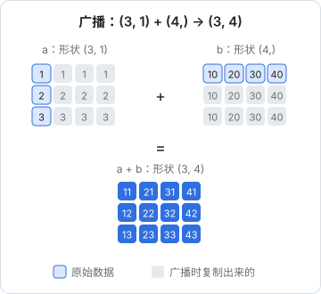
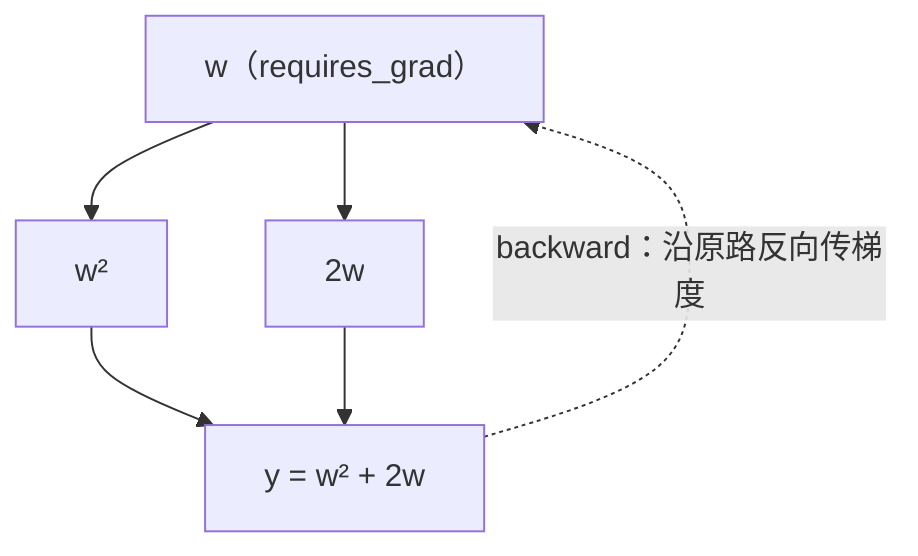

# PyTorch 张量

[《大模型原理科普》](../llm-fundamentals/)讲清楚了神经网络、注意力、Transformer「是什么」；这本书只做一件事：**亲手把它们写出来、跑起来**。从最底层的张量开始，经过多层网络、训练循环、正则化、卷积、循环网络、注意力，最后在你自己的 Mac 上从零训练一个字符级的 mini-GPT。

## 这本书讲什么、适合谁、怎么读

**适合谁**：会写代码（日常是 TypeScript 也没关系），读过[《AI 数学直觉》](../math-for-ai/)[《面向 AI 的 Python》](../python-for-ai/)《大模型原理科普》或者有等价的基础——知道矩阵乘法、导数和梯度下降的意思，能看懂 Python 的类和列表推导式，知道 Transformer 大致由什么组成。

**不适合谁**：想要系统学习机器学习理论、推导各种定理的读者。这本书只推必要的公式，重点在代码和「为什么这样写」。

**怎么读**：

| 章节 | 你会写出来的东西 |
|---|---|
| 1. PyTorch 张量 | 张量运算、广播、自动求导 |
| 2. 感知机到多层网络 | 手写参数解 XOR，再用 `nn.Module` 重写 |
| 3. 训练循环 | 一个能复用的标准训练脚本，FashionMNIST 上约 87% |
| 4. 过拟合与正则化 | 亲眼看到过拟合，再用 dropout、权重衰减、早停压住 |
| 5. 卷积网络 | 一个小 CNN，同样的数据到 90% 以上 |
| 6. 序列模型 | 字符级 tokenizer、bigram 模型、GRU 文本生成 |
| 7. 手写注意力 | 因果自注意力、多头，和 PyTorch 内置实现逐位对齐 |
| 8. 从零写 mini-GPT | 约 4M 参数的字符级 GPT，用这个书架里的书训练 |

每章的代码都是完整可运行的脚本，建议**真的敲一遍、跑一遍、改几个参数再跑一遍**。深度学习的手感只能这样来。书中给出的训练结果来自作者在 Apple Silicon Mac 上的实际运行，你的数字会因随机性和硬件略有不同，量级一致即可。

## 准备环境

用 `uv` 建一个独立项目（《面向 AI 的 Python》讲过它，相当于 Python 世界的 pnpm + nvm）：

```bash
uv init dl-lab --python 3.12
cd dl-lab
uv add torch torchvision numpy
uv run python -c "import torch; print(torch.__version__, torch.backends.mps.is_available())"
```

本书代码在 Python 3.12 + PyTorch 2.15 上验证过，用到的都是 PyTorch 2.x 里长期稳定的 API。最后一行如果打印 `True`，说明可以用 Apple Silicon 的 GPU（PyTorch 里叫 **MPS** 后端）。

整本书都用同一个选设备的函数：

```python
import torch

def get_device() -> torch.device:
    if torch.cuda.is_available():          # NVIDIA 显卡
        return torch.device("cuda")
    if torch.backends.mps.is_available():  # Apple Silicon
        return torch.device("mps")
    return torch.device("cpu")
```

没有 GPU 也没关系，本书所有例子在 CPU 上都能跑完，只是慢几倍。

## 张量是什么

**张量**（tensor）就是多维数组，和 NumPy 的 `ndarray` 几乎一样，多了两个能力：能放到 GPU 上算，能自动求导。

| 维度 | 例子 | 形状 |
|---|---|---|
| 0 维（标量） | 一个 loss 值 | `()` |
| 1 维（向量） | 一个词的 embedding | `(768,)` |
| 2 维（矩阵） | 一个线性层的权重 | `(768, 3072)` |
| 3 维 | 一批句子的 embedding | `(batch, seq_len, d_model)` |
| 4 维 | 一批图片 | `(batch, channels, height, width)` |

深度学习代码里最常见的 bug 不是逻辑错，而是**形状错**。养成习惯：每写一行张量运算，在注释里写上结果的形状。本书的代码都这样做。

### 创建张量

```python
import torch

a = torch.tensor([[1., 2., 3.], [4., 5., 6.]])
print(a.shape, a.dtype, a.device)   # torch.Size([2, 3]) torch.float32 cpu

torch.zeros(2, 3)                   # 全 0
torch.ones(2, 3)                    # 全 1
torch.randn(2, 3)                   # 标准正态分布随机数
torch.arange(6).reshape(2, 3)       # [[0, 1, 2], [3, 4, 5]]
```

三个属性要时刻心里有数：

- `shape`：形状
- `dtype`：数据类型。神经网络默认用 `float32`；类别标签、token id 用 `int64`（`torch.long`）
- `device`：在 CPU 还是 GPU 上。**参与同一次运算的张量必须在同一个设备上**，否则报错

```python
device = get_device()
x = torch.randn(3, 3).to(device)    # 拷到 GPU
y = x.cpu()                         # 拷回 CPU
```

### 索引与按维度归约

```python
x = torch.arange(12).reshape(3, 4)
x[0]          # 第 0 行：tensor([0, 1, 2, 3])
x[:, 1]       # 第 1 列：tensor([1, 5, 9])
x[1:, 2:]     # 右下角 2x2：[[6, 7], [10, 11]]

x.sum()                              # 66，全部加起来
x.sum(dim=0)                         # 沿第 0 维（行方向）压掉：[12, 15, 18, 21]
x.sum(dim=1)                         # 沿第 1 维压掉：[6, 22, 38]
x.float().mean(dim=1, keepdim=True)  # 形状 (3, 1)，保留被压掉的维度
```

`dim=k` 的意思是「**把第 k 维压掉**」。`sum(dim=0)` 后形状从 `(3, 4)` 变成 `(4,)`。后面 softmax 要沿最后一维做（`dim=-1`），分类准确率要沿类别维取 `argmax(dim=1)`，都是这个规则。

### 矩阵乘法

```python
A = torch.randn(2, 3)
B = torch.randn(3, 4)
(A @ B).shape          # (2, 4)

batch = torch.randn(8, 2, 3)
(batch @ B).shape      # (8, 2, 4)：对前面的「批」维度逐个做矩阵乘
```

`@` 只看**最后两维**做矩阵乘法，前面的维度当作批次。这一点在注意力里非常关键：`(B, n_head, T, hs) @ (B, n_head, hs, T)` 会对每个样本、每个头各做一次 `(T, hs) @ (hs, T)`，一行代码完成。

## 广播

两个形状不同的张量做逐元素运算时，PyTorch 会按**广播**（broadcasting）规则自动扩展：

1. 从最后一维往前对齐
2. 每一维要么相等，要么其中一个是 1（会被复制扩展），要么其中一个缺失（视为 1）

```python
m = torch.tensor([[1.], [2.], [3.]])        # (3, 1)
r = torch.tensor([10., 20., 30., 40.])      # (4,) 视为 (1, 4)
m + r                                       # (3, 4)
# tensor([[11., 21., 31., 41.],
#         [12., 22., 32., 42.],
#         [13., 23., 33., 43.]])
```



线性层 `x @ W + b` 里，`x @ W` 是 `(batch, out)`，`b` 是 `(out,)`，就是靠广播把同一个偏置加到每个样本上。广播很方便，也很危险：形状写错时它不会报错，而是悄悄算出一个错误的结果。比如 `(32,)` 的预测值减 `(32, 1)` 的标签，会得到 `(32, 32)`——再取平均当 loss，训练照样能跑，就是学不好。

## 改变形状

| 操作 | 作用 | 例子（`t` 形状 `(2, 3, 4)`） |
|---|---|---|
| `view` / `reshape` | 按内存顺序重新解释形状 | `t.view(6, 4)` → `(6, 4)` |
| `permute` / `transpose` | 交换维度顺序 | `t.permute(0, 2, 1)` → `(2, 4, 3)` |
| `unsqueeze` / `squeeze` | 增加 / 去掉长度为 1 的维 | `t.unsqueeze(0)` → `(1, 2, 3, 4)` |
| `flatten` | 把若干维压平 | `t.flatten(1)` → `(2, 12)` |

`view` 要求张量在内存里是连续的；`transpose` 之后通常不连续，直接 `view` 会报 `view size is not compatible with input tensor's size and stride`。解决办法是先 `.contiguous()` 再 `view`，或者直接用 `reshape`（必要时它会自动拷贝）。第 7 章拆、拼多头时会用到这个组合。

## 自动求导

训练神经网络需要每个参数对 loss 的梯度。PyTorch 的 **autograd** 会在前向计算时记下计算图，调用 `backward()` 时按链式法则自动把梯度算出来：

```python
w = torch.tensor(3.0, requires_grad=True)
y = w ** 2 + 2 * w        # y = w² + 2w
y.backward()              # 求 dy/dw
print(w.grad)             # tensor(8.)，因为 dy/dw = 2w + 2 = 8
```



矩阵也一样，而且可以拿手推公式验证 autograd 没骗人：

```python
x = torch.randn(4, 3)
W = torch.randn(3, 2, requires_grad=True)
loss = (x @ W).pow(2).mean()      # 4×2 个元素的平方取平均
loss.backward()

# 手推：d loss / dW = 2 · xᵀ (xW) / 8
manual = 2 * x.T @ (x @ W.detach()) / 8
print(torch.allclose(W.grad, manual))   # True
```

几条必须知道的规矩：

- 只有 `requires_grad=True` 的**叶子张量**（通常就是模型参数）会把梯度存进 `.grad`
- **梯度会累加**，不会自动清零。每一步训练前都要清零，这是新手最常见的 bug 之一
- 推理和评估时用 `with torch.no_grad():` 包起来，不建计算图，省内存也更快
- `.detach()` 返回一个切断了计算图的张量；`.item()` 把单元素张量变成 Python 数字，常用来打印 loss

## 和 NumPy 互转

```python
import numpy as np

n = np.ones(3)
t = torch.from_numpy(n)   # 共享内存！
n[0] = 5
print(t)                  # tensor([5., 1., 1.], dtype=torch.float64)

t.numpy()                 # 反向转换，同样共享内存（仅限 CPU 张量）
```

注意两点：`from_numpy` 不拷贝数据，改一边另一边也变；NumPy 默认是 `float64`，喂给模型前要 `.float()` 转成 `float32`，否则会遇到 `expected scalar type Float but found Double` 之类的报错。

## 本章要点

- 张量 = 多维数组 + GPU + 自动求导；时刻关注 `shape`、`dtype`、`device` 三个属性
- 每行张量运算都在注释里写结果形状，形状错是深度学习最常见的 bug
- `dim=k` 表示把第 k 维压掉；`@` 只对最后两维做矩阵乘，前面都是批
- 广播从最后一维对齐，长度 1 的维会被复制；写错形状时它不报错，只会悄悄算错
- `transpose` 后要 `.contiguous()` 才能 `view`，或者直接用 `reshape`
- `backward()` 自动求梯度；梯度会累加，每步要清零；评估时用 `torch.no_grad()`
