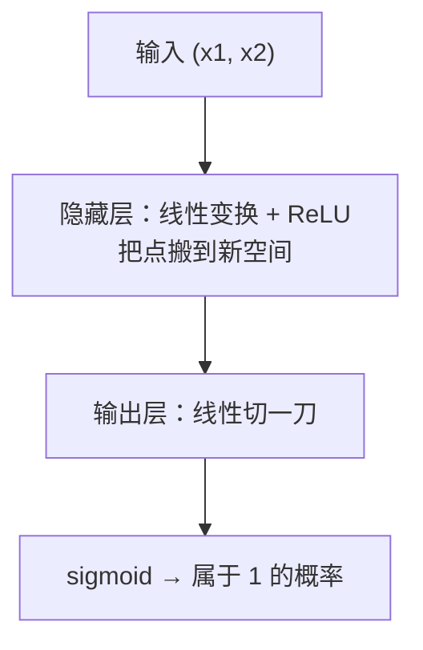
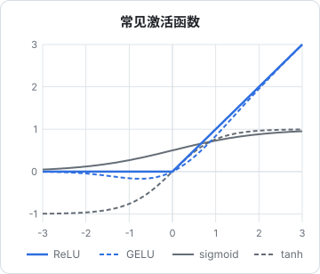

# 感知机到多层网络

上一章有了张量和自动求导，这一章用它们搭出第一个能学习的网络。先从一个神经元（感知机）开始，看它为什么解决不了最简单的 XOR 问题；再加一层隐藏层，手写全部参数和梯度下降，把 XOR 解掉；最后用 PyTorch 的 `nn.Module` 把同样的东西重写成工程上的标准写法。

## 一个神经元

一个神经元做的事情是：输入加权求和，加上偏置，再过一个非线性函数。

$$
y = \sigma(w_1 x_1 + w_2 x_2 + b) = \sigma(\mathbf{w}^\top \mathbf{x} + b)
$$

在 PyTorch 里，一批样本同时算就是一次矩阵乘法：

```python
import torch

X = torch.randn(32, 2)          # 32 个样本，每个 2 个特征
w = torch.randn(2, 1)
b = torch.zeros(1)
y = torch.sigmoid(X @ w + b)    # (32, 1)
```

$\mathbf{w}^\top \mathbf{x} + b = 0$ 在二维平面上是一条直线。所以一个神经元能做的，本质上是**用一条直线把平面切成两半**。这就是 1950 年代感知机的能力边界。

## XOR：一条直线切不开

XOR（异或）只有四个点：

| $x_1$ | $x_2$ | XOR |
|---|---|---|
| 0 | 0 | 0 |
| 0 | 1 | 1 |
| 1 | 0 | 1 |
| 1 | 1 | 0 |

把它们画在平面上，两个 1 在对角，两个 0 在另一条对角。你找不到任何一条直线，能让两个 1 在一边、两个 0 在另一边。单个神经元无论怎么训练都学不会 XOR。

解决办法是**先做一次变换，再切**。隐藏层把原始的二维点映射到一个新空间，在新空间里它们变得可以用直线分开：



关键在于中间那个**非线性**。如果去掉 ReLU，两层线性变换相乘还是一个线性变换（$W_2(W_1 x) = (W_2 W_1) x$），叠多少层都等于一层。非线性激活函数是深度网络能「深」的前提。

## 激活函数



| 函数 | 公式 | 用在哪 | 特点 |
|---|---|---|---|
| sigmoid | $1/(1+e^{-x})$ | 二分类输出层 | 输出 0~1，两端梯度接近 0 |
| tanh | $\tanh x$ | 早期 RNN | 输出 -1~1，同样会饱和 |
| ReLU | $\max(0, x)$ | CNN、MLP 的隐藏层 | 简单、快，正半轴梯度恒为 1 |
| GELU | $x \cdot \Phi(x)$ | Transformer（GPT、BERT） | 平滑的 ReLU，第 8 章会用 |

sigmoid 和 tanh 在两端「饱和」：输入很大或很小时导数接近 0，梯度经过很多层相乘后会消失，深层网络训不动。ReLU 在正半轴导数恒为 1，缓解了这个问题，这是 2010 年代深度网络能训起来的原因之一。现在隐藏层默认用 ReLU 或 GELU。

## 手写一个两层网络解 XOR

先不用任何高级 API，参数、前向、梯度下降全部手写。这段代码就是所有神经网络训练的骨架：

```python
import torch

torch.manual_seed(0)
X = torch.tensor([[0., 0.], [0., 1.], [1., 0.], [1., 1.]])
y = torch.tensor([[0.], [1.], [1.], [0.]])

# 2 -> 4 -> 1，手写参数
W1 = torch.randn(2, 4, requires_grad=True)
b1 = torch.zeros(4, requires_grad=True)
W2 = torch.randn(4, 1, requires_grad=True)
b2 = torch.zeros(1, requires_grad=True)
params = [W1, b1, W2, b2]
lr = 0.5

for step in range(2001):
    h = torch.relu(X @ W1 + b1)          # (4, 4)
    logits = h @ W2 + b2                 # (4, 1)
    loss = torch.nn.functional.binary_cross_entropy_with_logits(logits, y)

    for p in params:
        p.grad = None                    # 清掉上一步的梯度
    loss.backward()                      # 反向传播
    with torch.no_grad():                # 更新参数这一步不需要记录计算图
        for p in params:
            p -= lr * p.grad

    if step % 500 == 0:
        print(f"step {step:4d}  loss {loss.item():.4f}")

print(torch.sigmoid(logits).detach().round(decimals=3).squeeze())
```

运行结果：

```text
step    0  loss 0.8515
step  500  loss 0.0102
step 1000  loss 0.0038
step 1500  loss 0.0023
step 2000  loss 0.0016
tensor([0.0030, 0.9990, 0.9990, 0.0030])
```

四个输出分别接近 0、1、1、0，XOR 学会了。逐行看几个要点。

### logits 和 `..._with_logits`

网络最后一层的输出不过 sigmoid，直接叫 **logits**（未归一化的分数）。损失函数用 `binary_cross_entropy_with_logits`，它在内部把 sigmoid 和交叉熵合在一起算。为什么不自己先 sigmoid 再算交叉熵？因为 $\log(\text{sigmoid}(x))$ 在 $x$ 很负时会出现 $\log(0)$，合并后的实现用数学恒等式避开了这个数值问题。多分类时同理：模型输出 logits，用 `cross_entropy`，**不要自己先 softmax**。

### 交叉熵

二分类交叉熵是：

$$
L = -\big[y \log p + (1-y)\log(1-p)\big]
$$

直觉：正确答案是 1 时，loss 是 $-\log p$。模型给出 $p=0.99$，loss 约 0.01；给出 $p=0.01$，loss 约 4.6。**越自信地答错，惩罚越重**。[《AI 数学直觉》](../math-for-ai/)里讲过它和信息论的关系，这里只需记住：分类任务的标准损失就是交叉熵。

### 训练可能卡住

把 `torch.manual_seed(0)` 换成别的种子，不少时候会看到 loss 停在 0.35 或 0.48 附近不动。这是因为只有 4 个隐藏单元，某些 ReLU 单元初始化后对四个输入都输出 0（梯度也是 0），再也「活」不过来，剩下的单元不够用。解决办法很朴素：**把网络加宽**。作者试了种子 1~20：4 个隐藏单元的手写版卡住 7 次；下一节 8 个隐藏单元的版本只卡住 1 次。过参数化让优化变容易，这是深度学习里反复出现的经验。

## 用 `nn.Module` 重写

手写参数适合理解原理，工程上用 `torch.nn`。同样的网络：

```python
import torch
from torch import nn

class MLP(nn.Module):
    def __init__(self, d_in: int, d_hidden: int, d_out: int):
        super().__init__()
        self.net = nn.Sequential(
            nn.Linear(d_in, d_hidden),
            nn.ReLU(),
            nn.Linear(d_hidden, d_out),
        )

    def forward(self, x: torch.Tensor) -> torch.Tensor:
        return self.net(x)

torch.manual_seed(0)
X = torch.tensor([[0., 0.], [0., 1.], [1., 0.], [1., 1.]])
y = torch.tensor([[0.], [1.], [1.], [0.]])

model = MLP(2, 8, 1)
opt = torch.optim.SGD(model.parameters(), lr=0.5)
loss_fn = nn.BCEWithLogitsLoss()

for step in range(1001):
    loss = loss_fn(model(X), y)
    opt.zero_grad()
    loss.backward()
    opt.step()

print(f"loss {loss.item():.4f}")
print(torch.sigmoid(model(X)).detach().round(decimals=3).squeeze())
print(sum(p.numel() for p in model.parameters()), "parameters")
```

```text
loss 0.0016
tensor([0.0010, 0.9980, 0.9980, 0.0010])
33 parameters
```

和手写版逐一对应：

| 手写版 | `nn` 版 | 说明 |
|---|---|---|
| `W1`、`b1` | `nn.Linear(2, 8)` | 自动创建权重和偏置，并用合适的分布初始化 |
| `torch.relu(...)` | `nn.ReLU()` | 激活函数也可以是一层 |
| `params = [...]` | `model.parameters()` | 自动收集所有子模块的参数 |
| `p.grad = None` | `opt.zero_grad()` | 清梯度 |
| `p -= lr * p.grad` | `opt.step()` | 优化器负责更新规则 |

参数数量 33 = 第一层 $2 \times 8 + 8$ + 第二层 $8 \times 1 + 1$。数参数是个好习惯，第 8 章会算 mini-GPT 的参数都花在哪。

### `nn.Module` 的约定

- 在 `__init__` 里把子层赋值给 `self.xxx`，PyTorch 会自动注册它们的参数；放在普通 Python 列表里则**不会**被注册，要用 `nn.ModuleList`
- 在 `forward` 里写前向计算；调用时写 `model(x)` 而不是 `model.forward(x)`，前者会触发 hook 等机制
- `model.to(device)` 一次性把所有参数搬到 GPU
- `model.train()` / `model.eval()` 切换训练和评估模式，影响 dropout 和 BatchNorm 的行为（第 4 章）

## 网络的深与宽

理论上，**一个足够宽的隐藏层就能以任意精度逼近任何连续函数**（万能逼近定理）。那为什么还要深？

因为「能逼近」不等于「容易学到」。实践经验是：同样的参数量，深而窄的网络往往比浅而宽的网络学得更好、泛化更好。深层网络可以**复用中间特征**：图像里第一层学边缘，第二层把边缘组合成纹理，第三层组合成部件。第 5 章的卷积网络会让你直观看到这种层级。

但深也带来训练难题：梯度消失、梯度爆炸、退化。后面会逐个遇到对应的解法：ReLU（本章）、合理的初始化（`nn.Linear` 默认已处理）、归一化层（第 4、5 章）、残差连接（第 8 章）。

## 本章要点

- 一个神经元 = 加权求和 + 偏置 + 非线性，只能用一条直线（超平面）切分数据
- XOR 线性不可分，加一层隐藏层把数据映射到新空间后就能分开
- 没有非线性激活，多层线性等于一层；隐藏层默认用 ReLU 或 GELU
- 模型输出 logits，用 `..._with_logits` / `cross_entropy` 计算损失，不要自己先 sigmoid / softmax
- 训练骨架：前向 → 算 loss → 清梯度 → `backward` → 更新参数
- `nn.Module` + `optim` 是同一件事的工程写法；网络加宽能让优化更容易

## 动手练习

1. **拿掉 ReLU**：在[手写一个两层网络解 XOR](#手写一个两层网络解-xor)的代码里，把 `h = torch.relu(X @ W1 + b1)` 改成 `h = X @ W1 + b1`，其余不动，重跑。

   验证：loss 停在 0.693 附近不再下降，最后打印的四个概率都在 0.5 附近。

   参考答案：没有非线性，两层等价于一层，只能画一条直线，XOR 切不开。对 XOR 来说，线性模型能做到的最好就是对四个点都输出 0.5，交叉熵正好是 $\ln 2 \approx 0.693$。

2. **复现「训练卡住」**：把手写版包成一个函数 `run(seed, hidden)`，返回第 2000 步的 loss；对种子 1~20 分别跑隐藏层 4、8、16，统计最终 loss 大于 0.1 的次数。

   验证：隐藏层越宽，卡住的次数越少；隐藏层 4 时和[训练可能卡住](#训练可能卡住)里作者的 7 次一致或接近，卡住的 loss 停在 0.347 或 0.477 附近；16 时通常一次都不卡。作者用手写版复跑，8 个隐藏单元卡住 4 次，比正文 `nn` 版的 1 次多，因为两者的初始化方式不同。

   参考答案：卡住时打印 `torch.relu(X @ W1 + b1)`，能看到某几列对四个输入全是 0，这些单元梯度恒为 0，再也更新不了。隐藏单元多了，剩下的活单元仍然够用。

3. **漏注册的参数**：把 `MLP` 里的 `nn.Sequential(...)` 换成普通列表 `self.layers = [nn.Linear(2, 8), nn.ReLU(), nn.Linear(8, 1)]`，`forward` 里用 for 循环依次调用，然后创建优化器。

   验证：`len(list(model.parameters()))` 是 0，创建 `torch.optim.SGD` 时抛出 `ValueError`，信息里有 `empty parameter list`。

   参考答案：PyTorch 只自动注册直接赋给 `self` 的模块，普通列表里的层它看不见。换成 `nn.ModuleList([...])` 后参数数回到 4 个张量、共 33 个数。
