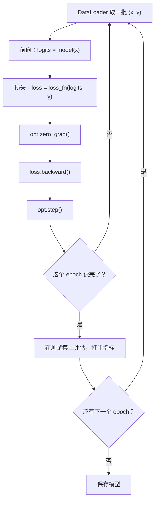

# 训练循环

XOR 只有 4 个样本，一次全部喂进去就行。真实任务有几万到几十亿个样本，需要分批读取、在 GPU 上计算、区分训练集和测试集、记录指标、保存模型。这一章写一个**标准训练脚本**，在 FashionMNIST 服装图片分类上跑到约 87% 准确率。后面每一章的训练代码都是它的变体，写熟了就能读懂绝大多数 PyTorch 项目。

## 训练循环的结构

不管模型多复杂，训练循环都是同一个形状：



几个术语：

| 术语 | 含义 |
|---|---|
| batch（批） | 一次前向 / 反向用的一组样本，常见 32~512 |
| step / iteration | 处理一个 batch 并更新一次参数 |
| epoch（轮） | 把整个训练集完整过一遍 |
| learning rate（学习率） | 每次更新沿梯度方向走多远 |

## 为什么要分批

**小批量随机梯度下降**（mini-batch SGD）是三种选择里的折中：

- 每次用全部数据算梯度：梯度准确，但一步要算完所有样本，内存放不下，也太慢
- 每次只用 1 个样本：更新很快，但梯度噪声极大，而且没法利用 GPU 的并行
- 每次用一小批：梯度是全量梯度的无偏估计，噪声适中；一批样本拼成一个大张量，在 GPU 上一次矩阵乘法搞定

适度的噪声甚至是好事：它让参数不容易陷进又窄又尖的局部最小值，往往泛化得更好。batch 大小通常受显存限制，在显存允许的范围里选 2 的幂即可。

## 数据：Dataset 与 DataLoader

PyTorch 把数据拆成两层：

- **`Dataset`**：知道「一共有多少条」（`__len__`）和「第 i 条是什么」（`__getitem__`）
- **`DataLoader`**：负责打乱顺序、拼成 batch、可选地多进程预读

FashionMNIST 是 7 万张 28×28 的灰度服装图片，10 个类别（T 恤、裤子、套衫、连衣裙、外套、凉鞋、衬衫、运动鞋、包、短靴），6 万训练、1 万测试。它和经典的手写数字 MNIST 格式完全一样，但更难一些，更能看出模型之间的差距。`torchvision` 内置了它，第一次运行会自动下载到 `data/` 目录。

自己的数据只要实现一个 `Dataset`：

```python
import torch
from torch.utils.data import Dataset

class CsvDataset(Dataset):
    def __init__(self, features: torch.Tensor, labels: torch.Tensor):
        self.x = features          # (N, d)
        self.y = labels            # (N,)

    def __len__(self) -> int:
        return len(self.y)

    def __getitem__(self, i: int):
        return self.x[i], self.y[i]
```

`DataLoader` 会自动把 `batch_size` 个 `(x, y)` 堆叠成 `(B, d)` 和 `(B,)`。数据量能整个放进内存时，这样就够了。

## 完整脚本

新建 `train_mlp.py`：

```python
import time
import torch
from torch import nn
from torch.utils.data import DataLoader
from torchvision import datasets, transforms


def get_device() -> torch.device:
    if torch.cuda.is_available():
        return torch.device("cuda")
    if torch.backends.mps.is_available():
        return torch.device("mps")
    return torch.device("cpu")


device = get_device()
torch.manual_seed(42)

# 1. 数据
tfm = transforms.ToTensor()  # PIL 图片 -> (1, 28, 28) 的 float 张量，取值 0~1
train_ds = datasets.FashionMNIST("data", train=True, download=True, transform=tfm)
test_ds = datasets.FashionMNIST("data", train=False, download=True, transform=tfm)
train_dl = DataLoader(train_ds, batch_size=128, shuffle=True)
test_dl = DataLoader(test_ds, batch_size=512)

# 2. 模型
model = nn.Sequential(
    nn.Flatten(),              # (B, 1, 28, 28) -> (B, 784)
    nn.Linear(784, 256),
    nn.ReLU(),
    nn.Linear(256, 10),        # 输出 10 个类别的 logits
).to(device)

# 3. 损失函数和优化器
loss_fn = nn.CrossEntropyLoss()
opt = torch.optim.AdamW(model.parameters(), lr=1e-3)


def train_one_epoch() -> float:
    model.train()
    total, n = 0.0, 0
    for x, y in train_dl:
        x, y = x.to(device), y.to(device)
        logits = model(x)
        loss = loss_fn(logits, y)

        opt.zero_grad()
        loss.backward()
        opt.step()

        total += loss.item() * x.size(0)
        n += x.size(0)
    return total / n


@torch.no_grad()
def evaluate() -> tuple[float, float]:
    model.eval()
    total, correct, n = 0.0, 0, 0
    for x, y in test_dl:
        x, y = x.to(device), y.to(device)
        logits = model(x)
        total += loss_fn(logits, y).item() * x.size(0)
        correct += (logits.argmax(dim=1) == y).sum().item()
        n += x.size(0)
    return total / n, correct / n


for epoch in range(1, 6):
    t0 = time.time()
    train_loss = train_one_epoch()
    test_loss, acc = evaluate()
    print(f"epoch {epoch}  train {train_loss:.4f}  test {test_loss:.4f}  "
          f"acc {acc:.2%}  {time.time() - t0:.1f}s")

torch.save(model.state_dict(), "mlp.pt")
```

```bash
uv run python train_mlp.py
```

作者机器上（MPS）的输出：

```text
epoch 1  train 0.5550  test 0.4531  acc 83.86%  3.5s
epoch 2  train 0.4024  test 0.4181  acc 85.15%  1.7s
epoch 3  train 0.3608  test 0.3881  acc 86.05%  1.7s
epoch 4  train 0.3338  test 0.3617  acc 87.15%  1.8s
epoch 5  train 0.3125  test 0.3514  acc 87.37%  1.9s
```

随机猜是 10%，一个 20 万参数的两层网络 5 轮就到了 87%。下面拆开讲关键选择。

## 多分类的损失：CrossEntropyLoss

`nn.CrossEntropyLoss` 接收：

- `logits`：形状 `(B, C)`，每个样本 C 个类别的原始分数
- `y`：形状 `(B,)`，`int64` 类型的类别下标，取值 `0 ~ C-1`

它在内部先做 `log_softmax`，再取正确类别那一项的负值，最后对 batch 取平均：

$$
L = -\frac{1}{B}\sum_{i=1}^{B} \log \frac{e^{z_{i,y_i}}}{\sum_{c} e^{z_{i,c}}}
$$

一个有用的基准：模型什么都没学、对 C 个类别给出均匀概率时，loss 等于 $\ln C$。10 分类是 $\ln 10 \approx 2.30$。训练刚开始的 loss 应该在这附近；如果一上来就是 10 甚至 NaN，说明初始化或数据处理有问题。第 6 章、第 8 章还会用这个基准判断文本模型学到了多少。

## 优化器：SGD、Adam、AdamW

| 优化器 | 更新规则（直觉） | 特点 |
|---|---|---|
| SGD | 沿负梯度走 `lr` 那么远 | 简单，需要仔细调学习率 |
| SGD + momentum | 带惯性，累积历史梯度方向 | 走得更稳，CV 领域常用 |
| Adam | 每个参数有自己的自适应步长 | 对学习率不敏感，开箱即用 |
| AdamW | Adam + 正确实现的权重衰减 | 现在训练 Transformer 的默认选择 |

Adam 为每个参数维护梯度的一阶矩（均值）和二阶矩（平方的均值），用二阶矩给步长做归一化：经常有大梯度的参数步子小一点，梯度一直很小的参数步子大一点。实践上，**新项目先用 AdamW、`lr=1e-3` 或 `3e-4`**，基本不会错。

## train() 和 eval()

`model.train()` 和 `model.eval()` 不会启动训练或评估，只是切换一个标志位，影响两类层：

- **Dropout**：训练时随机丢弃，评估时全部保留
- **BatchNorm**：训练时用当前 batch 的统计量并更新滑动平均，评估时用滑动平均

本章的模型里两者都没有，所以忘了切换也看不出来；第 4、5 章加上它们之后，忘了 `model.eval()` 会让测试结果明显变差且不稳定。养成习惯：训练函数开头写 `model.train()`，评估函数开头写 `model.eval()`。

`@torch.no_grad()` 是另一回事：它关闭梯度记录，节省内存和计算。评估时两个都要。

## 记录指标的细节

`loss.item()` 会把 GPU 上的值同步回 CPU。上面的代码每步都调用一次，简单起见可以接受；在大模型训练里，频繁同步会拖慢 GPU，通常每隔 N 步才取一次。

另外注意 `total += loss.item() * x.size(0)`：最后一个 batch 可能不满 128 个，按样本数加权平均才是准确的 epoch 平均 loss。

## 保存与加载

```python
# 保存：只存参数（state_dict），不存整个对象
torch.save(model.state_dict(), "mlp.pt")

# 加载：先建同样结构的模型，再把参数灌进去
model = nn.Sequential(nn.Flatten(), nn.Linear(784, 256), nn.ReLU(), nn.Linear(256, 10))
model.load_state_dict(torch.load("mlp.pt", map_location="cpu"))
model.eval()
```

**存 `state_dict` 而不是整个模型对象**：整个对象依赖 pickle，代码一改就可能加载失败，也有安全风险——加载来路不明的 pickle 文件等于执行别人的代码。新版 PyTorch 的 `torch.load` 默认开启了 `weights_only=True`，只允许加载张量等安全类型，这也是在提醒同一件事。从网上下模型权重时优先选 safetensors 格式。

要支持断点续训，还要把优化器状态、当前 epoch 一起存：

```python
torch.save({
    "model": model.state_dict(),
    "opt": opt.state_dict(),        # Adam 的一阶、二阶矩也要存，否则续训时会抖一下
    "epoch": epoch,
}, "ckpt.pt")
```

## 用模型做预测

```python
classes = test_ds.classes            # ['T-shirt/top', 'Trouser', ...]
x, y = test_ds[0]                    # x: (1, 28, 28)
with torch.no_grad():
    logits = model(x.unsqueeze(0))   # 加一个 batch 维 -> (1, 1, 28, 28)
    probs = logits.softmax(dim=-1)   # 预测时才需要 softmax，得到概率
print(classes[probs.argmax().item()], f"{probs.max().item():.1%}", "真实:", classes[y])
```

注意 `unsqueeze(0)`：模型总是期望第一维是 batch，哪怕只预测一张图。

## 训练不动时查什么

| 现象 | 常见原因 |
|---|---|
| loss 一直等于 $\ln C$ 附近 | 学习率太小、忘了 `opt.step()`、标签和输入没对齐 |
| loss 变成 NaN | 学习率太大、自己写的 log / 除法出现 0 |
| loss 剧烈震荡 | 学习率太大、batch 太小 |
| 训练 loss 降、测试 loss 升 | 过拟合，见下一章 |
| 报错 `Expected all tensors to be on the same device` | 数据或模型有一个没 `.to(device)` |
| 报错 `expected scalar type Long` | 分类标签不是 `int64` |

一个非常有效的调试技巧：**先拿一个 batch 反复训练，看能不能把 loss 压到接近 0**。小模型都记不住一个 batch，说明代码有 bug，不是模型不够大。

## 本章要点

- 训练循环固定为：取批 → 前向 → loss → `zero_grad` → `backward` → `step`，外面套 epoch 和评估
- 小批量 SGD 兼顾梯度质量和 GPU 并行，适度噪声还有助于泛化
- `Dataset` 管「第 i 条是什么」，`DataLoader` 管打乱、分批
- 多分类用 `CrossEntropyLoss`，输入 logits 和 `int64` 标签；初始 loss 应约为 $\ln C$
- 新项目默认 AdamW + `lr=1e-3`；`model.train()` / `model.eval()` 和 `torch.no_grad()` 各管各的
- 保存 `state_dict`，续训时连优化器状态一起存；调试先过拟合一个 batch
