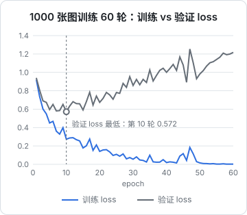

# 过拟合与正则化

上一章的模型在测试集上 87%，看起来不错。但训练 loss 能一直降，测试 loss 不会。模型参数足够多时，它可以把训练集**背下来**，而不是学会规律。这一章故意制造一次过拟合，亲眼看到训练 loss 和验证 loss 分道扬镳，然后用验证集、早停、权重衰减、dropout、数据增强、归一化这些手段把它压住。

## 三份数据

先把数据的用途分清楚，这是一切的前提：

| 数据集 | 用来做什么 | 能不能影响训练决策 |
|---|---|---|
| 训练集 | 计算梯度、更新参数 | 能 |
| 验证集 | 调超参数、选 epoch、比较模型 | 能（间接） |
| 测试集 | 最后报告一次成绩 | **不能** |

为什么不能拿测试集调参？因为你每看一次测试集、据此改一次超参数，测试集的信息就渗进了模型。调上几十次，测试成绩就不再代表「没见过的数据」。上一章为了简单直接用了测试集，从这一章开始从训练集里切出验证集：

```python
import torch
from torch.utils.data import random_split
from torchvision import datasets, transforms

full = datasets.FashionMNIST("data", train=True, download=True,
                             transform=transforms.ToTensor())
g = torch.Generator().manual_seed(0)          # 固定切分，保证每次实验可比
train_ds, val_ds = random_split(full, [55_000, 5_000], generator=g)
```

## 制造一次过拟合

过拟合的条件是**模型容量大、数据少**。下面用一个两层 512 宽的 MLP（约 67 万参数），只给它 1000 张训练图，训练 60 轮：

```python
import torch
from torch import nn
from torch.utils.data import DataLoader, Subset, random_split
from torchvision import datasets, transforms

device = torch.device("mps" if torch.backends.mps.is_available() else "cpu")
full = datasets.FashionMNIST("data", train=True, download=True,
                             transform=transforms.ToTensor())
g = torch.Generator().manual_seed(0)
train_full, val_ds = random_split(full, [55_000, 5_000], generator=g)
small_train = Subset(train_full, range(1_000))      # 故意只用 1000 张训练

train_dl = DataLoader(small_train, batch_size=64, shuffle=True)
val_dl = DataLoader(val_ds, batch_size=512)


def make_model(p_drop: float) -> nn.Module:
    return nn.Sequential(
        nn.Flatten(),
        nn.Linear(784, 512), nn.ReLU(), nn.Dropout(p_drop),
        nn.Linear(512, 512), nn.ReLU(), nn.Dropout(p_drop),
        nn.Linear(512, 10),
    ).to(device)


@torch.no_grad()
def mean_loss(model, dl, loss_fn):
    model.eval()
    total, n = 0.0, 0
    for x, y in dl:
        x, y = x.to(device), y.to(device)
        total += loss_fn(model(x), y).item() * x.size(0)
        n += x.size(0)
    return total / n


def run(p_drop: float, weight_decay: float, epochs: int = 60):
    torch.manual_seed(0)
    model = make_model(p_drop)
    opt = torch.optim.AdamW(model.parameters(), lr=1e-3, weight_decay=weight_decay)
    loss_fn = nn.CrossEntropyLoss()
    for epoch in range(1, epochs + 1):
        model.train()
        for x, y in train_dl:
            x, y = x.to(device), y.to(device)
            loss = loss_fn(model(x), y)
            opt.zero_grad()
            loss.backward()
            opt.step()
        tr = mean_loss(model, train_dl, loss_fn)
        va = mean_loss(model, val_dl, loss_fn)
        if epoch % 10 == 0 or epoch in (1, 5):
            print(f"drop={p_drop} wd={weight_decay} epoch {epoch:2d}  "
                  f"train {tr:.4f}  val {va:.4f}")

run(p_drop=0.0, weight_decay=0.0)     # 不加正则
run(p_drop=0.5, weight_decay=0.1)     # dropout + 权重衰减
```

不加正则时的结果：



| epoch | 训练 loss | 验证 loss |
|---|---|---|
| 1 | 0.921 | 0.941 |
| 5 | 0.450 | 0.596 |
| 10 | 0.274 | **0.572** |
| 20 | 0.141 | 0.674 |
| 40 | 0.020 | 1.001 |
| 60 | 0.002 | 1.218 |

训练 loss 降到 0.002，几乎完美地记住了 1000 张图；验证 loss 在第 10 轮见底后一路上升，到第 60 轮比最低点翻了一倍还多。**第 10 轮之后的训练全是在背答案**。

这张图是判断模型状态最重要的工具：

| 训练 loss | 验证 loss | 诊断 | 对策 |
|---|---|---|---|
| 高 | 高 | 欠拟合 | 加大模型、训练更久、调学习率 |
| 低 | 高且在升 | 过拟合 | 更多数据、正则化、早停 |
| 低 | 低且接近 | 正好 | 可以试更大的模型 |

## 早停

最简单也最有效的正则化：**验证 loss 不再下降时就停，并且用验证 loss 最低那一轮的参数**。

```python
import copy

best_val, best_state, patience, bad = float("inf"), None, 5, 0
for epoch in range(1, 101):
    train_one_epoch()
    val = evaluate_val()
    if val < best_val:
        best_val, bad = val, 0
        best_state = copy.deepcopy(model.state_dict())   # 记下最好的参数
    else:
        bad += 1
        if bad >= patience:                             # 连续 5 轮没进步就停
            print(f"early stop at epoch {epoch}")
            break
model.load_state_dict(best_state)
```

`patience` 不要设成 1：验证 loss 有噪声，偶尔回升一轮很正常。

## 权重衰减

权重衰减（weight decay）在每次更新时把参数往 0 拉一点：

$$
\theta \leftarrow \theta - \eta\,(\nabla L + \lambda \theta)
$$

效果等价于在 loss 上加了 $\frac{\lambda}{2}\lVert\theta\rVert^2$ 这一项（L2 正则）。直觉是：大的权重意味着模型对输入的微小变化非常敏感，容易拟合噪声；限制权重大小就是限制模型「拐弯」的能力，让函数更平滑。

在 PyTorch 里用 `AdamW(..., weight_decay=0.01)` 即可。为什么是 AdamW 而不是 Adam？Adam 的 `weight_decay` 参数把衰减项加进了梯度，又被自适应步长缩放，效果打了折扣；AdamW 把衰减和梯度更新**解耦**，直接作用在参数上，这才是想要的行为。训练 Transformer 时 `weight_decay` 常取 0.1。

## Dropout

Dropout 在训练时以概率 $p$ 把每个神经元的输出随机置 0，剩下的乘以 $\frac{1}{1-p}$ 保持期望不变；评估时什么都不做。

```python
import torch
from torch import nn

drop = nn.Dropout(p=0.5)
x = torch.ones(8)
drop.train(); print(drop(x))   # 一部分是 0，其余是 2.0（每次运行位置不同）
drop.eval();  print(drop(x))   # 全是 1.0
```

为什么有效？每一步训练的都是一个随机的「子网络」，任何一个神经元都不能指望某个特定的伙伴存在，只能学到更独立、更鲁棒的特征。也可以把它看成训练了指数多个共享参数的子网络，评估时取它们的平均。

这就是第 3 章强调 `model.eval()` 的原因：忘了切换，评估时还在随机丢神经元，结果会又差又不稳定。

## 把正则化加回去

同样 1000 张图，把 `p_drop=0.5`、`weight_decay=0.1` 加上：

| | 验证 loss 最低点 | 出现在 | 第 60 轮训练 loss | 第 60 轮验证 loss |
|---|---|---|---|---|
| 不加正则 | 0.572 | 第 10 轮 | 0.002 | 1.218 |
| dropout + 权重衰减 | 0.549 | 第 19 轮 | 0.103 | 0.772 |

正则化做到了三件事：训练 loss 降得慢了（不再轻易背答案）；验证 loss 的最低点更低；之后上升得也慢得多，对「训练多少轮」不那么敏感。但它没有魔法：1000 张图就是不够，两种设置的验证 loss 最终都在上升。**更多数据永远是最好的正则化**。同样的网络、不加任何正则，改用全部 5.5 万张训练，5 轮后验证 loss 就到了 0.313，远低于上面两个数字。

## 数据增强

数据不够时，可以「造」数据：对训练样本做不改变标签的变换。

```python
from torchvision import transforms

train_tfm = transforms.Compose([
    transforms.RandomHorizontalFlip(),                 # 左右翻转：T 恤翻过来还是 T 恤
    transforms.RandomAffine(degrees=10, translate=(0.1, 0.1)),  # 小幅旋转、平移
    transforms.ToTensor(),
])
test_tfm = transforms.ToTensor()                       # 验证、测试时不做增强
```

变换必须**符合任务语义**：服装可以左右翻转，但手写数字不能（翻转后的 2 不是 2），也不能上下翻（倒过来的鞋在测试集里不存在）。文本领域也有对应做法，比如同义改写、随机遮盖。

## 归一化层

归一化严格说不完全是为了正则化，主要是让深层网络**更好训练**，但它对泛化也有帮助，放在这里一起讲。

**BatchNorm** 对一个 batch 内的同一个特征做标准化（减均值、除标准差），再乘以可学习的缩放、加上可学习的偏移。它让每层输入的分布保持稳定，允许用更大的学习率。缺点是依赖 batch 统计量：batch 太小时不稳定，训练和推理行为不同（推理用滑动平均）。CNN 里最常用，下一章会用到。

**LayerNorm** 对单个样本的所有特征做标准化，与 batch 无关，训练和推理行为一致。序列长度可变、batch 可能很小的场景（RNN、Transformer）都用它。第 8 章 GPT 的每个块里都有两个。

```python
import torch
from torch import nn

x = torch.randn(4, 10, 64)             # (batch, seq_len, features)
ln = nn.LayerNorm(64)                  # 对最后一维的 64 个特征做标准化
y = ln(x)
print(y.mean(-1)[0, :3], y.std(-1, unbiased=False)[0, :3])   # 每个位置均值约 0、标准差约 1
```

## 学习率调度

最后一个和泛化密切相关的工具：**学习率在训练过程中逐渐变小**。前期大步走快速下降，后期小步走精细收敛到更好的位置。

```python
opt = torch.optim.AdamW(model.parameters(), lr=1e-3, weight_decay=0.01)
sched = torch.optim.lr_scheduler.CosineAnnealingLR(opt, T_max=num_epochs)

for epoch in range(num_epochs):
    train_one_epoch()
    sched.step()                       # 每个 epoch 结束后更新学习率
```

训练 Transformer 时通常还会在最开始加一段**预热**（warmup）：学习率从接近 0 线性升到最大值，再余弦下降。刚初始化的模型梯度方向很不靠谱，一上来就用大学习率容易训崩。第 8 章会手写这个调度。

## 本章要点

- 训练集更新参数，验证集做决策，测试集只在最后看一次
- 训练 loss 降、验证 loss 升就是过拟合；容量大、数据少最容易出现
- 早停：保存验证 loss 最低时的参数，`patience` 留出噪声余量
- 权重衰减限制参数大小，用 AdamW；dropout 训练时随机丢神经元，评估时关闭
- 数据增强要符合任务语义；更多真实数据永远是最好的正则化
- BatchNorm 用于 CNN，LayerNorm 用于序列模型和 Transformer；学习率调度和预热让训练更稳、收敛更好

## 动手练习

1. **忘了 `model.eval()` 会怎样**：沿用[制造一次过拟合](#制造一次过拟合)的脚本，不训练，直接对同一批验证数据前向两次：

   ```python
   model = make_model(0.5)
   x, _ = next(iter(val_dl))
   x = x.to(device)
   with torch.no_grad():
       model.train()
       print(torch.equal(model(x), model(x)))
       model.eval()
       print(torch.equal(model(x), model(x)))
   ```

   验证：第一行打印 `False`，第二行打印 `True`。

   参考答案：`train()` 模式下 dropout 每次随机丢不同的神经元，同一个输入两次输出不同；`eval()` 模式下 dropout 不起作用，输出是确定的。评估时忘了切换，指标就会带着这份随机性。

2. **给过拟合实验加早停**：把[早停](#早停)一节的逻辑（`patience=5`，保存最好的 `state_dict`）合进 `run()`，只跑不加正则的那一组，在停下时打印停在第几轮、最好的验证 loss 是多少。

   验证：训练在验证 loss 见底之后约 5 轮停下（作者数据里见底在第 10 轮，所以停在第 15 轮前后），最终加载的参数对应的验证 loss 就是打印出的最低值，而不是最后一轮的值。

   参考答案：每轮算完 `va` 后和 `best_val` 比较，变好就 `copy.deepcopy(model.state_dict())`，连续 `patience` 轮没变好就 `break`，循环结束后 `load_state_dict(best_state)`。

3. **数据才是最好的正则**：把 `Subset(train_full, range(1_000))` 改成 `range(10_000)`，仍然不加正则（`run(p_drop=0.0, weight_decay=0.0, epochs=30)`），和 1000 张时的结果比。

   验证：验证 loss 的最低点明显低于 0.572，训练 loss 和验证 loss 之间的差距也小得多；每轮耗时约是原来的 10 倍。

   参考答案：同样的模型容量，数据多了 10 倍，「背答案」变难了，模型只能去学更通用的规律。这和[把正则化加回去](#把正则化加回去)末尾用全部 5.5 万张训练的结论一致。
