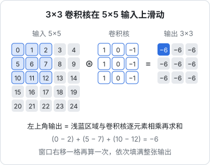
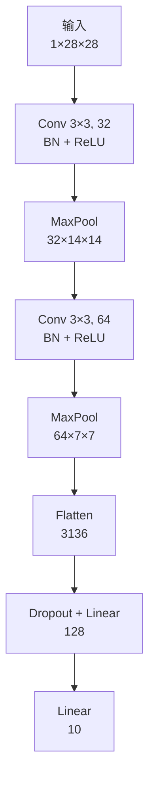

# 卷积网络

第 3 章的 MLP 第一步就是 `nn.Flatten()`：把 28×28 的图片拍平成 784 个数。这一步扔掉了一个关键信息——**哪些像素彼此相邻**。把所有像素打乱顺序再喂给 MLP，它的效果完全一样，可见它根本没在利用图像的空间结构。卷积网络（CNN）把「局部」和「平移不变」这两个关于图像的常识直接写进了网络结构，用更少的参数做到更好。这一章手推卷积的形状计算，再写一个小 CNN，在同样的数据上从 87% 提到 90% 以上。

虽然现在视觉领域也大量使用 Transformer，但卷积的思想（局部连接、权重共享）和形状推导的套路依然是基本功，多模态模型的图像编码器里也常见卷积层。

## MLP 看图的问题

| 问题 | MLP 的表现 | 图像的常识 |
|---|---|---|
| 参数太多 | 一张 224×224 彩色图拍平后约 15 万维，接一个 1000 宽的隐藏层就是 1.5 亿参数 | 识别边缘只需要看一小块邻域 |
| 不懂相邻 | 像素顺序打乱，效果不变 | 相邻像素高度相关 |
| 不懂平移 | 左上角的猫和右下角的猫要分别学 | 猫在哪里都是猫 |

## 卷积在做什么

卷积层用一个小窗口（**卷积核**，比如 3×3）在图上滑动，每到一个位置就把窗口内的像素和核的权重逐元素相乘再求和，得到输出的一个值：



它直接体现了两个先验：

- **局部连接**：每个输出只看输入的一小块
- **权重共享**：同一个核在所有位置使用同一组权重。所以在左上角学会识别竖线的核，在右下角同样能识别竖线

一个核只能检测一种模式，所以一层会用很多个核，每个核输出一张**特征图**（feature map），叠在一起形成多个**通道**。

### 用 PyTorch 验证

```python
import torch
from torch.nn import functional as F

x = torch.arange(25, dtype=torch.float32).reshape(1, 1, 5, 5)   # (B, C, H, W)
k = torch.tensor([[1., 0., -1.],
                  [1., 0., -1.],
                  [1., 0., -1.]]).reshape(1, 1, 3, 3)            # (out_C, in_C, kH, kW)
y = F.conv2d(x, k)
print(y.shape)        # torch.Size([1, 1, 3, 3])
print(y)              # 每个值都是 -6：左列减右列，输入每行是等差数列
```

这个核是一个简单的**竖向边缘检测器**：左边亮右边暗时输出正，反之输出负，颜色均匀时输出 0。早期的计算机视觉要人手设计这类核；CNN 的做法是让网络自己从数据里学出成百上千个核。

## 形状计算

卷积的输出尺寸由四个量决定：输入尺寸 $n$、核大小 $k$、填充 $p$（padding，四周补 0 的圈数）、步长 $s$（stride，每次滑动几格）：

$$
n_{\text{out}} = \left\lfloor \frac{n + 2p - k}{s} \right\rfloor + 1
$$

| 设置 | 输入 28 时的输出 | 用途 |
|---|---|---|
| `k=3, p=0, s=1` | 26 | 不补边，每层缩小 2 |
| `k=3, p=1, s=1` | 28 | 「same」卷积，尺寸不变，最常用 |
| `k=3, p=1, s=2` | 14 | 降采样一半 |
| `MaxPool2d(2)` | 14 | 2×2 取最大值，降采样一半 |

卷积层的参数量只和核有关，与图片大小无关：

$$
\text{参数量} = C_{\text{out}} \times C_{\text{in}} \times k \times k + C_{\text{out}}
$$

一个 `Conv2d(32, 64, 3)` 只有 $64 \times 32 \times 9 + 64 = 18496$ 个参数，处理 28×28 还是 1000×1000 的图都一样。

## 池化

**最大池化**（max pooling）把每个 2×2 区域取最大值，尺寸减半。它的作用：

- 降低分辨率，减少后续计算量
- 让后面的卷积核「看得更远」：经过一次池化，下一层 3×3 的核实际覆盖原图 6×6 的范围
- 对微小平移更不敏感：特征在 2×2 区域内挪动一格，最大值不变

层层卷积 + 池化之后，每个输出单元能看到的原图区域（**感受野**）越来越大，特征也从边缘、角点逐层组合成纹理、部件、整体形状。这就是第 2 章说的「深度带来层级特征」。

## 一个小 CNN

结构是经典的「卷积块 ×2 + 全连接头」：



完整脚本 `cnn.py`：

```python
import time
import torch
from torch import nn
from torch.utils.data import DataLoader
from torchvision import datasets, transforms

device = torch.device("mps" if torch.backends.mps.is_available() else "cpu")
torch.manual_seed(42)

train_tfm = transforms.Compose([
    transforms.RandomHorizontalFlip(),      # 衣服左右翻转还是同一类
    transforms.ToTensor(),
])
test_tfm = transforms.ToTensor()
train_ds = datasets.FashionMNIST("data", train=True, download=True, transform=train_tfm)
test_ds = datasets.FashionMNIST("data", train=False, download=True, transform=test_tfm)
train_dl = DataLoader(train_ds, batch_size=128, shuffle=True)
test_dl = DataLoader(test_ds, batch_size=512)


class SmallCNN(nn.Module):
    def __init__(self, n_classes: int = 10):
        super().__init__()
        self.features = nn.Sequential(
            nn.Conv2d(1, 32, kernel_size=3, padding=1),   # (B, 32, 28, 28)
            nn.BatchNorm2d(32),
            nn.ReLU(),
            nn.MaxPool2d(2),                              # (B, 32, 14, 14)
            nn.Conv2d(32, 64, kernel_size=3, padding=1),  # (B, 64, 14, 14)
            nn.BatchNorm2d(64),
            nn.ReLU(),
            nn.MaxPool2d(2),                              # (B, 64, 7, 7)
        )
        self.head = nn.Sequential(
            nn.Flatten(),                                 # (B, 64*7*7)
            nn.Dropout(0.3),
            nn.Linear(64 * 7 * 7, 128),
            nn.ReLU(),
            nn.Linear(128, n_classes),
        )

    def forward(self, x: torch.Tensor) -> torch.Tensor:
        return self.head(self.features(x))


model = SmallCNN().to(device)
print(sum(p.numel() for p in model.parameters()), "parameters")
loss_fn = nn.CrossEntropyLoss()
opt = torch.optim.AdamW(model.parameters(), lr=1e-3, weight_decay=1e-2)

for epoch in range(1, 6):
    t0 = time.time()
    model.train()
    for x, y in train_dl:
        x, y = x.to(device), y.to(device)
        loss = loss_fn(model(x), y)
        opt.zero_grad()
        loss.backward()
        opt.step()

    model.eval()
    correct = 0
    with torch.no_grad():
        for x, y in test_dl:
            x, y = x.to(device), y.to(device)
            correct += (model(x).argmax(1) == y).sum().item()
    print(f"epoch {epoch}  acc {correct / len(test_ds):.2%}  {time.time() - t0:.1f}s")
```

作者机器上的输出：

```text
421834 parameters
epoch 1  acc 87.67%  8.1s
epoch 2  acc 89.77%  5.0s
epoch 3  acc 89.75%  5.2s
epoch 4  acc 90.48%  5.0s
epoch 5  acc 90.53%  5.1s
```

第 1 轮就追平了 MLP 5 轮的成绩，5 轮后到 90.5%。（为了和第 3 章对比，这里仍直接在测试集上看准确率；正式实验应按第 4 章的做法用验证集选模型。）

### 参数都在哪

| 层 | 参数量 | 占比 |
|---|---|---|
| Conv 1→32 | 320 | 0.1% |
| Conv 32→64 | 18,496 | 4.4% |
| 两个 BatchNorm | 192 | 0.0% |
| Linear 3136→128 | 401,536 | 95.2% |
| Linear 128→10 | 1,290 | 0.3% |

两个卷积层只占不到 5% 的参数，却贡献了主要的提升。参数的 95% 都在拍平之后的第一个全连接层——这正是本章开头说的 MLP 处理大输入的问题。现代 CNN 通常用**全局平均池化**（`nn.AdaptiveAvgPool2d(1)`，把每个通道的特征图平均成一个数）代替大的全连接层，参数量能再降一个数量级。

### BatchNorm 的位置

`Conv → BatchNorm → ReLU` 是 CNN 里最常见的排列。BatchNorm2d 对每个通道，在 batch 和空间维度上统计均值、方差做标准化。有了它，网络对学习率和初始化都不那么敏感。记得它在 `train()` 和 `eval()` 下行为不同（第 3 章）。

## 通道维在前

PyTorch 的图像张量约定是 **`(B, C, H, W)`**，通道在前（NCHW）。而 PIL、NumPy、大多数图像库读出来的是 `(H, W, C)`。`transforms.ToTensor()` 会帮你转好，自己处理图片时要手动 `permute`：

```python
import numpy as np
import torch

img = np.random.randint(0, 256, size=(224, 224, 3), dtype=np.uint8)  # (H, W, C)
t = torch.from_numpy(img).permute(2, 0, 1).float() / 255.0          # (C, H, W)，0~1
batch = t.unsqueeze(0)                                               # (1, C, H, W)
```

## 迁移学习：别从零训练

真实项目里几乎不会从零训练视觉模型。做法是拿一个在大数据集上预训练好的网络（`torchvision.models` 里有 ResNet、EfficientNet、ViT 等），换掉最后的分类头，用自己的少量数据**微调**：

```python
from torch import nn
from torchvision import models

model = models.resnet18(weights=models.ResNet18_Weights.DEFAULT)  # 首次运行会下载权重
for p in model.parameters():
    p.requires_grad = False                          # 冻结骨干网络
model.fc = nn.Linear(model.fc.in_features, 5)        # 换成自己的 5 分类头，只训练这一层
```

预训练网络前面的层学到的是通用的边缘、纹理特征，换个任务依然有用。这个思路和大模型的「预训练 + 微调」完全一致，只是规模不同。

对一人公司来说，这类视觉任务更现实的选择往往是直接调用多模态大模型的 API（比如 hatch-counter 用视觉模型识别进货单），只在需要离线、低成本、高吞吐时才考虑自己微调小模型。知道 CNN 怎么工作，能帮你判断这两条路各自的边界。

## 本章要点

- MLP 拍平图片后丢掉了空间结构，参数量也随图片尺寸暴涨
- 卷积 = 局部连接 + 权重共享，参数量只和核大小、通道数有关
- 输出尺寸公式 $\lfloor (n + 2p - k)/s \rfloor + 1$；`k=3, p=1` 保持尺寸，池化或 `s=2` 减半
- 卷积 + 池化逐层扩大感受野，特征从边缘组合成部件
- 小 CNN 5 轮 90.5%，超过 MLP；参数大头在全连接层，可用全局平均池化替代
- PyTorch 图像张量是 `(B, C, H, W)`；实战优先用预训练模型微调或直接调多模态 API

## 动手练习

1. **先算再跑**：用[形状计算](#形状计算)的公式，先在纸上算出下面三个卷积对 28×28 输入的输出边长，再运行核对：

   ```python
   import torch
   from torch import nn

   x = torch.randn(1, 1, 28, 28)
   for conv in (nn.Conv2d(1, 8, 5),
                nn.Conv2d(1, 8, 3, padding=1, stride=2),
                nn.Conv2d(1, 8, 5, stride=2)):
       print(conv(x).shape, sum(p.numel() for p in conv.parameters()))
   ```

   验证：三行的形状依次是 `(1, 8, 24, 24)`、`(1, 8, 14, 14)`、`(1, 8, 12, 12)`，参数量依次是 208、80、208。

   参考答案：$28-5+1=24$；$\lfloor(28+2-3)/2\rfloor+1=14$；$\lfloor(28-5)/2\rfloor+1=12$，第三个是向下取整的例子。参数量 $8\times1\times k\times k+8$，和步长、填充无关。

2. **用全局平均池化瘦身**：把 `SmallCNN` 的 `head` 换成 `nn.AdaptiveAvgPool2d(1)`、`nn.Flatten()`、`nn.Linear(64, n_classes)`，重跑 `cnn.py`。

   验证：第一行打印 `19658 parameters`，约为原来的 1/21；再看 5 轮后的准确率和 90.5% 差多少。

   参考答案：卷积和 BatchNorm 共 $320+18496+192=19008$，新的头 $64\times10+10=650$。全连接大头没了，参数量骤降；准确率是否下降、降多少，取决于两层卷积提取的特征够不够用，以你跑出的数字为准。

3. **打乱像素**：用一个固定的像素排列同时处理训练集和测试集，分别喂给第 3 章的 MLP 和本章的 CNN（去掉随机翻转）：

   ```python
   perm = torch.randperm(784, generator=torch.Generator().manual_seed(0))
   shuffle = transforms.Lambda(lambda x: x.reshape(-1)[perm].reshape(1, 28, 28))
   tfm = transforms.Compose([transforms.ToTensor(), shuffle])
   ```

   验证：MLP 的准确率和不打乱时基本一样；CNN 的准确率下降，对 MLP 的领先明显缩小甚至消失。

   参考答案：MLP 一上来就拍平，像素顺序对它只是换了一种第一层权重的排列，学得出来的东西完全相同。CNN 依赖「相邻像素相关」这个先验，打乱后 3×3 窗口里看到的是互不相干的像素，卷积的优势就没了。这正是本章开头[MLP 看图的问题](#mlp-看图的问题)表格里第二行说的事。
