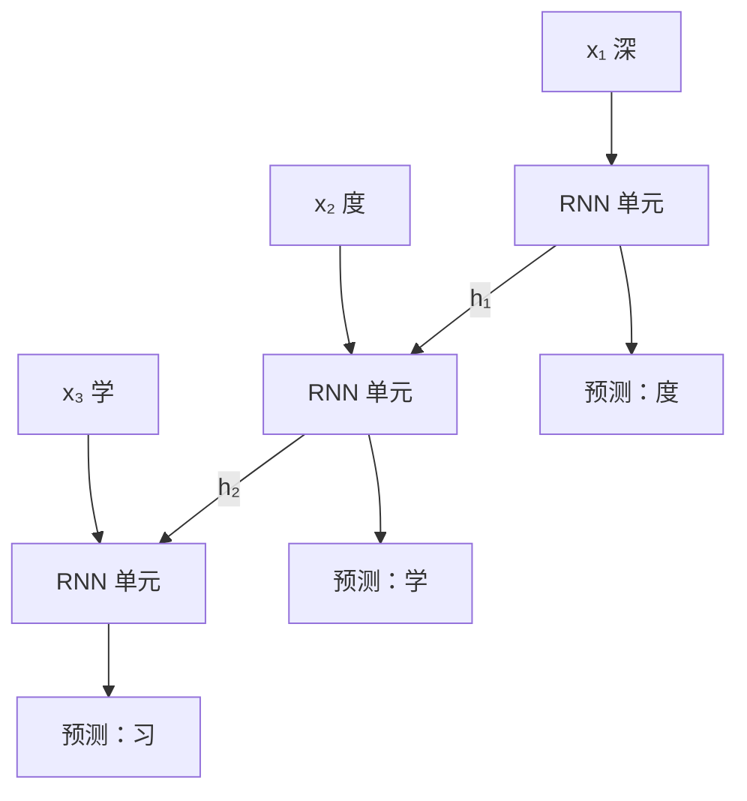

# 序列模型

图片尺寸是固定的，文本不是：一句话可能 5 个字，也可能 500 个字，而且顺序至关重要。这一章转向文本，搭好后面两章都要用的基础设施：字符级 tokenizer、语言模型的训练数据怎么切、怎么用交叉熵评价一个语言模型。然后写两个模型：只看前一个字的 **bigram**，和带「记忆」的循环网络 **GRU**，让它们学着写中文。最后看清循环网络的局限，为下一章的注意力做铺垫。

## 语料：用这个书架的书

语言模型需要一份纯文本。我们不去下载公开数据集，直接用这个书架里的 Markdown——内容是中文技术写作，混着代码和公式，正好够有挑战性：

```bash
cat ~/path/to/hatch-shelf/books/*/*.md > input.txt
wc -c input.txt
```

作者运行时得到约 103 万个字符、1919 种不同字符（汉字、英文字母、标点、代码符号）。你的数字会随书架内容变化，不影响后面的代码。换成任何你有权使用的文本都行：自己的博客、项目文档、聊天记录导出。

## 字符级 tokenizer

[《大模型原理科普》](../llm-fundamentals/)讲过真实的大模型用 BPE 之类的子词 tokenizer。为了把注意力放在模型本身，我们用最简单的方案：**每个字符就是一个 token**。

```python
text = open("input.txt", encoding="utf-8").read()
chars = sorted(set(text))
vocab_size = len(chars)
stoi = {ch: i for i, ch in enumerate(chars)}     # 字符 -> id
itos = {i: ch for ch, i in stoi.items()}         # id -> 字符
encode = lambda s: [stoi[c] for c in s]
decode = lambda ids: "".join(itos[i] for i in ids)

print(encode("模型"))           # 两个 id
print(decode(encode("模型")))   # 模型
```

| 方案 | 词表大小 | 一句话的 token 数 | 优缺点 |
|---|---|---|---|
| 字符级 | 小（本例约 2000） | 多 | 实现简单，不会遇到未知词；序列长、学得慢 |
| 子词（BPE） | 几万到几十万 | 少 | 效率高，是实际大模型的选择；需要训练 tokenizer |
| 词级 | 极大 | 最少 | 未登录词问题严重，基本被淘汰 |

## 语言模型的训练数据

语言模型的任务是：给定前面的字，预测下一个字。一段长度为 $T+1$ 的文本可以同时提供 $T$ 个训练样本：

| 输入（上下文） | 目标 |
|---|---|
| 深 | 度 |
| 深度 | 学 |
| 深度学 | 习 |

实现上，从语料里随机截一段长度 `block_size + 1` 的片段，前 `block_size` 个字作输入 `x`，往后错一位的 `block_size` 个字作目标 `y`：

```python
import torch

data = torch.tensor(encode(text), dtype=torch.long)
n = int(0.9 * len(data))
train_data, val_data = data[:n], data[n:]        # 前 90% 训练，后 10% 验证

block_size, batch_size = 64, 32

def get_batch(split: str):
    src = train_data if split == "train" else val_data
    ix = torch.randint(len(src) - block_size - 1, (batch_size,))   # 随机起点
    x = torch.stack([src[i : i + block_size] for i in ix])          # (B, T)
    y = torch.stack([src[i + 1 : i + block_size + 1] for i in ix])  # (B, T)，错一位
    return x, y
```

模型对每个位置都输出一个 `vocab_size` 维的 logits，形状 `(B, T, V)`，和目标 `(B, T)` 算交叉熵。`F.cross_entropy` 要求类别维在第二维，所以先把前两维压平：

```python
loss = F.cross_entropy(logits.view(-1, vocab_size), y.view(-1))   # (B*T, V) 和 (B*T,)
```

验证集取语料的**最后 10%**，而不是随机抽：随机抽的片段和训练片段会大量重叠，验证 loss 就失去了意义。

### 怎么读 loss

第 3 章说过，均匀猜测的 loss 是 $\ln V$。本例 $V = 1919$，$\ln 1919 \approx 7.56$。loss 也可以换算成**困惑度**（perplexity）$e^{L}$：loss 2.7 对应困惑度约 15，直觉上相当于模型每一步在大约 15 个字里犹豫。困惑度越低越好。

## 模型一：bigram

最简单的语言模型：**只看当前这一个字**，预测下一个字。它就是一张 `V × V` 的表，第 `i` 行是「字 `i` 后面跟各个字的 logits」。用 `nn.Embedding` 实现正合适——embedding 本质就是按 id 查表：

```python
from torch import nn

class Bigram(nn.Module):
    def __init__(self, vocab_size: int):
        super().__init__()
        self.table = nn.Embedding(vocab_size, vocab_size)

    def forward(self, idx, h=None):
        return self.table(idx), None             # (B, T) -> (B, T, V)
```

它不用训练也能「解出来」：数一遍语料里每对相邻字符出现的次数，归一化就是最优解。用梯度下降训练它，是为了让它和后面的模型共用同一套代码。

## 模型二：循环网络

bigram 只看一个字，「机器学」后面它不知道该接「习」，因为它只看到「学」。要看更长的上下文，最朴素的想法是把前 $k$ 个字的 embedding 拼起来喂给 MLP，但窗口固定，而且窗口越大参数越多。

**循环神经网络**（RNN）换了个思路：维护一个**隐藏状态** $h$，每读一个字就更新一次，像人读书时脑子里的「到目前为止的理解」：

$$
h_t = \tanh(W_x x_t + W_h h_{t-1} + b)
$$



图里三个「RNN 单元」是**同一个**，共享同一组参数，只是在时间上展开。这和卷积在空间上共享权重是同一个思想。不管序列多长，参数量都不变。

原始 RNN 有严重的梯度消失问题：反向传播要穿过很多次 $W_h$ 和 tanh，梯度指数级衰减，几十步之前的信息基本学不到。**LSTM** 和 **GRU** 加了「门」来控制信息保留多少、更新多少，给梯度留了一条更通畅的路。GRU 是更简洁的那个，PyTorch 一行就能用：

```python
class CharGRU(nn.Module):
    def __init__(self, vocab_size: int, d_emb: int = 128, d_hidden: int = 256):
        super().__init__()
        self.emb = nn.Embedding(vocab_size, d_emb)
        self.rnn = nn.GRU(d_emb, d_hidden, batch_first=True)
        self.out = nn.Linear(d_hidden, vocab_size)

    def forward(self, idx, h=None):
        x = self.emb(idx)                        # (B, T, d_emb)
        y, h = self.rnn(x, h)                    # (B, T, d_hidden)，h 是最后的隐藏状态
        return self.out(y), h                    # (B, T, V)
```

`batch_first=True` 让输入形状是 `(B, T, ...)`，否则 PyTorch 的 RNN 默认要 `(T, B, ...)`，这是个常见坑。

## 训练与生成

把上面的零件组装成 `char_rnn.py`，用命令行参数选模型：

```python
import math
import sys
import torch
from torch import nn
from torch.nn import functional as F

device = torch.device("mps" if torch.backends.mps.is_available() else "cpu")
torch.manual_seed(1337)

# ……此处放上文的 tokenizer、get_batch（返回前加 .to(device)）、Bigram、CharGRU……

@torch.no_grad()
def estimate_loss(model, iters: int = 50) -> dict:
    model.eval()
    out = {}
    for split in ("train", "val"):
        losses = torch.zeros(iters)
        for k in range(iters):
            x, y = get_batch(split)
            logits, _ = model(x)
            losses[k] = F.cross_entropy(logits.view(-1, vocab_size), y.view(-1)).item()
        out[split] = losses.mean().item()
    model.train()
    return out


@torch.no_grad()
def generate(model, prompt: str, n_new: int = 80) -> str:
    model.eval()
    idx = torch.tensor([encode(prompt)], device=device)
    logits, h = model(idx)
    out = list(idx[0].tolist())
    for _ in range(n_new):
        probs = F.softmax(logits[:, -1, :], dim=-1)          # 只要最后一个位置的预测
        nxt = torch.multinomial(probs, num_samples=1)       # 按概率抽一个字，(1, 1)
        out.append(nxt.item())
        logits, h = model(nxt, h)                           # 只喂新字，隐藏状态接着用
    return decode(out)


kind = sys.argv[1] if len(sys.argv) > 1 else "gru"
model = (Bigram(vocab_size) if kind == "bigram" else CharGRU(vocab_size)).to(device)
opt = torch.optim.AdamW(model.parameters(), lr=3e-3)
print(f"{kind}: {sum(p.numel() for p in model.parameters()):,} params, "
      f"均匀猜测的 loss = {math.log(vocab_size):.2f}")

for step in range(3001):
    if step % 500 == 0:
        l = estimate_loss(model)
        print(f"step {step:4d}  train {l['train']:.3f}  val {l['val']:.3f}")
    x, y = get_batch("train")
    logits, _ = model(x)
    loss = F.cross_entropy(logits.view(-1, vocab_size), y.view(-1))
    opt.zero_grad()
    loss.backward()
    opt.step()

print(generate(model, "模型"))
```

`estimate_loss` 在 50 个随机 batch 上取平均：单个 batch 的 loss 噪声很大，直接打印会看不出趋势。

```bash
uv run python char_rnn.py bigram
uv run python char_rnn.py gru
```

作者运行 3000 步的结果：

| 模型 | 参数量 | 起始 val loss | 3000 步 val loss | 困惑度 |
|---|---|---|---|---|
| bigram | 368 万 | 8.01 | 3.77 | 约 43 |
| GRU | 104 万 | 7.59 | 2.73 | 约 15 |

bigram 的参数全在那张 1919×1919 的表里，比 GRU 多 3 倍多，效果却差得多：**参数多不等于能力强，结构决定了模型能利用什么信息**。bigram 3000 步时其实还没收敛，但就算收敛，只看一个字的上限也摆在那里。

两者生成的文字（提示词「模型」）对比很直观：

```text
bigram：模型博气办愿意5`（潜结果事是程》第 DDe pog);
GRU：  模型博客。「清单`」只看敏感的程序列写给容器日志
       # 静态资源
       - **共享最简单的格式回名**：有状态时预备：
```

bigram 只会拼出局部合理的两字组合；GRU 已经学会了常见词、标点、Markdown 的标题和列表格式，句子读起来「像那么回事」但不通顺。

## 循环网络的局限

GRU 的进步是真实的，但它有两个结构性问题：

1. **只能串行**：$h_t$ 依赖 $h_{t-1}$，第 100 个字必须等前 99 个字算完。GPU 擅长的是大规模并行，RNN 在训练时浪费了大部分算力
2. **信息瓶颈**：前面所有内容都要压缩进一个固定大小的向量 $h$。上下文越长，早期信息越容易被冲掉。门控缓解了梯度消失，但没有消除这个瓶颈

把这两个问题换成一个问题来问：**能不能让每个位置直接去看前面任意一个位置，而且所有位置同时算？** 这就是下一章的注意力机制。

## 本章要点

- 字符级 tokenizer 用两个字典实现，适合教学；实际大模型用 BPE 等子词方案
- 语言模型的数据：截一段文本，输入和目标错开一位，一段同时提供 T 个样本
- 验证集取语料末尾，避免和训练片段重叠；loss 和 $\ln V$ 比较，可换算成困惑度
- bigram 只看一个字，是一张查找表；RNN 用隐藏状态累积上下文，GRU / LSTM 用门缓解梯度消失
- 生成时每次取最后位置的分布，`torch.multinomial` 抽样，把新字接回去
- RNN 只能串行计算、上下文被压进固定大小的向量，这两点引出了注意力

## 动手练习

1. **起始 loss 为什么高于 $\ln V$**：作者表格里 bigram 的起始 val loss 是 8.01，比 $\ln 1919 \approx 7.56$ 还高。在 `char_rnn.py` 里建好 `Bigram` 之后加一行 `nn.init.zeros_(model.table.weight)`，运行 `uv run python char_rnn.py bigram`，看 step 0 那一行。

   验证：step 0 的 train 和 val loss 都等于程序开头打印的「均匀猜测的 loss」（到小数点后两位一致）；去掉这一行，step 0 的 loss 会高于它。

   参考答案：`nn.Embedding` 默认用标准正态初始化，查出来的 logits 随机且尺度不小，等于一开始就带着随机的偏见乱猜，比均匀猜还差。全零的 logits 经过 softmax 就是均匀分布，loss 正好是 $\ln V$。

2. **不训练的 bigram**：[模型一：bigram](#模型一bigram)说它可以直接数出来。用训练集数相邻字符对，在验证集上算交叉熵，和 3000 步训练出的 bigram 比：

   ```python
   V = vocab_size
   pairs = train_data[:-1] * V + train_data[1:]               # 把 (前, 后) 编成一个整数
   counts = torch.bincount(pairs, minlength=V * V).view(V, V).float()
   probs = (counts + 0.1) / (counts + 0.1).sum(dim=1, keepdim=True)   # 加 0.1 平滑，避免 log(0)
   val_loss = -probs[val_data[:-1], val_data[1:]].log().mean()
   print(f"count bigram val loss {val_loss.item():.3f}")
   ```

   验证：几秒内算完，结果低于 `char_rnn.py bigram` 第 3000 步的 val loss。

   参考答案：数出来的频率就是 bigram 在训练集上的最优解，梯度下降 3000 步还没走到那里。平滑系数可以试 1、0.1、0.01，太大会把常见搭配的概率摊薄，val loss 反而变高。

3. **漏写 `batch_first`**：对比 `batch_first=True` 和不写时，改动 batch 里第 0 条序列会不会影响第 1 条的输出：

   ```python
   import torch
   from torch import nn

   torch.manual_seed(0)
   for bf in (True, False):
       gru = nn.GRU(8, 16, batch_first=bf)
       x = torch.randn(2, 5, 8)                     # 本意：(B=2, T=5, 8)
       x2 = x.clone()
       x2[0] = torch.randn(5, 8)                    # 只改第 0 条
       y, _ = gru(x)
       y2, _ = gru(x2)
       print(bf, y.shape, "第 1 条变了:", not torch.allclose(y[1], y2[1]))
   ```

   验证：两种写法输出形状都是 `torch.Size([2, 5, 16])`、都不报错；`True` 那行打印 `第 1 条变了: False`，`False` 那行打印 `第 1 条变了: True`。

   参考答案：不写 `batch_first` 时，GRU 把 `(2, 5, 8)` 当成 `T=2, B=5`，第 0 维变成了时间，第 0 条样本成了第 1 条的「前文」，样本之间串了味。形状对得上就不会报错，只能靠这类检查发现。
