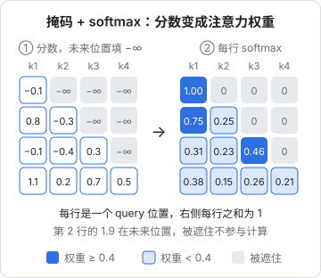

# 手写注意力

[《大模型原理科普》](../llm-fundamentals/)用「检索」的比喻讲了注意力的直觉：Query 去匹配 Key，按匹配程度混合 Value。这一章不再重复比喻，而是从一个更朴素的问题出发，一步步把**因果自注意力**写出来：先用矩阵乘法做「对前文求平均」，再把固定的平均权重换成由数据决定的权重，加上缩放和掩码，扩展成多头，最后和 PyTorch 内置实现逐位对比，确认写对了。写完这一章，下一章的 GPT 只剩组装。

## 从「对前文求平均」开始

上一章结尾提出的问题是：让每个位置直接看前面所有位置。最简单的「看」是**取平均**：位置 $t$ 的新表示 = 位置 $1 \ldots t$ 的向量的平均值。

用循环写很直观，但很慢。关键技巧是：**加权平均可以写成矩阵乘法**。构造一个下三角矩阵，每行归一化，左乘输入即可：

```python
import torch

T = 4
w = torch.tril(torch.ones(T, T))        # 下三角全 1
w = w / w.sum(dim=1, keepdim=True)      # 每行和为 1
print(w)
# tensor([[1.0000, 0.0000, 0.0000, 0.0000],
#         [0.5000, 0.5000, 0.0000, 0.0000],
#         [0.3333, 0.3333, 0.3333, 0.0000],
#         [0.2500, 0.2500, 0.2500, 0.2500]])

x = torch.tensor([[1., 0.], [3., 2.], [5., 4.], [7., 6.]])   # (T, C)
print(w @ x)
# tensor([[1., 0.],
#         [2., 1.],
#         [3., 2.],
#         [4., 3.]])
```

第 3 行 `[3., 2.]` 正好是前三行 `[1,0]`、`[3,2]`、`[5,4]` 的平均。**一次矩阵乘法，所有位置同时完成**，没有 RNN 那种串行依赖。

同样的结果可以换一种写法得到，这个写法就是注意力的骨架：

```python
from torch.nn import functional as F

scores = torch.zeros(T, T)                                        # 所有位置一视同仁
mask = torch.tril(torch.ones(T, T, dtype=torch.bool))
scores = scores.masked_fill(~mask, float("-inf"))                 # 未来位置填 -inf
w = F.softmax(scores, dim=-1)                                     # 和上面的 w 完全相同
```

softmax 把 $-\infty$ 变成 0，把相等的分数变成均匀权重。现在只差一步：**分数不该全是 0，而应该取决于内容**。

## 让权重取决于内容

平均的问题是一视同仁。读到「它」的时候，前文的「奖杯」比「的」重要得多。所以每个位置要自己决定该关注谁、关注多少。做法是让每个位置的向量 $x$ 经过三个线性变换：

- $q = x W_Q$：我在找什么
- $k = x W_K$：我有什么可以被找到
- $v = x W_V$：被选中时我贡献什么内容

位置 $i$ 对位置 $j$ 的分数就是 $q_i \cdot k_j$。所有分数一次算出来就是 $QK^\top$，形状 `(T, T)`。剩下的流程和上面求平均完全一样：

$$
\begin{aligned}
&\text{Attention}(Q, K, V) \\
&= \text{softmax}\left(\frac{QK^\top}{\sqrt{d_k}} + M\right)V
\end{aligned}
$$

其中 $M$ 是掩码矩阵：允许看的位置为 0，未来位置为 $-\infty$。



图里的数字可以直接复现：

```python
scores = torch.tensor([[-0.1,  0.4, -0.9,  0.1],
                       [ 0.8, -0.3,  1.9, -1.9],
                       [-0.1, -0.4,  0.3, -0.3],
                       [ 1.1,  0.2,  0.7,  0.5]])
mask = torch.tril(torch.ones(4, 4, dtype=torch.bool))
w = scores.masked_fill(~mask, float("-inf")).softmax(dim=-1)
print(w.round(decimals=2))
# tensor([[1.0000, 0.0000, 0.0000, 0.0000],
#         [0.7500, 0.2500, 0.0000, 0.0000],
#         [0.3100, 0.2300, 0.4600, 0.0000],
#         [0.3800, 0.1500, 0.2600, 0.2100]])
```

注意第 2 行：原始分数里位置 3 的 1.9 最大，但它在未来，被遮掉了，不参与 softmax。**掩码必须在 softmax 之前加**：如果先 softmax 再把未来位置置 0，每行加起来就不等于 1，而且未来位置的分数已经通过分母影响了其他权重，信息泄露了。

## 为什么除以 $\sqrt{d_k}$

如果 $q$ 和 $k$ 的每个分量都是均值 0、方差 1 的独立随机数，它们的点积是 $d_k$ 项乘积之和，方差约等于 $d_k$。实测一下：

```python
import math

for d in (16, 64, 256):
    q, k = torch.randn(10000, d), torch.randn(10000, d)
    s = (q * k).sum(-1)
    print(d, f"{s.var().item():.1f}", f"{(s / math.sqrt(d)).var().item():.2f}")
# 16 15.8 0.99
# 64 63.5 0.99
# 256 261.3 1.02
```

维度越大，分数的尺度越大。分数尺度大了，softmax 会变得极其尖锐：

```python
s = torch.tensor([1., 2., 3., 4.])
print(s.softmax(-1))        # [0.0321, 0.0871, 0.2369, 0.6439]
print((s * 8).softmax(-1))  # [3.8e-11, 1.1e-07, 3.4e-04, 9.9966e-01]
```

几乎变成了 one-hot：只看一个位置，其他位置的梯度接近 0，训练很难进行。除以 $\sqrt{d_k}$ 把方差拉回 1 附近，softmax 保持在梯度健康的区域。

## 单头因果自注意力

把以上组装成一个函数。「自」注意力（self-attention）的意思是 Q、K、V 都来自同一个序列：

```python
import math
import torch
from torch.nn import functional as F

def attention(q, k, v, causal: bool = True):
    # q, k, v: (B, T, d)
    d = q.size(-1)
    scores = q @ k.transpose(-2, -1) / math.sqrt(d)          # (B, T, T)
    if causal:
        T = q.size(-2)
        mask = torch.tril(torch.ones(T, T, dtype=torch.bool, device=q.device))
        scores = scores.masked_fill(~mask, float("-inf"))
    weights = F.softmax(scores, dim=-1)                       # 每行和为 1
    return weights @ v, weights                               # (B, T, d)

torch.manual_seed(0)
x = torch.randn(1, 4, 8)
out, w = attention(x, x, x)
ref = F.scaled_dot_product_attention(x, x, x, is_causal=True)
print("max diff vs torch:", (out - ref).abs().max().item())   # 约 1e-7，浮点误差
```

`F.scaled_dot_product_attention`（常简称 SDPA）是 PyTorch 2.x 内置的注意力实现，在支持的硬件上会自动选用 FlashAttention 这类融合内核，又快又省显存。**自己写一遍是为了理解，生产代码用 SDPA**。手写版和它的差异在 $10^{-7}$ 量级，是 float32 的舍入误差，说明逻辑完全一致。

## 多头注意力

一组 Q、K、V 只能表达一种「关注方式」。多头注意力把 $d_{\text{model}}$ 维切成 $n_{\text{head}}$ 份，每份独立做一次注意力，再拼回来。参数量和单头一样，但能同时捕捉多种关系。

形状变换是本章最容易写错的地方，逐步看：

| 步骤 | 操作 | 形状 |
|---|---|---|
| 输入 | | `(B, T, C)` |
| 一次算出 QKV | `self.qkv(x)` | `(B, T, 3C)` |
| 切成三份 | `.split(C, dim=2)` | 3 个 `(B, T, C)` |
| 切头 | `.view(B, T, nh, hs)` | `(B, T, nh, hs)` |
| 头维提前 | `.transpose(1, 2)` | `(B, nh, T, hs)` |
| 注意力分数 | `q @ k.transpose(-2, -1)` | `(B, nh, T, T)` |
| 加权求和 | `att @ v` | `(B, nh, T, hs)` |
| 拼回 | `.transpose(1, 2).contiguous().view(B, T, C)` | `(B, T, C)` |
| 输出投影 | `self.proj(y)` | `(B, T, C)` |

其中 `hs = C // nh` 是每个头的维度。把头维放到第 2 维之后，`@` 会把 `(B, nh)` 都当作批维度，所有样本的所有头一次算完（第 1 章讲过 `@` 只看最后两维）。拼回时 `transpose` 之后内存不连续，所以要 `.contiguous()` 才能 `view`（同样是第 1 章的内容）。

```python
from torch import nn

class CausalSelfAttention(nn.Module):
    def __init__(self, d_model: int, n_head: int, block_size: int, dropout: float = 0.0):
        super().__init__()
        assert d_model % n_head == 0
        self.n_head = n_head
        self.qkv = nn.Linear(d_model, 3 * d_model)    # 一次算出 Q、K、V
        self.proj = nn.Linear(d_model, d_model)       # 多头结果拼回去后再混一次
        self.drop = nn.Dropout(dropout)
        mask = torch.tril(torch.ones(block_size, block_size, dtype=torch.bool))
        self.register_buffer("mask", mask.view(1, 1, block_size, block_size))

    def forward(self, x):
        B, T, C = x.shape
        q, k, v = self.qkv(x).split(C, dim=2)                         # 各 (B, T, C)
        hs = C // self.n_head
        q = q.view(B, T, self.n_head, hs).transpose(1, 2)             # (B, nh, T, hs)
        k = k.view(B, T, self.n_head, hs).transpose(1, 2)
        v = v.view(B, T, self.n_head, hs).transpose(1, 2)

        att = (q @ k.transpose(-2, -1)) / math.sqrt(hs)               # (B, nh, T, T)
        att = att.masked_fill(~self.mask[:, :, :T, :T], float("-inf"))
        att = self.drop(F.softmax(att, dim=-1))
        y = att @ v                                                   # (B, nh, T, hs)
        y = y.transpose(1, 2).contiguous().view(B, T, C)              # 拼回 (B, T, C)
        return self.proj(y)
```

几个实现细节：

- **一个 Linear 算 QKV**：等价于三个 `Linear(C, C)`，但一次大矩阵乘法比三次小的更快
- **`register_buffer`**：掩码不是参数，不需要梯度，但要跟着 `model.to(device)` 一起搬到 GPU、跟着 `state_dict` 一起保存。buffer 就是干这个的
- **预先建好最大尺寸的掩码**，前向时切出 `[:T, :T]`，序列比 `block_size` 短时也能用
- **输出投影 `proj`**：拼接后的各头结果是彼此独立算出来的，再过一个线性层让它们混合

## 验证：形状、因果性、正确性

写完注意力一定要做这三个检查，下一章出了问题时才能排除这一块：

```python
torch.manual_seed(0)
attn = CausalSelfAttention(d_model=32, n_head=4, block_size=16)
x = torch.randn(2, 10, 32)
y = attn(x)
print(y.shape)                                # torch.Size([2, 10, 32])

# 因果性：改动第 7 个位置之后的输入，前 7 个位置的输出不应该变
x2 = x.clone()
x2[:, 7:] = torch.randn(2, 3, 32)
print("prefix unchanged:", torch.allclose(attn(x2)[:, :7], y[:, :7], atol=1e-6))

# 正确性：与 PyTorch 内置 SDPA 对比
q, k, v = attn.qkv(x).split(32, dim=2)
sh = lambda t: t.view(2, 10, 4, 8).transpose(1, 2)
ref = F.scaled_dot_product_attention(sh(q), sh(k), sh(v), is_causal=True)
ref = attn.proj(ref.transpose(1, 2).contiguous().view(2, 10, 32))
print("max diff vs sdpa:", (y - ref).abs().max().item())
```

```text
torch.Size([2, 10, 32])
prefix unchanged: True
max diff vs sdpa: 1.043081283569336e-07
```

因果性检查特别重要。如果掩码写错（比如 `tril` 写成 `triu`，或者忘了 `~`），模型训练时能偷看答案，训练 loss 会降得出奇地低，生成时却一塌糊涂。这种 bug 不会报错，只有这样的测试能抓住。

## 注意力不知道顺序

注意力有一个反直觉的性质：**它对输入的顺序没有感知**。把输入序列打乱，（不加掩码的）注意力输出只是被同样地打乱，每个位置的值本身不变：

```python
x = torch.randn(1, 5, 8)
p = torch.tensor([2, 0, 4, 1, 3])                         # 一个排列
o = F.scaled_dot_product_attention(x, x, x)
o2 = F.scaled_dot_product_attention(x[:, p], x[:, p], x[:, p])
print(torch.allclose(o[:, p], o2, atol=1e-6))             # True
```

点积只看内容不看位置，「我爱你」和「你爱我」在它眼里是同一袋字。RNN 天生按顺序读，没有这个问题；注意力必须额外注入位置信息。最简单的做法是给每个位置学一个**位置 embedding**，加到 token embedding 上——下一章的 GPT 就这么做。更现代的方案（如 RoPE）留给[《大模型原理进阶》](../llm-deep-dive/)。

## 和 RNN 比

| | RNN / GRU | 自注意力 |
|---|---|---|
| 位置 $t$ 看到位置 1 | 经过 $t-1$ 步传递 | 一步直达 |
| 训练时并行 | 不能，按时间串行 | 能，所有位置同时算 |
| 上下文容量 | 压进固定大小的 $h$ | 保留所有位置，按需取用 |
| 计算量随长度 $T$ | $O(T)$ | $O(T^2)$ |
| 顺序信息 | 天生具备 | 需要位置编码 |

$O(T^2)$ 是注意力付出的代价：分数矩阵是 `(T, T)`。这也是为什么上下文长度是大模型最昂贵的资源之一，KV Cache、FlashAttention 等技术都是围绕它展开的。

## 本章要点

- 对前文的加权平均可以写成「下三角权重矩阵 @ 输入」，所有位置一次算完
- 注意力 = 权重由内容决定的加权平均：$q \cdot k$ 打分，掩码，softmax，乘 $V$
- 掩码在 softmax 之前把未来位置设为 $-\infty$；除以 $\sqrt{d_k}$ 防止 softmax 过尖
- 多头 = 把通道切成几份分别做注意力再拼回；关键形状 `(B, nh, T, hs)`
- 写完必做三项检查：形状、因果性（改后缀不影响前缀）、与 SDPA 对比；生产代码用 SDPA
- 注意力本身不感知顺序，需要位置编码；计算量随序列长度平方增长

## 动手练习

1. **埋一个掩码 bug**：把 `CausalSelfAttention.__init__` 里的 `torch.tril` 改成 `torch.triu`，重跑[验证：形状、因果性、正确性](#验证形状因果性正确性)那段代码。

   验证：形状仍是 `torch.Size([2, 10, 32])`，没有任何报错，但打印 `prefix unchanged: False`，和 SDPA 的差值也不再是 1e-7 量级。

   参考答案：`triu` 让每个位置只能看自己和**未来**，前 7 个位置的输出依赖被改动的后缀。这类 bug 只有因果性测试能抓到，改回 `tril` 后两项检查恢复正常。

2. **先 softmax 再遮**：用随机的 `(4, 4)` 分数，先 `softmax(dim=-1)`，再用 `masked_fill(~mask, 0.)` 把上三角置 0，打印每行之和。

   验证：只有最后一行的和是 1，前三行都小于 1。

   参考答案：未来位置已经进了 softmax 的分母，把它们事后置 0 不会让剩下的权重重新归一化，信息也已经泄露。正确顺序是先填 `-inf` 再 softmax。

3. **因果掩码和顺序**：把[注意力不知道顺序](#注意力不知道顺序)那段代码里两次 `scaled_dot_product_attention` 都加上 `is_causal=True`，再看 `allclose` 的结果。

   验证：打印 `False`。

   参考答案：因果掩码按「第几个位置」决定谁能看谁，打乱顺序后每个 token 能看到的前文变了，输出不再只是同样地被打乱。可见因果掩码本身带进了一部分顺序信息，不过下一章的 GPT 仍按常规做法显式加上位置 embedding。
