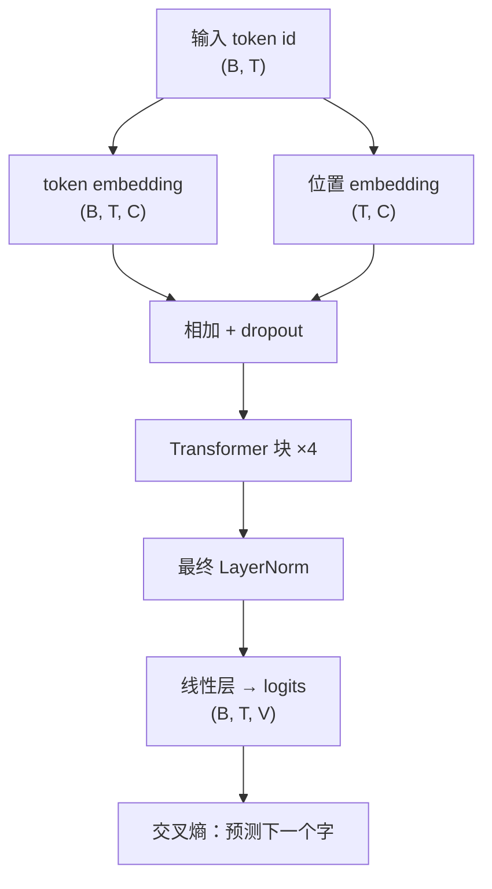
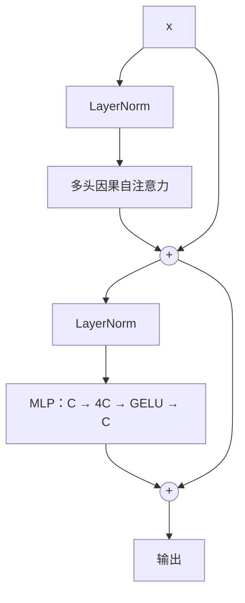

# 从零写一个 mini-GPT

前七章的零件已经齐了：张量和自动求导（第 1 章）、MLP 和 GELU（第 2 章）、训练循环和 AdamW（第 3 章）、dropout、LayerNorm、学习率预热和余弦退火（第 4 章）、字符级 tokenizer 和语言模型的数据切法（第 6 章）、多头因果自注意力（第 7 章）。这一章把它们组装成一个完整的 GPT：约 370 万参数，在 Mac 上训练 5 分钟左右，用这个书架里的书学会写「像模像样」的中文技术文档。代码是一个约 200 行的单文件，结构和 GPT-2 一致，只是小了几个数量级。

## 整体结构



每个 Transformer 块内部：



分工很清楚：**注意力负责在位置之间交换信息，MLP 负责在每个位置上独立地加工信息**。两者交替堆叠。

## 完整代码

新建 `gpt.py`，`input.txt` 沿用上一章的语料。需要 Python 3.10 及以上（用到了 `int | None` 写法）：

```python
"""字符级 mini-GPT：python gpt.py train / python gpt.py sample "提示词" """
import math
import sys
import time
from dataclasses import dataclass

import torch
from torch import nn
from torch.nn import functional as F


@dataclass
class Config:
    block_size: int = 128     # 上下文长度（字符数）
    vocab_size: int = 0       # 由数据决定
    n_layer: int = 4
    n_head: int = 4
    d_model: int = 256
    dropout: float = 0.1


# ---------------- 模型 ----------------
class CausalSelfAttention(nn.Module):
    def __init__(self, cfg: Config):
        super().__init__()
        self.n_head = cfg.n_head
        self.qkv = nn.Linear(cfg.d_model, 3 * cfg.d_model)
        self.proj = nn.Linear(cfg.d_model, cfg.d_model)
        self.attn_drop = nn.Dropout(cfg.dropout)
        self.resid_drop = nn.Dropout(cfg.dropout)
        mask = torch.tril(torch.ones(cfg.block_size, cfg.block_size, dtype=torch.bool))
        self.register_buffer("mask", mask.view(1, 1, cfg.block_size, cfg.block_size))

    def forward(self, x):
        B, T, C = x.shape
        hs = C // self.n_head
        q, k, v = self.qkv(x).split(C, dim=2)
        q = q.view(B, T, self.n_head, hs).transpose(1, 2)
        k = k.view(B, T, self.n_head, hs).transpose(1, 2)
        v = v.view(B, T, self.n_head, hs).transpose(1, 2)
        att = (q @ k.transpose(-2, -1)) / math.sqrt(hs)
        att = att.masked_fill(~self.mask[:, :, :T, :T], float("-inf"))
        att = self.attn_drop(F.softmax(att, dim=-1))
        y = (att @ v).transpose(1, 2).contiguous().view(B, T, C)
        return self.resid_drop(self.proj(y))


class MLP(nn.Module):
    def __init__(self, cfg: Config):
        super().__init__()
        self.net = nn.Sequential(
            nn.Linear(cfg.d_model, 4 * cfg.d_model),
            nn.GELU(),
            nn.Linear(4 * cfg.d_model, cfg.d_model),
            nn.Dropout(cfg.dropout),
        )

    def forward(self, x):
        return self.net(x)


class Block(nn.Module):
    def __init__(self, cfg: Config):
        super().__init__()
        self.ln1 = nn.LayerNorm(cfg.d_model)
        self.attn = CausalSelfAttention(cfg)
        self.ln2 = nn.LayerNorm(cfg.d_model)
        self.mlp = MLP(cfg)

    def forward(self, x):
        x = x + self.attn(self.ln1(x))   # pre-norm + 残差
        x = x + self.mlp(self.ln2(x))
        return x


class GPT(nn.Module):
    def __init__(self, cfg: Config):
        super().__init__()
        self.cfg = cfg
        self.tok_emb = nn.Embedding(cfg.vocab_size, cfg.d_model)
        self.pos_emb = nn.Embedding(cfg.block_size, cfg.d_model)
        self.drop = nn.Dropout(cfg.dropout)
        self.blocks = nn.ModuleList([Block(cfg) for _ in range(cfg.n_layer)])
        self.ln_f = nn.LayerNorm(cfg.d_model)
        self.head = nn.Linear(cfg.d_model, cfg.vocab_size, bias=False)
        self.head.weight = self.tok_emb.weight          # 权重共享
        self.apply(self._init_weights)

    @staticmethod
    def _init_weights(m):
        if isinstance(m, (nn.Linear, nn.Embedding)):
            nn.init.normal_(m.weight, mean=0.0, std=0.02)
        if isinstance(m, nn.Linear) and m.bias is not None:
            nn.init.zeros_(m.bias)

    def forward(self, idx, targets=None):
        B, T = idx.shape
        assert T <= self.cfg.block_size
        pos = torch.arange(T, device=idx.device)
        x = self.drop(self.tok_emb(idx) + self.pos_emb(pos))   # (B, T, C)
        for block in self.blocks:
            x = block(x)
        logits = self.head(self.ln_f(x))                        # (B, T, V)
        loss = None
        if targets is not None:
            loss = F.cross_entropy(logits.view(-1, logits.size(-1)), targets.view(-1))
        return logits, loss

    @torch.no_grad()
    def generate(self, idx, max_new_tokens: int, temperature: float = 1.0, top_k: int | None = None):
        for _ in range(max_new_tokens):
            idx_cond = idx[:, -self.cfg.block_size:]            # 超长就只保留最近的上下文
            logits, _ = self(idx_cond)
            logits = logits[:, -1, :] / temperature
            if top_k is not None:
                v, _ = torch.topk(logits, min(top_k, logits.size(-1)))
                logits[logits < v[:, [-1]]] = float("-inf")
            probs = F.softmax(logits, dim=-1)
            nxt = torch.multinomial(probs, num_samples=1)
            idx = torch.cat([idx, nxt], dim=1)
        return idx


# ---------------- 数据 ----------------
def get_device() -> torch.device:
    if torch.cuda.is_available():
        return torch.device("cuda")
    if torch.backends.mps.is_available():
        return torch.device("mps")
    return torch.device("cpu")


def build_vocab(text: str):
    chars = sorted(set(text))
    stoi = {ch: i for i, ch in enumerate(chars)}
    return chars, stoi


# ---------------- 训练 ----------------
def train():
    device = get_device()
    torch.manual_seed(1337)
    text = open("input.txt", encoding="utf-8").read()
    chars, stoi = build_vocab(text)
    data = torch.tensor([stoi[c] for c in text], dtype=torch.long)
    n = int(0.9 * len(data))
    train_data, val_data = data[:n], data[n:]

    cfg = Config(vocab_size=len(chars))
    model = GPT(cfg).to(device)
    print(f"device={device}  params={sum(p.numel() for p in model.parameters()) / 1e6:.2f}M  "
          f"vocab={cfg.vocab_size}")

    batch_size, max_iters, eval_interval = 32, 5000, 500
    max_lr, min_lr, warmup = 1e-3, 1e-4, 200
    opt = torch.optim.AdamW(model.parameters(), lr=max_lr, weight_decay=0.1)

    def get_batch(split):
        src = train_data if split == "train" else val_data
        ix = torch.randint(len(src) - cfg.block_size - 1, (batch_size,))
        x = torch.stack([src[i : i + cfg.block_size] for i in ix])
        y = torch.stack([src[i + 1 : i + cfg.block_size + 1] for i in ix])
        return x.to(device), y.to(device)

    def lr_at(it):
        if it < warmup:                                      # 线性预热
            return max_lr * (it + 1) / warmup
        ratio = (it - warmup) / (max_iters - warmup)         # 余弦退火
        return min_lr + 0.5 * (max_lr - min_lr) * (1 + math.cos(math.pi * ratio))

    @torch.no_grad()
    def estimate_loss(iters=50):
        model.eval()
        out = {}
        for split in ("train", "val"):
            losses = torch.zeros(iters)
            for k in range(iters):
                _, loss = model(*get_batch(split))
                losses[k] = loss.item()
            out[split] = losses.mean().item()
        model.train()
        return out

    t0 = time.time()
    for it in range(max_iters + 1):
        if it % eval_interval == 0:
            l = estimate_loss()
            print(f"iter {it:5d}  train {l['train']:.3f}  val {l['val']:.3f}  "
                  f"lr {lr_at(it):.2e}  {time.time() - t0:.0f}s")
        for g in opt.param_groups:
            g["lr"] = lr_at(it)
        _, loss = model(*get_batch("train"))
        opt.zero_grad(set_to_none=True)
        loss.backward()
        torch.nn.utils.clip_grad_norm_(model.parameters(), 1.0)
        opt.step()

    torch.save({"model": model.state_dict(), "cfg": cfg.__dict__, "chars": chars}, "gpt.pt")
    print("saved gpt.pt")


def sample(prompt: str, n: int = 200, temperature: float = 0.8, top_k: int = 50):
    device = get_device()
    ckpt = torch.load("gpt.pt", map_location=device)
    cfg = Config(**ckpt["cfg"])
    chars = ckpt["chars"]
    stoi = {ch: i for i, ch in enumerate(chars)}
    model = GPT(cfg).to(device)
    model.load_state_dict(ckpt["model"])
    model.eval()
    idx = torch.tensor([[stoi[c] for c in prompt if c in stoi]], device=device)
    out = model.generate(idx, n, temperature=temperature, top_k=top_k)
    print("".join(chars[i] for i in out[0].tolist()))


if __name__ == "__main__":
    if len(sys.argv) > 1 and sys.argv[1] == "sample":
        sample(sys.argv[2] if len(sys.argv) > 2 else "\n")
    else:
        train()
```

## 逐段讲解

`CausalSelfAttention` 就是第 7 章写的那个，多了一个 `resid_drop`。下面讲新出现的东西。

### 位置 embedding

第 7 章说过注意力不感知顺序。这里用最直接的办法：位置 0 到 `block_size - 1` 各学一个向量，和 token embedding **相加**。`self.pos_emb(pos)` 的形状是 `(T, C)`，和 `(B, T, C)` 相加时靠广播复制到每个样本。代价是模型只认识训练时见过的位置，输入不能超过 `block_size`——这就是 `generate` 里 `idx[:, -block_size:]` 截断的原因。

### 残差连接

`x = x + self.attn(self.ln1(x))`：子层算出的是对 `x` 的**增量**，而不是替换 `x`。反向传播时，梯度可以沿着加号这条「高速公路」直接传回底层，不必穿过每一层的权重。没有残差，几十层的网络基本训不动；有了残差，可以叠到上百层。可以把这条贯穿所有块的 `x` 理解为一条**信息总线**，每个块读取它、往上面写一点东西。

### Pre-norm

LayerNorm 放在子层**之前**（`self.attn(self.ln1(x))`），而不是原始 Transformer 论文里的加完残差之后。好处是残差通路上完全没有归一化操作，梯度更干净，训练更稳，对学习率不那么敏感。GPT-2 之后的模型基本都用 pre-norm。因为残差总线上没有归一化，最后要补一个 `ln_f` 再接输出层。

### 权重共享

`self.head.weight = self.tok_emb.weight`：输入的 embedding 表（id → 向量）和输出层（向量 → 每个 id 的分数）用同一个矩阵。直觉是两者干的是互逆的事，意思相近的字应该在两边都相近。GPT-2 等模型都这样做，能省掉一个 `V × C` 的矩阵，在词表大、模型小的时候尤其划算。

### 初始化

`std=0.02` 的正态初始化沿用 GPT-2 的习惯。它让初始的 logits 都接近 0，输出接近均匀分布，所以训练开始时的 loss 应该接近 $\ln V$。下面的训练日志第一行是 7.58，而 $\ln 1919 \approx 7.56$，符合预期——这就是第 3 章说的「用 $\ln C$ 检查初始化」。

### 梯度裁剪

`clip_grad_norm_(model.parameters(), 1.0)`：如果所有参数梯度拼起来的范数超过 1，就等比例缩小。偶尔出现的异常 batch 会产生巨大的梯度，一步就能把模型推飞；裁剪是一道便宜的保险。

### 学习率调度

`lr_at` 实现第 4 章说的「预热 + 余弦退火」：前 200 步从 0 线性升到 `1e-3`，之后按余弦曲线降到 `1e-4`。每步手动写进 `opt.param_groups`，比用内置 scheduler 更直观。

## 参数都花在哪

| 部分 | 计算 | 参数量 |
|---|---|---|
| token embedding（与输出层共享） | $1919 \times 256$ | 491,264 |
| 位置 embedding | $128 \times 256$ | 32,768 |
| 每块注意力（QKV + 输出投影） | $256 \times 768 + 768 + 256 \times 256 + 256$ | 263,168 |
| 每块 MLP | $256 \times 1024 + 1024 + 1024 \times 256 + 256$ | 525,568 |
| 每块两个 LayerNorm | $2 \times 2 \times 256$ | 1,024 |
| 4 个块合计 | $4 \times 789{,}760$ | 3,159,040 |
| 最终 LayerNorm | $2 \times 256$ | 512 |
| **合计** | | **3,683,584** |

和训练时打印的 `3.68M` 一致。每个块的参数约 $12 C^2$：注意力 $4C^2$，MLP $8C^2$。**MLP 占了块内参数的三分之二**，大模型也是这个比例。把 `d_model` 翻倍，参数量大约变成 4 倍。

## 训练

```bash
uv run python gpt.py train
```

作者在 Apple Silicon Mac（MPS）上的完整日志：

```text
device=mps  params=3.68M  vocab=1919
iter     0  train 7.576  val 7.582  lr 5.00e-06  3s
iter   500  train 3.185  val 3.195  lr 9.91e-04  31s
iter  1000  train 2.692  val 2.837  lr 9.40e-04  57s
iter  1500  train 2.392  val 2.610  lr 8.47e-04  84s
iter  2000  train 2.214  val 2.521  lr 7.22e-04  110s
iter  2500  train 2.066  val 2.482  lr 5.79e-04  137s
iter  3000  train 1.939  val 2.416  lr 4.34e-04  164s
iter  3500  train 1.843  val 2.394  lr 3.00e-04  191s
iter  4000  train 1.784  val 2.366  lr 1.93e-04  218s
iter  4500  train 1.722  val 2.340  lr 1.24e-04  245s
iter  5000  train 1.694  val 2.351  lr 1.00e-04  272s
saved gpt.pt
```

纯 CPU 会慢几倍，可以先把 `max_iters` 改成 1000 体验流程。

和上一章对比：

| 模型 | 参数量 | 上下文 | 最终 val loss | 困惑度 |
|---|---|---|---|---|
| bigram | 368 万 | 1 个字 | 3.77 | 约 43 |
| GRU | 104 万 | 隐藏状态 | 2.73 | 约 15 |
| mini-GPT | 368 万 | 128 个字 | 2.34 | 约 10 |

还要注意训练 loss 和验证 loss 的差距在拉大（1.69 对 2.35）：100 万字的语料对 370 万参数的模型来说偏少，已经开始过拟合了。验证集是语料末尾的 10%，恰好是另外几本书，主题不同也让差距更明显。第 4 章的工具在这里都适用：加大 dropout、加数据、早停。

## 生成：温度和 top-k

```bash
uv run python gpt.py sample "## Docker "
```

[《大模型原理科普》](../llm-fundamentals/)讲过温度和 top-k 采样的原理，这里看代码和实际效果。`generate` 里：

- `logits / temperature`：温度小于 1 时分布变尖，更保守；大于 1 时变平，更随机
- `top_k`：只保留分数最高的 k 个候选，其余设为 $-\infty$，再做 softmax

同一个模型、同一个提示词、同一个随机种子，不同设置的输出：

````text
--- T=0.5 top_k=50
## Docker 守护进程

```bash
# 系统盘上只放行 ufw /var/log/nginx/snippets/ 下的文件
sudo ufw settings --dev    # 看 server 块
sudo systemctl drestor

--- T=0.8 top_k=50
## Docker 发布的变体

把 Docker Enginx 默认值得随用户数，就得到 `root` 里 `User`，它是一个 include 的 Shell 脚本里常见的：

--- T=1.5 top_k=None
## Docker 发信号注册哪些子 SQL

先按系统的降级总能台初值，内存读注须等待混放服务同类型、看以敏感，认不急代码。每家携带意义详细：英文当作通空入d2脸再看回报呈条访旦合……
````

低温时它像模像样地写出了标题、代码块、`sudo systemctl`、`ufw`、nginx 路径，还知道代码块里要写注释——这些全是从书架里的运维类书学来的。高温且不限 top-k 时，低概率的字频繁被抽中，很快就语无伦次。它不懂任何事实（`ufw settings --dev` 不是真实命令），只是学会了这批文本的统计规律。这正是《大模型原理科普》里说的「下一个 token 预测」，只是规模小到能在一台笔记本上看清楚每个零件。

## 继续折腾

| 想试的方向 | 改哪里 | 预期 |
|---|---|---|
| 更大的模型 | `n_layer=6, d_model=384` | val loss 更低，需要更多数据防过拟合 |
| 更长的上下文 | `block_size=256` | 能写更连贯的长段落，显存和时间约按平方增长 |
| 更快的注意力 | 把手写注意力换成 `F.scaled_dot_product_attention(q, k, v, is_causal=True, dropout_p=...)` | 结果等价，速度更快、显存更省 |
| 换语料 | 换 `input.txt` | 想让它写什么风格就喂什么 |
| 子词 tokenizer | 用 BPE 替换字符级 | 同样的 `block_size` 能看更长的文本 |

## 它和真正的 GPT 差在哪

结构上，这个 mini-GPT 和 GPT-2 几乎一样：token + 位置 embedding、pre-norm 的 Transformer 块、因果自注意力、GELU MLP、权重共享。差距主要在：

- **规模**：GPT-2 最小的版本约 1.24 亿参数，已是这里的 30 多倍，如今的大模型更是多出几个数量级；训练文本以万亿 token 计，比这里的 100 万字多出六七个数量级，需要成百上千张 GPU 并行训练
- **tokenizer**：用 BPE 等子词方案，词表几万到几十万
- **架构改进**：RoPE 位置编码、RMSNorm、SwiGLU、分组查询注意力（GQA）、MoE 等
- **工程**：混合精度、分布式训练、FlashAttention、推理时的 KV Cache
- **后训练**：SFT、RLHF / DPO 把「续写文本的模型」变成「听指令的助手」

这些在[《大模型原理进阶》](../llm-deep-dive/)里逐个展开。你现在已经有了一份能跑、能改、每一行都懂的代码作为参照，读那些内容时可以随时回来对照：RoPE 替换的是哪一行，KV Cache 缓存的是哪个张量，GQA 改的是 `qkv` 的哪一维。

## 本章要点

- GPT = token embedding + 位置 embedding → N 个 Transformer 块 → LayerNorm → 线性输出层
- 每个块：pre-norm 的注意力（位置之间交换信息）+ MLP（每个位置独立加工），各带一个残差
- 残差让梯度直达底层，pre-norm 让训练更稳，权重共享省参数，初始 loss 应接近 $\ln V$
- 每块参数约 $12C^2$，MLP 占三分之二；梯度裁剪、预热 + 余弦退火是训练 Transformer 的标配
- 370 万参数、100 万字语料、5 分钟训练，val loss 2.34，明显好于 GRU；训练和验证 loss 拉开说明数据不够
- 温度和 top-k 控制生成的保守程度；模型学到的是统计规律，不是事实

## 接下来读什么

到这里，你已经亲手实现过深度学习的每个核心零件。导读里的下一站是《大模型原理进阶》：注意力的数学推导、RoPE、KV Cache、MoE、长上下文、对齐方法、量化和可解释性，都可以对照本章的代码来理解。如果更关心怎么把模型用进产品，接着读[《RAG 与知识系统》](../rag-systems/)和[《评测与质量》](../llm-evals/)；想回头补应用层的基本功，可以重读[《大模型应用工程》](../llm-app-engineering/)。
