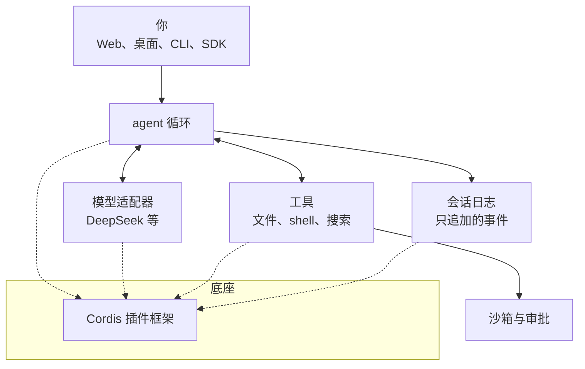

# DSH 是什么

这本书写给**完全没接触过 DeepSeek Harness（下文简称 DSH）的人**。读完你应该能：说清楚它是什么、和 Claude Code 这类工具有什么不同；在自己电脑上把它跑起来、安全地让它干活；看懂它的架构文档；写出第一个插件。

**适合谁**：用过 ChatGPT、DeepSeek 网页版这类聊天产品，想进一步了解「能自己动手干活的 AI」的人。会一点命令行就能读前 7 章；第 8、9 章写插件，需要能读懂 TypeScript。读过[《Agent 原理与设计》](../agent-principles/)更好，没读过也不影响，必要的概念本书都会从头讲。

**怎么读**：第 1–2 章建立印象并动手跑起来；第 3–4 章讲它内部怎么转（agent loop 和会话日志），这是理解其他一切的基础；第 5–7 章是日常使用时要懂的工具、模型和安全；第 8–9 章进入「一切皆插件」的底层和插件开发；第 10 章讲自动化和接下来学什么。

> [!WARNING]
> DSH 处于开发者预览阶段（developer preview），官方明确说「未来将出现破坏兼容性的变更」。本书按 2026 年 11 月 4 日的状态整理：npm 上 `@deepseek-ai/dsh` 的 `latest` 标签指向 0.2.1-rc.5，`next` 是 0.2.2-rc.1，GitHub Releases 里最新的是 0.2.2-alpha.3，全部标为预发布；正文以 0.2.1 为基线，0.2.2 里已经出现的变化随文注明。命令、配置字段、默认值和界面文字都可能已经变化。动手前以官方仓库 `github.com/deepseek-ai/deepseek-harness` 的 README、`docs/` 目录和文档站 `deepseek-harness.github.io/deepseek-harness` 为准。本书尽量讲清「为什么这样设计」，这部分不太会过时。

## 一句话定义

**DSH 是 DeepSeek 开源的 Agent 运行时（agent harness）。它不是模型，而是把模型接到你的文件、终端、浏览器和各种工具上，让模型能一步步把一件事做完的那层软件。**

- 开发方：DeepSeek AI（深度求索）
- 命令行名字：`dsh`
- 协议：MIT，可以自由使用、修改、商用
- 状态：开发者预览，没有经过安全审计
- 形态：Web 界面（在浏览器里用）、桌面应用（macOS Apple 芯片、Windows 64 位）、命令行一次性运行、Python SDK
- 底层：一个叫 **Cordis** 的插件框架，口号是「Everything is a Plugin」（一切皆插件）

## Agent = Model + Harness

DeepSeek 介绍 DSH 时用了一个公式：

$$
\text{Agent} = \text{Model} + \text{Harness}
$$

用一个比喻来理解：

| | 模型（Model） | Harness |
|---|---|---|
| 比喻 | 大脑 | 手脚、眼睛、记事本和规章制度 |
| 负责 | 读懂任务、想下一步做什么、写出代码或文字 | 把模型的「想法」变成真实动作，再把结果喂回给模型 |
| 例子 | DeepSeek-V4、Claude、GPT、Kimi | DSH、Claude Code、Codex CLI、OpenCode |
| 换掉它会怎样 | 同样的流程，聪明程度不同 | 同样的模型，能做的事、安全程度、可靠程度不同 |

光有模型，你只能和它聊天：它说「你应该运行 `pnpm test`」，然后你自己去跑、再把报错贴回去。加上 harness 之后，模型说「我要运行 `pnpm test`」，harness 真的去跑，把输出交还给模型，模型看完再决定下一步。**这个「想 → 做 → 看结果 → 再想」的循环，就是 agent 的本质**，第 3 章会细讲。

「Harness」原意是马具、挽具：套在马身上，让马的力气变成拉车的力。用在这里很贴切——模型是马力，harness 决定这股力往哪里使、能使多大、会不会把车拉翻。

> 「harness」这个说法在 2025 年底到 2026 年因为 Anthropic 的一系列工程文章流行起来，指模型权重之外、让模型变成 agent 的全部基础设施。DSH 是 DeepSeek 对这件事的官方回答。

## harness 到底要管哪些事

一个能用的 harness 至少要做好下面这些事。后面的章节基本就是按这张表展开的：

| 要管的事 | 具体是什么 | 本书哪里讲 |
|---|---|---|
| 循环 | 请求模型、执行它要的工具、把结果交回去，直到任务做完 | [第 3 章](03-agent-loop.md) |
| 记录 | 每一步说了什么、做了什么、结果是什么，能恢复、回放、分叉 | [第 4 章](04-session-log.md) |
| 工具 | 读写文件、跑命令、搜索、上网、派子 agent | [第 5 章](05-tools-and-modes.md) |
| 模型 | 接哪家模型、怎么切换、推理强度、成本 | [第 6 章](06-models.md) |
| 安全 | 什么能直接做、什么要问你、什么根本做不了 | [第 7 章](07-safety.md) |
| 上下文 | 对话太长时怎么压缩，哪些信息该放进提示词 | 第 3、4 章 |
| 扩展 | 怎么加新工具、新模型、新界面 | [第 8 章](08-cordis.md)、[第 9 章](09-write-a-plugin.md) |

## DSH 能用来干什么

官方产品页列的场景：

- **写代码**：读仓库、修 bug、加功能、跑测试
- **日常办公**：整理文件、分析数据、写文档、做幻灯片，能处理文档、表格、PDF
- **调研**：查资料、核对事实、给出处（内置网页搜索，用的就是 DeepSeek 的 API key）
- **后台任务**：跑脚本、批量处理文件、跟踪进度
- **定时任务**：比如每周一早上自动整理一份周报
- **开发插件**：甚至可以在「Creator 模式」里通过聊天让它帮你写插件

还有一批标为「实验性」的功能：多个 agent 组队协作（Agent Teams）、子 agent、自动审批审查员（Auto review）、语音输入、内置终端等。

另外有一个对开发者很友好的功能：**Trajectory（轨迹）视图**。它把一次任务里模型的每次回复、每个工具调用、耗时和 token 用量按顺序列出来。刚开始学的时候，这是理解 agent 到底在干什么的最好窗口。

## 和 Claude Code、Codex、OpenCode 有什么不同

如果你用过 Claude Code，会觉得 DSH 很眼熟：都能读写文件、跑命令、派子 agent、接 MCP、用 Skills。区别不在「功能清单」，而在**哪些部分是你能换掉的**。

| | Claude Code | Codex CLI | OpenCode | DSH |
|---|---|---|---|---|
| 是否开源 | 否 | 是 | 是 | 是（MIT） |
| 模型 | 主要是 Claude | 主要是 OpenAI | 多家 | 多家，默认 DeepSeek |
| 扩展方式 | CLAUDE.md、hooks、MCP、Skills、插件 | 文档化的扩展点 | 插件挂在固定的服务端核心上 | 一切都是插件 |
| agent 循环能换吗 | 不能，循环是固定的 | 改源码 | 不能，核心固定 | 能，循环本身就是一个插件 |
| 会话存储能换吗 | 不能 | 改源码 | 不能 | 能 |

用一句话说：**Claude Code 是一辆造好的车，你能装配件；DSH 是一套底盘加零件库，连发动机和方向盘都能换。**

这带来两面性：

- **好处**：想做一个「专门审合同的 agent」「只读不写的调研 agent」「用公司内部模型的 agent」，不用 fork 整个项目，写几个插件、改几行配置就行。研究者也能拿它当实验台，比如换一个循环策略做对比
- **代价**：组件多、配置层多、版本还在快速变化，学习曲线比开箱即用的产品陡

> [!NOTE]
> 第三方文章里流传着「上线一周十几万 star」「能把 Claude Code、Codex 当子 agent 调用」等说法。前者各来源数字不一，不必在意；后者属实：0.2.1 起插件页里有官方的「Claude Code 子智能体」「Codex 子智能体」组合包，默认不装，启用后多出 `subagent_claude_code` 这类工具，把一个自包含的任务交给一次全新的、无人值守的 Claude Code（或 Codex）会话，只取回最终答案（Claude Code 那一个默认以 `dontAsk` 权限模式运行）。更早的实验性 `subagent_oar` 工具也还在。组合包自带对应的运行时，但不替你登录，账号和凭据仍走 Claude Code 或 Codex 自己的机制；被派出去的 Claude Code 会读你本机常规的 Claude Code 设置。

## 为什么 DeepSeek 要做 harness

按公开报道，DeepSeek 在 2026 年上半年开始招聘 Agent Harness 团队（北京、杭州），研究员公开说过要对标 Claude Code 做代码 harness。背后的逻辑并不复杂：

1. **模型能力要靠 harness 释放**。同一个模型，放在粗糙的 harness 里经常「看起来很笨」：忘事、乱改文件、不会验证。好的 harness 能让模型的真实能力发挥出来
2. **评测需要标准环境**。DSH 有一个 Minimal 模式（只有一个 shell 和一个文件编辑器），DeepSeek 用它跑模型评测。harness 是模型训练和评估的一部分
3. **开放生态**。闭源 harness 只能等官方加功能；开源 + 插件化，社区能自己补齐各种场景

## 一张全景图

先有个整体印象，后面每章会放大其中一块：

图里的每个方框——循环、模型适配器、每一个工具、会话日志、沙箱、甚至界面——都是挂在 Cordis 上的插件。这就是「一切皆插件」的意思。

## 认准官方仓库

- 官方仓库：`github.com/deepseek-ai/deepseek-harness`
- 官方文档站：`deepseek-harness.github.io/deepseek-harness`
- 官方产品页：`deepseek.com` 上的 Harness 页面
- npm 包：`@deepseek-ai/dsh`；Python 包：`deepseek-harness-sdk`

GitHub 上还有一个由个人开发者发布的同名项目 `deepseek-harness`，**不是官方的**。安装任何东西前，先确认发布者是 `deepseek-ai`。插件也一样：插件能以你的身份读写文件、跑命令，第 7 章会专门讲。

## 本章要点

- DSH 是 DeepSeek 开源（MIT）的 agent harness，命令叫 `dsh`，目前是开发者预览，会有破坏性变更
- Agent = Model + Harness：模型负责想，harness 负责把想法变成动作、把结果交回去，并管好记录、安全和扩展
- 它和 Claude Code 的核心差别是「能换掉什么」：DSH 连 agent 循环、会话存储都是可替换的插件
- 底层是 Cordis 插件框架；全书的主线就是从「怎么用」一路走到「怎么写插件」
- 只从 `deepseek-ai` 官方渠道安装，第三方同名项目和插件都要先审再用

## 动手练习

1. **自己当一次 harness**：打开任意一个聊天产品（DeepSeek 网页版即可，不需要 API key），让它帮你回答「这个仓库有几个 package.json，各自的 name 是什么」。它每让你运行一条命令，你就照做并把输出原样贴回去，直到它给出答案。记下来回了几轮。

   验证：你会经历至少两三轮「它给命令 → 你执行 → 贴回结果」，最后它给出的答案和你自己运行 `find . -name package.json -not -path '*/node_modules/*'` 的结果一致。

   参考答案：你刚才做的就是 harness 的工作：执行模型想做的动作、把结果交回去、循环直到完成。DSH 把这一步自动化了，同时负责记录、审批和安全。

2. **核对官方发布渠道**：运行 `npm view @deepseek-ai/dsh dist-tags` 和 `npm view @deepseek-ai/dsh maintainers`，再在 GitHub 上搜索 `deepseek-harness`，看看有几个同名仓库、各自的所有者是谁。

   验证：`dist-tags` 至少有 `latest`，把它和本章开头 WARNING 里写的版本对照，看是否已经变化；搜索结果里能找到所有者为 `deepseek-ai` 的那一个，以及不属于它的同名项目。

   参考答案：安装前先确认发布者，是防供应链风险最便宜的一步。版本号如果已经和本书不同，以官方仓库的 README 和 changelog 为准阅读后面的章节。

3. **按「能换掉什么」选工具**：下面三个需求各选 Claude Code 还是 DSH，并用本章的对比表说明理由：A. 每天用来改自己的 TypeScript 项目，希望开箱即用；B. 做一个只读不写、只能访问内部文档的调研 agent，模型要接公司的网关；C. 研究「换一种循环策略，同一个模型的成功率会不会变」。

   验证：每个选择的理由都落在「哪部分需要被替换」上，而不是「哪个更强」。

   参考答案：A 两者都可以，不需要替换任何部件时，开箱即用的产品学习成本更低；B 倾向 DSH，工具集、模型接入都要定制，用插件和配置就能完成；C 只有 DSH 合适，因为 agent 循环本身是可替换的插件。
