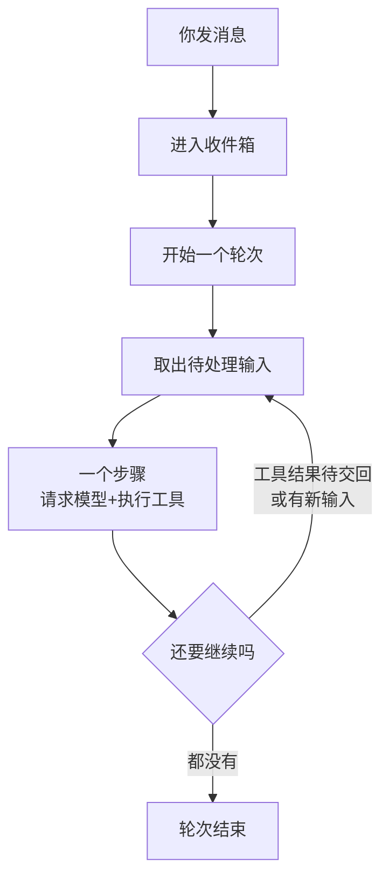
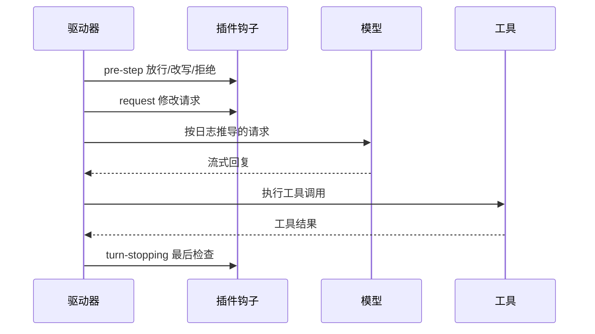

# 一次任务里发生了什么

上一章你让 DSH 读仓库、写测试，看到它「读一下、找一下、改一下、跑一下」。这一章把镜头拉近，看清这一圈一圈的循环在 DSH 里是怎么实现的：轮次（turn）和步骤（step）是什么，一次模型请求前后发生了哪些事，工具调用怎样被执行和把关，上下文快满时怎么办。

这一章是全书的地基。后面讲会话日志、权限、插件，都是在这个循环的某个位置上「挂东西」。

## 最朴素的 agent 循环

先看一个最简单的 agent 循环，大约十几行就能写完（[《动手构建 Agent》](../build-your-agent/01-minimal-loop.md)第 1 章就是从这里开始的）：

```ts
const messages = [{ role: 'user', content: task }]
while (true) {
  const reply = await llm.chat(messages, tools)      // 1. 问模型
  messages.push(reply)
  if (reply.toolCalls.length === 0) break            // 2. 不要工具了，结束
  for (const call of reply.toolCalls) {              // 3. 执行它要的工具
    const result = await runTool(call.name, call.args)
    messages.push({ role: 'tool', id: call.id, content: result })
  }
}                                                    // 4. 带着结果回到第 1 步
```

所有 agent 的骨架都是这样。但要把它变成一个可以每天用的产品，还缺很多东西：

- 用户在 agent 干活时又发了一句话，怎么办？
- 工具要不要先问用户？多个工具能不能并行？
- 模型请求失败、网络断了、上下文超长了，怎么办？
- 程序崩了，重启后能不能接着干？能不能回看每一步？
- 想在「发请求前」改一下提示词、在「工具执行后」记个日志，代码插在哪？

DSH 的循环就是把这些问题一个个回答之后的样子。

## 三个层级：轮次、步骤、Round

DSH 用一组固定的词描述循环，先把它们分清楚：

| 术语 | 含义 | 例子 |
|---|---|---|
| **步骤（step）** | 一次模型请求，加上这次回复引发的全部工具调用 | 模型说「读 README 并搜索 package.json」，执行这两个工具，算一步 |
| **轮次（turn）** | 处理一批已接收输入的全过程，包含零个或多个步骤，直到模型不再要工具、也没有新输入 | 你发一句话，agent 连续干了 8 步后回复你，这是一轮 |
| **Round** | 外层策略的一次迭代，承载一个轮次 | 「目标（goal）」功能里自动续做的一次；Ralph 循环里一个全新子会话的一次尝试 |

还有一个容易忽略的概念：**收件箱（inbox）**。你发的每条消息、子 agent 完成的通知、定时任务的触发，都先进入 agent 的收件箱，由循环的驱动器（driver）按顺序取出来处理。所以你在 agent 干活时插一句「别改那个文件」，不会打断当前这一步，而是排进收件箱，在下一步开始前被取出来——这叫**中途引导（steering）**。



## 一个步骤的完整过程

下面按时间顺序走一遍一个步骤。官方文档里有一张完整的时序图，事件名很多，这里只保留主干，括号里是对应的事件名，第 8、9 章写插件时会用到。

### 1. 准备：组装这一步的工具和提示词

- 驱动器先确定这一步**有哪些工具可用**（不同 agent、不同模式看到的工具集不同）
- 再**组装系统提示词**：各个插件往里贡献自己的片段（工具说明、环境信息、Skills 列表、权限说明……），这个过程叫 `system-prompt/assemble`

### 2. 关卡：要不要进入这一步（`agent/pre-step`）

在真正请求模型之前，插件有机会检查即将进入的消息：放行、改写、或者拒绝。上下文压缩就在这里检查「是不是太长了」。如果第一批输入就被拒绝，这个轮次会直接结束，不花一次模型请求。

### 3. 发请求（`agent/request` → `llm/stream`）

- 插件还能在 `agent/request` 上最后修改请求
- 驱动器通过模型适配器准备这次调用（`prepareCall`），绑定具体的模型提供方
- 然后把系统提示词和用户消息**先写进会话日志**，再**从日志里推导出**要发给模型的消息列表
- 模型的回复以流的形式回来，界面上实时显示（`agent/assistant-stream`）

第三点非常关键：**DSH 不是拿着内存里的一个消息数组去请求模型，而是每次从日志重建**。这是下一章的主题。

### 4. 记录回复

- 请求成功：整段回复作为 `assistant/message` 写进日志
- 请求失败、被取消：写成 `assistant/attempt`，然后触发 `agent/request-error`，插件可以决定是否重试。重试发生在同一个步骤内，不会重复前面的关卡和用户消息

### 5. 执行工具

如果回复里有工具调用，进入工具流水线（下一节细讲），每个调用写一条 `tool/call`、完成后写一条 `tool/result`。

### 6. 收尾（`step/end`）

一步结束。如果还有工具结果要交回给模型，或者收件箱里有新输入，开始下一步；否则在结束前触发 `agent/turn-stopping`——这是轮次结束前的最后一个检查点，比如「目标」功能就在这里判断要不要继续——然后 `turn/end`，agent 回到空闲。



## 工具流水线：模型只能「请求」

模型从来不能直接执行任何东西。它只是在回复里写「我想调用 `bash`，参数是 `pnpm test`」。**要不要执行、怎么执行，由 DSH 决定。**

每一个工具调用都要过三关：

| 阶段 | 事件 | 做什么 |
|---|---|---|
| 执行前 | `tools/pre-execute` | 策略检查：这个工具在当前 agent 可用吗？参数合法吗？要不要先问用户？沙箱怎么设？ |
| 执行 | `tools/execute` | 真正干活 |
| 执行后 | `tools/post-execute` | 处理结果：太长的输出转存到文件只返回摘要、记录、改写错误信息 |

几个值得知道的细节：

- **并发**：每个工具声明自己能不能和别的工具同时跑。读文件、搜索这类可以并行；会修改状态的会形成「屏障」，前面的跑完才开始。整体是一个有上限的并发池
- **顺序**：不管执行顺序怎样，结果总是**按模型发出调用的顺序**交回给模型，保证模型看到的东西可预测
- **不存在的工具 = 被禁用的工具**：被当前 agent 过滤掉的工具既不会出现在提示词里，调用了也会被拒绝，两者对模型来说无法区分
- **失败也要有结果**：一个步骤中途失败，DSH 会为没完成的工具调用补上「缺失」结果，保证日志里每个调用都有配对的结果。否则下次请求时，很多模型接口会因为「有调用没结果」直接报错

这套设计和[《工具设计与 MCP》](../tools-and-mcp/)里讲的原则一致：工具是 agent 的手，但手的每个动作都要经过 harness 的允许。

## 上下文满了怎么办

每一步的工具结果都留在上下文里，长任务很快就会把上下文窗口塞满。DSH 的处理方式（默认插件 `dsh-compaction-basic`）：

1. **事前**：在 `agent/pre-step` 关卡检查压力，快满时主动处理
2. **事后**：如果请求还是因为上下文超长被拒绝，在 `agent/request-error` 里处理后重试
3. **先剪枝，再摘要**：先把旧的、大块的工具结果修剪掉；还不够，再请模型把前面一段对话总结成摘要，用摘要**替换**那一段

替换不是删除。原始事件全都还在日志里，只是模型从此看到的是摘要。这和[《上下文工程》](../context-engineering/04-compaction.md)里讲的压缩思路相同，DSH 的特别之处在于它把压缩做成了一个可替换的插件，并且整个过程都记在日志里，可以回看压缩前后模型分别看到了什么。

你也可以手动触发压缩：会话里输入 `/compact`。以 `/` 开头的输入是**人类命令**，由界面直接处理，不会作为消息发给模型。

## 你能在哪里插手

把上面的流程汇总成一张「插手点」表。现在不用记住，第 9 章写插件时回来查：

| 想做的事 | 挂在哪里 |
|---|---|
| 往系统提示词里加一段说明 | `system-prompt/assemble` 或系统提示词服务 |
| 在进入某一步前检查、改写、拦截输入 | `agent/pre-step` |
| 发请求前改模型参数 | `agent/request` |
| 请求失败时自定义重试 | `agent/request-error` |
| 拦截、审核某类工具调用 | `tools/pre-execute` |
| 记录或改写工具结果 | `tools/post-execute`、`tools/result` |
| 轮次结束前决定要不要继续 | `agent/turn-stopping` |
| 在运行中途塞一段上下文给模型 | `agent.inject()` |

## 本章要点

- 所有 agent 的骨架都是「问模型 → 执行工具 → 交回结果」的循环，DSH 在此之上处理并发输入、失败重试、并发工具、压缩和可扩展性
- 步骤 = 一次模型请求 + 它引发的工具调用；轮次 = 处理一批输入的若干步骤；消息先进收件箱，所以可以中途引导
- 每次请求前，DSH 把消息写进日志再从日志推导请求，而不是直接用内存里的数组
- 模型只能请求工具，执行前后都要过流水线；结果按调用顺序交回，失败的调用也会补上结果
- 上下文快满时先剪枝工具结果、再摘要替换，原始记录仍在日志里
- 循环的每个关键位置都是插件可以挂钩的事件
