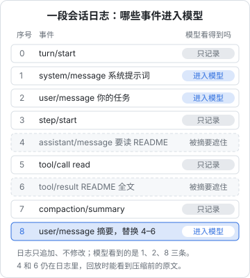

# 会话就是一本流水账

大多数聊天程序这样保存对话：内存里一个消息数组，`[系统, 用户, 助手, 工具, 助手, ……]`，存盘时整个写进去。DSH 不这么做。它的会话是**一条只追加、不修改的事件日志**，模型看到的消息历史是每次从这条日志里「推导」出来的。

这个设计决定了 DSH 很多能力：断点恢复、分叉、回放、压缩后还能看原文、Trajectory 视图、把会话转交给子 agent。理解它，你就理解了 DSH 的一半。

## 一个类比：银行流水和余额

银行不会只存一个「余额」数字，它存的是每一笔流水：存入多少、取出多少、什么时间、什么渠道。余额是从流水算出来的。

- 想知道上个月某天的余额？从头算到那天就行
- 发现某笔账有问题？流水还在，可以追查
- 要做一份新报表？对同一份流水换一种算法

DSH 的会话日志就是流水，模型看到的消息列表就是余额：

| | 银行 | DSH |
|---|---|---|
| 原始记录 | 交易流水，只增不改 | 会话事件日志，只追加 |
| 算出来的结果 | 余额 | 发给模型的消息历史 |
| 换一种算法 | 各种报表 | 界面上的对话视图、Trajectory、统计 |

DSH 文档里把这个叫做**事件溯源（event sourcing）**：日志是唯一的真相来源，其他一切都是投影。

## 日志里记了什么

每条事件有一个连续递增的序号 `seq`、一个时间戳、一个类型和数据。常见类型：

| 类型 | 记录什么 | 模型看得到吗 |
|---|---|---|
| `turn/start`、`turn/end` | 一个轮次的开始和结束，结束时记录原因 | 否 |
| `step/start`、`step/end` | 一个步骤的开始和结束 | 否 |
| `system/message` | 渲染好的系统提示词 | 是 |
| `user/message` | 你的输入，或者插件注入的上下文 | 是 |
| `assistant/message` | 一次成功的模型回复，连同原始流、用量、模型名 | 是 |
| `assistant/attempt` | 一次失败或被取消的模型请求 | 否 |
| `tool/call` | 一次工具调用的开始 | 否 |
| `tool/result` | 工具结果 | 是 |
| `compaction/*` | 压缩的加锁、摘要、解锁 | 否 |
| `approval/asked`、`approval/decided` | 审批的问与答 | 否 |

能进入模型的只有五种「消息类」事件（system、developer、user、assistant、tool result），其他都是**只记录（log-only）**的结构事件，用来回放、审计、驱动界面。插件还可以声明自己的新事件类型，同样只记录、不进入模型。

轮次结束时会记下**为什么结束**：正常完成、被取消、出错、输出被截断（`max-tokens`）、程序崩溃后补记的「中断」、分叉时补记的「已分叉」。所以事后看日志，能分清「它说做完了」和「它其实是被截断了」。

## 模型看到的是「推导」出来的

每次请求模型前，DSH 调用 `deriveMessages()`，从日志的消息类事件里算出当前的消息列表。规则很直接：

- 普通消息按顺序**追加**到末尾
- 压缩产生的摘要是一条特殊的 `user/message`，它声明「我**替换**序号 X 到 Y 的那几条」。推导时那几条被遮住，摘要出现在它们的位置
- 空内容的助手回复不进入消息列表（比如输出被截断、什么都没生成的那一次），但它的用量和模型信息仍记在日志里

DSH 为此立了一条硬规矩：**模型看到的任何东西，都必须能从日志里还原出来**（model-visible means logged）。插件不能偷偷在发请求时塞一段日志里没有的内容；如果要改消息内容，必须注册一个纯函数的「投影」，让任何人拿着同一份日志都能算出一模一样的结果。

这条规矩的好处是：出了问题时，你看到的日志就是模型当时看到的全部。不会有「日志里明明没有，模型却好像知道」的灵异事件。

## 它带来的能力

### 断点恢复

DSH 崩了、电脑重启了，会话不会丢。日志按 JSONL 格式落盘（每行一个事件），重启后读回来，重新推导消息，就能接着干。崩溃时还没结束的轮次会被补上一个「中断」的结束记录，崩溃前的事件原样保留。

### 分叉（fork）

「如果刚才第 3 轮我换个说法会怎样？」在 DSH 里可以从某个轮次结束的位置分叉出一个新会话：新会话复制那之前的全部事件作为「种子」，然后各走各的路。原会话不受影响。

分叉只能从轮次之间的稳定位置开始；如果你指定的位置落在一个还没结束的轮次中间，DSH 会直接拒绝，而不是悄悄截断。

### 回放与 Trajectory

Trajectory 视图本质上就是把日志换一种方式展示出来。因为每次模型回复都连同原始的流式数据一起保存，回放时甚至能还原出当时一个字一个字出现的节奏和用量。

> [!NOTE]
> 回放是「重新推导模型当时看到了什么」，不是「重新执行一遍」。模型的输出有随机性，外部世界（文件、网络）也变了，所以重放日志不会得到一模一样的结果。

### 给子 agent 一份上下文

派子 agent 时可以选「全新开始」或「从当前会话分叉」。后者就是用日志前缀作为子会话的种子，子 agent 一开始就知道前面发生过的一切。第 5 章讲子 agent 时会再提到。

### 让 agent 查自己的历史

有一组可选的只读工具（`session_search`、`session_event_search` 等），让 agent 能搜索、追溯过去的会话。比如「上周我们讨论过的那个数据库迁移方案是什么」，它可以自己去翻。

## 投影：同一份日志，多种视图

界面要显示的东西五花八门：对话气泡、待办清单、当前权限设置、会话标题。DSH 不为每一样单独存一份状态，而是用**投影（projection）**：每个投影是一个函数，把已提交的事件「折叠」成它关心的视图。

比如待办清单：agent 每次调用 `todo_write` 都会写一条 `todo/write` 事件，界面上的清单就是「最后一条 `todo/write` 的内容」。权限设置也一样：当前权限 = 日志里最后一次修改权限的事件。所以恢复会话时，权限、待办、标题全都自动回到原来的样子，不需要额外的「保存状态」逻辑。

## 日志会上传到哪里

日志默认存在你本机。但上一章提到过：**用 DeepSeek 官方 API 时，会话日志默认会增量上传给 DeepSeek**（`dsh_session_log` 扩展字段），内容包括工作目录、系统提示词、全部对话、工具的参数和结果、压缩摘要等。

结合这一章再看这件事就更清楚了：日志是**完整的**真相，它比「发给模型的消息」还多——失败的请求、被摘要遮住的原文、审批记录都在里面。所以：

- 处理敏感资料时，在「设置 → 通用」里关掉上传开关
- 写插件时，可以注册「上传排除条件」，让特定会话或特定用途的请求不附带日志
- 用第三方模型或自建网关时不会发送这个字段

## 会话格式会变

> [!WARNING]
> 会话的存储格式在预览期频繁演进，官方仓库 `docs/persistence-changes/` 下按日期记录了每一次格式变化（2026 年 9–10 月就有二十多条）。本节只讲原则，具体格式以官方文档为准。

DSH 给每种格式一个版本号，旧格式在读取时一代一代地迁移到新格式；已经提交的事件永远不会被覆盖。作为使用者你不用操心；但如果你写了直接读 `~/.dsh` 下会话文件的脚本，升级后要检查一遍。更稳妥的做法是通过 SDK 或会话查询工具读取，而不是直接解析文件。

## 本章要点

- DSH 的会话是只追加的事件日志，模型的消息历史每次从日志推导，日志是唯一真相
- 只有五种消息类事件进入模型，其余是只记录的结构事件；轮次结束会记录原因，能区分完成、取消、截断、崩溃
- 硬规矩：模型看到的一切都必须能从日志还原；压缩是「替换」而不是删除，原文还在
- 这个设计带来断点恢复、分叉、回放、Trajectory、子 agent 继承上下文，以及用投影实现的待办、权限等界面状态
- 日志比发给模型的内容还完整；用官方 API 时默认会上传，敏感场景记得关掉
