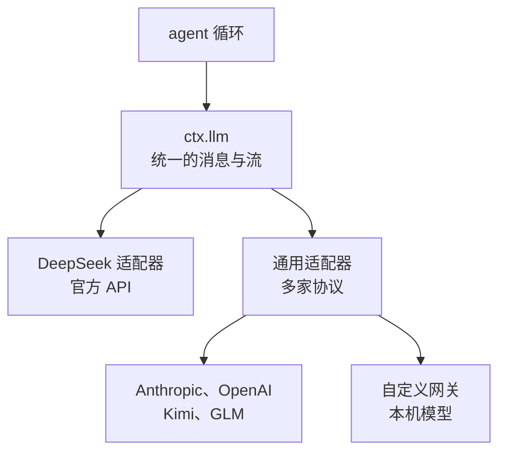

# 模型：接哪家、怎么配、花多少

DSH 默认用 DeepSeek 的模型，但它的模型层是一个可替换的插件：Anthropic、OpenAI、Kimi、GLM、公司内部网关、本机跑的开源模型都能接。这一章讲怎么配置这些模型、推理强度怎么选、遇到兼容问题怎么修，以及怎样控制花费。

> [!WARNING]
> 本章的界面位置、配置字段、错误码和默认值按 2026 年 11 月初官方仓库的 `docs/user/guide/providers.md` 整理；DeepSeek 的模型名称、上下文长度和价格以 DeepSeek 开放平台的最新公告为准。

## 模型层在架构里的位置

回忆第 3 章：每一步请求模型前，驱动器会通过 `prepareCall()` 绑定一个模型适配器。适配器负责把 DSH 统一格式的消息翻译成某家 API 的格式，再把流式回复翻译回来。



- **DeepSeek 适配器**（`llm-deepseek`）：直连 DeepSeek 官方 API，支持 DeepSeek 专有的功能和扩展字段（包括第 2 章说的会话日志上传）
- **通用适配器**（`llm-pi-ai`）：按三种协议之一说话——OpenAI Chat Completions、OpenAI Responses、Anthropic Messages——覆盖绝大多数提供方和网关

因为循环只认 `ctx.llm` 这个接口，换模型不需要改循环的任何代码。

## 在界面里配置

所有模型配置都在 **设置 → 模型（Settings → Models）**，保存后从下一次请求生效，不用重启。

### DeepSeek

DeepSeek 卡片只有一个 API key 输入框。用默认地址时，模型列表跟随 DeepSeek 公布的列表自动更新（首次需要时加载，之后大约每十分钟在后台刷新；加载失败就用内置列表）。官方 Python SDK 的示例里用的模型名是 `deepseek-v4-flash`，你可以在选择器里看到当前可用的全部型号。

如果你在「自定义设置」里手动编辑了模型列表，它就不再跟随官方列表；点「恢复默认」回到自动跟随。

### 第三方提供方

点 **添加模型提供方（Add model provider）**，从内置目录里选，例如：

| 目录里的名字 | 是谁 |
|---|---|
| `anthropic` | Claude |
| `openai` | GPT |
| `moonshotai` | Kimi |
| `zai` | GLM（智谱） |

填 API key 即可，地址、协议、模型列表都由内置目录提供。key 也可以留空，改用环境变量：页面上绿色提示表示检测到了对应的环境变量，黄色表示没检测到。注意检测到不等于 key 是对的，它不会替你测试连接。

### 自定义 API

接公司网关、中转服务、自建推理服务，或者目录里没有的提供方，用 **自定义模型 API**。要填：

| 字段 | 说明 |
|---|---|
| 提供方 ID | 小写，**创建后不能改**，因为请求、会话、默认设置、凭据引用都会用到它。想改名只能新建一个再删旧的 |
| 显示名称、地址（base URL）、凭据、模型 | 都能随时改 |
| API 协议 | `openai-completions`、`openai-responses`、`anthropic-messages` 三选一。一个提供方只说一种协议，同一个网关同时提供两种协议就建两个提供方 |

**获取可用模型** 按钮会请求该地址的 `GET /models`，弹出一个可搜索的列表让你勾选。获取失败也没关系，手动填模型 ID 即可。

### 接本机的开源模型

用 Ollama、vLLM、llama.cpp server 这类工具在本机跑开源模型时，它们通常提供兼容 OpenAI 的接口，按「自定义模型 API + `openai-completions`」接入即可。这样数据完全不出本机。

但要现实一点：agent 任务对模型的工具调用能力、长上下文能力要求很高，本机能跑的小模型往往会频繁出错或绕圈。部署、量化和选型见[《开源模型：部署、量化与微调》](../open-models/)。

## 用配置文件做更细的调整

界面覆盖不到的设置，写在 profile 的配置补丁里：`~/.dsh/profiles/<profile>/cordis.patch.yml`（`dsh web` 用的 profile 叫 `web`）。服务和浏览器在同一台机器上时，设置页顶部有「打开配置文件」的按钮。适配器每次请求都会重新读取它。

> [!CAUTION]
> 补丁里按 `id` 定位一行配置时，会**整个替换**那一行的 `config`。比如写了一个 `id: llm-pi-ai` 的条目，只放了一个新提供方，原来在界面里配好的其他提供方就会消失。编辑前先用 `dsh --profile web --dump-config` 看清当前的完整配置，把要保留的都带上。第 8 章会讲补丁的规则。

一个自定义网关的完整例子：一个纯文本模型，一个支持图片的模型。

```yaml
- id: llm-pi-ai
  config:
    providers:
      my-gateway:
        apiKeyEnv: GATEWAY_API_KEY
        api: openai-completions
        baseURL: https://gateway.example/v1
        models:
          - id: legacy-chat
          - id: vision-preview
            input: [text, image]
```

`apiKeyEnv` 写的是环境变量的**名字**，不是 key 本身。

### 图片输入

模型能不能看图，要你来声明：界面里的复选框，或配置里的 `input: [text, image]`（DeepSeek 直连适配器用的字段叫 `inputModalities`）。没声明的一律当作纯文本模型。

这里有个坑：**声明是一种承诺，DSH 不会替你验证**。声明了不支持的能力，结果是请求失败或被改写，而不是一条友好的警告。如果某次会话里已经发了图，后来发现模型不支持，图片已经记在日志里了（第 4 章），需要开一个新会话。

### 上下文长度和输出上限

DeepSeek 账号登录方式下没有模型编辑器，可以用 `modelOverrides` 调整：

```yaml
- id: llm-deepseek-account
  config:
    modelOverrides:
      deepseek-flash:
        contextWindow: 524288
        maxTokens: 131072
```

没写的字段保留官方列表里的值。

## 推理强度

推理模型会先「想」一段再回答。想得越多，复杂任务越靠谱，但更慢、更贵。DSH 在模型选择器里提供 **推理强度（Effort）** 菜单：

- DeepSeek 模型提供 `off`、`low`、`high`、`max` 四档
- 设置 DeepSeek 默认档位：

```yaml
- id: llm-deepseek
  config:
    reasoningEffort: max
```

- 自定义提供方的模型默认没有推理档位菜单，要在「模型选项」里打开「推理档位」，或在配置里写 `reasoningEfforts`
- 通过网关接 DeepSeek 推理模型时，`off` 关不掉思考？加上 `compat.thinkingFormat: deepseek`，DSH 会改用 DeepSeek 的 `thinking` 字段开关思考

怎么选档位：

| 任务 | 建议 |
|---|---|
| 查资料、改个错别字、跑个命令 | `off` 或 `low`，快且省 |
| 日常写代码、改 bug | `high` |
| 跨很多文件的重构、难查的 bug、要做方案 | `max` |
| 子 agent 做的机械工作（批量读文件、整理格式） | 给子 agent 单独选低档位或便宜的模型 |

推理模型为什么能「想」、思考 token 怎么计费，见[《大模型原理进阶》第 6 章](../llm-deep-dive/06-reasoning-models.md)。

## 网关兼容问题

很多网关只实现了 OpenAI 接口的一部分。两个最常见的修法，加在提供方的 `compat` 里：

```yaml
- id: llm-pi-ai
  config:
    providers:
      my-gateway:
        apiKeyEnv: GATEWAY_API_KEY
        api: openai-completions
        baseURL: https://gateway.example/v1
        compat:
          supportsDeveloperRole: false
          maxTokensField: max_tokens
        models:
          - id: my-model
```

- `supportsDeveloperRole: false`：很多网关不认识推理模型用的 `developer` 角色
- `maxTokensField: max_tokens`：有的服务器不接受新字段名 `max_completion_tokens`

提供方级别的 `compat` 是默认值，单个模型的 `compat` 可以逐字段覆盖。写错字段名 DSH 会直接报错并列出可用的名字。

## 常见报错

| 报错 | 原因 | 处理 |
|---|---|---|
| `MISSING_CREDENTIAL` | 没有 key | 在模型页保存 key，或设置配置里引用的环境变量 |
| `UNKNOWN_MODEL` | 选了没配置的模型 | 重新选择，或把它加进自定义提供方 |
| 获取模型列表返回 401 | key 不对 | 检查 key，或手动填模型 |
| key 和地址都对，但每个请求都被拒 | 网关不兼容 | 试试上一节的两个 `compat` 开关 |
| 菜单里没有推理档位 | 模型没声明 | 在模型选项或配置里加上 |
| 图片在发送前被拒 | 模型没声明图片输入 | 在 `input` 里加上 `image` |
| 提供方拒绝了图片 | 声明了但其实不支持 | 去掉 `image`，开一个新会话 |
| `CLIENT_UPGRADE_REQUIRED` | 这个模型需要更新版本的 DSH | 升级 DSH |

## 花多少钱，怎么省

DSH 本身免费，花费全在模型推理上，按输入和输出 token 计费。agent 任务比聊天贵得多，原因是**每一步都要把整个上下文重新发一遍**：第 20 步发出去的请求里，包含前 19 步的所有对话和工具结果。

几个省钱的办法，按效果大致排序：

1. **任务拆小**。一个会话只干一件事，干完就开新会话。上下文越长，每一步越贵
2. **少读大文件**。让它用 `grep` 定位、只读相关的几十行，而不是整个读进来。说明文件里可以写明「大文件先搜索再读局部」
3. **重复操作用 PTC 模式**。批量工具调用的中间结果不进上下文
4. **推理强度按需**。简单任务关掉思考
5. **机械活交给便宜的子 agent**。子 agent 可以用不同的模型
6. **利用提示词缓存**。很多提供方对重复的上下文前缀打折。DSH 的设计尽量保持前缀稳定（比如审批策略变化时追加一条新快照，而不是改写已经发过的系统提示词），你这边要做的是：会话中途少改说明文件和 Skills

Trajectory 视图里能看到每一步的 token 用量，花了钱的地方一目了然。

## 本章要点

- 模型层是可替换的插件：DeepSeek 直连适配器 + 一个覆盖三种协议的通用适配器，循环不关心背后是哪家
- 配置在「设置 → 模型」：DeepSeek 填 key 即可；第三方从目录里选；网关和本机模型用自定义 API，提供方 ID 创建后不能改
- 细节写在 `~/.dsh/profiles/<profile>/cordis.patch.yml`，按 `id` 覆盖会整行替换，先 `--dump-config` 再改
- 能力声明（图片、推理档位、兼容开关）是承诺而不是检测，声明错了只会失败不会警告
- 花费主要来自「每步重发整个上下文」，最有效的省钱办法是任务拆小、少读大文件、按需推理
