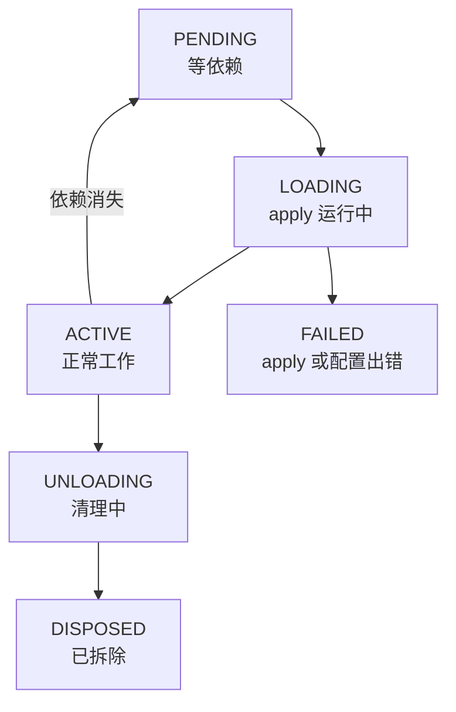
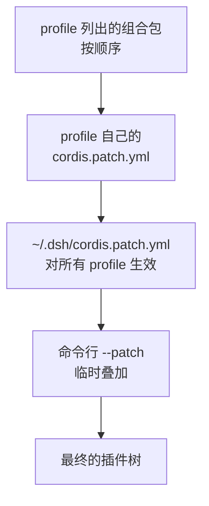

# Cordis：一切皆插件的底座

前面几章反复说「这是一个插件」：模型适配器、工具、会话存储、沙箱、压缩、连 agent 循环本身。这一章讲托住这一切的框架 **Cordis**：插件长什么样，插件之间怎么找到彼此，为什么卸载一个插件不会留下垃圾，以及 DSH 怎么用 profile、组合包和补丁把几百个插件拼成一个应用。

读懂这一章，DSH 的架构文档就不再是天书；第 9 章写插件也会顺理成章。代码示例用 TypeScript，看不太懂语法也没关系，重点是概念。

> [!WARNING]
> 本章的 API 名称和配置格式按 2026 年 11 月初官方仓库的 `docs/cordis-primer.md`、`docs/cordis-tutorial/` 和 `docs/architecture.md` 整理，预览期可能变化，以官方文档为准。

## Cordis 从哪来

Cordis 原本是 Koishi（一个流行的开源聊天机器人框架）生态里的插件框架，作者是社区开发者 Shigma。DeepSeek 在它的基础上做了扩展，以 vendor 的方式放进 DSH 仓库。2026 年 8 月，北京大学和 DeepSeek 的研究者发表了论文 *A Programming Paradigm for Spatiotemporal Composability*（arXiv 2608.25512），把 Cordis 背后的思想形式化了。

论文回答的问题是：**一个可以在运行中随时加载、卸载、替换组件的系统，怎样保证它始终是对的？** 对一个「自我进化」的 agent harness 来说，这不是理论问题——用户随时装插件、改配置，Creator 模式下 agent 甚至自己写插件、热加载进来。

## 五个核心概念

官方入门文档把 Cordis 归结为五点：

1. **插件**：一个带 `apply(ctx)` 的模块（或函数、或 `Service` 子类），Cordis 加载它时调用 `apply`
2. **上下文（ctx）是服务的容器**：每个服务占据一个固定的键，比如 `ctx.tools`、`ctx.llm`、`ctx.sessions`。插件通过键找服务，而不是 `import` 某个具体实现
3. **用 `inject` 声明依赖**：插件说「我需要 `tools`」，Cordis 就等 `tools` 就绪后才启动它。启动顺序由依赖关系决定，不用手工排
4. **类型化事件**：服务定义事件，插件监听，有五种分发方式
5. **注册是可逆的副作用**：通过 `ctx` 注册的一切（工具、监听器、提示词片段……）在插件卸载时自动撤销

下面一个一个展开。

## 插件的三种写法

最常见的是**函数式模块**，导出 `name`、可选的 `inject` 和 `apply`：

```ts
import type { Context } from '@deepseek-ai/cordis'

export const name = 'hello-plugin'

export function apply(ctx: Context) {
  console.log('[hello-plugin] loaded')
}
```

另外两种：**对象形式**（默认导出一个带 `name`、`inject`、`apply` 的对象），和**类形式**（继承 `Service`，用来**提供**一个服务给别人用）。大多数时候函数式就够了。

## 服务与依赖注入

一个插件想**提供**能力给别人，就写成一个服务：

```ts
import { Service, type Context } from '@deepseek-ai/cordis'

declare module '@deepseek-ai/cordis' {
  interface Context {
    greeter: GreeterService
  }
}

export class GreeterService extends Service {
  constructor(ctx: Context) {
    super(ctx, 'greeter')   // 以 greeter 为名注册，别人用 ctx.greeter 访问
  }
  greet(who: string) {
    return `Hello, ${who}!`
  }
}
```

`declare module` 那一段只是告诉 TypeScript「`ctx` 上有个 `greeter`」，让类型检查通过，运行时不产生代码。

另一个插件**使用**它：

```ts
export const name = 'consumer'
export const inject = ['greeter']

export function apply(ctx: Context) {
  console.log(ctx.greeter.greet('world'))
}
```

关键在于 `inject` 不是一次性的启动检查，而是**持续跟踪**：

- `greeter` 还没就绪，`consumer` 就等着（状态叫 PENDING），不报错也不运行
- 运行中 `greeter` 被卸载或替换了，`consumer` 也跟着卸载；`greeter` 回来后，`consumer` 重新启动
- 配置文件里两个插件谁写在前面无所谓

这就是 DSH「换一个零件不用改别的零件」的根基。比如把本地 shell 换成沙箱 shell：卸载 `dsh-bash-local`，加载 `dsh-bash-sandbox`，所有依赖 `shell` 服务的插件（比如 `bash` 工具）自动用上新实现。

如果某个依赖是**可选**的，不写进 `inject`，而是在用的时候探测：`ctx.get('greeter')` 拿不到就返回 `undefined`。

## 可逆的副作用

这是论文里「**时间可组合性**」的落地：**一个组件被移除时，它造成的影响应该完全撤销。**

通过 `ctx` 做的注册天然可逆：`ctx.on(...)` 注册的监听器、`ctx.tools.register(...)` 注册的工具、`ctx.plugin(...)` 挂载的子插件，卸载时都自动撤掉。对于 Cordis 不知道的资源（定时器、网络连接、文件监视器），用 `ctx.effect()` 包起来，返回一个清理函数：

```ts
export function apply(ctx: Context) {
  ctx.effect(() => {
    const timer = setInterval(() => console.log('heartbeat'), 5000)
    return () => clearInterval(timer)   // 卸载时自动调用
  })
}
```

需要注意边界：**可逆的只是在 DSH 进程内部的注册**。agent 已经执行过的 shell 命令、已经发出去的网络请求、已经写进磁盘的文件，卸载插件撤不回来。

每个加载的插件实例有一个运行时句柄叫 **fiber**，它的状态变化：



写插件时最常见的困惑「我的插件怎么没反应」，答案通常是它卡在 PENDING：缺了某个依赖服务。

## 事件与五种分发方式

服务之间除了直接调用方法，还通过事件通信。一个事件只能用一种方式分发，这是它公开约定的一部分：

| 方式 | 等待监听器吗 | 顺序 | 有返回值吗 | 典型用途 |
|---|---|---|---|---|
| `emit` | 否 | 按注册顺序 | 否 | 通知：「一个会话创建了」 |
| `waterfall` | 否 | 按注册顺序，层层包裹 | 是 | 拦截和改写：pre-step、request |
| `parallel` | 是 | 并行 | 否 | 同时做几件独立的事 |
| `serial` | 是 | 按注册顺序依次 | 是 | 必须一个接一个的检查，如 turn-stopping |
| `bail` | 否 | 按顺序，直到有人给出结果 | 是 | 「谁能处理就谁处理」 |

`waterfall` 最重要，DSH 的大部分拦截点都是它。它像洋葱一样层层包裹，监听器拿到参数和一个 `next`：

- 调用 `next()`，就把控制权交给下一层，并拿到下游的返回值，可以再加工后返回
- 不调用 `next()` 直接返回，就**短路**：下游的监听器全都不会执行

所以规矩是：**只想观察或做标注的监听器，必须调用 `next()`；只有真正拥有决策权的策略监听器，才可以短路。** 第 7 章的审批就是一个 `waterfall`：每个应答者要么给出结论，要么 `next()` 交给下一个；`never` 策略在分发之前就生效，后来注册的应答者也绕不过去。

## 空间可组合性：作用域

论文的另一半是「**空间可组合性**」：组件声明自己依赖谁，系统根据依赖是否满足来决定它何时启用、何时停用——上面的 `inject` 就是。DSH 在此基础上加了一层**按 agent 划分的作用域（scope）**：

- 一项注册要么是**全局的**（所有 agent 可见），要么**属于某一个 agent**
- 某个 agent 作用域里注册的同名工具或提示词片段，会在这个 agent 里**遮蔽**全局的那个，这是给不同 agent 定制人格和工具变体的方式
- 可以给某个 agent **限制**工具集合；被过滤掉的工具既不出现在提示词里，也拒绝执行
- 作用域只有两层，**不会继承给子 agent**；父子关系作为数据记录，不影响可见性

这正是第 5 章「不同模式看到不同工具」「子 agent 可以用不同预设」背后的机制。

## 能力接缝：定义、提供、使用

DSH 把每一项可替换的能力叫一个**接缝（seam）**，由三种角色组成：

| 角色 | 是什么 | 以 shell 为例 |
|---|---|---|
| 服务定义（Service Definition） | 声明接口和词汇，占据 `ctx.<键>` | `dsh-shell` |
| 服务提供方（Service Provider） | 具体实现，可以有多个 | `dsh-bash-local`（本地直接跑）、`dsh-bash-sandbox`（在沙箱里跑） |
| 使用方（Consumer） | 注入服务来用，常常是一个给模型的工具 | `dsh-tool-bash`（模型看到的 `bash` 工具） |

只有一个角色不叫接缝。官方强调：**加一项新能力，三种角色都要设计**。好处是模型看到的工具（使用方）保持稳定，背后的实现（提供方）可以随便换，比如把本地执行换成远程 SSH 机器上的执行，`bash` 工具的说明一个字都不用改。

## 把插件拼成应用：profile、组合包、补丁

DSH 有几百个插件，靠三层配置拼起来：

| 层 | 是什么 | 例子 |
|---|---|---|
| **组合包（bundle）** | 一个 npm 包，带一份配置层，插入或覆盖若干插件行 | `dsh-base`（模型、工具、存储、沙箱、审批……几乎所有 profile 的第一层）、`dsh-web-app`（浏览器界面） |
| **profile** | `~/.dsh/profiles/<名字>/` 下的一个目录，列出按顺序叠加的组合包，加上你自己的补丁 | `web`、`headless`、`sdk`、`sdk-minimal`、`acp` 五个随发行版提供的模板 |
| **补丁（patch）** | YAML 文件，按 `id` 定位插件行并替换它的配置，或插入新行 | `cordis.patch.yml`、`--patch` 传入的文件 |

生效的配置从空开始，按顺序一层层叠：



后面的层覆盖前面的。补丁有两种基本写法：

```yaml
# 插入一行新插件
- insert:
    - id: hello
      name: '/absolute/path/to/my-plugin.ts'

# 按 id 找到已有的一行，整个替换它的 config
- id: llm-deepseek
  config:
    reasoningEffort: max
```

第二种写法会**整个替换**那一行的配置（第 6 章提醒过），所以改之前先看清当前配置：

```bash
dsh --profile web --dump-config          # 打印最终的配置树，注明每行来自哪个文件
dsh --profile web --dump-default-config  # 只看组合包层
dsh --profile web --dump-config-schema   # 打印配置的 JSON Schema
```

`--dump-config` 不会启动应用，只打印。它会标出每一行由哪个文件提供、被哪些补丁改过，是排查「我的配置为什么没生效」的第一工具。

几个相关命令：

| 命令 | 作用 |
|---|---|
| `dsh <名字>` | 启动 `~/.dsh/profiles/<名字>`，等于 `dsh --profile <名字>` |
| `dsh --profile demo --from-default-profile web` | 用随附的 `web` 模板创建或重置一个叫 `demo` 的 profile |
| `dsh plugin --profile demo add <包>` | 往 profile 里装插件（实际是转发给 pnpm） |

### 热重载

Web profile 默认开启热重载（HMR）：修改配置后，受影响的插件被卸载、用新配置重新加载，它的旧注册全部撤销。很多设置改完不用重启，靠的就是这套「卸载即撤销」的机制。headless、SDK、ACP 这些自动化用的 profile 默认关闭热重载，保证一次运行期间配置稳定。

## 本章要点

- Cordis 来自 Koishi 生态，DeepSeek 扩展后作为 DSH 的底座；论文把它的思想概括为时间可组合（卸载即撤销）和空间可组合（按依赖自动启停）
- 插件通过 `ctx.<键>` 找服务、用 `inject` 声明依赖；依赖持续跟踪，消失就停、回来就启，这让替换零件不影响别的零件
- 通过 `ctx` 的注册都可逆，外部资源用 `ctx.effect()` 包起来；但已经发生的外部动作撤不回
- 事件有五种分发方式，`waterfall` 是主要的拦截机制：观察者必须调 `next()`，只有决策者可以短路
- 每项可替换能力是一个接缝：定义、提供方、使用方三种角色
- 应用由组合包 → profile 补丁 → 全局补丁 → 命令行补丁逐层叠成，`--dump-config` 是排查配置的第一工具

## 动手练习

1. **手写一个 waterfall**：用十来行 JavaScript 实现本章的 `waterfall`：每个监听器拿到参数和 `next`，调用 `next()` 交给下一层，不调用就短路。注册一个只记录日志的观察者和一个遇到 `rm -rf` 就返回「拒绝」的门禁，分别用 `[观察者, 门禁]` 和 `[门禁, 观察者]` 两种顺序处理 `pnpm test` 和 `rm -rf /tmp/x`。

   验证：`pnpm test` 走到最终的执行；`rm -rf` 两种顺序都被拒绝；但门禁排在前面时，观察者的日志里没有这条 `rm -rf`。

   参考答案：短路会让排在后面的监听器全都看不到这次调用，所以「只观察」的插件必须调 `next()`，并且要清楚自己可能看不到被前面短路掉的事件。

   ```js
   function waterfall(listeners, arg, final) {
     const run = (i, a) => (i === listeners.length ? final(a) : listeners[i](a, (b = a) => run(i + 1, b)));
     return run(0, arg);
   }
   ```

2. **看清你的插件树**：运行 `dsh --profile web --dump-config`，找出 `llm-deepseek`、会话存储和 `bash` 工具对应的行，记下它们分别由哪个文件提供；再运行 `--dump-default-config`，对比两者差在哪里。

   验证：`--dump-config` 里能看到每行的来源标注；两份输出的差别恰好就是你在 profile 补丁和全局补丁里改过的东西（没改过就没有差别）。

   参考答案：这两条命令都不启动应用。以后遇到「配置没生效」，先看这里有没有你那一行、是哪个文件最后改了它。

3. **让一个插件卡在 PENDING**：照本章写两个插件文件：只 `inject: ['greeter']` 并打印问候语的 `consumer.ts`，和提供 `greeter` 服务的 `greeter.ts`。先写一个只插入 `consumer` 的补丁文件，用 `dsh web --patch` 启动；再把 `greeter` 也插进补丁，重启。插件路径写绝对路径（第 9 章有完整的加载步骤）。

   验证：第一次终端里看不到问候语，也没有报错；第二次出现 `Hello, world!`。在补丁里把两行的顺序对调，结果不变。

   参考答案：缺依赖时插件停在 PENDING 静静等待，这是「我的插件怎么没反应」最常见的原因；`inject` 让启动顺序由依赖决定，与配置里的先后无关。
