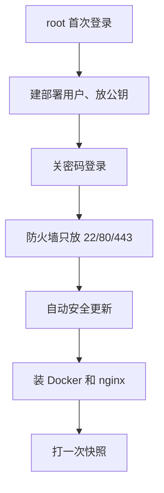

# VPS 选型与初始化

这本书讲一件事：**一个人怎么把写好的代码稳稳地送到用户手里，出了事还能退回来**。它覆盖服务端部署（VPS + Docker Compose + nginx）、密钥管理、零停机、GitHub Actions、版本号与 changelog、回滚，最后是 iOS / Android / 桌面端 / Cloudflare Workers 这些「不是 ssh 上去换个镜像」的发版方式。

适合谁：已经能把 NestJS、React、Expo 项目在本机跑起来，现在要第一次（或者想更体面地）上线的独立开发者。默认你会用终端、看得懂 bash 和 YAML、用过 Docker。

怎么读：前四章是一条主线，从一台空机器走到「一条命令发一版服务端」，建议按顺序读；第 5–7 章讲流水线、版本号和回滚，可以按需跳；第 8 章是客户端发版，做 App 的人直接翻过去也行。全书反复引用两个真实项目：

- **hatch-counter（掌柜眼）**：NestJS + Postgres 的门店管理，跑在一台阿里云 ECS 上，`deploy/` 目录下有 `deploy.sh`、`push.sh`、`gen-env.sh`、`agent.sh` 一套脚本，发版走 `pnpm release` 触发 GitHub Actions
- **hatch-recordwall（唱片墙）**：Expo 播放器加一个 Cloudflare Worker，iOS 包本机出、传 TestFlight，Worker 用 `wrangler deploy`

这一章先解决最底下那层：**买什么样的机器，拿到之后头半小时做什么**。

## 一个人为什么还在用 VPS

2026 年有很多「不用管机器」的选择：Serverless、PaaS、托管数据库。它们的取舍在[《云与边缘》](../cloud-and-edge/)里细讲，这里只说结论：

| 方案 | 适合 | 不适合 |
|---|---|---|
| VPS + Docker Compose | 有长连接、有 Postgres、要自己控制数据位置；预算固定 | 流量暴涨要秒级扩容 |
| Serverless（Workers 等） | 无状态 API、静态站、边缘代理 | 长时间任务、需要本地磁盘的服务 |
| PaaS（托管容器平台） | 不想碰 Linux | 价格随用量涨得快，境内可用性看平台 |

hatch-counter 选 VPS 的理由很典型：服务端要连 Postgres、要 SSE 长连接、用户在境内要求延迟低，一台 2 核 4G 的 ECS 一个月的钱是确定的。唱片墙的曲库则只是 R2 前面一层鉴权代理，没有状态，放 Worker 正合适。**两种并不冲突，一个人的公司里常常两样都有。**

## 选型：四个真正要想的问题

### 地域

地域决定延迟，也决定合规。用户主要在境内，就选境内地域；在境内用自己的域名对外提供网站服务，需要先办 ICP 备案，备案下来之前域名访问会被云厂商在网络层拦掉（hatch-counter 的部署文档里专门记了这个症状：打 IP 一切正常，打域名回 403）。备案的材料、时长和规则会变，**以云厂商和主管部门的最新说明为准**。

还有一条容易忽略：**机器、镜像仓库、对象存储放同一个地域**。hatch-counter 的 ECS、ACR（镜像仓库）、OSS（对象存储）都在同一地域，这样拉镜像、读写图片都走内网地址，不过公网、不计流量；跨地域时内网域名根本解析不了。

### 规格

| 跑什么 | 起步建议 |
|---|---|
| 只有静态站 + nginx | 1 核 1G 足够 |
| Node 服务端 + Postgres + nginx 挤一台 | 2 核 4G，系统盘 40G 以上 |
| 再加构建（在机器上 `docker build`） | 别这么干，见下文 |

2G 内存跑 NestJS + Postgres 能起来，但没有余量：Postgres 的缓存、Node 的堆、偶尔一次 `docker compose pull` 解压镜像，任何一个冲高都可能触发 OOM。**不要在生产机上构建镜像**，构建吃 CPU 和内存，而且会把开发依赖留在磁盘上，交给 CI 去做（第 5 章）。

### 架构：amd64 还是 arm64

开发用的 Mac 是 arm64，大多数云主机是 amd64。本地 `docker build` 出来的镜像扔上去会报 `exec format error`。可以 `docker buildx build --platform linux/amd64` 交叉构建，但 QEMU 模拟下 `pnpm install` 加 `tsc` 会慢好几倍。hatch-counter 的做法是**不在本地编镜像**，GitHub 默认的 `ubuntu-latest` runner 就是 amd64。如果你选的是 arm64 服务器，GitHub 也有原生的 arm64 runner，见[第 5 章](05-ci-cd.md#arm64-runner)。

### 系统

选 **Ubuntu LTS**（或 Debian 稳定版）。理由很实际：网上的教程、Docker 官方安装脚本、nginx 的目录约定（`/etc/nginx/snippets/` 是 Debian 系才有的）都默认它。换成发行版定制系统，包管理和配置目录都要重新查。

## 拿到机器之后的头半小时



### 1. 本机配好 ssh 别名

先在本机 `~/.ssh/config` 里给这台机器起个名字，后面所有脚本都认这个名字，换机器只改这一处：

```text
Host prod
  HostName <公网 IP>
  User deploy
  IdentityFile ~/.ssh/id_ed25519
```

hatch-counter 的 `push.sh` 就是这么写的：主机名默认取 ssh 配置里的别名，需要时用 `DEPLOY_HOST=别的名字` 覆盖。**IP 只出现在你本机的 ssh 配置里，不进仓库**。

### 2. 建一个部署用户

```bash
# 以 root 登录后执行
adduser --disabled-password --gecos "" deploy
usermod -aG sudo,docker deploy   # docker 组要等装完 Docker 才有，可以装完再加
mkdir -p /home/deploy/.ssh
cp ~/.ssh/authorized_keys /home/deploy/.ssh/
chown -R deploy:deploy /home/deploy/.ssh
chmod 700 /home/deploy/.ssh && chmod 600 /home/deploy/.ssh/authorized_keys
```

注意 `docker` 组的成员等价于 root（能挂载宿主机任意目录进容器）。一个人的机器上这是可以接受的取舍，但要知道它意味着什么。

### 3. 关掉密码登录

```bash
sudo tee /etc/ssh/sshd_config.d/10-hardening.conf >/dev/null <<'EOF'
PasswordAuthentication no
PermitRootLogin prohibit-password
EOF
sudo sshd -t && sudo systemctl reload ssh
```

`sshd -t` 先检查语法，过了才 reload。**改完别急着关当前终端**，另开一个窗口确认 `ssh prod` 能进，再退出。把自己锁在门外是 VPS 新手最常见的事故，救回来要去控制台用 VNC。

### 4. 防火墙

两层都要有：云厂商的**安全组**和机器上的 **ufw**。只放行 22 / 80 / 443。

```bash
sudo ufw default deny incoming
sudo ufw allow OpenSSH
sudo ufw allow 80,443/tcp
sudo ufw enable
```

特别注意：**Postgres 的 5432、Node 的 3000 一个都不要对公网开**。hatch-counter 的编排里库不映射任何端口，服务端只绑 `127.0.0.1:3000` 给宿主机上的 nginx。注意 **Docker 发布的端口会绕过 ufw**，`ports: "3000:3000"` 照样对公网开放，要写成 `127.0.0.1:3000:3000`，原因见[《容器技术》Docker 会绕过防火墙](../docker-containers/05-network-storage.md#docker-会绕过防火墙)。

### 5. 自动安全更新

```bash
sudo apt update && sudo apt install -y unattended-upgrades
sudo dpkg-reconfigure -plow unattended-upgrades
```

它只装安全更新，不升大版本。内核更新后需要重启才生效，这件事要自己留意（[《一人运维手册》](../production-ops/)会讲怎么把它纳入例行检查）。

### 6. 装 Docker 和 nginx

```bash
sudo apt install -y nginx certbot
curl -fsSL https://get.docker.com | sudo sh
docker version && docker compose version && nginx -v
```

几点说明：

- `docker compose`（插件，带空格）是现在的标准，**不要再装老的 `docker-compose` 命令**，两者参数不完全一样
- 境内机器装 Docker 慢，官方脚本支持 `--mirror Aliyun` 之类的参数走国内源
- 境内机器拉 Docker Hub 经常超时。hatch-counter 的解法是用一条 GitHub Actions 工作流把 `postgres:16-alpine` 这类外来镜像转存进自己的镜像仓库，编排里一个 `docker.io` 的镜像都不留
- nginx 装在宿主机上而不是放进 compose：证书续期用 certbot 加一个 reload 钩子就完事，塞进容器要自己拼一套。nginx 本身的配置在[《Nginx 与反向代理》](../nginx-gateway/)里展开

### 7. 打一次快照

基础环境装好、还没放任何数据时，在云控制台给系统盘打一个快照。之后机器被你折腾坏了，回到这个点只要几分钟。快照不是备份（它和机器在同一个云账号里，账号出事一起没），数据库备份另说。

## 目录约定

把一台机器上「属于这个应用」的东西收在一个目录里，例如 `/srv/myapp/`：

| 文件 | 谁写 | 进不进 git |
|---|---|---|
| `docker-compose.yml`、`deploy.sh` | 仓库里写好，传上来 | 进 |
| `api.env`、`postgres.env` | 在机器上生成一次 | **不进** |
| `.env`（只有一行镜像 tag） | `deploy.sh` 每次发版改 | 不进 |
| `sites/<app>/<版本>/` | 静态站各版本 | 不进 |

hatch-counter 把密钥文件和 compose 自己读的 `.env` 分开，原因很具体：`.env` 每次发版都会被脚本改写一行镜像 tag，密码放在里面迟早被冲掉。第 3 章会细讲。

## 本章要点

- 有状态、要长连接、预算固定的服务端，一台 VPS + Docker Compose 仍然是一个人性价比最高的方案
- 机器、镜像仓库、对象存储放**同一地域**；境内对外服务要先备案，规则以官方为准
- 2 核 4G 起步；**不在生产机上构建镜像**，也别在 arm64 的 Mac 上编 amd64 镜像
- 初始化顺序：部署用户 → 关密码登录 → 安全组 + ufw → 自动安全更新 → Docker / nginx → 快照
- 数据库和应用端口只绑本机；Docker 的端口映射会绕过 ufw，要写成 `127.0.0.1:端口:端口`
- 应用的东西收在一个目录，密钥文件只在机器上生成、不进仓库

## 动手练习

下面的题会改防火墙和 sshd 配置，请在一次性虚拟机里做（例如 `multipass launch --name lab 24.04`，做完 `multipass delete --purge lab`），不要在正在用的服务器上试。

1. **亲眼看 Docker 绕过 ufw**：在虚拟机里按本章打开 ufw（`default deny incoming`，只放 OpenSSH），装好 Docker 后运行 `docker run -d --name web -p 8080:80 nginx:alpine`，然后在 Mac 上 `curl -s http://<虚拟机 IP>:8080 | head -n 4`。再把容器换成 `-p 127.0.0.1:8080:80` 重来一次。

   验证：第一次能拿到 nginx 欢迎页的 HTML（`sudo ufw status` 里明明没有 8080）；第二次 curl 连接失败，而在虚拟机里 `curl -s 127.0.0.1:8080` 仍然正常。

   参考答案：Docker 发布端口是直接往 iptables 的 nat / DOCKER 链里写规则，流量在到达 ufw 管的 INPUT 链之前就被转发走了。所以对外只靠端口映射写成 `127.0.0.1:端口:端口`，再由宿主机上的 nginx 转发。

2. **让 `sshd -t` 拦下一次手误**：在虚拟机里写一份故意拼错的 `/etc/ssh/sshd_config.d/10-hardening.conf`（例如 `PasswordAuthenticaton no`，少了一个 i），先跑 `sudo sshd -t; echo $?`，改对后再跑一次，最后用 `sudo sshd -T | grep -i '^passwordauthentication'` 看生效值。

   验证：拼错时 `sshd -t` 打印出错的文件和行号，退出码非 0；改对后没有输出、退出码为 0；`sshd -T` 打印 `passwordauthentication no`。

   参考答案：`sshd -t` 只做语法检查，`sshd -T` 打印合并所有配置文件后的最终值，两者配合才能确认「改的那一行真的生效了」。前面那份配置还没生效时，用 `&&` 把 `sshd -t` 和 `reload` 串起来，错了就不会 reload。

3. **arm64 的 Mac 上编 amd64 镜像要多久**：在 Mac 上找一个有 `pnpm install` 的小项目（或者写一个只有 `RUN npm i typescript` 的 Dockerfile），分别 `time docker build -t t:native .` 和 `time docker buildx build --platform linux/amd64 -t t:amd64 --load .`，再用 `docker image inspect --format '{{.Architecture}}' t:amd64` 看架构。

   验证：inspect 输出 `amd64`；amd64 那次的耗时明显长于原生构建（记下两次的 real 时间，对比倍数）。

   参考答案：跨架构构建靠 QEMU 逐条翻译指令，CPU 密集的安装和编译步骤会成倍变慢，这就是本章建议把构建交给 amd64 的 CI runner 的原因。
