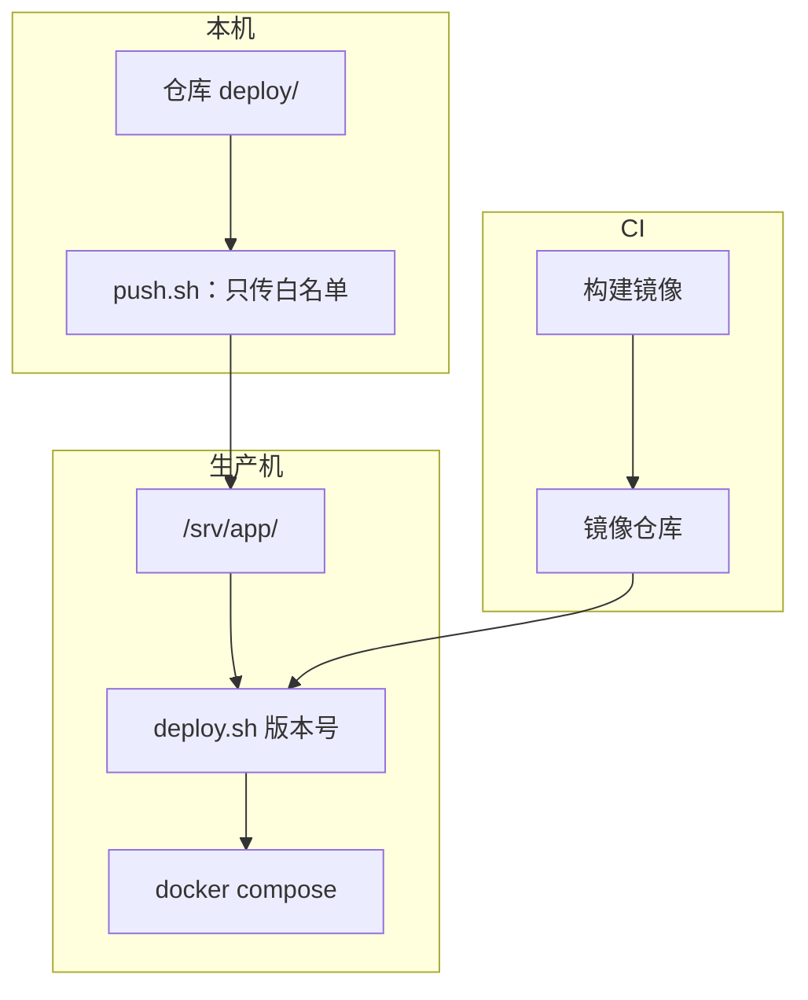

# 部署脚本

机器准备好了，下一个问题是：**每次发版具体敲哪几条命令**。手敲当然可以，但手敲的问题不是慢，而是每次顺序可能不一样、某一步失败了没注意到、出事时想不起上次怎么做的。部署脚本的价值是把「顺序」和「失败时怎么办」固化下来。

这一章以 hatch-counter 的两份脚本为主线：机器上跑的 `deploy.sh`（换一版服务端）和本机跑的 `push.sh`（把配置文件传上机器），讲一份可靠的部署脚本该有哪些骨架。

## 先分清两件事：传配置和换版本

很多人的第一份部署脚本是「rsync 整个目录上去，再 ssh 进去 `docker compose up`」。它把两件频率完全不同的事绑在了一起：

| | 传配置 | 换版本 |
|---|---|---|
| 内容 | compose 文件、nginx 配置、脚本本身 | 镜像 tag |
| 频率 | 偶尔（改了 `deploy/` 才需要） | 每次发版 |
| 在哪跑 | 本机 → 机器 | 机器上 |
| hatch-counter | `deploy/push.sh` | `deploy/deploy.sh <版本>` |

拆开之后，日常发版就是 ssh 上去跑一条 `./deploy.sh 1.4.0`，不用担心顺手把哪份配置也覆盖了。



## 每份脚本的开头

```bash
#!/usr/bin/env bash
set -euo pipefail
cd "$(dirname "$0")"
```

这三行几乎是强制的：

- `set -e`：任何一条命令失败就退出，不带着错误继续往下跑
- `set -u`：用到未定义的变量就报错。没有它，`rm -rf "$DIR/"` 在 `DIR` 为空时会变成 `rm -rf /`
- `set -o pipefail`：管道里任何一段失败，整条管道算失败。没有它，`curl ... | tar -x` 里 curl 失败了也会被 tar 的成功掩盖
- `cd "$(dirname "$0")"`：不管从哪个目录调用，都以脚本所在目录为准，相对路径才可靠

## deploy.sh：顺序就是全部内容

hatch-counter 的 `deploy.sh` 开头注释写着一句话：「顺序是这个脚本的全部内容，别改」。简化后的骨架如下：

```bash
#!/usr/bin/env bash
set -euo pipefail
cd "$(dirname "$0")"

VERSION="${1:?用法：./deploy.sh <版本号>}"
TAG_KEY=API_TAG

# 只改 .env 里自己那一行，不整份重写
set_tag() {
  touch .env
  grep -v "^$TAG_KEY=" .env > .env.tmp || true
  echo "$TAG_KEY=$1" >> .env.tmp
  mv .env.tmp .env
}

# 记下上一版，失败时退回去
PREV=""
[ -f .env ] && PREV=$(sed -n "s/^$TAG_KEY=//p" .env)

restore() {
  trap - ERR
  [ -z "$PREV" ] && { echo "没有上一版可退" >&2; return; }
  echo "退回 $PREV" >&2
  set_tag "$PREV"
  docker compose up -d --wait --wait-timeout 90
}
trap 'restore || true' ERR

set_tag "$VERSION"
docker compose pull api
docker compose up -d --wait --wait-timeout 60 postgres
docker compose run --rm api node dist/db/migrate.js   # 先迁移
docker compose up -d --wait --wait-timeout 90          # 再起新容器
trap - ERR

echo "起来了：$VERSION"
```

一行行看它在防什么。

### 先迁移，再起新容器

反过来的话，新代码会对着旧表跑几秒，而那几秒进来的是真实请求。迁移用 `docker compose run` 而不是 `docker run`：数据库在 compose 网络里，裸容器解析不了 `postgres` 这个服务名。

迁移先跑还有一个前提：**迁移必须兼容上一版代码**，因为迁移跑完到新容器起来之间、以及回滚之后，旧代码都要对着新表跑。这条纪律在第 4 章和第 7 章展开。

### `--wait` 等的是健康检查，不是进程

`docker compose up -d --wait` 会等到容器的 HEALTHCHECK 报告 healthy 才返回，超时则返回非零退出码，于是触发 `trap ... ERR`。hatch-counter 的镜像里 HEALTHCHECK 是去请求 `/v1/health`，而那个接口会真去数据库 `select` 一下：

```dockerfile
HEALTHCHECK --interval=30s --timeout=5s --start-period=20s --retries=3 CMD \
  node -e "fetch('http://127.0.0.1:3000/v1/health').then(r=>process.exit(r.ok?0:1)).catch(()=>process.exit(1))"
```

为什么不自己写个 curl 循环？因为自己写多半是从宿主机打端口，而换容器那几秒端口是空的，分不出「还没起来」和「起来了但连不上库」。

### 失败自动退回上一版

`trap 'restore || true' ERR` 注册了一个失败钩子。两个细节值得抄：

- `restore` 一进来先 `trap - ERR` 摘掉钩子，否则回滚本身失败时会递归进来，刷屏的「回滚失败」会把真正的第一条错误挤出屏幕
- `restore || true`：回滚失败也要让后面的提示语句继续跑

注意它退的只是镜像，**退不了迁移**。所以首次部署（没有上一版）时它只提示「库可能已经迁移过了，看一眼日志」，不假装自己能修好。

### 只改自己那一行

`set_tag` 用 `grep -v` 加追加的方式只替换 `API_TAG=` 那一行，而不是 `echo "API_TAG=$1" > .env` 整份重写。今天 `.env` 里只有这一行，明天多记一样东西，整份重写就会悄悄把它冲掉。

### 旧镜像不删

脚本最后提示「旧镜像没删，回滚要用」。`docker image prune` 留给人在磁盘紧张时手动清，并且带时间过滤：

```bash
docker image prune -a --filter until=720h
```

## 停服维护：一个文件当开关

大多数发版不需要停服（迁移是加法，见第 4 章）。真要停的是另一类：长时间回填数据、真删列、升 Postgres 大版本。hatch-counter 的做法是 `deploy.sh --maintenance`：

1. 脚本 `touch` 一个约定路径的标记文件
2. nginx 对每个转给服务端的请求检查这个文件，存在就返回 503 和一句给用户看的中文
3. 新容器健康检查通过后才删掉标记

nginx 那一侧大致是：

```nginx
# 放进 snippets，每个转给后端的 location 各 include 一次
if (-f /srv/app/maintenance.on) {
    return 503;
}
error_page 503 /maintenance.html;
```

一个反直觉的设计：**中途失败时标记故意不摘**。停在维护页上是可解释的，停在一堆「连接失败」上是不可解释的；而回滚本身也可能失败，自动摘掉等于在最糟的时刻把最糟的画面递给用户。人就坐在终端前，脚本会打印「确认服务起来了再执行 `rm` 摘掉标记」。

## push.sh：白名单，不是 rsync 整个目录

本机把 `deploy/` 传上机器，最省事的写法是：

```bash
rsync -av --exclude '*.env' deploy/ prod:/srv/app/
```

问题在于它靠一条 `--exclude` 挡着本机的密钥文件。漏写一回，本机那几把开发用的密码就覆盖了线上的，数据库连不上，报出来只是一句「认证失败」。hatch-counter 的 `push.sh` 改成了**白名单**：

```bash
FILES=(
  docker-compose.yml
  deploy.sh
  gen-env.sh
  api.env.example
  nginx/app.conf
)
```

`*.env` 根本不在名单上，命令写错也带不上去。加一份文件要想清楚「它在机器上谁读」；README 不上去，机器上留一份旧文档只会让人读岔。

它的另外几个做法：

- **只传改过的**：先 ssh 上去要一份各文件的 sha256，和本机比，只打包变了的那几份。`--dry-run` 只列出会变什么
- **不依赖 rsync**：macOS 自带的 rsync 和 Linux 上的 GNU rsync 参数对不齐，所以用 `tar` 通过 ssh 管道灌过去，两头只要有 `tar` 和 `ssh`
- **退役名单**：以前传上去、现在不用的文件明确列在 `RETIRED` 里删除，而不是做「镜像同步」，避免误删机器上自己生成的文件
- **nginx 只在明说时装**：`--nginx` 才把配置拷进 `/etc/nginx`，先备份、再 `nginx -t`，没过就换回原来那份

最后一条的核心片段：

```bash
sudo cp nginx/app.conf /etc/nginx/conf.d/app.conf
if sudo nginx -t; then
  sudo systemctl reload nginx
else
  sudo cp -a "$bak/app.conf" /etc/nginx/conf.d/app.conf   # 换回备份
  echo "nginx -t 没过，已换回原配置" >&2
  exit 1
fi
```

**改 nginx 永远是 `nginx -t` 通过才 reload**。`reload` 本身是平滑的（老 worker 处理完当前请求才退出），但配置有错时 nginx 会拒绝加载，如果你用的是 `restart` 就直接挂了。

## 好脚本的共同特征

| 特征 | 为什么 | 例子 |
|---|---|---|
| 幂等 | 失败后重跑同一条命令不会出错 | `mkdir -p`、`grep -v` 替换行、`gen-env.sh` 文件已存在就拒绝 |
| 有 `--dry-run` | 不确定时先看会发生什么 | `push.sh --dry-run` |
| 危险操作要显式 flag | 判断在人，不让脚本猜 | `--maintenance`、`--nginx`、`--force` |
| 报错说后果和下一步 | 出事时人在压力下读输出 | 「维护标记还挂着，确认起来了再 rm」 |
| 注释写为什么 | 半年后的自己会想「改掉这步」 | 「必须是 compose run 不能是 docker run」 |
| 能本机试 | 不在生产机上第一次跑 | `DEPLOY_HOST=local DEPLOY_DIR=<临时目录>` |

最后一条值得多说一句：`push.sh` 支持 `DEPLOY_HOST=local`，此时不走 ssh，在本机一个临时目录上完整跑一遍。部署脚本是最难测试的代码，留一个本机演练的口子成本很低。

对于用编码 agent 写脚本的人，还有一条：**把这些「为什么」写进脚本注释和项目规则文件**。agent 很擅长写出语法正确的 bash，但不知道你踩过哪些坑；注释里那句「迁移必须在起新容器之前」就是防止它「顺手优化」掉的护栏。

## 本章要点

- 把「传配置」和「换版本」拆成两份脚本，前者偶尔跑，后者每次发版跑
- 开头固定写 `set -euo pipefail` 和 `cd "$(dirname "$0")"`
- 服务端发版顺序：拉镜像 → 起库 → **先迁移** → 起新容器并 `--wait` 健康检查
- 用 `trap ... ERR` 记住上一版并自动退回镜像，但要清楚迁移是退不回去的
- 停服维护用一个标记文件 + nginx 判断，失败时宁可停在维护页
- 传文件用**白名单**而不是「整目录同步 + 排除」，密钥文件永远不在名单上
- 改 nginx 必须 `nginx -t` 通过才 reload，失败自动换回备份

## 动手练习

1. **`set -u` 和 `pipefail` 各拦住了什么**：在本机临时目录里分别运行下面两段，比较输出和退出码。

   ```bash
   bash -c 'echo "将要删除：$DIR/"'; echo "exit=$?"
   bash -c 'set -u; echo "将要删除：$DIR/"'; echo "exit=$?"
   bash -c 'false | true'; echo "exit=$?"
   bash -c 'set -o pipefail; false | true'; echo "exit=$?"
   ```

   验证：第一段打印 `将要删除：/`、`exit=0`；第二段报 `DIR: unbound variable`，退出码非 0（具体数值随 bash 版本不同）；第三段 `exit=0`；第四段 `exit=1`。

   参考答案：没有 `set -u` 时未定义变量被当成空串，路径悄悄变成 `/`；没有 `pipefail` 时管道的退出码只看最后一段，前面的失败被吞掉。这里只用 `echo` 演示，不要把 `rm` 放进去试。

2. **让 `trap ... ERR` 真的退回一次**：在本机建一个目录，放一份只有一个服务的 `docker-compose.yml`（`api` 用 `nginx:${API_TAG}`，加一个 `wget -q -O /dev/null http://127.0.0.1/` 的 healthcheck），把本章的 `deploy.sh` 删掉起库和迁移两行。先 `./deploy.sh 1.27-alpine`，再 `./deploy.sh no-such-tag`。

   验证：第二次 `docker compose pull api` 失败后，屏幕上出现 `退回 1.27-alpine`；`cat .env` 仍是 `API_TAG=1.27-alpine`，`docker compose ps` 里容器是 healthy。

   参考答案：`pull` 返回非 0 触发 ERR 钩子，`restore` 先摘掉钩子再把 tag 写回上一版并 `up --wait`。可以再试一次把 healthcheck 改成必然失败的命令，观察 `--wait` 超时同样会触发退回。

   ```yaml
   services:
     api:
       image: nginx:${API_TAG}
       ports: ["127.0.0.1:8080:80"]
       healthcheck:
         test: ["CMD", "wget", "-q", "-O", "/dev/null", "http://127.0.0.1/"]
         interval: 2s
         retries: 5
   ```

3. **`set_tag` 不冲掉别的行**：准备一份两行的 `.env`（`OTHER=keep` 和 `API_TAG=old`），把本章的 `set_tag` 函数复制进一个小脚本，连续调用 `set_tag 1.0`、`set_tag 1.1`。再把函数换成 `echo "API_TAG=$1" > .env` 重做一遍。

   验证：前者结束后 `grep -c '^API_TAG=' .env` 输出 `1`，`OTHER=keep` 还在；后者 `OTHER=keep` 消失。

   参考答案：`grep -v` 先过滤掉旧的那一行再追加，重复执行结果相同（幂等），也不碰其他键；整份重写只在「文件里永远只有一行」时才碰巧正确。
