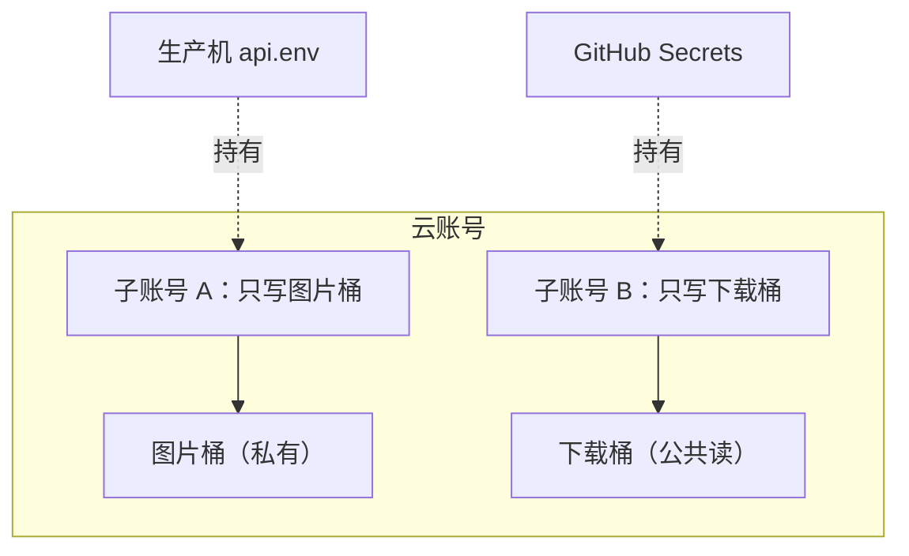

# 环境变量与密钥

部署出事，很大一部分不是代码的错，而是配置的错：密码抄岔了一位、key 首尾多了个空格、开发环境的地址被打进了生产包、仓库里不小心提交了一份 `.env`。这些错误的共同点是**报错离原因很远**：你看到的是「认证失败」「401」「够不着」，而原因是三步之外的一份文件。

这一章讲三件事：配置放在哪里、密钥怎么生成和分发、怎么让配置错误尽早暴露。

## 配置的三个层次

先把「配置」分个类，不同类放不同地方：

| 类型 | 例子 | 放哪 | 进 git |
|---|---|---|---|
| 不变的约定 | 端口号、超时、特性开关默认值 | 代码或配置文件 | 进 |
| 随环境变的、不机密 | API 地址、桶名、地域 | 环境变量；CI 的 Variables | 模板进，值看情况 |
| 机密 | 数据库密码、JWT 密钥、云厂商 AccessKey | 机器上的 env 文件；CI 的 Secrets；平台的 secret 存储 | **永远不进** |

「十二要素应用」里那句「配置存在环境变量里」说的是第二、三类。第一类别也塞进环境变量，否则每台机器、每个 CI job 都要配一遍本来不会变的东西。

## 模板进仓库，值不进

标准做法是仓库里放 `.env.example`，列出所有键和说明，值留空或写占位；真正的 `.env` 被 `.gitignore` 挡住。

```gitignore
.env
.env.*
!.env.example
```

唱片墙的仓库在这条上更细一步：开发默认值 `.env.development` **进仓库**（里面只有 localhost 和本机 Worker 的占位令牌，新机器 clone 完就能跑），生产配置 `.env.production` 不进。它的规则文件里特别写了一句：**永远别给 `.env.production` 补一条 `!` 例外**，放行名单只有确认没有机密的两份。

## 在机器上生成，而不是从本机拷过去

生产密钥最安全的产生方式是**在生产机上随机生成，从不离开那台机器**。hatch-counter 的 `gen-env.sh` 做的就是这件事，模板里有两种占位符：

```bash
# api.env.example（节选，示意）
POSTGRES_PASSWORD=<<gen:pg_owner:32>>
DATABASE_URL=postgres://app:<<gen:pg_owner:32>>@postgres:5432/app
JWT_SECRET=<<gen:jwt:48>>
OSS_ACCESS_KEY_ID=<<ask:去云控制台拿图片桶的 AccessKey>>
```

- `<<gen:名字:长度>>`：脚本生成随机值。**同名的占位符拿同一个值**，所以 `POSTGRES_PASSWORD` 和 `DATABASE_URL` 里那段一定对得上
- `<<ask:说明>>`：只能人去控制台拿的东西。脚本把它**清成空值**，而不是留一句占位文字

后一条是精心的选择：空值会被服务端启动时的配置校验当场拦下；一句假值能骗过启动，等到用户点了某个功能才炸。

生成随机值的那一行：

```bash
gen_secret() {
  openssl rand -hex "$(((${1} + 1) / 2))" | cut -c "1-${1}"
}
```

为什么用 `-hex` 不用 `-base64`？base64 会产生 `+ / =`，而这些密码要嵌进 `postgres://user:密码@host/db` 这种 URL，`/` 和 `+` 在 URL 里有含义，连接串会解析错，错法恰恰是最难往回查的「密码不对」。hex 只有 `[0-9a-f]`，在 URL、shell、复制粘贴三处都安全。

还有两个细节：

```bash
umask 077          # 先收紧权限再创建文件
printf '%s\n' "$body" > api.env
```

先 `umask 077` 再写文件，文件一创建就是 600；反过来「建完再 chmod」，中间有一小段时间文件是 644 的。

以及，**默认拒绝覆盖**。文件已存在就退出，要覆盖得显式 `--force`。因为重新生成的代价不是「再跑一次而已」：

- `JWT_SECRET` 一换，所有在用的令牌都验不过，全员掉线
- `POSTGRES_PASSWORD` 只在数据卷为空、第一次 initdb 时生效。库建好之后改这份文件不会改库里的密码，只会让服务端拿新密码去连一个还在用旧密码的库

## 一个消费方一把钥匙

hatch-counter 有两个对象存储桶，这张对比表是它的部署文档里的：

| | 图片桶 | 下载桶 |
|---|---|---|
| 装什么 | 用户拍的单据原图 | 安装包、前端包 |
| 读权限 | 私有 | 公共读 |
| 谁在写 | 服务端（生产机上） | GitHub 的 runner |
| 钥匙放哪 | 机器上的 `api.env` | GitHub 仓库 secret |

两个桶用**两个不同的 RAM 子账号**，各自只授权自己那个桶的最小权限（下载桶那把只有 `PutObject` 和 `AbortMultipartUpload`）。理由是：GitHub 那把钥匙跑在别人家的机器上，泄漏概率比生产机上那把高；如果复用同一把，它一旦泄漏，泄的是全部用户的单据原图。



推广成三条原则：

1. **按消费方分钥匙**：谁用谁一把，名字写清楚是谁的（将来查 403 或要吊销时看的就是它）
2. **按资源分权限**：精确到桶、到动作，不图省事挂 FullAccess
3. **按暴露面分等级**：会进客户端包的钥匙默认它会泄漏，只给只读；真正不能丢的钥匙不进任何包

唱片墙的 Worker 就是第三条的样板：打进 App 的只读令牌「算不上高价值机密，丢了换一把」；能写曲库的 `WRITE_TOKEN` 和发布者口令的 `TOTP_SECRET` 不进任何包，只在 Worker 的 secret 存储里。

## 打包时内联：客户端没有秘密

前端和移动端有个特殊情况：环境变量是在**构建那一刻**被替换进代码的。

| 工具 | 内联的前缀 |
|---|---|
| Vite | `VITE_` |
| Expo | `EXPO_PUBLIC_` |
| Next.js | `NEXT_PUBLIC_` |

带前缀的变量会以明文出现在 JS bundle 里，任何人解包都能看到。所以：

- **客户端代码里不存在真正的密钥**。能放的只有「默认它会泄漏也没关系」的东西
- **改了 env 要重新构建**，热重载不算。唱片墙的规则里专门写了：改完 env 文件要整个重启 Metro
- 换一把内联的令牌意味着**发一版新包**

唱片墙的出包工具还加了两道闸门：缺只读令牌就拒绝出包（漏了 Metro 一个字都不报），开发用的地址变量被设过也拒绝。关键在于：**闸门要按构建工具的同一份文件名单去读配置**。只看 `process.env` 的话，令牌明明写在 `.env.production` 里却判成没配，而混进文件的开发地址反倒看不见，两道闸门一正一反全废掉。

## 平台的 secret 存储

不同部署目标都有自己的 secret 机制，用法类似：

```bash
# Cloudflare Workers：值交互式输入，不进 shell 历史，不进 wrangler.toml
pnpm -C apps/vault exec wrangler secret put WRITE_TOKEN

# GitHub Actions：用 gh CLI 写入仓库 secret
gh secret set OSS_ACCESS_KEY_ID
gh variable set OSS_BUCKET --body "my-downloads"
```

GitHub 区分 **Secrets** 和 **Variables**：前者加密、日志里自动打码、读不回来；后者是明文配置。桶名、endpoint 这类不机密的东西放 Variables，方便查看和修改。

在 workflow 里使用时，只在需要的那一步注入：

```yaml
- name: 上传安装包
  run: pnpm -C tools/oss upload dist/app.apk
  env:
    OSS_ACCESS_KEY_ID: ${{ secrets.OSS_ACCESS_KEY_ID }}
    OSS_ACCESS_KEY_SECRET: ${{ secrets.OSS_ACCESS_KEY_SECRET }}
    OSS_BUCKET: ${{ vars.OSS_BUCKET }}
```

写在 job 级或 workflow 级的 `env` 会让每一步都看得到，包括第三方 action。

## 让配置错误尽早暴露

服务端启动时校验配置，缺什么当场退出，是性价比最高的防线。NestJS 项目可以用 zod 写一个 `loadConfig()`：

```ts
import { z } from "zod";

const Config = z.object({
  NODE_ENV: z.enum(["development", "production", "test"]),
  DATABASE_URL: z.string().url(),
  JWT_SECRET: z.string().min(32),
  OSS_ACCESS_KEY_ID: z.string().min(1),
  TRUST_PROXY: z.coerce.number().int().min(0),
});

export function loadConfig(env = process.env) {
  const parsed = Config.safeParse(env);
  if (!parsed.success) {
    const keys = parsed.error.issues.map((i) => i.path.join(".")).join(", ");
    throw new Error(`配置不完整或格式不对：${keys}`); // 只报键名，不打印值
  }
  return parsed.data;
}
```

注意报错**只列键名、不打印值**，否则密钥会出现在日志里。

hatch-counter 还白捡了一道闸门：迁移脚本和服务端走的是同一个 `loadConfig()`，所以 `deploy.sh` 跑迁移那一步时，配置缺项会在碰数据库之前就炸，新容器根本不会被拉起。

再配一个只看不改的检查命令，部署前跑一次：

```bash
./gen-env.sh --check
# ✗ api.env 的 OSS_ACCESS_KEY_ID 还空着 —— 去云控制台拿图片桶的 AccessKey
```

## 那些「看起来像密码错了」的坑

| 症状 | 真正原因 |
|---|---|
| 云 API 报签名不匹配 | AccessKey 首尾带了空格或换行，复制时带上的 |
| 数据库认证失败 | 两份 env 文件里同一个密码抄岔了；或改了 `POSTGRES_PASSWORD` 但库早已初始化 |
| 连接串解析错 | 密码里有 `/ + @ :` 等 URL 特殊字符 |
| 客户端一路 401 | 内联进包的令牌和服务端那份不是逐字一致 |
| 生产包连到了 localhost | 开发配置被构建工具读进了生产构建 |

最后，**万一密钥进了 git**：从历史里删掉不够，推到远端的那一刻就要当它已经泄漏。正确顺序是先在控制台吊销、换新，再清理历史。

## 本章要点

- 配置分三层：不变的约定进代码，随环境变的进环境变量，机密只在机器 / CI Secrets / 平台 secret 里
- `.env.example` 进仓库，真值不进；`.gitignore` 的放行名单里只有确认无机密的文件
- 生产密钥在生产机上随机生成：用 hex 避开 URL 特殊字符，`umask 077` 先于写文件，默认拒绝覆盖
- 一个消费方一把钥匙、权限精确到资源；进客户端包的钥匙默认会泄漏
- `VITE_` / `EXPO_PUBLIC_` 变量是构建时内联的明文，客户端没有真正的秘密
- 服务端启动时校验配置，缺项立即退出，报错只列键名
