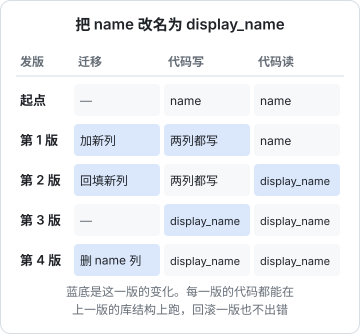

# 零停机发布

上一章的 `deploy.sh` 已经很可靠了，但它有一个已知的缺口，hatch-counter 的部署文档在「还没做的」里老实记着：**换容器那几秒的 502 没消掉**。`docker compose up -d` 换镜像的方式是「停旧的、起新的」，中间有一段没有任何进程在监听端口。

对很多个人项目，这几秒可以接受，挑凌晨发就是了。这一章讲清楚这几秒从哪来、什么时候值得消掉它、怎么消，以及比 502 更致命的那件事：**数据库迁移和新旧代码并存**。

## 停机从哪来

一次「重建容器」式的发版，时间线大致是这样：


空窗由三段组成：

1. **旧容器停止**：Docker 发 SIGTERM，等进程退出（默认最多 10 秒，然后 SIGKILL）
2. **新容器启动**：Node 加载代码、连数据库、Nest 初始化模块
3. **健康检查通过**：在这之前进来的请求，nginx 拿到的是连接被拒，返回 502

零停机的思路只有一个：**让新的先起来、确认能干活，再把流量切过去，旧的处理完手头的请求再走**。具体做法按对象分三种：静态站、无状态服务端、数据库。

## 静态站：原子地换一个软链

静态文件最简单，因为「切换」可以做成一个原子操作。hatch-counter 的四个静态站都是这个结构：

```text
/srv/app/sites/web/
├── 1.4.0/
├── 1.4.1/
├── 1.5.0/
└── current -> 1.5.0
```

nginx 的 `root` 指向 `sites/web/current`。发新版时先把包完整解到 `1.5.1/`，再切软链：

```bash
ln -sfn 1.5.1 sites/web/.current.next
mv -Tf sites/web/.current.next sites/web/current
```

为什么不直接 `ln -sfn 1.5.1 current`？因为 `ln -sf` 是先删后建，中间有一瞬间 `current` 不存在。先建一个临时链再 `mv -T` 覆盖，用的是 `rename(2)` 系统调用，它是原子的：nginx 任何时刻读到的都是一个完整的目录。（macOS 的 `mv` 没有 `-T`，所以这段只在 Linux 上成立。）

配合 Vite 这类工具的**内容哈希文件名**（`assets/index-a1b2c3.js`），旧页面上已经打开的标签页继续引用旧文件，新加载的页面拿新文件，互不干扰。这也是为什么机器上要保留最近几个版本，而不是解压覆盖：覆盖的话，旧标签页去取旧的 JS 会 404。

切完还要验证。hatch-counter 的上线代理 `agent.sh` 切完软链后立即请求本机首页，检查里面是否出现这一版那个带哈希的 JS 文件名，认不出就切回去：

```bash
switch_link "$app" "$ver"
if got=$(fetch_home "$app") && grep -qF "$want" <<< "$got"; then
  say "✓ 本机首页已经是 $ver"
else
  say "✗ 首页里没有 $want，切回 $prev"
  switch_link "$app" "$prev"
fi
```

**只信结果，不信「软链换成功了」**，这个思路在第 5 章的流水线里还会出现。

## 服务端：蓝绿切换

无状态的 Node 服务端可以用**蓝绿部署**：同时定义两个服务，各占一个本机端口，nginx 只指向其中一个。

```yaml
# docker-compose.yml（节选）
services:
  api_blue:
    image: registry.example.com/app/api:${BLUE_TAG}
    env_file: api.env
    ports: ["127.0.0.1:3001:3000"]
    init: true
    stop_grace_period: 30s
  api_green:
    image: registry.example.com/app/api:${GREEN_TAG}
    env_file: api.env
    ports: ["127.0.0.1:3002:3000"]
    init: true
    stop_grace_period: 30s
```

nginx 的 upstream 单独放一个小文件，切换就是改写它：

```nginx
# /etc/nginx/conf.d/api-upstream.conf，由脚本生成
upstream api {
    server 127.0.0.1:3001;
    keepalive 16;
}
```

切换脚本的核心：

```bash
#!/usr/bin/env bash
set -euo pipefail
cd "$(dirname "$0")"
VERSION="${1:?版本号}"
UPSTREAM=/etc/nginx/conf.d/api-upstream.conf

if grep -q 3001 "$UPSTREAM"; then
  NEXT=green; NEXT_PORT=3002; NEXT_KEY=GREEN_TAG; OLD=blue
else
  NEXT=blue;  NEXT_PORT=3001; NEXT_KEY=BLUE_TAG;  OLD=green
fi

grep -v "^$NEXT_KEY=" .env > .env.tmp || true
echo "$NEXT_KEY=$VERSION" >> .env.tmp && mv .env.tmp .env

docker compose pull "api_$NEXT"
docker compose run --rm "api_$NEXT" node dist/db/migrate.js
docker compose up -d --wait --wait-timeout 90 "api_$NEXT"   # 新的先起来

printf 'upstream api {\n    server 127.0.0.1:%s;\n    keepalive 16;\n}\n' "$NEXT_PORT" \
  | sudo tee "$UPSTREAM" >/dev/null
sudo nginx -t && sudo systemctl reload nginx                 # 平滑切流量

sleep 15                                                     # 等长请求收尾
docker compose stop "api_$OLD"
echo "已切到 $NEXT（$VERSION），$OLD 已停，回滚只需把 upstream 改回去"
```

`nginx reload` 是平滑的：新 worker 用新配置接新连接，老 worker 处理完手上的请求才退出。所以「切流量」这一步本身不丢请求。

回滚也因此变得极快：旧容器还在（只是 stopped），`docker compose start api_$OLD`、改回 upstream、reload，几秒钟。

第一次用之前，在 `.env` 里把 `BLUE_TAG` 和 `GREEN_TAG` 都写上当前版本，否则 compose 解析另一个服务时会拿到一个空 tag。

社区也有现成的工具把这套流程包装成 `docker compose` 插件（例如 docker-rollout），原理相同：扩出一个新副本、等健康、停掉旧副本。用不用工具都行，关键是你要明白它在做什么。

### 优雅退出：别让旧容器把请求掐断

蓝绿切换后旧容器会收到 SIGTERM。如果进程不处理这个信号，正在处理的请求会被直接掐断。三件事要做对：

```ts
// main.ts
const app = await NestFactory.create(AppModule);
app.enableShutdownHooks(); // 收到 SIGTERM 时触发 onModuleDestroy / beforeApplicationShutdown
await app.listen(3000);
```

- **Nest 里开 `enableShutdownHooks()`**，在 `onModuleDestroy` 里关数据库连接池、停定时任务
- **compose 里开 `init: true`**：Node 作为容器内 1 号进程时，没有注册处理函数的信号会被内核忽略；`init: true` 会放一个小的 init 进程在前面转发信号、回收僵尸进程
- **Dockerfile 用 exec 形式启动** `CMD ["node", "dist/main.js"]`，不要套 `pnpm start` 或 `sh -c`，中间那层壳不一定转发信号

`stop_grace_period` 设得比最长的正常请求略长。超过这个时间 Docker 会 SIGKILL。

### 长连接怎么办

SSE、WebSocket 这类长连接不会「处理完」。nginx reload 后老 worker 会一直挂着这些连接，可以用 `worker_shutdown_timeout 30s;` 给它一个上限。客户端那边要做好断线重连（浏览器的 `EventSource` 自带重连）。**长连接的零停机靠的是客户端重连，不是服务端不断**。

## 数据库：新旧代码并存的那一段

蓝绿部署有个前提常被忽略：**切换前后有一段时间，新旧两版代码同时在跑，连的是同一个库**。而迁移在新容器起来之前就已经跑完了。于是：

> 每一个迁移，都必须让上一版代码还能正常工作。

这就是 **expand / contract（扩张 / 收缩）** 模式。以「把 `name` 列改名为 `display_name`」为例，一次改名要拆成四次发版：



| 迁移操作 | 能直接做吗 | 怎么拆 |
|---|---|---|
| 加表、加可空列、加索引 | 能 | 大表加索引用 `CREATE INDEX CONCURRENTLY` |
| 加 NOT NULL 列 | 不能直接 | 先加可空列 + 回填，下一版再加约束（或给默认值） |
| 删列 | 不能直接 | 先发一版代码不再读写它，下一版再删 |
| 改名 | 不能直接 | 加新列 + 双写 → 回填并切读 → 停写旧列 → 删旧列 |
| 改列类型 | 不能直接 | 同改名，新列新类型 |

hatch-counter 的规则写得很直白：加列、加表、加索引随便；删列、改类型、加 NOT NULL 都要拆两版；不守这条的代价是**回滚那一刻旧镜像对着已经少了一列的表查询，每个请求都是 500，而你正处在「刚发现新版有问题」的那五分钟里**。

### Drizzle 项目的几个具体建议

- 用 `drizzle-kit generate` 生成 SQL 迁移文件，**提交前人工读一遍**。它检测到列消失时可能生成 `DROP COLUMN`，在 expand 阶段这正是你不想要的
- 改名时 drizzle-kit 会交互式问你是「重命名」还是「删了再建」。两个都不是你要的，按上表手写三步
- 迁移不要放在应用启动时自动跑。hatch-counter 的理由是权限：迁移用建表的 owner 角色，应用连的是受行级安全策略约束的非 owner 角色，后者根本建不了表。把迁移放在部署脚本里显式跑一步，也让「先迁移后起服务」的顺序清清楚楚

### 真的需要停机的时候

有些操作 expand / contract 也绕不过去，或者绕过去的成本远高于停五分钟：

- 几千万行的回填，跑起来会锁表或拖慢线上
- 升 Postgres 大版本
- 数据结构的大重构

这时用第 2 章的维护模式，挑用户最少的时段，提前通知。**判断要不要停服在人，脚本只提供显式的 `--maintenance` 开关**。

## 一个人值不值得做蓝绿

| 情况 | 建议 |
|---|---|
| 用户集中在白天，可以凌晨发 | 重建容器 + 挑时间，够用 |
| 发版频繁，白天也要发 | 值得上蓝绿 |
| 有收银、支付这类不能断的操作 | 值得上，并且客户端要有重试 |
| 单机内存紧张，跑不起两份 | 先升配置，或接受几秒空窗 |

无论选哪种，**expand / contract 的迁移纪律都必须守**，因为它不只服务于零停机，还决定了你能不能回滚（第 7 章）。

## 本章要点

- 「重建容器」式发版的空窗 = 旧进程退出 + 新进程启动 + 健康检查通过
- 静态站用「完整解压到新目录 + 原子替换软链」，保留旧版本目录，切完验证首页
- 服务端用蓝绿：新的先起来并通过健康检查，改 upstream 后 `nginx -t && reload`，旧的稍后再停
- 优雅退出三件事：`enableShutdownHooks()`、compose `init: true`、exec 形式的 CMD
- 新旧代码会同时连同一个库，所以迁移必须兼容上一版：expand / contract，删列和改名拆成多次发版
- 真需要停机的操作用显式的维护模式，挑时段、提前说
