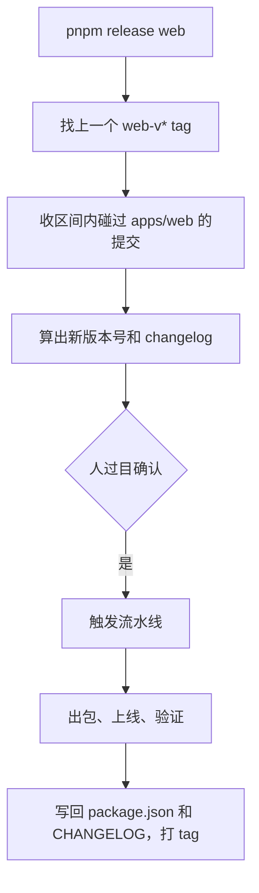

# 版本号与 changelog

版本号看起来是最无聊的部分：改个数字，写几行更新说明。但在一个有服务端、网页端、移动端的项目里，它要回答几个实际问题：**线上跑的到底是哪一版？这一版比上一版多了什么？手机上那个半年没更新的旧客户端还能不能用？出了事要退到哪个点？**

这一章讲版本号怎么定、tag 怎么打、changelog 怎么从提交历史里自动收出来，主要案例是 hatch-counter 的 `pnpm release`。

## 语义化版本，在应用里意味着什么

语义化版本（SemVer）的格式是 `主版本.次版本.修订号`：

| 位 | 什么时候升 | 例子 |
|---|---|---|
| 主版本 major | 不兼容的变更 | `1.4.2 → 2.0.0` |
| 次版本 minor | 向后兼容的新功能 | `1.4.2 → 1.5.0` |
| 修订号 patch | 向后兼容的修复 | `1.4.2 → 1.4.3` |

这套规则是为**库**设计的：「不兼容」指的是调用方的代码要改。对一个**应用**来说，「调用方」是谁？

- **服务端**的调用方是各个客户端。删了一个接口、改了一个字段的含义，老版本的 App 就会坏。这才是服务端的「不兼容」
- **网页端**的调用方是用户本人。界面大改版不会让任何东西「坏掉」，升不升主版本更多是一种沟通姿态
- **移动端**的版本号会显示在商店里，用户看得到

实践中，一个人的应用不必在主版本上纠结。hatch-counter 默认每次升补丁号，有明显的新功能时手动指定 `minor`。真正要守的纪律是：**服务端不要做出让在用的旧客户端坏掉的改动**，做不到时用「最低客户端版本」去拦（见本章最后一节）。

## 一个 monorepo，一个版本号还是多个

| 方案 | 适合 | 代价 |
|---|---|---|
| 全仓一个版本号 | 所有端总是一起发 | 发服务端的修复也要给移动端升号，日志里混着无关内容 |
| 每个 app 各自一个 | 各端发版节奏不同 | 要有工具按路径分清每条提交属于谁 |

hatch-counter 选了后者：每个 app 各管各的版本号，**tag 带前缀**（`web-v1.2.0`、`api-v0.3.0`、`mobile-v1.0.5`），changelog 各写各的 `apps/<app>/CHANGELOG.md`。发服务端不会把网页端的打包流水线也拖起来。

## tag 是唯一的真相

版本号会出现在好几个地方：`package.json` 的 `version`、CHANGELOG 的标题、git tag、镜像 tag、商店里的版本。它们迟早会对不上，所以必须指定**一个**权威来源。

hatch-counter 的选择是 **git tag**，而且 tag 只由流水线在出包（静态站还要等上线验证）成功之后才打。于是：

- tag 在 = 这一版真的发出去了
- changelog 的区间是「上一个 tag 到 HEAD」，起点永远是上一个真发出去的版本
- 失败的发版不留下 tag，同一个版本号修完可以再触发一次



### 发版前的预检

`pnpm release` 在触发流水线之前会拦住几种发不出去的情形：

| 检查 | 为什么 |
|---|---|
| 工作区有未提交改动 | tag 必须指向一个和你测过的代码完全一致的提交 |
| 不在 main | 发版只从 main 发 |
| 本地有没推送的提交 | 流水线打包拿的是 `origin/main`，没推的改动它看不见，表现是「包里没有我刚写的东西」，而版本号和日志却对得上 |
| 落后于 origin | 同上 |
| 目标 tag 已存在 | 版本号不能重复 |
| 上一版的 tag 在 origin 上已经没了 | 见下 |

### 一个不吭声的坑：删掉的远端 tag

`git fetch` 不会删除本地 tag（即使带 `--tags`），只有 `--prune-tags` 才会。所以你在 GitHub 网页上删掉一个 tag 之后，本地那份会一直留着。而 changelog 的起点是「上一个 tag」，如果起点是个远端已经不存在的版本，那一版里的提交会整批漏掉，一个报错都没有。

```bash
git tag -d web-v1.2.0                    # 删掉单个本地残留
git fetch --prune --prune-tags origin    # 一次清干净，注意也会删掉本地还没推的 tag
```

反过来，**别手敲 `git push --tags`**，它会把本地残留的 tag 整批推回去，刚删的全部复活。

## 从提交历史自动生成 changelog

手写 changelog 的问题是会忘。从提交信息自动生成的前提是提交信息有格式，这就是 **Conventional Commits**：

```text
feat: 后台员工管理能给别人重置密码，旧密码和他所有的登录当场作废
fix: 配方管理跳下一道的快捷键按平台认：Mac 只认 ⌘↵，Windows 只认 Ctrl+↵
chore: 升级 eslint 到 10
docs: 部署文档补上第 11 步的常见报错
```

前缀决定这条进不进日志、进哪一节：

| 前缀 | 进 changelog | 小节 |
|---|---|---|
| `feat:` | 是 | 新功能 |
| `fix:` | 是 | 修复 |
| `perf:` / `refactor:` | 按项目约定 | 改进 |
| `chore:` | **否** | — |

hatch-counter 有一条很实用的约定：**提交信息写「改完之后是什么样」，不写「改了哪个文件」**。因为这句话会原封不动地出现在 changelog 里、播进用户群。「修复 bug」对用户毫无意义，「一首放完之后真的停住，进度不再自己往前跑」才有。只给开发者看的改动（注释、内部 README）一律用 `chore:`，不打扰用户。

### 按路径归属

monorepo 里一条提交属于哪个 app，看它**实际碰了哪些路径**：

- 碰了 `apps/web/` 的进网页端的日志
- 碰了 `packages/core/`（被所有 app 依赖）的，进**每个依赖它的 app** 的「共享口径」一节
- 只碰仓库根的（CI 配置、工具）不进任何 app 的日志

核心逻辑用 git 就能做：

```ts
import { execFileSync } from "node:child_process";

const git = (...args: string[]) => execFileSync("git", args, { encoding: "utf8" }).trim();

export function lastTag(app: string): string | undefined {
  try {
    return git("describe", "--tags", "--abbrev=0", "--match", `${app}-v*`);
  } catch {
    return undefined; // 这个 app 还没发过版
  }
}

export function commitsFor(app: string, deps: string[]): string[] {
  const from = lastTag(app);
  const range = from ? `${from}..HEAD` : "HEAD";
  const out = git("log", range, "--format=%s", "--", `apps/${app}`, ...deps.map((d) => `packages/${d}`));
  return out ? out.split("\n").filter((s) => /^(feat|fix|perf)(\(.+\))?!?:/.test(s)) : [];
}
```

```ts
export function bump(version: string, kind: "patch" | "minor" | "major"): string {
  const [ma, mi, pa] = version.split(".").map(Number);
  if (kind === "major") return `${ma + 1}.0.0`;
  if (kind === "minor") return `${ma}.${mi + 1}.0`;
  return `${ma}.${mi}.${pa + 1}`;
}
```

hatch-counter 把「版本号怎么算」和「changelog 收哪些提交」各写在一个共享模块里，本机的 `pnpm release` 和 CI 里的记账工具调的是同一份代码。**两边各写一版的话，你过目的和最后播进群里的可能不是同一段话。**

### 发版时不许改日志

过目时看到一条不想播出去的，怎么办？hatch-counter 的规定是：去改提交信息本身（还没推的话），或者承认它本来就该用 `chore:`。**不允许在发版那一刻划掉或改写条目**，否则日志里会出现一条对不上任何提交的话。

### 现成工具

不想自己写，有几类成熟方案：

| 工具 | 思路 |
|---|---|
| changesets | 每个 PR 附一个描述变更的小文件，发版时汇总；monorepo 友好 |
| release-please | 根据 Conventional Commits 自动开一个「发版 PR」，合并即发版 |
| semantic-release | 全自动，推到 main 就算版本、发包 |

它们都更偏向「库」和「团队」。一个人的应用项目里，几百行自己的脚本往往更贴合：你能精确控制按路径归属、播到哪个群、什么时候打 tag。

## 版本号要能在运行时看到

版本号写进 `package.json` 只是开始，还要让它**在运行时可见**，出事时才能确认「用户手上到底是哪一版」：

- **客户端每个请求带上版本**：hatch-counter 的客户端在请求头里带 `x-client: web/1.2.0`，服务端日志里一眼看得出是哪一版发来的
- **服务端提供最低客户端版本**：老客户端低于这条线，服务端返回明确的错误码，客户端提示「请更新」，而不是莫名其妙地报错
- **网页端检测新版**：出包时把版本号写进 `dist/version.json`，页面隔一会儿请求它，发现变了就提示刷新

```ts
// 网页端：每 5 分钟问一次线上版本
const current = import.meta.env.VITE_APP_VERSION;
setInterval(async () => {
  const res = await fetch(`/version.json?t=${Date.now()}`, { cache: "no-store" });
  const { version } = (await res.json()) as { version: string };
  if (version !== current) showUpdateBanner();
}, 5 * 60 * 1000);
```

hatch-counter 曾经让网页端去读服务端返回的「最新版本」头，后来改掉了：那个号跟着服务端镜像走，网页端发了新版要等服务端重新构建才会提示。**哪个端的版本，就由哪个端自己的产物来回答。**

## 本章要点

- 应用的「不兼容」指的是在用的旧客户端会坏，服务端要守这条，不必在主版本号上纠结
- monorepo 里各 app 发版节奏不同时，各自一个版本号，tag 带前缀
- git tag 是唯一权威：只在真发出去之后才打，changelog 区间从上一个 tag 算起
- 发版前预检：工作区干净、在 main、和 origin 同步、tag 不存在；当心本地残留的已删除 tag
- Conventional Commits + 按路径归属自动收 changelog；提交信息写给用户看，内部改动用 `chore:`
- 版本号要在运行时可见：请求头带版本、最低客户端版本、网页端轮询 `version.json`

## 动手练习

1. **复现「删掉的远端 tag 还留在本地」**：用一个本地裸仓库当 origin，克隆出 A、B 两份。在 A 里打 `web-v1.0.0` 并推送；在 B 里 `git fetch --tags` 后用 `git push origin :refs/tags/web-v1.0.0` 删掉远端 tag。回到 A，依次运行 `git fetch --tags origin && git tag`、`git fetch --prune --prune-tags origin && git tag`。

   验证：第一次 `git tag` 仍列出 `web-v1.0.0`；第二次不再列出；`git ls-remote --tags origin` 始终没有它。

   参考答案：普通 fetch 只增不删本地 tag，只有 `--prune-tags` 会按远端清理。这时在 A 里跑 `git push --tags`，这个 tag 会重新出现在远端，这就是本章说别手敲它的原因。

2. **按路径收 changelog**：建一个测试仓库，目录有 `apps/web`、`apps/api`、`packages/core`。先提交一次并打 `web-v1.0.0`，之后依次提交四条：`feat: api 新接口`（只改 `apps/api`）、`fix: core 金额取整`（只改 `packages/core`）、`chore: web 注释`（只改 `apps/web`）、`feat: web 新页面`（只改 `apps/web`）。运行：

   ```bash
   git log web-v1.0.0..HEAD --format=%s -- apps/web packages/core \
     | grep -E '^(feat|fix|perf)(\(.+\))?!?:'
   ```

   验证：输出恰好两行，`feat: web 新页面` 和 `fix: core 金额取整`；api 那条和 chore 那条都不在。

   参考答案：路径过滤决定「属于谁」，前缀过滤决定「进不进日志」。共享包 `packages/core` 要显式加进路径列表，否则依赖它的修复会从网页端的日志里漏掉。

3. **找出 `bump` 的边界 bug**：把本章的 `bump` 去掉类型写成 `bump.mjs`，打印 `bump("1.4.2","minor")`、`bump("1.4.2-beta.1","patch")`、`bump("v1.4.2","patch")` 三个结果。

   验证：第一个是 `1.5.0`；第二个出现 `NaN`（`1.4.NaN`）；第三个是 `NaN.4.3`。

   参考答案：`Number("2-beta")` 和 `Number("v1")` 都是 `NaN`。修法是在入口用正则 `/^(\d+)\.(\d+)\.(\d+)$/` 校验，不匹配就抛错，而不是让一个畸形版本号一路流到 tag 和商店里。
