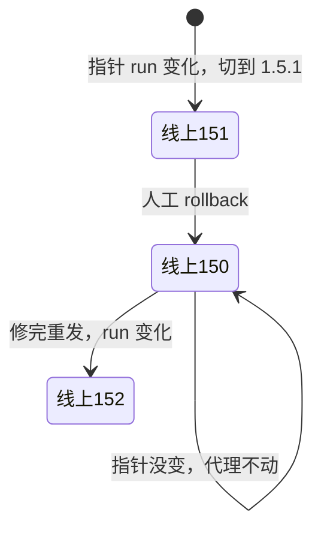
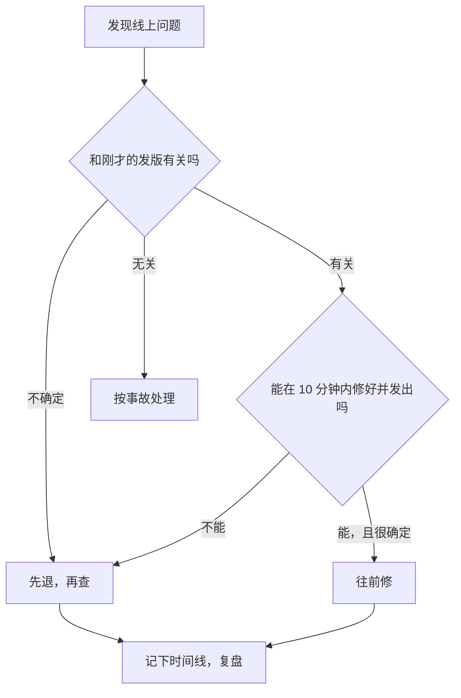

# 回滚

发版出问题的那五分钟，你的脑子不会像现在这么清醒。用户在群里问「怎么打不开了」，日志在刷屏，你在想是修还是退。这一章要做的是：**在不着急的时候，把「怎么退」想清楚、写下来、练过一遍**。

核心结论先放在这里：**不是所有东西都能回滚**。镜像能退，静态站能退，Worker 能退；数据库迁移退不了，装在用户手机上的 App 退不了。回滚能力是在发版之前就决定好的，而不是出事之后才去找。

## 每种产物能不能退

| 产物 | 能退吗 | 怎么退 | 前提 |
|---|---|---|---|
| 服务端镜像 | 能 | `./deploy.sh <上一版>` | 旧镜像还在机器或仓库里 |
| 静态站 | 能 | 软链切回旧版本目录 | 机器上还留着那一版 |
| Cloudflare Worker | 能 | `wrangler rollback` | 平台保留的历史版本内 |
| 配置 / 环境变量 | 看情况 | 改回去再重启 | 你记得原来是什么 |
| 数据库结构 | **不能** | 只能往前再写一个迁移 | — |
| 数据库数据 | 不算回滚 | 从备份恢复是灾难恢复 | 有备份且演练过 |
| 已安装的移动端 / 桌面端 | **不能** | 只能发新版，或用开关关掉功能 | 预先留了开关 |

下面逐个说。

## 服务端：退镜像

第 2 章的 `deploy.sh` 已经内置了「失败自动退回上一版」。发版成功、上线后才发现问题时，手动退也是同一条命令：

```bash
ssh prod
cd /srv/app
./deploy.sh 1.4.2     # 直接指定要退到的版本号
```

它会把 `.env` 里的镜像 tag 改回去、拉镜像、跑迁移（对已经迁过的库来说什么都不做）、起容器并等健康检查。**回滚走的是和发版完全相同的路径**，这是好事：这条路每次发版都在被验证，不会出现「回滚脚本半年没跑过、关键时刻坏了」的情况。

能退的前提是旧镜像还在：

- **生产机上**：`deploy.sh` 不删旧镜像，清理时用 `docker image prune -a --filter until=720h` 只清一个月前的
- **镜像仓库里**：不可变的版本 tag（`api:1.4.2`）永远不覆盖。`latest` 这种可变 tag 不能用来回滚，你不知道它此刻指着谁

如果用了第 4 章的蓝绿部署，回滚更快：旧容器还在，启动它、改回 upstream、reload nginx，几秒钟。

## 迁移只能往前

`deploy.sh` 退的只是镜像，**库已经迁过去了**。没有「退回上一版 schema」这回事。

你可能会想：给每个迁移写一个 `down` 不就行了？实际上 down 迁移在生产环境很少真正可用：

- 删列的 down 能把列加回来，但数据回不来
- 写 down 和测 down 的成本跟写 up 一样高，而它几乎从不运行，坏了也没人知道
- 出事时你最不想做的就是在生产库上跑一段从没跑过的 SQL

所以正确的策略是让回滚**不需要**动数据库：第 4 章的 expand / contract 保证每个迁移都兼容上一版代码，于是退镜像就够了。hatch-counter 的部署文档把代价写得很清楚：不守这条，回滚那一刻旧镜像对着已经少了一列的表查询，每个请求都是 500。

数据真的被写坏了，那是**灾难恢复**而不是回滚：从备份恢复、或者用 Postgres 的时间点恢复（PITR）回到某个时刻。这会丢掉那之后的所有写入，代价完全不同。备份和恢复演练在《PostgreSQL 运维》和《一人运维手册》里讲。

## 静态站：切回旧软链

第 4 章说过，静态站的每个版本都完整保留在自己的目录里，`current` 软链指向线上那一版。回滚就是把软链切回去：

```bash
ssh prod
cd /srv/app
./agent.sh status                 # 每个站线上是哪一版、机器上留着哪几版
./agent.sh rollback web 1.5.0     # 切回 1.5.0，并验证本机首页
```

hatch-counter 的 `agent.sh` 每个站保留最近 5 版（`KEEP=5`），正在用的那版不管排第几都不删。**能退到哪，取决于你留了多少**。

### 一个精妙的细节：按变化动手，不跟指针对齐

第 5 章讲过，静态站的上线是机器上的代理去读一份「指针」文件，看到新版就切过去。问题来了：你手动回滚到 1.5.0 之后，指针里写的还是 1.5.1。如果代理的逻辑是「让线上和指针保持一致」，十几秒后它就会把你的回滚撤销掉。

`agent.sh` 的做法是**只认指针的变化**：它记下自己看过的 run id，只有 run id 变了（也就是流水线真的发了新的一次）才动手。手动回滚之后，指针没变，代理就不动，线上停在 1.5.0，直到下一次发版。



任何「自动对齐期望状态」的系统（包括 GitOps 工具）都有这个问题：**手动回滚会被自动同步撤销**。要么像 `agent.sh` 这样按变化触发，要么回滚就必须通过修改期望状态本身来做（在 GitOps 里，回滚 = 在 git 里 revert）。

## Cloudflare Workers：平台自带版本历史

Workers 每次 `wrangler deploy` 都会生成一个新版本，平台保留历史：

```bash
pnpm -C apps/vault exec wrangler deployments list    # 看最近的部署
pnpm -C apps/vault exec wrangler rollback            # 退到上一个版本
```

两个注意点：

- **secret 和绑定不一定跟着回滚**。如果出问题的是你刚改的 secret，退代码没用，得把 secret 改回去
- 能退多远、命令的具体参数以当前 wrangler 文档为准，它的版本和部署模型这几年一直在演进

## 客户端：退不了，只能提前留后路

装在用户手机上的 App 是回滚不了的。iOS 和 Android 都不支持把用户已装的版本降级；商店里撤下一个版本，已经装了的人照样在用。唯一的「回滚」是**尽快发一个修复版**，而审核和用户更新都需要时间。

所以客户端的回滚能力要在发版**之前**埋好：

| 手段 | 做法 | 用来干什么 |
|---|---|---|
| 服务端保持兼容 | 服务端的改动永远不让在用的旧版本坏掉 | 最根本的一条 |
| 远程功能开关 | 客户端启动时从服务端读一份开关配置 | 新功能出问题时直接关掉，不用发版 |
| 最低版本线 | 服务端拒绝低于某版本的客户端，返回「请更新」 | 旧版本有严重 bug 时逼用户升级 |
| 自动更新的「急刹」 | 桌面端自动更新前先读一个开关 | 新版有问题时停止继续推送 |

hatch-counter 的桌面端（现已退役）就有过这样的急刹：本机一条命令把下载桶里的更新源标记为「暂停」，还没升级的用户就不会再拉到有问题的版本。

### 功能开关：不发版的回滚

功能开关值得多说一句。它把「部署」和「发布」拆开了：代码可以先部署上线但默认关闭，打开开关才对用户生效；出问题时关掉开关，就是一次几秒钟、不涉及任何部署的回滚。

一个人的项目不需要专门的开关服务，一张数据库表或一个配置接口就够：

```ts
// 服务端：GET /v1/flags
@Get("flags")
async flags(@Req() req: Request) {
  const rows = await this.db.select().from(featureFlags);
  return Object.fromEntries(rows.map((r) => [r.key, r.enabled]));
}
```

客户端要处理好**拉不到开关时的默认值**：新功能默认关，这样网络出问题时用户看到的是旧行为，而不是一个半成品。

## 退还是修：出事时的决策



几条经验：

- **拿不准就先退**。退是一个已知结果的操作，修是一个未知结果的操作
- 回滚之后，问题如果还在，说明它和这次发版无关，这本身就是很有用的信息
- 「往前修」只在你非常确定原因、修复很小、发版流水线很快时才划算
- 无论退还是修，都要记下时间线，事后复盘（《一人运维手册》讲复盘怎么做）

## 演练

回滚流程只有在演练过之后才算存在。找一个不忙的时段，把下面几件事真做一遍：

```bash
# 1. 服务端：退到上一版，再发回来
./deploy.sh 1.4.2 && ./deploy.sh 1.4.3

# 2. 静态站：退一版，确认页面正常，再切回
./agent.sh rollback web 1.5.0 && ./agent.sh rollback web 1.5.1

# 3. 确认旧镜像和旧目录都还在
docker image ls | grep api
./agent.sh status
```

演练时顺便检查：命令记得住吗？需要的 ssh 别名、权限都在吗？从决定回滚到恢复正常一共花了多久？把答案写进项目的部署文档，下次出事照着做。

## 本章要点

- 回滚能力在发版前就决定了：镜像、静态站、Worker 能退；迁移和已安装的客户端退不了
- 服务端回滚走和发版完全相同的路径，旧镜像要保留，回滚只用不可变的版本 tag
- 迁移只能往前；靠 expand / contract 让退镜像就够，数据损坏属于灾难恢复
- 静态站保留最近几版，切软链即回滚；自动同步系统要「按变化触发」，否则会撤销手动回滚
- 客户端的后路要提前埋：服务端兼容、远程功能开关、最低版本线、自动更新急刹
- 拿不准就先退再查；回滚流程要真的演练过
