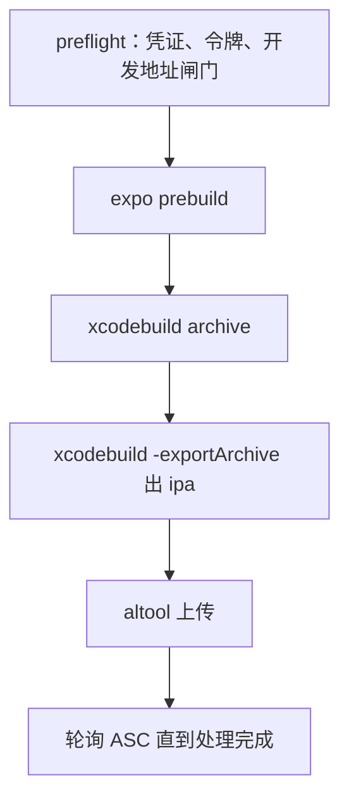

# 移动端与桌面端的发版

前七章讲的发版有一个共同前提：**代码跑在你自己控制的机器上**。换个镜像、切个软链，所有用户下一个请求就是新版，出了事随时退回来。

客户端完全不同。代码跑在用户的设备上，你要经过签名、商店或分发渠道，用户什么时候更新你说了不算，发出去的版本收不回来。这一章讲 Android、iOS、Electron 桌面端和 Cloudflare Workers 的发版，案例来自 hatch-counter 的安卓流水线和唱片墙的 TestFlight 出包。

## 客户端发版的四个不同

| | 服务端 | 客户端 |
|---|---|---|
| 身份 | 域名 + 证书，可以换 | **签名密钥**，丢了就再也发不了同一个 App |
| 上线速度 | 秒级 | 审核 + 用户自己更新，以天计 |
| 回滚 | 能 | 不能（第 7 章） |
| 版本号 | 你自己定 | 平台有硬规则：构建号必须单调递增 |

这四条决定了客户端发版的全部重点：**保管好签名密钥，算对构建号，让服务端兼容旧版本**。

## Android：签名密钥就是身份

Android 认一个 App 的身份是「包名 + 签名证书」这一对。系统只允许同一把私钥签出来的新包覆盖旧包，对不上直接拒装。这把私钥只存在于 keystore 文件里，从已经发出去的 APK 里推不回来（APK 里只有公钥）。

hatch-counter 的发布文档把后果写得很直白：**这是整条链上唯一没有补救办法的环节**。keystore 丢了，这个包名就永远发不出下一版；已经安装的用户得先卸载（本地数据一起没）再装新钥匙签的包，换包名也一样，那在系统看来是另一个 App。

所以：

- keystore 至少存两份，放在不同的地方（例如密码管理器 + 离线加密盘）
- 密码和 keystore 分开存
- 走 Google Play 的话，可以使用 Play App Signing：真正的应用签名密钥由 Google 保管，你手里的是可以申请重置的「上传密钥」，丢了还有救
- 不走 Play（例如境内直接分发 APK，hatch-counter 就是传到自己的下载桶）就没有这层保护，只能靠自己备份

### 在 CI 里出安卓包

hatch-counter 的 `release-mobile.yml` 在 GitHub 的 Linux runner 上出安卓包，keystore 以 base64 存进仓库 secret：

```bash
# 本机：把 keystore 转成一行文本，存进 secret
base64 -i release.keystore | gh secret set ANDROID_KEYSTORE_BASE64
```

```yaml
- name: 解出 keystore
  run: echo "$KEYSTORE_B64" | base64 -d > "$RUNNER_TEMP/release.keystore"
  env:
    KEYSTORE_B64: ${{ secrets.ANDROID_KEYSTORE_BASE64 }}

- name: 生成原生工程并打包
  working-directory: apps/mobile
  run: |
    npx expo prebuild --platform android --clean
    cd android && ./gradlew assembleRelease
  env:
    ANDROID_KEYSTORE_PATH: ${{ runner.temp }}/release.keystore
    ANDROID_KEYSTORE_PASSWORD: ${{ secrets.ANDROID_KEYSTORE_PASSWORD }}
    ANDROID_KEY_ALIAS: ${{ secrets.ANDROID_KEY_ALIAS }}
    ANDROID_KEY_PASSWORD: ${{ secrets.ANDROID_KEY_PASSWORD }}

- name: 验签名
  run: |
    apk=apps/mobile/android/app/build/outputs/apk/release/app-release.apk
    out=$("$ANDROID_HOME"/build-tools/*/apksigner verify --print-certs "$apk")
    echo "$out"
    if grep -q "CN=Android Debug" <<< "$out"; then
      echo "✗ 这是调试签名的包，停"; exit 1
    fi
```

几个要点：

- **`android/` 和 `ios/` 不进仓库，每次 `expo prebuild` 现生成**。进了仓库就会变成两份真相：改了 `app.json` 却没重新生成，而 prebuild 默认不覆盖已有目录，改动安安静静地不生效
- **签名配置用 config plugin 注入**：hatch-counter 有一个插件在 prebuild 时把 release 构建的签名从调试钥匙换成正式的那把，只在 `ANDROID_KEYSTORE_PATH` 有值时动手，本地开发照旧
- **验的是结果不是手法**：插件改的是 Expo 生成的模板，模板升一次大版本就可能变样，变了之后最坏的情况不是报错，而是**安安静静出一个调试签名的包**。一旦发出去，换钥匙就得让所有用户卸载重装。所以出包后直接问包本身「你是谁签的」

### 版本号：从 package.json 现算

Android 有两个版本：给人看的 `versionName`（如 `1.2.3`）和给系统比较的 `versionCode`（整数，必须单调递增）。hatch-counter 的 `app.config.js` 从 `package.json` 现算，一个都不存：

```js
// app.config.js（节选）
const { version } = require("./package.json");
const [major, minor, patch] = version.split(".").map(Number);
if (minor > 99 || patch > 99) {
  throw new Error(`版本号 ${version} 放不进 versionCode 算法，先换算法`);
}

module.exports = ({ config }) => ({
  ...config,
  version,
  android: { ...config.android, versionCode: major * 10000 + minor * 100 + patch },
  ios: { ...config.ios, buildNumber: version },
});
```

为什么不在仓库里存一个自增的数？因为「写版本号」在 build job，「提交回仓库」在 publish job，各自增一次，打进包里的号和提交回仓库的号就分家了。次版本或补丁号超过 99 时直接抛错，而不是悄悄进位撞上别的版本。

## iOS：TestFlight 和构建号

iOS 的分发路径按「谁装得上」排：

| 方式 | 谁能装 | 要不要审核 |
|---|---|---|
| 开发构建直接装 | 注册过设备的人 | 不要 |
| TestFlight 内部测试 | App Store Connect 里的团队成员，上限 100 人 | 不要 |
| TestFlight 外部测试 | 有链接的任何人 | 第一个构建要过 Beta App Review |
| App Store | 所有人 | 要 |

（具体规则 Apple 会调整，以 App Store Connect 的当前说明为准。）

这个书架 App 是最简单的一种：个人自用，用 dev client 直接装到自己手机上（`pnpm app ios --device`），不上商店也不走 TestFlight。

唱片墙走的是 **TestFlight 内部测试**：朋友被加成 App Store Connect 里的用户，不用过 Beta 审核。代价是 TestFlight 构建 **90 天过期**，每个季度要重传一次。

### 唱片墙的 pnpm ship

`pnpm ship` 在本机跑完整条链：



核心命令（简化）：

```bash
xcodebuild -workspace ios/App.xcworkspace -scheme App \
  -configuration Release -archivePath build/App.xcarchive \
  -allowProvisioningUpdates \
  -authenticationKeyPath "$ASC_KEY_PATH" \
  -authenticationKeyID "$ASC_KEY_ID" \
  -authenticationKeyIssuerID "$ASC_ISSUER_ID" \
  DEVELOPMENT_TEAM="$APPLE_TEAM_ID" CURRENT_PROJECT_VERSION="$BUILD" \
  archive

xcodebuild -exportArchive -archivePath build/App.xcarchive \
  -exportPath build -exportOptionsPlist ExportOptions.plist \
  -allowProvisioningUpdates \
  -authenticationKeyPath "$ASC_KEY_PATH" \
  -authenticationKeyID "$ASC_KEY_ID" \
  -authenticationKeyIssuerID "$ASC_ISSUER_ID"

xcrun altool --upload-app -f build/App.ipa -t ios \
  --apiKey "$ASC_KEY_ID" --apiIssuer "$ASC_ISSUER_ID"
```

`ExportOptions.plist` 里的 `method` 在较新的 Xcode 里写 `app-store-connect`（旧名是 `app-store`）。Apple 的命令行工具变化频繁，照抄前先对一下你的 Xcode 版本的文档。

唱片墙在这条路上踩过的坑，每条都值得记住：

**构建号用分钟级时间戳**。TestFlight 上传不是幂等的：同一个（版本，构建号）只收一次，重传直接被拒。而「传失败了改完重跑」是常事。用 `202611021430` 这样的时间戳当构建号，每次跑都比上次大，重跑天然安全。

**分发证书要手动建一次**。`-allowProvisioningUpdates` 配合 API key 能自动创建和续期描述文件，但云端管理的分发证书只认 Apple ID 登录，API key 够不着。表现是 archive 成功、只在导出那一步报找不到签名证书。解法是在 Xcode 的账号设置里手动建一张 Apple Distribution 证书装进钥匙串，之后就不用管了。

**上传成功不等于能装**。altool 的退出码只说明字节传上去了，App Store Connect 还要处理一阵。所以最后一步轮询 App Store Connect API，等构建状态变成可用才算完。又是「看痕迹，不信退出码」。

### 为什么 iOS 出包留在本机

唱片墙的规则文件写了三条理由：

1. App Store Connect 的 API key 能以你的名义上传构建、修改元数据，放进仓库 secret 之后，任何一次 workflow 改动都够得着它
2. GitHub 的 macOS runner 单价远高于 Linux
3. 出包一个季度也就几次

这和第 5 章「不把生产机的 ssh 私钥放进 CI」是同一个判断：**权限越大的凭证，越不该放在你不完全控制的地方**，除非频率高到手动成本压过风险。

如果不想自己维护这套脚本，Expo 的 EAS Build / EAS Submit 是托管方案，证书和上传都由它代管，代价是凭证交给第三方、构建按量计费。至于 JS 层的热更新（EAS Update），这个书架 App 的决策是不用：离线优先、个人自用，热更新带来的复杂度不值得。

## 桌面端：Electron 的签名与更新

macOS 上的 Electron 应用有三档：

| 档位 | 能在哪跑 | 要什么 |
|---|---|---|
| ad-hoc 签名 | 只在构建它的那台电脑上 | 什么都不要 |
| Developer ID 签名 | 别人的 Mac，但会被 Gatekeeper 警告 | 付费开发者账号 |
| 签名 + 公证 | 别人的 Mac，正常打开 | 上面那个 + 提交 Apple 公证 |

唱片墙的桌面端是第一档：自己用，`electron-builder` 配 `identity: "-"` 做 ad-hoc 签名，并关掉 hardened runtime（它是给公证用的，配 ad-hoc 签名反而起不来）。为什么连 ad-hoc 都要签？因为 Electron 自带的签名封着整个包，改过内容后签名就坏了，在 Apple 芯片上随时可能被系统杀掉。

要发给别人就得走第三档。electron-builder 支持在打包时自动调用 `notarytool` 提交公证，需要 Apple ID 或 App Store Connect API key。公证的凭证同样是高权限凭证，放 CI 之前想清楚。

**自动更新**通常用 `electron-updater`：应用启动时去一个更新源（对象存储里的一份 `latest-mac.yml` 之类）检查新版。设计时预留两件事：

- **急刹开关**：更新源可以被标记为暂停，新版有问题时停止继续推送（第 7 章）
- **最低版本线**：太旧的版本由服务端拒绝，提示用户手动更新

## Cloudflare Workers：最接近服务端的「客户端」

Worker 跑在 Cloudflare 的边缘节点上，发版体验很像服务端，但不需要你管机器：

```bash
pnpm -C apps/vault exec wrangler secret put WRITE_TOKEN   # secret 单独灌，不进 wrangler.toml
pnpm -C apps/vault ship                                    # package.json 里 "ship": "wrangler deploy"
```

唱片墙的几条经验：

- **脚本叫 `ship` 不叫 `deploy`**：`pnpm deploy` 是 pnpm 的内置命令，同名脚本根本不会被执行，而且后面跟的参数会被 pnpm 当成它自己的选项。hatch-counter 曾因为类似的命名冲突，出现过「群里播了发布成功，tag 和 changelog 一个都没有」
- **正式地址写在 `wrangler.toml` 的 routes 里**，部署时 wrangler 会顺手建好 DNS 记录和证书
- **别用 `*.workers.dev` 当正式地址**：这个域名在境内的可达性不稳定，绑自己的域名
- **不同项目用不同域名、不同账号**，和「一个消费方一把钥匙」是同一条隔离逻辑

Workers 也支持按比例灰度发布新版本、平台保留版本历史可以回滚（第 7 章）。这部分 API 演进较快，用之前查 wrangler 的当前文档。Workers 的运行模型、R2 / KV / D1 在[《云与边缘》](../cloud-and-edge/)里细讲。

## 各平台发版清单

| 平台 | 发版前必查 |
|---|---|
| Android | keystore 有备份；`versionCode` 比线上大；出包后 `apksigner` 验签名不是调试证书 |
| iOS | 分发证书在钥匙串里；构建号比上次大；生产包里没有开发地址；上传后等处理完成 |
| Electron | 签名档位符合分发范围；更新源可暂停；旧版本有最低版本线兜底 |
| Worker | secret 已配置且和客户端逐字一致；routes 指向自己的域名 |
| 所有客户端 | 服务端兼容当前在用的最老版本；新功能有远程开关 |

## 本章要点

- 客户端发版的四个不同：签名即身份、上线慢、回滚不了、构建号必须递增
- Android keystore 丢了无法补救：多处备份，能用 Play App Signing 就用；出包后验签名
- 构建号从 `package.json` 现算或用时间戳，不在仓库里存自增数
- iOS 内部测试走 TestFlight，构建 90 天过期；上传成功后要等处理完成才算发出去
- 高权限凭证（ASC API key、公证凭证、生产机 ssh 私钥）能留在本机就留在本机
- Electron 按分发范围选签名档位；自动更新要留急刹和最低版本线
- Worker 发版像服务端但更轻；`pnpm deploy` 是内置命令，脚本换个名字

---

到这里，「把代码送上线」这件事已经完整了。接下来按书架导读里运维路线的顺序，建议读[《一人运维手册》](../production-ops/)：服务器加固、备份与容灾演练、事故响应和复盘，把这本书里反复提到的「出事了怎么办」系统化；然后是[《可观测性与性能》](../observability-performance/)，让你在用户报告之前先知道线上出了问题；最后是[《PostgreSQL 运维》](../database-ops/)，补上本书一直绕开的那块：数据库本身的备份、PITR 和升级。对 Cloudflare 和 Serverless 感兴趣，可以接着读《云与边缘》；想把服务器配置也变成代码，读[《基础设施即代码》](../iac-gitops/)。
