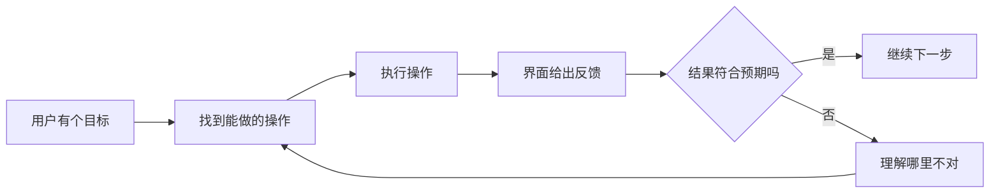

# 交互原则

## 这本书讲什么

一人公司没有设计师。界面难看，用户第一眼就走了；界面好看但难用，用户第二天就走了。你不需要成为设计师，但需要一套「不靠天赋也能做对」的规则：知道为什么这样排、这样配色、这样留白，知道一个按钮该写什么字、一个列表空着时该显示什么。

这本书就讲这套规则，并且全部落到代码上：

- 网页端以 **Tailwind CSS 4 + Radix（shadcn/ui）** 为例，案例是门店管理工具「掌柜眼」（hatch-counter）的网页端
- 移动端以 **React Native / Expo** 为例，案例是离线书架 hatch-shelf 和播放器「唱片墙」（hatch-recordwall）

**适合谁**：会写前端、能把功能做出来，但每次调样式都靠「感觉差不多」的开发者。不需要会 Figma，也不需要美术基础。

**怎么读**：

| 章 | 解决什么问题 |
|---|---|
| 1 交互原则（本章） | 界面「好用」到底是什么意思，有哪些可以照着检查的原则 |
| 2 排版 | 字号、字重、行高怎么定，层级怎么拉开 |
| 3 色彩 | 怎么挑色、怎么算对比度、深色模式怎么做 |
| 4 间距与网格 | 间距用哪些数、怎么用留白分组、怎么对齐 |
| 5 设计系统 | 把前几章的决定沉淀成 token 和组件，让自己和 agent 都照着写 |
| 6 移动端规范 | 安全区、可点范围、动态字体、手势这些手机特有的约束 |
| 7 空态、错误态与文案 | 界面在「没数据」「出错了」「加载中」时长什么样，话怎么说 |

建议按顺序读：前四章是基本功，第五章把它们串起来，后两章是最容易被忽略、但最影响口碑的部分。每章结尾有「本章要点」，复查自己的界面时可以直接当清单用。

## 设计不是装饰

很多开发者把「设计」理解成最后一步的美化：功能做完了，加点阴影和渐变。这正好反了。

界面设计要解决的问题是：**让用户用最少的思考完成他来这里要做的事**。好看是结果之一，不是目标。一个界面可以朴素到只有黑白两色，但只要用户一眼知道该点哪、点了之后知道发生了什么、出错了知道怎么办，它就是好设计。

开发者其实有一个巨大的优势：你知道系统内部是怎么运作的。劣势也在这里：**你太知道了**。你知道「同步」按钮会先拉再推，知道「归档」不等于「删除」，用户不知道。设计的大部分工作，就是把你脑子里的系统模型翻译成用户脑子里能理解的样子。

## 心智模型：用户以为它怎么工作

**心智模型**（mental model）是用户对「这个东西怎么工作」的猜测。用户不会读你的文档，他靠以往用过的产品来猜：

- 看到右上角的「×」，猜是关闭
- 看到列表项向左滑，猜会露出删除
- 看到带下划线的蓝字，猜能点

当界面的行为和用户的猜测一致，用户觉得「顺手」；不一致，用户觉得「难用」，而且往往说不出为什么。

所以第一条原则是：**能用约定俗成的做法，就不要发明新的**。在手机上，返回就该是左上角或者从左边缘右滑；在网页上，Logo 点了就该回首页。创新留给你的核心功能，别花在按钮该放哪这种事上。

掌柜眼的界面约定里有一条很典型：从一张单子里去掉一项用垃圾桶图标，「×」只给关闭、清空搜索框、收起、取消这类**不删东西**的动作。理由是同一个动作两个图标，用户扫一眼分不清哪颗是删、哪颗是关。这就是在维护用户的心智模型：图标的意思在整个产品里只能有一个。

## 示能与指示符：让人知道能做什么

Don Norman 在《设计心理学》里区分了两个概念：

- **示能**（affordance）：东西本身允许你做什么。按钮可以按，输入框可以打字
- **指示符**（signifier）：告诉你「这里可以这么做」的线索。按钮的边框和底色、输入框的描边和占位字、链接的下划线

界面上的问题大多是**指示符缺失**：能点的东西看起来不像能点（扁平化过头的纯文字按钮），不能点的东西看起来像能点（加了下划线的普通强调文字）。

几个常见的检查点：

| 情况 | 问题 | 改法 |
|---|---|---|
| 卡片整块可点，但看不出来 | 没有指示符 | 加悬停态、右侧加箭头，或者把主操作做成按钮 |
| 灰掉的按钮点了没反应 | 用户不知道为什么不能点 | 悬停提示原因（掌柜眼的 `Locked` 组件会说「为什么点不动、找谁放开」） |
| 图标按钮没有文字 | 只有你知道它是干嘛的 | 加文字，或者至少加悬停提示和无障碍标签 |
| 输入框只靠占位字说明用途 | 一打字说明就没了 | 标签写在框外，占位字只放示例或「选填」 |

## 反馈：每个操作都要有回应

用户做了一件事，界面必须告诉他「收到了」以及「结果是什么」。没有反馈，用户就会重复点击，或者以为坏了。

响应时间有三个经常被引用的经验阈值（出自 Jakob Nielsen 对早期人机交互研究的总结）：

| 响应时间 | 用户感受 | 界面该做什么 |
|---|---|---|
| 约 0.1 秒以内 | 觉得是「即时」的 | 直接显示结果，不需要额外提示 |
| 约 1 秒以内 | 能察觉到等待，但思路不断 | 不必转圈，但按钮可以进入按下态 |
| 超过约 10 秒 | 注意力会跑掉 | 显示进度、允许取消，或者改成后台任务做完通知 |

这是数量级上的经验值，不是精确的生理常数，但足够指导实践。一个落地的例子：掌柜眼的骨架屏组件**晚 120 毫秒才现形**，网快的时候整个跳过，不闪那一下灰的。快的操作不该显示加载态，否则「闪一下」本身就成了干扰。

反馈的完整流程可以这样理解：



Norman 把「找到能做的操作」那段的困难叫**执行鸿沟**，「看懂反馈」那段的困难叫**评估鸿沟**。前面讲的指示符缩小执行鸿沟，这一节讲的反馈缩小评估鸿沟。

## 一致性：同一件事只有一种说法

一致性分两层：

- **外部一致**：和用户用过的其他产品一致（平台约定、行业惯例）
- **内部一致**：自己产品内部一致。同一个动作同一个词、同一个图标、同一个位置

内部一致最容易在迭代中被破坏。今天写「新增」，明天写「添加」，后天 agent 帮你写了个「创建」。用户会以为这是三件不同的事。

掌柜眼的规则写得非常具体，值得照抄这种写法：

- 建东西的按钮一律「新建 X」，弹出来的标题跟按钮同一句
- 「分类」只有这一个叫法，菜品、食材、开支三套都叫分类，没分的一律叫「未分类」
- 侧边栏和页头标题一律四个汉字
- **一件事只有一个入口**：功能长在哪一页有一张表管着，别顺手往就近的页面加

最后一条尤其重要。同一件事两个入口，用户不知道该在哪儿改，改了一边还以为另一边也变了。

## 防错优于报错，撤销优于确认

好的界面不是报错写得好，而是让人很难犯错：

- **约束输入**：日期用日历选，不让人手打；只能从几个值里挑的用下拉
- **合理默认值**：大多数人会选的那个预先选好
- **把危险操作和常用操作分开**：「删除」不要紧挨着「保存」

当用户真的要做一件不可逆的事时，很多人的第一反应是弹确认框：「确定要删除吗？」问题是，确认框弹多了用户会养成不看就点「确定」的习惯，保护作用就没了。

更好的做法是**先做，再给撤销**。掌柜眼在拖动菜品归类、批量放进分类、停用班次这些操作上，都是直接执行，然后在右下角弹一条带「撤销」按钮的提示，停留 6 秒。确认框只留给真正撤不回来的事（比如注销账号），而且确认按钮要写清后果，比如「删除 3 本书」，而不是「确定」。

## 两条定律：Fitts 和 Hick

两个经常被引用的人机交互定律，记住结论就够了：

**Fitts 定律**：点中一个目标所需的时间，取决于目标的**距离**和**大小**。越近、越大，越快越准。推论：

- 主按钮做大一点
- 常用操作放在手或鼠标附近（手机上是屏幕下半部分）
- 屏幕边缘和角落在桌面系统上是「无限大」的目标（鼠标冲过去会停在边上），macOS 菜单栏放在屏幕顶端就是这个道理

**Hick 定律**：做选择的时间随选项数量增加而增加。推论：

- 一个界面上的主要操作越少越好
- 选项多的时候分组，或者给默认值
- 把高级选项收起来（渐进披露，下面讲）

## 渐进披露：先给 80% 的人要的

**渐进披露**（progressive disclosure）：先只展示大多数人需要的东西，把少数人才用的高级选项藏到「更多」「高级设置」或二级页面里。

hatch-shelf 的阅读器设置就是这样：面板上只有主题、字号、行高、代码换行几项。真正复杂的东西（书的结构、导入规则）根本不出现在界面上，交给书的作者在 `book.yaml` 里写。

判断一个选项该不该露在外面，问自己：**如果去掉它，会有多少人来问？** 没人问的，就不该占主界面的位置。

## 尼尔森十条启发式

Jakob Nielsen 在 1990 年代提出的十条可用性启发式，至今仍是最常用的检查清单。名称和大意如下（措辞是意译）：

| # | 原则 | 一句话 |
|---|---|---|
| 1 | 系统状态可见 | 随时让用户知道发生了什么 |
| 2 | 贴合真实世界 | 用用户的词，不用系统内部的词 |
| 3 | 用户掌控与自由 | 提供撤销、返回、退出的出口 |
| 4 | 一致性与标准 | 同一件事同一种表达，遵守平台约定 |
| 5 | 防止出错 | 让错误很难发生，比报错更重要 |
| 6 | 识别而非回忆 | 把选项摆出来，别让用户记 |
| 7 | 灵活高效 | 给熟手快捷方式，比如快捷键、指令面板 |
| 8 | 简洁的审美 | 每多一样东西，都在和重要的东西抢注意力 |
| 9 | 帮用户识别和恢复错误 | 报错用人话，说清原因和怎么办 |
| 10 | 帮助与文档 | 最好不需要，需要时容易找到 |

第 2 条对开发者特别难。你的数据库里叫 `inventory_adjustment`，用户嘴里叫「盘点」；你的代码里叫 `sync conflict`，用户只想知道「我改的东西还在不在」。

## 把原则交给 agent

你多半会让 Claude Code 这类 agent 写大量界面代码。agent 不会自动知道你的设计约定，它会写出「看起来合理」但和你其他页面不一致的东西。

掌柜眼的做法值得借鉴：

- 跨页通用的界面规矩写在一份 `界面约定` 文档里，每条规矩后面跟着「为什么」
- 改坏了不报错的规矩放进 `.claude/rules/web-ui.md`，agent 动到界面文件时自动加载
- 能用工具拦的就用工具拦，比如 ESLint 直接禁止 `<input type="date">`

一份写给 agent 的界面规则，可以从下面这种粒度开始：

```markdown
## 界面规则

- 建东西的按钮一律「新建 X」，弹窗标题与按钮文字相同
- 颜色只用 index.css 里的语义变量（bg-primary、text-muted-foreground），不写 amber-700 这类调色板色
- 删除用 Trash2 图标；X 只用于关闭、清空、取消
- 可撤销的操作直接执行并弹「撤销」提示，不弹确认框
- 加载态延迟 120ms 才显示
```

规则写得越具体（具体到组件名和类名），agent 越能照做。「保持风格一致」这种话对 agent 没有用。

## 本章要点

- 设计的目标是让用户少思考，好看是副产品
- 用约定俗成的做法，别在按钮位置上创新；图标和词语在整个产品里只能有一个意思
- 能做什么要有**指示符**，做了什么要有**反馈**；快的操作不显示加载态
- 内部一致靠写下来的规则维护：同一动作同一个词，一件事只有一个入口
- 防错优于报错，**撤销优于确认**；确认按钮写清后果
- Fitts：常用目标要大、要近；Hick：选项少、给默认值、渐进披露
- 尼尔森十条是现成的检查清单
- 把界面规则写成具体到类名的文档，交给 agent 照着写
