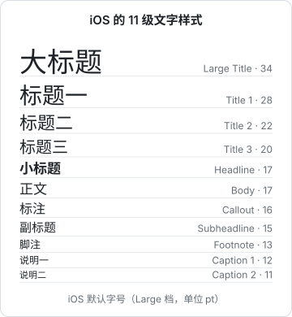

# 排版

界面上九成的内容是文字。排版做对了，即使只有黑白两色，界面也会显得清楚、有条理；排版做错了，配色再好也救不回来。本章讲怎么用字号、字重、颜色和行高建立层级，怎么定一套字号阶梯，中文排版有哪些特殊之处，以及在 Tailwind 4 和 React Native 里怎么落地。

## 层级：让眼睛知道先看哪

用户不会逐字读你的界面，他是**扫**的。排版的首要任务是建立**视觉层级**：最重要的信息最先被看到，次要的信息退到后面，但需要时找得到。

看同一张营收卡片的两种排法：


左边每一行都一样大、一样黑，眼睛不知道该停在哪。右边做了四件事：

1. **金额放大加粗**：28 号、600 字重，是整张卡的视觉锚点
2. **标签变小变灰**：「今日营收」「订单」退到 12 号次要色，它们是解释，不是内容
3. **增幅用主色**：唯一的彩色，第二眼就会看到
4. **分隔线和左右对齐**：把「明细」和「结论」分成两组

建立层级的杠杆有四个，按力度从大到小：

| 杠杆 | 怎么用 | 注意 |
|---|---|---|
| 字号 | 重要的大，次要的小 | 相邻两级差别要明显，差 1–2 号等于没差 |
| 字重 | 标题、关键数字加粗 | 一个区域里粗体太多就都不粗了 |
| 颜色 | 次要信息用灰色，强调用主色 | 灰色要保证对比度，见第 3 章 |
| 间距 | 相关的靠近，无关的拉开 | 见第 4 章 |

一个常见错误是**只用字号拉层级**：标题 32、副标题 24、正文 16，结果界面上全是大字，很吵。更好的做法是组合使用：标签不一定要比正文小很多，变成灰色、小一号就足够退后了。掌柜眼的界面约定里有一句话很到位：「分主次靠字号、留白」，而不是靠大色块压场。

## 字号阶梯

不要每次随手写一个字号。定一套**字号阶梯**（type scale），整个产品只用阶梯上的值。

### 模数比例

一种经典的定法是选一个基准字号，再乘以固定比例得到上下各级，叫**模数比例**（modular scale）。比如基准 16、比例 1.25：

| 级别 | 计算 | 结果（取整） |
|---|---|---|
| 小字 | 16 ÷ 1.25 | 13 |
| 正文 | 16 | 16 |
| 小标题 | 16 × 1.25 | 20 |
| 标题 | 16 × 1.25² | 25 |
| 大标题 | 16 × 1.25³ | 31 |
| 特大 | 16 × 1.25⁴ | 39 |

比例越大，层级越鲜明，适合内容少、要有冲击力的页面（着陆页）；比例越小，层级越温和，适合信息密集的后台。工具类界面常用 1.125–1.25，营销页常用 1.333 以上。

实际上你不必自己算。Tailwind 的默认字号已经是一套经过调校的阶梯：

| 类名 | 字号 | 默认行高 |
|---|---|---|
| `text-xs` | 12px | 16px |
| `text-sm` | 14px | 20px |
| `text-base` | 16px | 24px |
| `text-lg` | 18px | 28px |
| `text-xl` | 20px | 28px |
| `text-2xl` | 24px | 32px |
| `text-3xl` | 30px | 36px |
| `text-4xl` | 36px | 40px |

一个后台类界面，通常只需要其中四五级：`text-xs`（辅助信息）、`text-sm`（表格、表单的主体）、`text-base`（正文）、`text-lg` / `text-xl`（区块标题）、`text-2xl`（页面标题或关键数字）。用到七八级以上，多半是层级规划乱了。

### 按角色命名，而不是按大小

iOS 的系统文字样式是一个很好的参考：它不叫「17 号字」，而叫「正文」「标题」「脚注」。



注意小标题（Headline）和正文（Body）都是 17pt，只靠字重区分。这说明层级不一定要靠字号。

按角色命名的好处是：改设计时只改一处映射，代码里的语义不变。唱片墙的 `tokens.ts` 就是这么写的，注释里直接写着「字号按角色取名，不按大小」：

```ts
export const size = {
  /** 一位音乐人、一张专辑、主推那一首的名字 */
  h2: 28,
  /** 弹层的标题 */
  sheet: 24,
  /** 曲目行的曲名 */
  big: 18,
  body: 14,
  small: 12,
  caption: 11,
} as const;
```

## 行高与行长

### 行高

**行高**（line-height）决定了行与行之间的呼吸感。经验值：

| 内容 | 行高（相对字号） | 原因 |
|---|---|---|
| 大标题 | 1.1–1.3 | 字大，行间本来就松，再加会散 |
| 界面文字（按钮、表格、表单） | 1.3–1.5 | 多为单行，紧凑一些 |
| 中文长段正文 | 1.6–1.8 | 汉字是方块字，字面饱满，比西文需要更多行间 |

hatch-shelf 的阅读器默认字号 17、行高 1.75，可调范围 1.4–2.2。这是长文阅读的设定，放到后台表格里就太松了。

**字越大，行高倍数越小**。Tailwind 默认值里 `text-xs` 是 12/16（约 1.33），`text-4xl` 是 36/40（约 1.11），就是这个规律。

### 行长

一行太长，眼睛换行时容易找错下一行；一行太短，换行太频繁，阅读断断续续。

- 西文常被引用的舒适行长是每行 45–75 个字符左右
- 中文没有统一标准，常见的经验是每行三十几到四十字左右；具体以实际阅读感受为准

Tailwind 的 `max-w-prose` 是 `65ch`。`ch` 是数字「0」的宽度，对中文不准。中文正文可以用 `em` 控制，因为一个汉字大约就是 `1em` 宽：

```tsx
<article className="mx-auto max-w-[38em] text-base leading-[1.75]">
  {/* 每行最多约 38 个汉字 */}
</article>
```

后台界面的问题通常反过来：表格和表单在宽屏上被拉得很长。一个输入框横跨 1600px，没人需要。给表单设最大宽度（`max-w-xl`），宁可右边留白。

## 字重

中文界面用三档字重基本就够：

| 字重 | 数值 | 用途 |
|---|---|---|
| 常规 | 400 | 正文、大部分界面文字 |
| 中等 | 500 | 按钮、表头、需要轻微强调的标签 |
| 半粗 | 600 | 标题、关键数字 |

**700 以上的粗体在中文界面里要慎用**：笔画多的字（「囊」「鑫」）一加粗就糊成一团。苹方、思源黑体这类字体都有多档字重，用 600 足够分出层级。

另一个坑是**假粗体**。如果字体文件只有一个字重，你再写 `fontWeight: 'bold'`，系统会用算法把笔画描粗，效果很差。唱片墙用的展示字体只有一档字重，`tokens.ts` 里特意写了：「字重由字体文件定，别叠 fontWeight（iOS 会合成一层假粗）」。

## 中文排版的特殊之处

### 字体栈

中文字库很大，一套完整字重动辄几十 MB，网页上不适合整个加载。常规做法是用系统字体：

```css
font-family:
  -apple-system, BlinkMacSystemFont, "PingFang SC", "Hiragino Sans GB",
  "Microsoft YaHei", "Noto Sans CJK SC", sans-serif;
```

顺序的意思：苹果设备用系统字体（西文是 SF，中文落到苹方），Windows 用微软雅黑，Linux 用 Noto。西文字体排在中文字体前面，是为了让字母和数字用西文字体的字形。

如果非要用中文网页字体（比如品牌标题），只对用到的字做**子集化**，或者只在少量标题上用。移动端可以把字体打进安装包，唱片墙就是通过 `@expo-google-fonts` 的 TTF 在本地注册了展示字体，不走网络。

### 中英混排

- **中英文之间加空格**：「用 Tailwind 写样式」比「用Tailwind写样式」好读。数字和中文之间同理：「共 32 本」
- **用全角标点**：中文句子里用「，。：」，不用半角的 `,.:`
- **不用斜体**：汉字没有真正的斜体，浏览器只能把字形倾斜，很难看。中文强调用加粗或颜色
- **引号**：简体中文常用「」或“”，一个产品内选一种统一

### 数字

界面上的数字有两个要点：

1. **等宽数字**（tabular figures）：默认字体里「1」比「8」窄，一列金额上下对不齐。开启等宽数字后每个数字等宽
2. **金额右对齐**：小数点对齐，才能一眼比大小

掌柜眼的规则：金额列右对齐、用等宽数字，还要加 `whitespace-nowrap`，因为「-¥2.35万」折在「万」前面就读不成一个数了。

```tsx
<td className="text-right tabular-nums whitespace-nowrap">
  {fmtMoney(amount)}
</td>
```

React Native 里对应的是 `fontVariant`，唱片墙把它做成了一个共享样式：

```ts
/** 数字一律等宽变体：时长、进度、订阅数排成列才对得齐 */
export const tabular = { fontVariant: ["tabular-nums" as const] };
```

## 在 Tailwind 4 里定义字号

Tailwind 4 改为在 CSS 里用 `@theme` 配置。字号用 `--text-*` 定义，行高用 `--text-*--line-height` 附在同一级上：

```css
@import "tailwindcss";

@theme {
  --font-sans:
    -apple-system, BlinkMacSystemFont, "PingFang SC", "Hiragino Sans GB",
    "Microsoft YaHei", sans-serif;

  /* 按角色加几级，生成 text-caption、text-body、text-title 等类 */
  --text-caption: 0.75rem;
  --text-caption--line-height: 1rem;
  --text-body: 0.875rem;
  --text-body--line-height: 1.375rem;
  --text-title: 1.25rem;
  --text-title--line-height: 1.75rem;
  --text-title--font-weight: 600;
}
```

写完就能用 `text-caption`、`text-title` 这些类。如果想**只保留**自己定义的字号、禁用默认的 `text-xs` 到 `text-9xl`，可以在 `@theme` 里先写 `--text-*: initial;` 再写自己的。这对 agent 尤其有用：它想写 `text-[15px]` 或者随手挑一个默认字号时，就没得挑了。

## 在 React Native 里定义字号

RN 没有层叠样式，字号要在组件层面统一。推荐做一个 `Text` 包装组件，只接受角色名：

```tsx
import { Text as RNText, type TextProps } from "react-native";

const ROLES = {
  title: { fontSize: 22, lineHeight: 28, fontWeight: "600" },
  body: { fontSize: 15, lineHeight: 22 },
  caption: { fontSize: 12, lineHeight: 16 },
} as const;

type Role = keyof typeof ROLES;

export function Text({ role = "body", style, ...rest }: TextProps & { role?: Role }) {
  return <RNText style={[ROLES[role], style]} maxFontSizeMultiplier={1.6} {...rest} />;
}
```

两点说明：

- `maxFontSizeMultiplier` 限制用户系统字号调到最大时的放大倍数。**不要设成 1 或关掉 `allowFontScaling`**，那等于无视用户的视力需求；设一个上限，防止布局完全崩掉即可。动态字体的完整讨论见[第 6 章](06-mobile-guidelines.md)
- `lineHeight` 在 RN 里是绝对值（pt），不是倍数，字号变了要一起改

## 本章要点

- 排版的首要任务是**视觉层级**：字号、字重、颜色、间距组合使用，别只靠字号
- 定一套字号阶梯，只用阶梯上的值；后台界面四五级就够
- 按**角色**命名字号（body / caption / title），而不是按大小
- 中文正文行高 1.6–1.8，界面文字 1.3–1.5；字越大行高倍数越小
- 控制行长：中文用 `em` 设最大宽度，表单设 `max-w`
- 中文用 400 / 500 / 600 三档字重，避免假粗体和斜体
- 中英文之间加空格，用全角标点
- 数字用等宽变体、金额右对齐、不许折行
- Tailwind 4 在 `@theme` 里用 `--text-*` 定义字号；RN 用只接受角色名的 `Text` 组件
