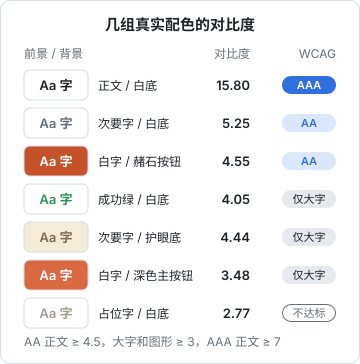

# 色彩

颜色是开发者最容易出错的地方：要么全是默认蓝，要么五颜六色。本章讲一套不靠审美也能做对的方法：先用灰度把层级做好，再按「角色」而不是「色值」分配颜色；用公式算对比度，而不是凭眼睛判断；最后讲深色模式怎么做，以及在 Tailwind 4 和 React Native 里怎么落地。文中所有对比度数值都是按 WCAG 公式实际算出来的。

## 先灰后彩

做界面时先只用黑、白、灰把层级做对：哪个是标题，哪个是次要信息，哪块是卡片，哪块是背景。灰度下层级清楚了，再给少数需要强调的东西上色。

这样做的原因是，颜色是界面里最「响」的信号。一旦一开始就上色，你会不自觉地用颜色去弥补层级上的问题（「这个不够显眼？换个红色」），最后满屏都是彩色，没有一个真正显眼。

一个常被提起的经验比例是 **60-30-10**：约六成面积是中性色（背景），三成是辅助色（卡片、侧栏、次要元素），一成是强调色（主按钮、关键数字、选中态）。它不是定律，但能提醒你：强调色是用来「点」的，不是用来「铺」的。

## 按角色分配颜色

不要在代码里写 `#c4532b`，也不要写 `bg-orange-700`。给每个颜色一个**角色名**：

| 角色 | 用途 | 掌柜眼浅色值 |
|---|---|---|
| `background` | 页面底色 | `#faf8f4` |
| `foreground` | 正文文字 | `#221c17` |
| `card` | 卡片底色 | `#ffffff` |
| `muted-foreground` | 次要文字 | `#6f675f` |
| `placeholder` | 占位字、空槽 | `#a39a90` |
| `border` | 边框、分隔线 | `#e9e4dc` |
| `primary` | 主按钮、链接、品牌 | `#c4532b` |
| `destructive` | 删除、亏损、错误 | `#c9393b` |
| `success` | 涨了、到位 | `#2f8f58` |
| `warning` | 偏低、该补、待填 | `#a8680e` |
| `info` | 参考信息 | `#2e8c9a` |

按角色命名有三个好处：

1. **深色模式只是换一组值**，组件代码不用动
2. **改品牌色只改一处**
3. **防止语义混乱**：成功和警告各有各的颜色，不会出现「这里的绿表示通过，那里的绿表示在线」

掌柜眼的界面约定里明确写着：别写 `amber-700`、`bg-emerald-100` 这种调色板色，因为深色底上那是另一套数，写一处就得两处维护。

### 状态色要和品牌色拉开

一个容易忽略的坑：品牌色是橙色，警告色也是橙色，用户分不清「这是按钮」还是「这是提醒」。掌柜眼的处理是让 `warning` 比品牌橙偏黄一档（色相约 60 对 40），注释里写着「不然『毛利偏低』跟按钮一个色」。

同理，如果品牌色是红色，`destructive` 就要换个明显不同的红，或者在删除场景里加图标和文字来区分。

## 色彩模型：为什么用 OKLCH

写颜色有几种方式：

| 模型 | 写法 | 优点 | 问题 |
|---|---|---|---|
| HEX / RGB | `#2f6fdf` | 通用，设计稿直接给 | 看不出颜色的明暗和饱和度，很难手动调 |
| HSL | `hsl(218 73% 53%)` | 色相、饱和度、亮度分开 | 亮度不符合人眼感受：同样 50% 亮度，黄色看起来比蓝色亮得多 |
| OKLCH | `oklch(0.6 0.15 255)` | L 是**感知亮度**，C 是彩度，H 是色相 | 部分颜色超出显示器色域时会被裁剪 |

OKLCH 的关键价值是：**L 相同的两个颜色，人眼看起来亮度也差不多**。这让「生成一组亮度递进的色阶」「保证两种状态色同样醒目」变得简单。Tailwind 4 的默认调色板就是用 OKLCH 定义的。

掌柜眼的经营分析页有一组「越多越深」的格子底色，就是用 OKLCH 写的：

```css
--fill-good: oklch(0.72 0.16 152);
--fill-bad: oklch(0.7 0.18 22);
--fill-heat: oklch(0.75 0.15 55);
```

三个颜色的 L 都在 0.7 左右，所以并排时没有哪个特别跳。注释里还解释了为什么不直接拿状态色去兑：状态色是给文字定的，L 低、彩度中等，兑进白卡片 10% 后几乎只剩灰色，一屏格子看着是黑白的。

## 对比度：用公式算，不要用眼睛估

你的显示器很好，你的视力也很好，用户未必。阳光下的手机、老旧的办公电脑、上了年纪的店主，都会让低对比度的文字直接看不见。

### WCAG 对比度公式

WCAG（Web 内容无障碍指南）用**相对亮度**计算对比度。先把每个 sRGB 通道（0–255）换算到线性值：

$$
c = \frac{v}{255},\quad c_{lin} = \begin{cases} c / 12.92 & c \le 0.04045 \\ \left(\frac{c + 0.055}{1.055}\right)^{2.4} & c > 0.04045 \end{cases}
$$

相对亮度是三个通道的加权和，绿色权重最大，因为人眼对绿光最敏感：

$$
L = 0.2126\,R_{lin} + 0.7152\,G_{lin} + 0.0722\,B_{lin}
$$

两个颜色的对比度：

$$
\text{ratio} = \frac{L_{亮} + 0.05}{L_{暗} + 0.05}
$$

范围从 1（同色）到 21（纯黑对纯白）。

### 达标线

| 级别 | 正文 | 大字 | 图形和界面组件 |
|---|---|---|---|
| AA | ≥ 4.5 | ≥ 3 | ≥ 3 |
| AAA | ≥ 7 | ≥ 4.5 | — |

「大字」指至少 18pt（约 24 CSS px），或者至少 14pt（约 18.67 CSS px）且加粗。「图形和界面组件」指图标、输入框边框、图表线条这类需要被看清的非文字元素。**AA 是通常应该做到的底线**。

### 写一个对比度函数

把公式写成代码，放进你的工具包或测试里：

```ts
function channel(v: number): number {
  const c = v / 255;
  return c <= 0.04045 ? c / 12.92 : ((c + 0.055) / 1.055) ** 2.4;
}

function luminance(hex: string): number {
  const n = parseInt(hex.replace("#", ""), 16);
  const r = (n >> 16) & 0xff;
  const g = (n >> 8) & 0xff;
  const b = n & 0xff;
  return 0.2126 * channel(r) + 0.7152 * channel(g) + 0.0722 * channel(b);
}

export function contrast(a: string, b: string): number {
  const [hi, lo] = [luminance(a), luminance(b)].sort((x, y) => y - x);
  return (hi + 0.05) / (lo + 0.05);
}

// contrast("#6f675f", "#ffffff") ≈ 5.55
```

可以为所有「文字色 × 底色」的组合写一个单元测试，改 token 时自动检查：

```ts
import { describe, expect, it } from "vitest";
import { contrast } from "./contrast";

const PAIRS: Array<[string, string, string, number]> = [
  ["正文 / 卡片", "#221c17", "#ffffff", 4.5],
  ["次要字 / 卡片", "#6f675f", "#ffffff", 4.5],
  ["主按钮字 / 主色", "#ffffff", "#c4532b", 4.5],
];

describe("颜色对比度", () => {
  it.each(PAIRS)("%s", (_name, fg, bg, min) => {
    expect(contrast(fg, bg)).toBeGreaterThanOrEqual(min);
  });
});
```

### 拿真实项目算一遍

下面是从掌柜眼和 hatch-shelf 的实际配色里挑的几组：



完整的数据和解读：

| 组合 | 前景 | 背景 | 对比度 | 结论 |
|---|---|---|---|---|
| hatch-shelf 阅读器正文 | `#1f2328` | `#ffffff` | 15.80 | AAA |
| hatch-shelf 阅读器次要字 | `#656d76` | `#ffffff` | 5.25 | AA |
| 掌柜眼次要字 / 卡片 | `#6f675f` | `#ffffff` | 5.55 | AA |
| 掌柜眼主按钮白字 | `#ffffff` | `#c4532b` | 4.55 | AA，刚好过线 |
| 掌柜眼成功绿 / 白底 | `#2f8f58` | `#ffffff` | 4.05 | 仅大字和图标 |
| 掌柜眼信息青 / 白底 | `#2e8c9a` | `#ffffff` | 3.94 | 仅大字和图标 |
| hatch-shelf 护眼主题次要字 | `#7a6a53` | `#f4ecd8` | 4.44 | 差一点到 AA |
| 掌柜眼深色主按钮白字 | `#ffffff` | `#da6840` | 3.48 | 仅大字 |
| 掌柜眼占位字 / 卡片 | `#a39a90` | `#ffffff` | 2.77 | 不达标 |
| 掌柜眼品牌字 / 品牌淡底 | `#c4532b` | `#fbe9df` | 3.86 | 仅大字 |

几个值得注意的发现：

**状态色常常是「给图标的颜色」**。成功绿 4.05、信息青 3.94，用来画图标、大号数字、粗体标签没问题，但如果拿来写 12px 的说明文字就不达标。要么规定状态色只用于图标和大字，要么把它们压暗一点：`#287d4c` 对白底是 5.09，`#277f8c` 是 4.67，都能过 AA，色相基本不变。

**淡底会吃掉对比度**。品牌色字本身对白底是 4.55，放到品牌淡底 `#fbe9df` 上就只剩 3.86。侧栏选中项、提示条这类「彩字配淡彩底」的地方要单独算。

**深色模式的主色最难**。掌柜眼深色主题的 `--primary` 取了中间值 `#da6840`，因为一个变量既要当实心按钮的底色，又要当深底上的文字色。算一下就知道两头为难：

| 用法 | 组合 | 对比度 |
|---|---|---|
| 当文字（深底上） | `#da6840` / `#211c17` | 4.85 |
| 当按钮底（上面放白字） | `#ffffff` / `#da6840` | 3.48 |
| 稿子里的亮色当文字 | `#f07b52` / `#211c17` | 6.16 |
| 稿子里的暗色当按钮底 | `#ffffff` / `#b6482a` | 5.32 |

结论是：**把「主色文字」和「主色实心底」拆成两个 token**，比如 `--primary` 和 `--primary-solid`，各自取最合适的值，两项就都能过 AA。这正是设计稿里原本的做法，合并成一个变量是为了少维护一个名字，代价是按钮上的白字对比度不够。这种取舍要算过之后再做。

**占位字的定位**。掌柜眼故意让占位字比次要字淡一档，理由是「占位字跟次要字同色的话，分不清框里是填了字还是空着」。这个理由成立，但 2.77 意味着视力不好的人可能看不见占位字。稳妥的做法是：**占位字里不放必需的信息**，字段用途写在框外的标签上，占位字只放「选填」「如：张三」这类可有可无的提示。

**系统色也不是都过 AA**。iOS 的系统蓝 `#007aff` 对白底是 4.02。iOS 的按钮文字一般是 17pt 常规或半粗，按 WCAG 的定义，17pt 半粗属于「14pt 以上加粗」的大字，3:1 就够。这说明同一个颜色能不能用，要看字号和字重。

## 不要只靠颜色传达信息

大约有百分之几的男性有某种红绿色觉异常（比例因人群而异）。如果你的界面只用红绿区分「亏损 / 盈利」「失败 / 成功」，这部分用户就看不出来。WCAG 1.4.1 要求颜色不能是传达信息的唯一方式。

改法很简单：**颜色之外再加一个通道**。

| 只靠颜色 | 加一个通道 |
|---|---|
| 红色数字表示亏损 | 加负号：「-¥320」 |
| 绿点表示在线 | 绿点加文字「在线」 |
| 红框表示输入有误 | 红框加下方的错误说明 |
| 图表里红线绿线 | 线型不同（实线 / 虚线），或直接在线尾标注名称 |

掌柜眼表格里出问题的行，是「整行上底色 + 出问题那一格底下一道波浪线 + 悬停说明原因」，三个通道一起用。

## 深色模式

深色模式**不是把颜色反过来**。直接反色会得到刺眼的纯白字压在纯黑底上，彩色变得又脏又暗。

### 几条原则

1. **底色选深灰还是纯黑**：两种做法都有道理。iOS 系统背景在深色下是纯黑 `#000000`，OLED 屏上省电、和系统一致，hatch-shelf 的书架页沿用了这套系统色。掌柜眼选了暖调的深灰 `#15120f`，理由是纯黑上白字发飘、暖橙发脏，而且整个产品是暖白色系，深色也要暖。选哪个，取决于你的产品调性和是否要贴合系统
2. **用亮度表示层级**：浅色模式靠阴影区分前后，深色模式下阴影几乎看不见，改为**越靠前的面越亮**。掌柜眼深色下的层次是侧栏 < 页底 < 卡片 < 弹层，一层比一层亮半档，不靠描边
3. **文字不用纯白**：用略灰或略暖的白（掌柜眼用 `#f2eae0`），减少眩光
4. **彩色要提亮、降饱和**：浅色模式的品牌色放到深底上会显得闷。掌柜眼的成功绿从 `#2f8f58` 换成 `#62cc8f`，在深色卡片上的对比度是 8.49
5. **两套主题都要算对比度**：深色模式的值不是自动推出来的，每一对都要重新算

### 淡底用透明度

「浅黄底的警告条」在深色模式下不能还是浅黄底。掌柜眼的做法是淡底一律用透明度：`bg-warning/10`、`ring-success/15`。`warning` 在两套主题里各有一个值，叠 10% 透明度后自动适配，不用为深色单独写一个淡底色。

Tailwind 4 的 `/10` 这类透明度修饰符底层用的是 CSS 的 `color-mix()`，对 CSS 变量也有效。

## 在 Tailwind 4 里落地

完整的结构分三段：定义两套变量、声明深色变体、把变量注册成 Tailwind 的颜色。

```css
@import "tailwindcss";

/* 让 dark: 变体看祖先上的 .dark 类，而不是只看系统偏好 */
@custom-variant dark (&:is(.dark *));

:root,
.light {
  --background: #faf8f4;
  --foreground: #221c17;
  --muted-foreground: #6f675f;
  --primary: #c4532b;
  --primary-foreground: #ffffff;
  --success: #287d4c;
}

.dark {
  --background: #15120f;
  --foreground: #f2eae0;
  --muted-foreground: #b5aa9e;
  --primary: #f07b52;
  --primary-foreground: #2a1208;
  --success: #62cc8f;
}

@theme inline {
  --color-background: var(--background);
  --color-foreground: var(--foreground);
  --color-muted-foreground: var(--muted-foreground);
  --color-primary: var(--primary);
  --color-primary-foreground: var(--primary-foreground);
  --color-success: var(--success);
}
```

这份示例在深色下换了一种解法：主色取亮的 `#f07b52`（当文字对深底 6.16），实心按钮上的字改成深色 `#2a1208`（对 `#f07b52` 是 6.45），而不是白字。浅色下的成功绿用了压暗后的 `#287d4c`，对页面底 `#faf8f4` 是 4.80。

之后组件里只写 `bg-background`、`text-muted-foreground`、`bg-primary text-primary-foreground`、`text-success`，切换主题就是在 `<html>` 上挂不挂 `.dark`。

为什么用 `@theme inline` 而不是 `@theme`，以及 `.light` / `.dark` 为什么写成作用域而不是开关，放在[第 5 章](05-design-system.md)一起讲。

## 在 React Native 里落地

RN 没有 CSS 变量，主题就是一个按 `useColorScheme()` 切换的对象。hatch-shelf 书架页的写法最简单：

```ts
import { useColorScheme } from "react-native";

export function useShelfColors() {
  const dark = useColorScheme() === "dark";
  return dark
    ? { bg: "#000000", card: "#1c1c1e", fg: "#f2f2f7", muted: "#8e8e93", accent: "#0a84ff" }
    : { bg: "#f2f2f7", card: "#ffffff", fg: "#1c1c1e", muted: "#6e6e73", accent: "#007aff" };
}
```

这组值取自 iOS 系统色。算一下：浅色的次要字 `#6e6e73` 对页面底 `#f2f2f7` 是 4.54，深色的 `#8e8e93` 对卡片 `#1c1c1e` 是 5.22，都过 AA。

需要用户手动选「浅色 / 深色 / 跟随系统」时，就要把选择存起来，并且推给原生层，让键盘、系统弹窗也跟着变。唱片墙的 `theme.tsx` 是这么做的：

```tsx
import { Appearance, useColorScheme } from "react-native";

function applyNative(choice: "system" | "light" | "dark"): void {
  // 不推给原生层的话，键盘、Alert、分享面板还跟着系统走
  Appearance.setColorScheme(choice === "system" ? "unspecified" : choice);
}

export function ThemeProvider({ children }: { children: React.ReactNode }) {
  const choice = prefs.use((s) => s.theme);
  const system = useColorScheme();
  const dark = choice === "system" ? system === "dark" : choice === "dark";
  const theme = useMemo(() => (dark ? DARK : LIGHT), [dark]);
  return <Ctx.Provider value={theme}>{children}</Ctx.Provider>;
}
```

`Appearance.setColorScheme` 接受 `"unspecified"` 表示回到跟随系统，这是较新版本 RN 的取值，老版本用的是 `null`，用之前查一下你所用 RN 版本的文档。

## 一个省力的起点：Radix Colors

如果不想自己调色阶，可以直接用 Radix Colors。它的每种颜色有 12 级，每一级都有明确的用途：

| 级别 | 用途 |
|---|---|
| 1–2 | 应用背景、卡片等次级背景 |
| 3–5 | 组件背景：常态、悬停、按下 / 选中 |
| 6–8 | 边框：分隔线、组件边框、悬停或聚焦时的边框 |
| 9–10 | 实心色块：按钮底色及其悬停态 |
| 11–12 | 文字：低对比度文字、高对比度文字 |

每种颜色都配好了深色版本，第 11、12 级在对应的背景上设计为满足文字对比度。按级别用，基本不会出错。这套「按用途分级」的思路即使不用 Radix Colors，也值得借鉴。

## 本章要点

- 先用灰度做对层级，再给少数东西上色；强调色是「点」的不是「铺」的
- 按**角色**命名颜色，组件里不出现色值和调色板色；状态色和品牌色要拉开色相
- 调色阶、保证同等醒目用 **OKLCH**，它的 L 是感知亮度
- 对比度**用公式算**：AA 正文 4.5、大字和图形 3；写成单元测试
- 状态色往往只够图标和大字；彩字配淡彩底要单独算；深色主题的主色考虑拆成文字和实心底两个 token
- 不要只靠颜色传达信息，加符号、文字或形状
- 深色模式不是反色：靠亮度分层级，文字不用纯白，彩色提亮，两套都要算对比度
- 淡底用透明度（`bg-warning/10`），两套主题自动适配
