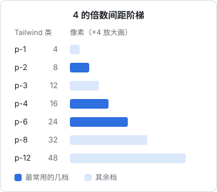

# 间距与网格

「看起来不专业」的界面，问题往往不在颜色和字体，而在间距：这里 10px、那里 13px，元素之间的距离毫无规律，该分开的挤在一起，该挨着的隔得老远。本章讲三件事：用一套固定的间距阶梯代替随手写的数字；用间距表达分组关系；用对齐和网格让界面有秩序。最后讲布局稳定性：内容变化时界面不要跳。

## 用一套间距阶梯

和字号一样，间距也只从一套固定的数里挑。最常见的是 **4 的倍数**（也叫 4pt / 8pt 网格）：



为什么是 4：

- 主流屏幕的像素密度是 1x、2x、3x，4 的倍数在这些密度下都能落在整像素上，边缘清晰
- 4 足够细，能表达「紧凑」和「宽松」之间的差别；又足够粗，不会出现 13 和 14 这种肉眼分不出的选择
- 设计工具、Tailwind、Material 都以它为基础，设计稿和代码天然对得上

阶梯越往上，间隔越大：4、8、12、16、24、32、48、64。小间距之间差 4，大间距之间差 8 甚至 16。原因是人对间距的感知是相对的：4 和 8 差一倍，一眼能看出；48 和 52 只差不到一成，基本看不出。

### Tailwind 4 的间距变量

Tailwind 4 的所有间距类都基于一个变量 `--spacing`，默认值是 `0.25rem`（4px）。`p-4` 编译后是 `calc(var(--spacing) * 4)`，也就是 16px。

这意味着两件事：

1. **任意整数都能用**：`p-5`、`gap-7` 都会生成。但能用不等于该用，团队约定里最好限定在几档常用值
2. **改一个变量就能整体调密度**：比如做一个紧凑模式，在某个容器上把 `--spacing` 改成 `0.2rem`

一个实用的约定：

| 场景 | 常用值 | Tailwind |
|---|---|---|
| 图标和文字之间 | 4–8 | `gap-1` / `gap-2` |
| 标签和它的输入框之间 | 6–8 | `gap-1.5` / `gap-2` |
| 表单字段之间、列表项之间 | 12–16 | `gap-3` / `gap-4` |
| 卡片内边距 | 16–24 | `p-4` / `p-6` |
| 区块之间 | 24–48 | `gap-6` / `gap-8` / `gap-12` |
| 页面边距 | 24–40 | `px-6` / `px-8` / `px-10` |

**`p-[13px]` 这种任意值是一个信号**：要么设计稿量错了，要么在用间距弥补别的问题（比如图标本身带了留白）。偶尔需要可以用，但每次出现都值得多看一眼。

### React Native 里的间距常量

RN 没有工具类，就把阶梯写成常量。唱片墙的 `tokens.ts`：

```ts
export const space = { xs: 4, sm: 8, md: 12, lg: 16, xl: 24, xxl: 32 } as const;
export const radius = { sm: 8, md: 12, lg: 14, xl: 22, pill: 999 } as const;

/** 页面左右的边：画板上一律是 24 */
export const GUTTER = 24;
```

样式里只引用这些名字：

```tsx
const styles = StyleSheet.create({
  row: { flexDirection: "row", alignItems: "center", gap: space.md, paddingHorizontal: GUTTER },
  card: { padding: space.lg, borderRadius: radius.md },
});
```

`gap` 从 React Native 0.71 起支持，比给每个子元素加 `marginBottom` 干净得多，也不会出现「最后一项多一截」的问题。

## 间距就是分组

格式塔心理学的**接近原则**：靠得近的东西会被看成一组。这是间距最重要的用途，比「好看」重要得多。


左边的表单，每个标签离上一个输入框和下一个输入框都是 12px，眼睛要读完文字才能判断它属于哪个框。右边把「标签到自己的框」缩到 6px，「字段到字段」拉到 22px，结构不用读就看出来了。

由此得到一条最实用的规则：**内小外大**。

- 组内间距 < 组间间距
- 元素内边距 ≤ 元素之间的距离
- 卡片的内边距 < 卡片和卡片之间的距离

违反这条规则的典型例子：卡片内边距 24px，卡片之间只隔 8px，结果卡片之间的缝看起来比卡片里的内容还紧，几张卡像粘在一起。

用 Tailwind 写一个符合内小外大的表单：

```tsx
<form className="flex max-w-xl flex-col gap-6">
  <div className="flex flex-col gap-1.5">
    <Label htmlFor="name">食材名称</Label>
    <Input id="name" />
  </div>
  <div className="flex flex-col gap-1.5">
    <Label htmlFor="unit">单位</Label>
    <Input id="unit" />
  </div>
</form>
```

外层 `gap-6`（24px），每个字段内 `gap-1.5`（6px），比例 4 比 1。

### 留白也是层级

间距不只表达分组，还表达重要性。一个元素周围的留白越多，它越显得重要。着陆页的大标题上下留出大片空白，就是在说「先看这里」。

开发者的本能是「填满」：屏幕上有空地，就再塞点什么。但留白本身就是在做设计。掌柜眼在门店概览以外的「干活的页」不放大色块的主卡，分主次靠字号和留白，就是这个思路。

## 对齐

界面上每个元素都应该和另一个元素对齐。没有对齐的界面，即使间距都对，也会显得乱。

### 一条左边线

最简单有效的规则：**一个区块里的内容共用一条左边线**。标题、正文、按钮、表单都从同一个 x 坐标开始。

常见的破坏方式：

- 图标在文字左边，导致图标行的文字比其他行缩进了一截。改法：要么所有行都有图标位，要么图标悬挂在左边线外
- 卡片内边距和页面标题的边距不一致，卡片里的文字比页面标题偏右
- 居中对齐和左对齐混用。居中适合一两行的标题、空态提示；多行正文和表单一律左对齐

### 数字右对齐

上一章提过，金额、数量这类要比较大小的数字列**右对齐**，配合等宽数字。表头也跟着右对齐，否则表头和数据错开。文字列左对齐，状态这类短标签可以居中。

### 圆角嵌套

两个圆角矩形嵌套时，如果内外圆角相同，转角处的间隙会显得比直边宽，看起来别扭。正确的关系是：

$$
r_{内} = r_{外} - d
$$

其中 $d$ 是两个边框之间的距离（内边距，或者贴边时的边框宽度）。比如卡片圆角 16、内边距 8，里面的按钮圆角应该是 8。内边距大于等于外圆角时，内部元素可以用任意小圆角。

掌柜眼的界面约定里就有这一条：贴边一排的格子，两头顺着外框收圆，半径 = 外框半径 − 边框宽，不然圆角容器会把贴边那一项裁掉一角。

## 网格与断点

### 网页：12 列网格和容器查询

营销页、内容站常用 **12 列网格**：12 能被 2、3、4、6 整除，可以方便地切成两栏、三栏、四栏。Tailwind 写法：

```tsx
<div className="grid grid-cols-1 gap-6 md:grid-cols-12">
  <main className="md:col-span-8">...</main>
  <aside className="md:col-span-4">...</aside>
</div>
```

但应用类界面（后台、工具）更多是「侧栏 + 内容区」的结构，内容区的宽度取决于侧栏展开与否，这时**视口断点**就不准了。掌柜眼的做法是页面排版一律用**容器查询**：

```tsx
<div className="@container">
  <div className="grid grid-cols-1 gap-4 @lg:grid-cols-2 @4xl:grid-cols-3">
    {cards}
  </div>
</div>
```

`@lg:` 看的是最近的 `@container` 祖先的宽度，而不是窗口宽度。Tailwind 4 内置了容器查询，不需要插件。掌柜眼的约定里解释了原因：视口断点会把左边 230px 的侧栏算进去，判断偏宽。

### 定一个最窄宽度

掌柜眼照 1024 宽排版，因为那是店里老电脑常见的窄屏。1024 宽时内容区只剩约 740px，装不下就在某个断点上先藏最不要紧的一列。

**为你的产品定一个最窄宽度，并在那个宽度下检查每一页**。这比「适配所有尺寸」更可执行。手机端同理：iPhone 的较窄机型逻辑宽度是 375pt 左右，在这个宽度下看一遍。

### 手机：页边距和安全区

手机上没有多列网格，主要是**页面左右边距**（gutter）。常见取值是 16 或 20，唱片墙的设计稿统一用 24。选定后全应用一致，所有内容从同一条边线开始。

屏幕顶部的刘海、灵动岛和底部的 Home 指示条要留出**安全区**，这部分在[第 6 章](06-mobile-guidelines.md)讲。

## 布局稳定性：内容变了，界面别跳

一个很少被提及但极影响体验的问题：数据加载前后、开关切换前后，界面高度变了，下面的东西全部往下跳。用户刚要点的按钮被挤走，点到了别的东西。网页上这类问题有个指标叫 CLS（累积布局偏移）。

掌柜眼有一组专门针对这个问题的规则，可以直接照抄：

| 场景 | 做法 |
|---|---|
| 页头副标题 | 每一页、每一种情况都有副标题，加载中先写一句抽象的，回来再换成带数的；不给就不画的话，数一到整页往下一跳 |
| 开关控制输入框 | 关掉时输入框禁用、用「—」占位，**不藏**；藏起来表单会缩一截，来回切时下面的控件一路跳 |
| 表格里出问题的行 | 整行上底色，**行高不许变** |
| 骨架屏 | 骨架的尺寸和真实内容一致 |
| 加载中的分页条 | 画骨架，别画一条「共 0 条」 |

通用的原则是：**为会变化的内容预留空间**。图片写明宽高比（`aspect-video`、`aspect-square`），数字用等宽字体（位数变化时宽度不变），按钮里的文字在「保存 / 保存中…」之间切换时给按钮一个最小宽度。

## 本章要点

- 间距只用 **4 的倍数**阶梯；最常用 8、16、24
- Tailwind 4 的间距基于 `--spacing`（默认 4px），任意值 `p-[13px]` 是要多看一眼的信号
- RN 把阶梯写成常量，用 `gap` 代替一个个 margin
- **间距就是分组**：内小外大，组内间距小于组间间距
- 留白表达重要性，不要本能地填满
- 一个区块共用一条左边线；数字列右对齐
- 嵌套圆角：内圆角 = 外圆角 − 间距
- 应用类界面用**容器查询**而不是视口断点；定一个最窄宽度并在该宽度下检查
- 为会变化的内容预留空间，切换状态时**布局不许跳**
