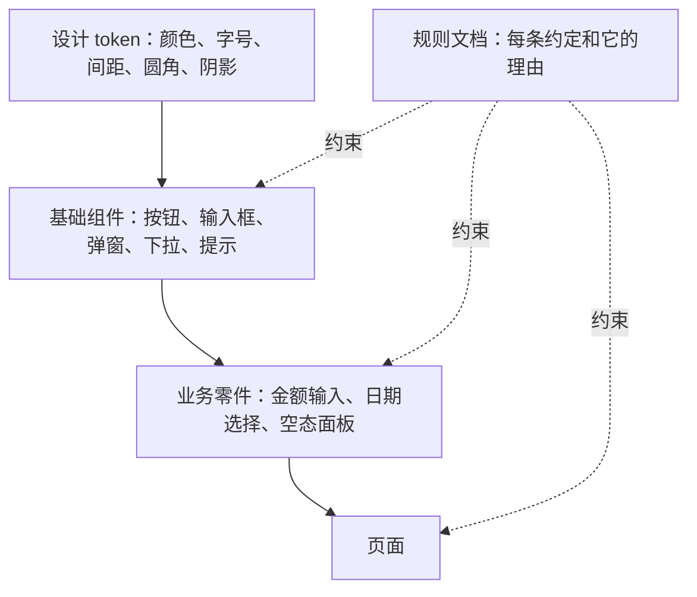

# 设计系统

前四章做了很多决定：字号阶梯、颜色角色、间距阶梯、圆角。如果这些决定只存在于你的脑子里，三个月后你自己都会忘，agent 更不会知道。**设计系统**就是把这些决定沉淀成代码和文档，让每一个新页面自动「长得像」旧页面。本章讲一人公司尺度的设计系统该有多大、token 怎么分层、在 Tailwind 4 + Radix 里怎么搭、在 React Native 里怎么搭，以及怎么让它不被慢慢腐蚀。

## 一人公司需要多大的设计系统

大公司的设计系统有专门团队、文档站、Figma 组件库、版本发布流程。一人公司不需要这些，但需要最小的那部分：



最小可用的版本：

1. **一份 token 文件**：网页是 `index.css`，RN 是 `tokens.ts`
2. **十来个基础组件**：Button、Input、Select、Dialog、DropdownMenu、Tooltip、Tabs、Switch、Toast、Skeleton
3. **几个业务零件**：你的产品里反复出现的东西，比如掌柜眼的金额输入、月份条、空态面板
4. **一份规则文档**：写下「为什么」，给自己和 agent 看

不需要一开始就建全。**第二次写同样的东西时，把它抽出来**。掌柜眼的规则是：被两组以上用到的零件一律进 `shared/`，别留在先用它的那一组里让别组跨目录去引。

## Token 分三层

token 是设计决定的最小单位，一个名字对应一个值。成熟的做法是分三层：

| 层 | 例子 | 谁用它 |
|---|---|---|
| 原始值（palette） | `orange-600: #c4532b`、`stone-900: #221c17` | 只被语义层引用 |
| 语义（semantic） | `primary`、`foreground`、`muted-foreground`、`destructive` | 组件和页面 |
| 组件（component） | `button-primary-bg`、`sidebar-accent` | 特定组件 |

关键规则：**组件和页面只用语义层**。这样深色模式只需要重新映射语义层，原始色板可以不动。

一人公司可以把原始层省掉，直接在语义层写色值，这也是掌柜眼的做法。它的值来自设计稿的 `f-*` 变量，`index.css` 里的注释说明了映射关系：通用名（`--background`、`--card`、`--primary`）映射到设计稿的变量，没有对得上的通用名才另起（`--glass`、`--hero-0`、`--good-soft`）。

组件层 token 按需加，不要预先为每个组件都建一套，否则维护成本会超过收益。

## 在 Tailwind 4 里搭

### 完整结构

把[第 3 章](03-color.md)的颜色和[第 2 章](02-typography.md)的字号合在一起，一份 `index.css` 大致长这样：

```css
@import "tailwindcss";

@custom-variant dark (&:is(.dark *));

:root,
.light {
  color-scheme: light;
  --radius: 0.5625rem;
  --background: #faf8f4;
  --foreground: #221c17;
  --card: #ffffff;
  --primary: #c4532b;
  --primary-foreground: #ffffff;
  --muted-foreground: #6f675f;
  --border: #e9e4dc;
}

.dark {
  color-scheme: dark;
  --background: #15120f;
  --foreground: #f2eae0;
  --card: #211c17;
  --primary: #da6840;
  --primary-foreground: #ffffff;
  --muted-foreground: #b5aa9e;
  --border: #3a322a;
}

@theme inline {
  --color-background: var(--background);
  --color-foreground: var(--foreground);
  --color-card: var(--card);
  --color-primary: var(--primary);
  --color-primary-foreground: var(--primary-foreground);
  --color-muted-foreground: var(--muted-foreground);
  --color-border: var(--border);

  --radius-md: calc(var(--radius) - 2px);
  --radius-lg: var(--radius);
}
```

### 为什么是 `@theme inline`

`@theme` 里定义的 `--color-*` 会做两件事：生成 `bg-primary` 这类工具类，同时在 `:root` 上输出一个同名 CSS 变量。普通的 `@theme` 下，`bg-primary` 编译成 `background-color: var(--color-primary)`。

问题在于 CSS 变量的引用是在**定义它的元素上**解析的。`--color-primary: var(--primary)` 定义在 `:root` 上，它在 `:root` 就被算成了浅色的 `#c4532b`。之后你在某个子树上挂 `.dark` 把 `--primary` 改掉，`--color-primary` 不会跟着变。

加上 `inline` 后，工具类直接内联变量的值表达式：`bg-primary` 编译成 `background-color: var(--primary)`，在使用它的元素上解析，于是能拿到最近的 `.dark` 或 `.light` 作用域里的值。

### `.light` / `.dark` 是作用域，不是开关

正因为用了 `inline`，主题类可以挂在任意容器上，把一块界面钉在某个主题里。掌柜眼的单据模板页就是这样：整页是深色时，右边那份仿 Excel 的表格套一层 `.light`，照样画成白底，看起来像真的 Excel。

注意一个陷阱：在被钉住的块里**不要用 `dark:` 变体**。`dark:` 看的是祖先里有没有 `.dark`，套了 `.light` 的块，外面的 `<html>` 上仍然有 `.dark`，`dark:` 依然生效，钉不住。只用语义变量就不会有这个问题。

### 开屏别闪白

主题选择通常存在 `localStorage`。如果等 React 渲染后再读，深色用户每次打开都会先看到一帧白屏。解决办法是在 `index.html` 里放一段内联脚本，在第一帧之前就把类挂上：

```html
<script>
  try {
    const t = localStorage.getItem("app.theme");
    const dark = t === "dark" || (t !== "light" && matchMedia("(prefers-color-scheme: dark)").matches);
    document.documentElement.classList.add(dark ? "dark" : "light");
  } catch {}
</script>
```

掌柜眼还多做了一层兜底：在 `index.css` 里写一段 `prefers-color-scheme: dark` 的媒体查询，在 `.dark` 还没挂上的那一瞬先把深色底借过来。

## 用 Radix 做行为，用 Tailwind 做样式

弹窗、下拉菜单、悬停提示这类组件，难的不是样式，而是**行为**：焦点要困在弹窗里、按 Esc 要关闭、关闭后焦点回到触发按钮、屏幕阅读器要读出正确的角色、下拉菜单要支持方向键。自己写很容易漏，而且漏了不会报错。

**Radix Primitives** 是一套「无样式」（headless）组件：只提供行为和无障碍属性，不带任何视觉样式。样式完全由你来写。

### 用 `data-state` 写状态样式

Radix 组件会在 DOM 上挂 `data-state="open"`、`data-state="checked"`、`data-disabled` 这类属性。Tailwind 可以直接用它们做选择器：

```tsx
import * as Dialog from "@radix-ui/react-dialog";

export function ConfirmDialog({ open, onOpenChange, title, children }: Props) {
  return (
    <Dialog.Root open={open} onOpenChange={onOpenChange}>
      <Dialog.Portal>
        <Dialog.Overlay className="fixed inset-0 bg-black/40 data-[state=open]:animate-in data-[state=open]:fade-in-0" />
        <Dialog.Content className="bg-card fixed top-1/2 left-1/2 w-full max-w-md -translate-x-1/2 -translate-y-1/2 rounded-2xl p-6 shadow-lg">
          <Dialog.Title className="text-lg font-semibold">{title}</Dialog.Title>
          <Dialog.Description className="text-muted-foreground mt-1 text-sm">
            这一步做完可以在提示条里撤销。
          </Dialog.Description>
          <div className="mt-6">{children}</div>
        </Dialog.Content>
      </Dialog.Portal>
    </Dialog.Root>
  );
}
```

`animate-in`、`fade-in-0` 来自 `tw-animate-css`（掌柜眼的 `index.css` 里引入了它）。`Dialog.Title` 和 `Dialog.Description` 会被自动关联到弹窗的无障碍属性上，屏幕阅读器打开弹窗时会读出它们。

### `asChild`：把行为借给你的组件

Radix 的触发器默认渲染一个 `<button>`。如果你想用自己的 `Button` 组件当触发器，用 `asChild`：

```tsx
<Dialog.Trigger asChild>
  <Button variant="outline">新建分类</Button>
</Dialog.Trigger>
```

Radix 不再渲染自己的按钮，而是把事件处理和 `aria-*` 属性合并到你的 `Button` 上。这背后是 `@radix-ui/react-slot` 的 `Slot` 组件，掌柜眼的 `Button` 自己也支持 `asChild`，用的就是它。

## shadcn/ui：把组件代码放进你的仓库

shadcn/ui 不是一个 npm 包，而是一个**代码生成器**：它把基于 Radix + Tailwind 写好的组件源码复制到你的项目里（通常是 `components/ui/`）。代码归你所有，可以随便改。

这种模式的好处是没有黑盒、没有版本升级的破坏性变更。代价是：一旦改了生成的代码，下次重新生成就会覆盖掉。掌柜眼的处理方式值得学：

- `components/ui/` 原则上不手改，样式在调用处或 `index.css` 的变量里改
- 少数非改不可的地方（按钮的投影、弹窗的关闭按钮点击区），在规则文档里**逐个列出来**，并写明「重新生成 shadcn 组件之后把这几截补回去」
- Prettier 不格式化这个目录，跟着生成器的格式走，方便和上游对比

### 用 cva 管理变体

shadcn 的按钮用 `class-variance-authority`（cva）管理变体。这是把「设计系统里有几种按钮」写成代码的好方法：

```tsx
import { cva, type VariantProps } from "class-variance-authority";

const buttonVariants = cva(
  "inline-flex items-center justify-center gap-2 rounded-md text-sm font-medium whitespace-nowrap transition-colors disabled:pointer-events-none disabled:opacity-50 focus-visible:ring-2 focus-visible:ring-ring/50 outline-none",
  {
    variants: {
      variant: {
        default: "bg-primary text-primary-foreground hover:bg-primary/90",
        destructive: "bg-destructive text-white hover:bg-destructive/90",
        outline: "border bg-card hover:bg-accent",
        ghost: "hover:bg-accent",
      },
      size: {
        default: "h-9 px-4",
        sm: "h-8 px-3 text-xs",
        icon: "size-9",
      },
    },
    defaultVariants: { variant: "default", size: "default" },
  },
);

type ButtonProps = React.ComponentProps<"button"> & VariantProps<typeof buttonVariants>;
```

这段代码同时就是文档：按钮有四种外观、三种尺寸，默认是主色中号。想加第五种外观，得来这里加，加的时候自然会想想是不是真的需要。

注意基础类里的 `focus-visible:ring-2`：键盘用户需要看得见焦点在哪。**不要为了好看去掉焦点环**，用 `focus-visible` 而不是 `focus`，鼠标点击时就不会出现。

## 在 React Native 里搭

RN 没有 CSS 变量也没有工具类，设计系统就是**一个 token 模块 + 一个主题 Context + 一组基础组件**。

唱片墙的结构：

| 文件 | 内容 |
|---|---|
| `packages/core/src/ui/palette.ts` | 颜色。放在共享包里，手机端和桌面端读同一份 |
| `apps/mobile/src/ui/tokens.ts` | 字号、间距、圆角、字体，以及转出 palette |
| `apps/mobile/src/ui/theme.tsx` | `ThemeProvider` 和 `useTheme()` |
| `apps/mobile/src/ui/text.tsx`、`kit.tsx` 等 | 基础组件 |

颜色放进跨端共享的包里，是一个很好的决定：桌面端是 Electron（网页技术），手机端是 RN，两边的样式写法完全不同，但颜色值只有一份。

基础组件从 token 取值，页面从基础组件拼装，页面里不出现裸的数字和色值：

```tsx
import { Pressable, StyleSheet } from "react-native";
import { radius, space } from "./tokens";
import { useTheme } from "./theme";
import { Text } from "./text";

export function PrimaryButton({ label, onPress }: { label: string; onPress: () => void }) {
  const t = useTheme();
  return (
    <Pressable
      onPress={onPress}
      accessibilityRole="button"
      style={({ pressed }) => [styles.base, { backgroundColor: t.accent, opacity: pressed ? 0.85 : 1 }]}
    >
      <Text role="body" style={{ color: t.onAccent }}>{label}</Text>
    </Pressable>
  );
}

const styles = StyleSheet.create({
  base: { minHeight: 44, paddingHorizontal: space.lg, borderRadius: radius.md, alignItems: "center", justifyContent: "center" },
});
```

`t.accent`、`t.onAccent` 是示意的 token 名，按你的 palette 命名。`minHeight: 44` 的来历见[第 6 章](06-mobile-guidelines.md)。

## 不让设计系统腐蚀

设计系统最大的敌人不是没建，而是建了之后被一点点绕过：今天一个 `text-[15px]`，明天一个 `bg-amber-100`，半年后 token 形同虚设。尤其当大量代码由 agent 生成时，它会随手挑一个「看起来合适」的值。

### 用工具拦

能自动检查的就不要靠记忆。最简单的方式是一个 grep 脚本，挂进 `pnpm lint` 或提交前检查：

```bash
#!/usr/bin/env bash
# 禁止调色板色和任意字号：颜色只走语义变量，字号只走阶梯
set -euo pipefail
pattern='(bg|text|border|ring|fill|stroke)-(red|orange|amber|yellow|lime|green|emerald|teal|cyan|sky|blue|indigo|violet|purple|fuchsia|pink|rose|slate|gray|zinc|neutral|stone)-[0-9]{2,3}|text-\[[0-9]+px\]'
if grep -rEn "$pattern" src --include='*.tsx' --exclude-dir=ui; then
  echo "发现调色板色或任意字号，请改用语义 token" >&2
  exit 1
fi
```

更进一步，在 `@theme` 里用 `--color-*: initial;` 清掉默认调色板，那些类根本不会生成。代价是第三方组件里用到的默认色也会失效，需要权衡。

掌柜眼还用 ESLint 拦了几样「系统控件每个平台一副样子」的东西：不许用 `<input type="date">`，必须用自己的日期选择器。

### 用文档讲理由

不是所有规则都能用工具拦。比如「要让一样东西退后，只压字的颜色，不铺灰底」，因为在这套界面里底色的意思是「看这儿」。这种规则必须写下来，**并写明理由**。

理由很重要。只写规则，别人（包括 agent 和三个月后的你）会在「这次情况特殊」时轻易打破它；写了理由，打破之前至少会想一想理由是否还成立。掌柜眼的 `界面约定` 里几乎每条规则后面都跟着「因为」，这是它能被 agent 稳定执行的原因。

### 写给 agent 的入口

在 `CLAUDE.md` 或 `.claude/rules/` 里给 agent 一个明确的入口：

```markdown
## 界面

- 颜色、字号、间距只用 src/index.css 里的 token，见「界面约定」文档
- 基础组件在 components/ui/（shadcn 生成，不手改），业务零件在 components/shared/
- 新做一块界面，浅色和深色两套主题都要看一遍
- 需要新组件时先在 shared/ 里找，找不到再新建
```

## 本章要点

- 一人公司的设计系统 = token 文件 + 十来个基础组件 + 几个业务零件 + 一份讲理由的规则文档
- 第二次写同样的东西时再抽象；被两处以上用到的零件进 `shared/`
- token 分原始、语义、组件三层；组件和页面只用语义层
- Tailwind 4 用 `@theme inline` 映射 CSS 变量，主题类才能作为作用域挂在任意容器上
- 被钉住主题的块里不用 `dark:` 变体；`index.html` 内联脚本防开屏闪白
- Radix 负责行为和无障碍，Tailwind 负责样式；用 `data-[state=open]:` 写状态，用 `asChild` 借出行为
- shadcn 的代码归你，改动要登记；用 cva 把变体写成代码；保留 `focus-visible` 焦点环
- RN 的设计系统 = token 模块 + 主题 Context + 基础组件；颜色可以放共享包跨端复用
- 用 grep / ESLint 拦住调色板色和任意值；规则写明理由，给 agent 明确入口
