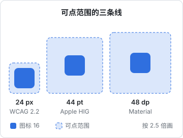

# 移动端规范

手机界面和网页界面的差别，不只是屏幕小。手指比鼠标粗得多，没有悬停；屏幕上有刘海和 Home 指示条；用户可能把系统字号调到最大；单手握持时拇指够不到屏幕顶部。本章讲这些手机特有的约束，以及在 React Native / Expo 里怎么照着做。iOS 的部分参考 Apple 的《人机界面指南》（Human Interface Guidelines，下称 HIG），安卓参考 Material Design，具体数值以两者的最新官方文档为准。

## 跟随平台，而不是统一成一套

用 RN 写跨平台应用，很自然会想做一套「两边长得一样」的界面。视觉风格可以统一（颜色、字体、图标），但**交互约定应该跟随各自平台**：

| 方面 | iOS 习惯 | 安卓习惯 |
|---|---|---|
| 返回 | 左上角返回按钮、从屏幕左边缘右滑 | 系统返回手势或返回键 |
| 弹出确认 | 居中的 Alert，或从底部升起的操作表 | 居中的对话框 |
| 开关 | iOS 风格的 Switch | Material 风格的 Switch |
| 日期选择 | 滚轮或日历的内嵌样式 | 日历对话框 |

RN 的系统组件（`Alert`、`Switch`、`@react-native-community/datetimepicker`）本身就会按平台渲染，**能用系统组件就用系统组件**。hatch-shelf 的导入结果反馈就直接用了 `Alert.alert`，在 iOS 上自然就是系统样式的弹窗：

```ts
Alert.alert(r.status === "updated" ? "已更新" : "已导入", lines.join("\n"), [
  { text: "好", style: "cancel" },
  { text: "打开", onPress: () => router.push({ pathname: "/read/[id]", params: { id: r.bookId } }) },
]);
```

如果你的应用只做 iOS（像 hatch-shelf 这样的个人工具），那就专心照 HIG 做，不必为安卓妥协。

## 安全区

现代手机屏幕不是一个完整的矩形：顶部有刘海或灵动岛，底部有 Home 指示条，横屏时左右也有缺口。内容放进这些区域会被遮挡，或者和系统手势冲突。

**安全区**（safe area）是屏幕上不会被遮挡的矩形。Expo 项目通常用 `react-native-safe-area-context`：

```tsx
import { SafeAreaView, useSafeAreaInsets } from "react-native-safe-area-context";

// 整屏包一层：四边自动内缩
export function Screen({ children }: { children: React.ReactNode }) {
  return <SafeAreaView style={{ flex: 1 }} edges={["top", "left", "right"]}>{children}</SafeAreaView>;
}

// 需要精确控制时取 insets
export function BottomBar() {
  const insets = useSafeAreaInsets();
  return <View style={{ paddingBottom: insets.bottom + 8, paddingTop: 8 }}>{/* ... */}</View>;
}
```

几个要点：

- **背景可以铺满，内容要内缩**。一个带底色的底栏，底色应该延伸到屏幕最底部（包括 Home 指示条下方），但按钮要在安全区内。所以是给底栏加 `paddingBottom: insets.bottom`，而不是把整个底栏放进安全区
- **`edges` 按需选**。上面例子没有包含 `bottom`，因为底部交给了底栏自己处理；如果同时包含，底部就会内缩两次
- **叠加的固定元素要算总高度**。唱片墙底部有页签栏和压在上面的迷你播放条，它把两个高度写成常量 `TAB_BAR = 54`、`MINI_H = 64`，注释说「屏幕底要给这两条让位，几处得是同一个数」。列表的底部内边距 = 页签栏 + 播放条 + 底部安全区，三个数加起来，最后一项才不会被遮住

```tsx
const insets = useSafeAreaInsets();
<FlatList contentContainerStyle={{ paddingBottom: TAB_BAR + MINI_H + insets.bottom }} />;
```

## 可点范围

鼠标指针是一个像素，手指的接触面积要大得多。按钮的**可点范围**太小，用户就会点不中或点错。



| 来源 | 最小可点范围 | 说明 |
|---|---|---|
| Apple HIG | 44 × 44 pt | iOS 控件的推荐最小尺寸 |
| Material Design | 48 × 48 dp | 安卓触摸目标的推荐最小尺寸 |
| WCAG 2.2 · 2.5.8（AA） | 24 × 24 CSS px | 网页的最低要求，周围有足够间距时可以例外 |
| WCAG 2.2 · 2.5.5（AAA） | 44 × 44 CSS px | 更高级别的要求 |

pt 和 dp 都是与像素密度无关的逻辑单位，44pt 和 48dp 在实际尺寸上相差不大。实践中**按 44 做就行**。

### 图标小，可点范围大

一个 20pt 的图标按钮，视觉上不需要做成 44pt 的大方块。让图标保持原样，把可点范围扩大：

```tsx
<Pressable
  onPress={onClose}
  hitSlop={12}
  accessibilityRole="button"
  accessibilityLabel="关闭"
  style={{ padding: 0 }}
>
  <Icon name="x" size={20} />
</Pressable>
```

`hitSlop={12}` 让四周各多出 12pt 的可点区域，20 + 12 × 2 = 44。另一种做法是直接给 `Pressable` 设 `minWidth: 44, minHeight: 44` 再把图标居中，好处是布局上也占了这个空间，不会和旁边的按钮的扩展区重叠。

**相邻的可点目标之间要留间距**。两个 44pt 的按钮紧贴在一起，用户手指稍微偏一点就点到另一个。尤其是「保存」和「删除」这种后果差别很大的按钮，必须拉开。

### 列表行高

列表行是最常见的可点目标，行高同样不低于 44pt。iOS 设置页那种单行列表项，标准高度就在 44pt 左右；带副标题的两行列表项会更高。

## 拇指能够到哪

单手握持手机时，拇指能舒服够到的是屏幕下半部分和中间；顶部的角落最难够。屏幕越大越明显。

由此得出的布局原则：

- **主操作放在下方**：底部的页签栏、底部的主按钮、从底部升起的操作表
- **顶部放不常用的或者只需要看的**：标题、搜索入口、设置
- **破坏性操作不要放在拇指最顺手的位置**，避免误触

这也是为什么 iOS 和安卓都把主导航放在底部的页签栏。Material 建议底部导航放 3 到 5 个目的地。少于 3 个不值得做页签，多于 5 个说明信息架构需要重新整理。

## 动态字体

iOS 用户可以在系统设置里调整字号（**动态字体**，Dynamic Type），安卓也有类似的字体缩放。有相当多的用户会调大，尤其是年纪大的用户。

RN 的 `Text` 默认就会跟随系统字号缩放（`allowFontScaling` 默认为 `true`）。问题在于你的布局能不能承受：

| 常见问题 | 改法 |
|---|---|
| 写死了容器高度，字放大后被裁掉 | 用 `minHeight` 代替 `height`，让容器随内容长高 |
| 一行里并排的标签和数值，放大后挤在一起 | 允许换行（`flexWrap: "wrap"`），或者在大字号下改成上下排列 |
| 页签栏、导航栏的文字放大后溢出 | 这些位置用 `maxFontSizeMultiplier` 设上限 |
| 关掉了 `allowFontScaling` | 不要整体关闭，这等于无视用户的视力需求 |

`maxFontSizeMultiplier` 是一个折中：正文让它充分放大，空间极其有限的地方（页签标签、徽标里的数字）限制一个倍数：

```tsx
<Text style={styles.tabLabel} maxFontSizeMultiplier={1.3}>书架</Text>
```

**测试方法**：在模拟器的辅助功能设置里把字号调到最大，把每一页过一遍。也可以在 iOS 模拟器的开发者工具里直接调。

需要根据字号调整布局时，可以读当前的缩放倍数：

```tsx
import { useWindowDimensions } from "react-native";

const { fontScale } = useWindowDimensions();
const stacked = fontScale > 1.3; // 字很大时改成上下排列
```

## 无障碍

手机上的无障碍主要是屏幕阅读器（iOS 的 VoiceOver、安卓的 TalkBack）。RN 组件需要你提供足够的信息：

```tsx
<Pressable
  onPress={toggle}
  accessibilityRole="switch"
  accessibilityState={{ checked: wrapCode }}
  accessibilityLabel="代码自动换行"
>
  {/* 自绘的开关 */}
</Pressable>
```

| 属性 | 作用 |
|---|---|
| `accessibilityLabel` | 屏幕阅读器读出的名称；纯图标按钮必须有 |
| `accessibilityRole` | 元素的角色：按钮、链接、开关、标题等 |
| `accessibilityState` | 选中、禁用、展开等状态 |
| `accessibilityHint` | 补充说明点了之后会怎样，可选 |

较新版本的 RN 也支持和网页对齐的 `aria-label`、`role` 等写法，两种二选一，项目里统一即可。

**测试方法**：在真机上打开 VoiceOver，闭上眼睛把核心流程走一遍。你会立刻发现哪些图标按钮只读出「按钮」两个字。

## 手势

手势让界面更简洁，但有一个根本问题：**手势是看不见的**。用户不知道列表项可以左滑，就永远不会发现删除功能。

原则：

- **手势只做快捷方式，不做唯一入口**。左滑删除之外，长按菜单或编辑模式里也要能删
- **遵守平台已有的手势含义**。iOS 上从左边缘右滑是返回，不要在这个区域放自己的横向滑动交互
- **滑动操作的结果要可撤销**，参见[第 1 章](01-interaction-principles.md)的「撤销优于确认」
- 用 `react-native-gesture-handler` 和 `react-native-reanimated` 实现，让手势和动画跑在原生线程上，跟手不卡

## 按下反馈

手机没有悬停态，**按下态**就是唯一的即时反馈。每个可点的东西都要有按下效果：

```tsx
<Pressable
  onPress={open}
  style={({ pressed }) => [styles.row, pressed && { backgroundColor: t.pressed }]}
>
  {/* ... */}
</Pressable>
```

iOS 上常见的是背景变灰或透明度降低，安卓上常见的是水波纹（`android_ripple` 属性）。

**触感反馈**（haptics）可以让关键操作更有实感，Expo 用 `expo-haptics`。但要克制：只在完成一件事（保存成功、切换开关、拖动到位）时用轻触，不要每次点击都震。

## 键盘

表单页上，键盘弹起会遮住一半屏幕。几个必做的事：

```tsx
<TextInput
  value={amount}
  onChangeText={setAmount}
  keyboardType="decimal-pad"   // 金额只弹数字键盘
  returnKeyType="next"         // 回车键显示「下一项」
  onSubmitEditing={() => noteRef.current?.focus()}
  placeholder="选填"
/>
```

- **用合适的键盘类型**：数字用 `number-pad` / `decimal-pad`，邮箱用 `email-address`，网址用 `url`
- **设置 `textContentType`（iOS）/ `autoComplete`**：让系统能自动填充验证码、邮箱、地址
- **回车键要有用**：多字段表单里跳到下一项，最后一项直接提交
- **别让键盘挡住输入框**：用 `KeyboardAvoidingView`，或者把表单放进能滚动的容器里
- 点空白处收起键盘

## 新系统带来的两处变化

> [!WARNING]
> 本节按 2026 年 11 月的官方资料整理：Liquid Glass 部分依据 Apple HIG、Expo SDK 58 的 `expo-glass-effect` 文档，以及 Apple 工程师 2026 年 6 月在开发者论坛上的答复；edge-to-edge 部分依据 Android 16 行为变更文档和 Expo SDK 54 更新日志。系统版本每年都会改这些行为，以 Apple / Android / Expo 的最新文档为准。

### iOS 26：Liquid Glass

iOS 26 引入了新的视觉语言 Liquid Glass：导航栏、页签栏、工具栏、操作表这些系统控件变成半透明的「玻璃」，浮在内容上方，滚动时内容从它们下面透过去。用系统组件的应用，用 iOS 26 SDK 重新构建后会自动换上新外观，不用改代码。

对自己画界面的开发者，有几件事要注意：

- **玻璃只用在控件层**。HIG 的意思是玻璃是给浮在内容之上的导航和操作用的，不要把列表卡片、正文背景也做成玻璃，否则层次反而乱了。内容层仍然是实底
- **内容会延伸到栏下面**。页签栏变成悬浮的胶囊后，列表最后一项要留出足够的底部内边距，这正是前面 [安全区](#安全区) 一节「叠加的固定元素要算总高度」的情况
- **自定义的玻璃效果用官方组件**。Expo 提供 `expo-glass-effect`，其中 `GlassView` 用的是系统原生的玻璃效果，只在 iOS 26 及以上可用，更低的系统会退化成普通 `View`；用 `isLiquidGlassAvailable()` 判断后再决定要不要给退化情况补一个实底背景。不要用模糊加半透明白色去「仿」玻璃，在不同背景下的可读性很难控制
- **对比度要重新检查**。半透明的栏上放文字和图标，背景是什么颜色取决于下面滚过的内容。用 [第 3 章](03-color.md) 的方法，在最亮和最暗的内容上各看一遍；系统设置里「降低透明度」「增强对比度」打开时也要看一遍

iOS 26 允许在 Info.plist 里加 `UIDesignRequiresCompatibility` 暂时保留旧外观。Apple 工程师 2026 年 6 月在开发者论坛上答复：应用用 iOS 27 SDK 构建后这个开关就不再生效，用更早 SDK 构建的应用不受影响。所以它只能用来争取过渡时间，不能当长期方案。

### Android：edge-to-edge 成为强制

Android 15 起，以 API 35 为目标的应用默认 edge-to-edge：内容画到状态栏和导航栏下面，由应用自己处理内缩，还可以用 `windowOptOutEdgeToEdgeEnforcement` 退出。Android 16 的行为变更文档写明，以 API 36 为目标的应用在 Android 16 设备上这个退出属性被停用。Expo SDK 54 起（React Native 0.81 以 Android 16 为目标），Expo 的更新日志写明所有 Android 应用都是 edge-to-edge，不能关闭。

这对 RN 开发者的含义是：**安卓和 iOS 一样，必须认真对待安全区**。过去在安卓上「状态栏下面天然不会有内容」的假设不再成立，底部的手势条区域也一样。前面用 `react-native-safe-area-context` 的写法两边通用；状态栏图标的深浅要跟着页面背景设置，否则浅色背景上会出现看不见的白色图标。

## 本章要点

- 视觉风格可以统一，**交互约定跟随平台**；能用系统组件就用系统组件
- 内容放进安全区，背景可以铺满；叠加的固定栏高度写成常量，列表底部内边距要把它们加起来
- 可点范围至少 **44pt**（Material 48dp，WCAG 2.2 AA 最低 24px）；小图标用 `hitSlop` 扩大可点范围；相邻目标留间距
- 主操作放在拇指够得到的下半屏；底部页签 3 到 5 个
- 支持**动态字体**：不写死高度，必要处用 `maxFontSizeMultiplier` 限制，别整体关闭缩放；调到最大字号过一遍
- 纯图标按钮必须有无障碍标签；用 VoiceOver 走一遍核心流程
- 手势只做快捷方式，不做唯一入口
- 每个可点元素都要有按下态；触感反馈要克制
- 表单用对键盘类型、回车键跳下一项、别让键盘挡住输入框
- iOS 26 的 Liquid Glass 只用在控件层，半透明栏上的文字要在不同内容上检查对比度；`UIDesignRequiresCompatibility` 只是过渡开关
- 安卓 edge-to-edge 已经无法关闭，安全区在两个平台上都要处理
