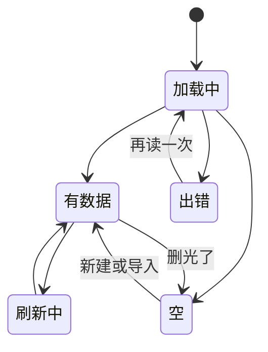

# 空态、错误态与文案

设计稿里的界面永远是「数据刚好、网络正常、用户操作正确」的样子。真实世界里，新用户打开时什么数据都没有，地铁里网络时断时续，用户会输错、会点错、会在操作一半时退出。这些「不完美」的状态，恰恰是用户对产品印象最深的时刻。本章讲每个界面都该考虑的几种状态，空态和错误态怎么设计，以及界面上的话该怎么写。

## 每个界面都有好几种状态

画一个列表页时，脑子里不应该只有「有数据」这一种样子。一个从服务端取数据的界面，至少有这几种状态：



| 状态 | 用户想知道什么 |
|---|---|
| 加载中 | 东西在来，大概长什么样 |
| 有数据 | 正常内容 |
| 空 | 为什么是空的，接下来做什么 |
| 出错 | 出了什么问题，我能做什么 |
| 部分数据 | 哪些有、哪些没有（比如分页加载到一半失败） |
| 离线 | 现在看到的是不是旧的，能不能操作 |

一个实用的习惯：**写组件时先把所有状态列出来，用一个联合类型强制自己处理每一种**：

```tsx
type Load<T> =
  | { status: "loading" }
  | { status: "error"; message: string; retry: () => void }
  | { status: "ready"; data: T };

function IngredientList({ state }: { state: Load<Ingredient[]> }) {
  switch (state.status) {
    case "loading":
      return <ListSkeleton rows={8} />;
    case "error":
      return <PaneError title="食材没读出来" error={state.message} onRetry={state.retry} />;
    case "ready":
      if (state.data.length === 0) {
        return <PaneEmpty icon={<Package />} title="还没有食材" desc="先建几样常用的，进货单识别时会自动对上" action={<Button>新建食材</Button>} />;
      }
      return <Table rows={state.data} />;
  }
}
```

TypeScript 会检查 `switch` 是否覆盖了所有分支（开启 `noImplicitReturns` 或在 `default` 里写 `never` 检查）。这样「忘了处理出错的情况」会变成编译错误，而不是线上的白屏。

`PaneEmpty`、`PaneError` 是掌柜眼的共享零件，下面会讲。

## 加载态

### 骨架屏还是转圈

| 方式 | 适合 | 原因 |
|---|---|---|
| 骨架屏 | 列表、卡片、详情页这类结构已知的内容 | 提前展示布局，内容到达时不跳，感觉更快 |
| 转圈 | 结构未知，或者只是一个按钮的等待 | 简单，不需要知道内容形状 |
| 进度条 | 上传、导入这类能算出进度的长操作 | 让用户知道还要等多久 |
| 什么都不显示 | 很快就能完成的操作 | 避免闪烁 |

最后一条容易被忽视。如果一个请求平时 80 毫秒返回，显示骨架屏反而会让界面「闪一下」。掌柜眼的骨架屏组件**晚 120 毫秒才显示**，网快的时候整个跳过。实现很简单：

```tsx
import { useEffect, useState } from "react";

export function Skeleton({ className }: { className?: string }) {
  const [show, setShow] = useState(false);
  useEffect(() => {
    const t = setTimeout(() => setShow(true), 120);
    return () => clearTimeout(t);
  }, []);
  return <div className={cn("bg-muted animate-pulse rounded-md", !show && "invisible", className)} />;
}
```

注意是 `invisible` 而不是不渲染：骨架即使看不见也要占住位置，否则 120 毫秒后它出现时又会让布局跳一下。

### 按钮的等待态

点了「保存」之后到服务端返回之间，按钮要进入等待态：禁用防止重复提交、显示正在进行。文字从「保存修改」变成「保存中…」时，给按钮一个最小宽度，不然宽度变化会让旁边的按钮移位。

## 空态

空态是**最被低估的界面**。它是新用户看到的第一屏，决定了用户会不会继续用下去。

### 三种空

空态不止一种，原因不同，该说的话也不同：

| 类型 | 场景 | 该做什么 |
|---|---|---|
| 首次使用 | 新用户，什么都还没有 | 说明这里会出现什么，给一个最直接的开始方式 |
| 没有结果 | 搜索、筛选后没匹配 | 说清是筛选造成的，给清除筛选的入口 |
| 已清空 | 用户把东西都处理完了（收件箱清零） | 给一点正向反馈，不需要引导 |

把这三种做成同一个「暂无数据」，是最常见的错误。用户搜了一个词没结果，看到「暂无数据」，会以为数据丢了。

### 首次使用的空态

好的首次使用空态有三个部分：

1. **说明这里是什么**：「这里会显示你导入的书」
2. **给一个行动**：一个主按钮，指向最直接的开始方式
3. **可以的话，直接给示例**：让用户不用自己准备数据就能看到产品的样子

hatch-shelf 的做法属于第三种：首次启动时把几本示例书放进书架（只放一次，删了不会再冒出来），用户一打开就有东西可读，第一屏不是空的。掌柜眼更进一步，门店概览在一笔销售都没有时，整页换成「头一次用」的引导页，而不是显示一堆零。

### 用一个组件统一空态

掌柜眼把空态和错误态做成了共享组件 `PaneEmpty` 和 `PaneError`，所有页面用同一套样子：

```tsx
<PaneEmpty
  icon={<Search />}
  title="没有符合条件的食材"
  desc="换个关键词，或者清除筛选看看全部"
  action={<Button variant="outline" onClick={clearFilters}>清除筛选</Button>}
/>
```

它的视觉处理也值得注意：图标放在一个淡灰色圆底里，用占位字的颜色，标题 14 号中等字重，说明 13 号次要色，最大宽度限制在一行能读完的长度。空态是「退后」的信息，不该比正常内容更抢眼。

## 错误态

### 一条好的报错要回答三个问题

1. **发生了什么**：用用户的话说，不是错误码
2. **为什么**（如果知道）：是网络问题、权限问题，还是输入有误
3. **现在能做什么**：重试、修改输入、联系谁

| 差的报错 | 好的报错 |
|---|---|
| Error 500 | 服务器出了点问题，刚才的修改没有保存。请稍后再试 |
| 操作失败 | 这张单子已经被别人撤销了，刷新后再看 |
| Invalid input | 单价要填数字，比如 12.5 |
| 网络错误 | 连不上服务器，检查一下网络。你填的内容还在 |
| 无权限 | 你没有「库存管理」的修改权限，请找店主在「员工管理 → 成员权限」里打开 |

最后一条来自掌柜眼的规则：指路要指到**具体的页名**，要连组一起写就写「组 → 页」。只写「请联系管理员」，用户不知道该找谁、该说什么。

### 报错文案写在哪

掌柜眼有一条很有意思的约定：**报错文案在服务端写**，那句中文原样穿过客户端给店主看，客户端不重写一遍。

理由是：只有服务端知道具体发生了什么（哪张单子、哪个字段、谁撤销的）。如果服务端只返回一个错误码，客户端只能写出「操作失败」这种泛泛的话；而如果每个客户端（网页、手机、后台）都各写一套，文案会不一致。

```ts
// 服务端
if (bill.revokedAt) {
  throw new ConflictException(`这张单子 ${fmtDate(bill.revokedAt)} 已经被 ${bill.revokedBy} 撤销了，刷新后再看`);
}
```

```tsx
// 客户端：原样显示
catch (e) {
  toast.error(e instanceof ApiError ? e.message : "连不上服务器，检查一下网络");
}
```

只有客户端自己才知道的错误（网络断开、本地校验）才由客户端写文案。

### 出错时保住用户的输入

用户填了一大张表单，提交时网络断了，表单被清空。这是最让人崩溃的体验之一。出错时**绝不能丢掉用户已经输入的内容**：

- 提交失败时保留表单的所有值
- 长表单考虑自动保存草稿
- 报错里明确说「你填的内容还在」，让用户放心

### 就近显示

错误显示在离问题最近的地方：

- 某个字段填错了：显示在那个字段下方，并把那个框标红
- 一块面板的数据读不出来：只在那块面板里显示错误，其他部分照常
- 整个页面都无法使用：才用整页的错误态

掌柜眼的 `PaneError` 就是「只在出错的那一栏里说」，底下一颗「再读一次」按钮。

## 文案

界面上的每一个字都是设计的一部分。按钮文字、标签、提示、空态说明，统称**界面文案**（UX writing / microcopy）。

### 按钮写清点了会怎样

按钮文字应该是一个**动词短语**，说清楚点击后会发生什么：

| 模糊 | 清楚 |
|---|---|
| 确定 | 删除 3 本书 |
| 提交 | 保存修改 |
| 完成 | 记下这笔 |
| 重试 | 再读一次 |
| 是 / 否 | 放弃修改 / 继续编辑 |

掌柜眼的规则写得很细：表单的主按钮说清点了会怎样，新建写「新建 X」或「保存 X」，改写「保存修改」，别只写一个结果词（「建好」「加进来」看不出这一下是不是在存）。读不出来那颗按钮一律写「再读一次」，不写「重试」。

确认对话框尤其如此。「确定要删除吗？[取消] [确定]」里，「确定」到底是确定删除还是确定取消？改成「[取消] [删除]」就没有歧义。

### 用用户的词

开发者最容易犯的错误是把系统内部的概念直接放到界面上：

| 系统的词 | 用户的词 |
|---|---|
| 同步冲突 | 这本书在手机上也改过，要保留哪一份 |
| 会话已过期 | 太久没操作，请重新登录 |
| 记录已软删除 | 已移到回收站，30 天内可以恢复 |
| 库存调整单 | 盘点 |

判断标准：**你的用户会不会在跟别人聊天时说这个词？** 店主不会说「我做了一张库存调整单」，他会说「我盘了一下」。

### 统一叫法

同一样东西在整个产品里只有一个名字，同一个动作只有一个动词。这一点在[第 1 章](01-interaction-principles.md)讲过，这里补充一个具体做法：**维护一张术语表**。

```markdown
| 用这个 | 不用这些 | 说明 |
|---|---|---|
| 新建 | 新增、添加、创建 | 建档类动作 |
| 分类 | 类别、小类、归类 | 三套分类都叫分类 |
| 未分类 | 其他、无分类 | 没分的那一桶 |
| 删除 | 移除、去掉 | 从单子里删一项也叫删除 |
```

把这张表放进给 agent 的规则文件里。agent 生成文案时会自然地变换用词（它觉得这样「更丰富」），术语表能阻止这种变化。

### 写法上的几条规则

- **说后果，不说操作**：「删除后，这本书的阅读进度也会一起清除」比「确定删除？」有用得多
- **不责备用户**：「单价要填数字」而不是「您输入了无效的单价」
- **简短**：能删的字都删掉。「请点击下方的按钮以开始导入您的书籍」→「导入第一本书」
- **数字具体**：「3 本书导入失败」比「部分书导入失败」好
- **中文排版**：中英文之间加空格，用全角标点，引号全产品统一一种（参见[第 2 章](02-typography.md)）
- **空格子用「—」**：掌柜眼表格里没有值的格子统一用「—」，不写「没改过」「还没记过」，因为文字和一列日期混在一起，扫的时候分不出哪行有值
- **占位字说清空着会怎样**：「不填就不算」「选填」，而不是重复标签

## 本章要点

- 每个界面至少有加载、有数据、空、出错几种状态；用联合类型强制处理每一种
- 快的操作不显示加载态（延迟约 120 毫秒）；骨架看不见时也要占住位置
- 空态分首次使用、没有结果、已清空三种，各说各的话；首次使用给行动或示例数据
- 报错回答三个问题：发生了什么、为什么、能做什么；指路指到具体页面
- 服务端知道细节，报错文案在服务端写，客户端原样显示
- 出错时保住用户输入；错误就近显示
- 按钮写**动词短语**，说清点了会怎样；确认框的按钮写具体动作
- 用用户的词，不用系统的词；维护术语表，交给 agent 照着用

## 接下来读什么

这本书讲的是「界面怎么做得好用、不难看」。文案这一章只讲了界面里的话，着陆页、产品介绍、内容营销的写法在《文案与内容》里展开。想把 Tailwind 4、Radix 和设计令牌在工程层面吃透，读《前端工程化与 Web 平台》；手机端的安全区、手势、动画和原生能力，在《React Native 与 Expo》里有更完整的讲解。如果还没想清楚界面背后该解决什么问题，回头读《产品思维》。
