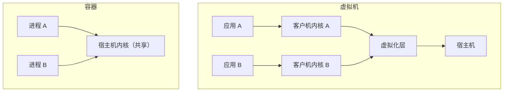
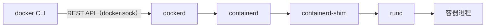

# 容器原理

## 关于这本书

这本书讲容器：它在 Linux 内核里到底是什么，镜像怎么分层，Dockerfile 怎么写才又快又小又安全，网络和存储卷怎么配，怎么用 Compose 把「一个 NestJS 服务 + 一个 Postgres」编排起来，镜像仓库怎么选，以及容器上线之后哪些地方最容易出安全问题。

适合这样的读者：会写 TypeScript 全栈，用过 `docker run` 和 `docker compose up`，但遇到「镜像为什么 1GB」「改一行代码为什么要重装全部依赖」「容器里连不上数据库」「端口到底该绑哪里」这类问题时，只能靠搜索和试错。读完之后，你应该能自己判断一份 Dockerfile 和 compose 文件写得对不对，并且知道每一行为什么这么写。

全书以作者自己的项目 hatch-counter 为主线案例：一个 NestJS + PostgreSQL + Drizzle 的门店管理服务端，pnpm monorepo，Node 22，跑在一台云服务器上，前面是宿主机上的 nginx。书里引用的 Dockerfile、compose 文件和部署脚本都取自这个项目（去掉了域名、仓库地址等敏感信息）。

怎么读：第 1–2 章讲原理，建议先读，后面所有「为什么」都建立在这里；第 3–4 章讲 Dockerfile，是动手最多的部分；第 5–6 章讲运行时的网络、存储和编排；第 7–8 章讲交付和安全。每章结尾有「本章要点」，复习时只看要点即可。

书中命令以 Linux 服务器上的 Docker Engine 和 Docker Compose v2（`docker compose`，不是旧的 `docker-compose`）为准。Docker 迭代很快，具体参数以你所用版本的官方文档为准。

## 容器不是轻量虚拟机

很多人第一次接触容器时听到的说法是「轻量级虚拟机」。这个比喻能帮你上手，但会在排障时误导你。两者的根本区别在于**有没有自己的内核**：



| 对比项 | 虚拟机 | 容器 |
|---|---|---|
| 内核 | 每台虚拟机一个 | 所有容器共享宿主机内核 |
| 启动 | 引导一个操作系统，通常几十秒 | 启动一个进程，通常不到一秒 |
| 隔离强度 | 强，靠硬件虚拟化 | 弱一些，靠内核功能 |
| 镜像内容 | 完整操作系统 | 应用和它依赖的用户态文件 |
| 在宿主机上看 | 一个虚拟机进程 | 就是普通进程，`ps` 能看到 |

最后一行最值得记住：**容器就是宿主机上的一个普通进程**，只不过内核给它戴了几副「眼罩」，让它看不到别的东西，又给它套了几条「缰绳」，限制它能用多少资源。在服务器上执行：

```bash
docker run -d --name demo nginx:alpine
ps -ef | grep "nginx: master"
```

你会在宿主机的进程列表里直接看到容器里的 nginx 主进程。它没有被包在任何「机器」里。

这带来几个直接后果：

- 容器里不能换内核，也不能加载和宿主机不兼容的内核模块
- 在 Mac 上跑 Docker，其实是 Docker Desktop 先起了一个 Linux 虚拟机，容器跑在那台虚拟机里。这也是 Mac 上 bind mount 比较慢、M 系列芯片默认构建出 arm64 镜像的原因（第 7 章会讲多架构）
- 容器的安全边界就是内核。内核有漏洞，或者你主动给容器开了特权，隔离就可能被突破（第 8 章）

那么「眼罩」和「缰绳」具体是什么？分别是 **namespace** 和 **cgroup**。再加上让镜像可以分层共享的**联合文件系统**，就构成了容器的三块基石。

## namespace：让进程看到一个独立的世界

namespace（命名空间）是 Linux 内核的隔离机制：把某一类全局资源包装一下，让一组进程以为自己独占这类资源。主要有这几种：

| namespace | 隔离的东西 | 容器里的效果 |
|---|---|---|
| PID | 进程号 | 容器里的第一个进程 PID 是 1，看不到宿主机的进程 |
| NET | 网卡、IP、路由、端口 | 容器有自己的 `eth0` 和 `localhost`，可以各自监听 3000 端口而不冲突 |
| MNT | 挂载点 | 容器看到的根目录是镜像内容，不是宿主机的 `/` |
| UTS | 主机名 | 容器有自己的 hostname |
| IPC | 共享内存、信号量 | 容器之间不能通过共享内存通信 |
| USER | 用户和组 ID | 容器里的 root 可以映射成宿主机上的普通用户（需要开启） |
| CGROUP | cgroup 视图 | 容器只看到自己那部分 cgroup 树 |

可以用 `unshare` 亲手体验一下 namespace，不需要 Docker：

```bash
# 在一个新的 PID 和 mount namespace 里起一个 shell
sudo unshare --pid --fork --mount-proc bash
ps -ef     # 只能看到 bash 和 ps 自己，bash 的 PID 是 1
exit
```

这就是容器最原始的样子。Docker 做的事情，本质上是帮你一次性创建好这一整套 namespace，再把镜像挂成根目录。

### 两个和日常开发直接相关的推论

**容器里的 `localhost` 是容器自己。** 因为 NET namespace 隔离了网络，NestJS 容器里连 `localhost:5432` 连的是它自己，不是宿主机，也不是旁边的 Postgres 容器。要连旁边的容器，得用 Compose 提供的服务名（第 5 章）。这是新手最常踩的坑。

**容器里的 PID 1 很特殊。** Linux 里 PID 1 是 init 进程，内核对它有特殊待遇：它不会被默认的信号处理杀掉，还要负责回收僵尸子进程。如果你的 `CMD` 是 `node dist/main.js`，Node 就成了 PID 1。Node 本身不会帮你回收孙进程，`SIGTERM` 也需要应用自己监听。第 3 章会讲怎么处理。

## cgroup：限制进程能用多少资源

namespace 管「看得见什么」，cgroup（control group）管「能用多少」：CPU、内存、磁盘 IO、进程数。现在主流发行版都用 cgroup v2，它把资源控制组织成一棵树，每个容器是树上的一个节点。

```bash
# 最多 1 个 CPU、512MB 内存、200 个进程
docker run -d --name api \
  --cpus 1 --memory 512m --pids-limit 200 \
  my-api:1.0.0

docker stats api   # 实时看 CPU、内存占用
```

内存限制对 Node 服务尤其要注意：

- 容器超过内存上限时，内核的 OOM killer 会直接杀掉进程，`docker inspect` 里能看到 `OOMKilled: true`，应用日志里什么都没有
- 新版 Node 会读取 cgroup 的内存上限来决定 V8 堆的默认大小，但具体行为随 Node 版本变化。稳妥的做法是显式设置 `NODE_OPTIONS=--max-old-space-size=...`，留出堆外内存（Buffer、原生模块、线程栈）的余量，比如容器限制 512MB 时把堆设到 384MB 左右

不设限制时，容器可以吃满整台机器。单机上跑 Postgres 和服务端时，一个内存泄漏的服务端就能把数据库拖进 swap 甚至被 OOM 杀掉。给服务端设上限，相当于给数据库留了一条命。

## 联合文件系统：镜像为什么能分层共享

第三块基石是文件系统。如果每个容器都复制一份完整的根文件系统，十个基于 `node:22-alpine` 的容器就要占十份磁盘，启动时还要拷贝，既慢又浪费。

联合文件系统（union filesystem）的做法是：把若干个**只读层**叠在一起，最上面再加一个**可写层**，对外呈现为一个完整的目录树。Docker 在 Linux 上默认使用的是 overlay2 存储驱动（基于内核的 OverlayFS）。

- **读文件**：从上往下找，第一个找到的就是
- **改文件**：先把文件从下面的只读层复制到可写层再改，叫**写时复制**（copy-on-write）
- **删文件**：在可写层放一个「白障」（whiteout）标记把它遮住，下层的文件其实还在

这个机制解释了很多现象：

- 同一个镜像起多少个容器，只读层在磁盘上只有一份
- 容器启动快，因为不用拷贝文件，只需新建一个空的可写层
- 在 Dockerfile 后面的步骤里 `rm` 掉前面步骤加的大文件，**镜像并不会变小**，因为文件还在下层
- 容器删掉，可写层就没了。数据库数据写在可写层，`docker rm` 一下就全没了，这就是为什么必须用卷（第 5 章）

下一章会把分层展开讲。

## Docker 由哪些部分组成

平时敲的 `docker` 只是一个客户端。完整的调用链是这样的：



| 组件 | 职责 |
|---|---|
| docker CLI | 解析命令，调用 dockerd 的 API |
| dockerd | Docker 守护进程，管镜像构建、网络、卷，对外提供 API |
| containerd | 容器运行时管理，负责拉镜像、管理容器生命周期 |
| runc | 真正调用内核创建 namespace、cgroup 并启动进程的底层工具 |

这些组件遵循 OCI（Open Container Initiative）标准：镜像格式和运行时规范都是公开的。所以 Docker 构建的镜像，可以被 Podman、containerd、Kubernetes 直接使用，反过来也一样。

还有一个安全上的要点先记下：dockerd 默认以 root 运行，谁能访问 `/var/run/docker.sock`，谁就等于拥有宿主机 root 权限。把用户加进 `docker` 组、把 docker.sock 挂进容器，都要意识到这一点（第 8 章）。

## 容器适合什么，不适合什么

对一个人维护的项目，容器的价值主要在三件事：

1. **环境一致**：本机、CI、服务器跑的是同一个镜像，「我这里能跑」的问题大大减少
2. **交付简单**：发版就是换一个镜像 tag，回滚就是换回上一个 tag
3. **依赖隔离**：Postgres、Redis 这类依赖一行配置就能起，不污染宿主机

但也不是什么都该放进容器。hatch-counter 的选择很有代表性：

| 组件 | 放在哪 | 原因 |
|---|---|---|
| NestJS 服务端 | 容器 | 频繁发版，需要可回滚 |
| PostgreSQL | 容器 + 命名卷 | 单机阶段图省事，以后迁到托管数据库 |
| nginx | 宿主机 | 证书续期由 certbot 管理，放进容器要自己拼续期和重载 |
| 开发时的服务端 | 不放容器 | 本机 `tsc --watch` + `node --watch` 热更新，放进容器反而慢 |

它的开发用 compose 文件里只有一个 Postgres，注释写得很直白：服务端塞进容器「反而断了热更」。容器是工具，不是信仰。

## 本章要点

- 容器不是虚拟机：所有容器**共享宿主机内核**，在宿主机上看就是普通进程
- **namespace** 负责隔离（看得见什么），**cgroup** 负责限制（能用多少），**联合文件系统**负责镜像分层共享
- 容器里的 `localhost` 是容器自己；连其他容器要用服务名
- 容器里的主进程是 PID 1，信号处理和僵尸进程回收需要专门处理
- Node 服务要设内存上限，并显式控制 V8 堆大小，否则可能被 OOM 静默杀掉
- 写在容器可写层的数据随容器删除而消失，持久数据必须用卷
- 能访问 docker.sock 就等于有宿主机 root 权限
