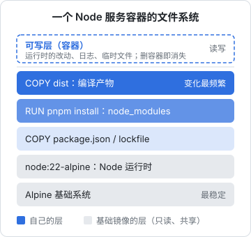
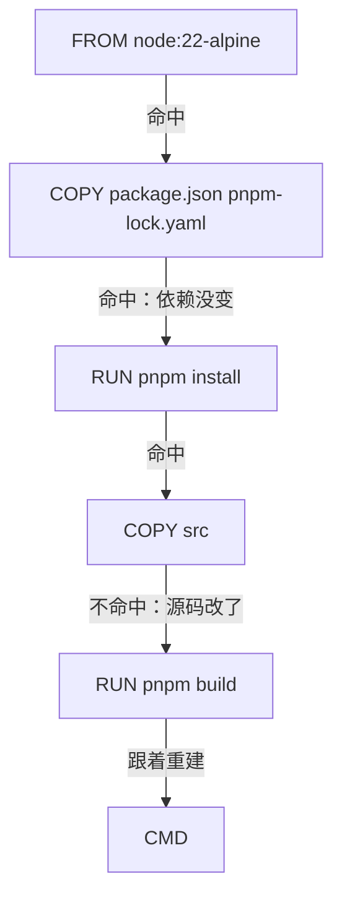

# 镜像与分层

上一章说容器的根文件系统是由若干只读层叠起来的。这一章把「镜像」拆开看：一个镜像由哪些东西组成，层是怎么产生的，构建缓存怎么复用，tag 和 digest 有什么区别。搞懂这些，下一章写 Dockerfile 时你就知道每一行指令的代价。

## 镜像由什么组成

一个镜像不是一个大文件，而是几样东西的组合：

| 组成部分 | 内容 | 类比 |
|---|---|---|
| 层（layers） | 若干个文件系统变更包，每个是一个 tar 压缩包 | 一叠透明胶片 |
| 配置（config） | 环境变量、工作目录、默认命令、暴露端口、用户、层的顺序 | 胶片的说明书 |
| 清单（manifest） | 列出 config 和每一层的摘要（sha256） | 装箱单 |
| 索引（index） | 多架构镜像才有：每个平台（amd64 / arm64）对应哪个 manifest | 装箱单的目录 |

层和 config 都以内容的 sha256 作为地址，叫**内容寻址**（content-addressable）。内容相同，摘要就相同，于是：

- 两个镜像如果基于同一个 `node:22-alpine`，底下那几层在本机和仓库里都只存一份
- 拉镜像时，本地已经有的层直接跳过，只下载缺的
- 推镜像时同理，只上传仓库里没有的层

用下面的命令可以看到一个镜像的层：

```bash
docker image history node:22-alpine
docker image inspect node:22-alpine --format '{{json .RootFS.Layers}}'
```

`history` 的每一行对应 Dockerfile 里的一条指令。大小为 0 的行是只改了 config 的指令（`ENV`、`WORKDIR`、`CMD` 等），不产生文件层。

## 哪些指令产生层

| 指令 | 产生文件层 | 说明 |
|---|---|---|
| `FROM` | 继承基础镜像的所有层 | 起点 |
| `RUN` | 是 | 执行命令后的文件系统变化 |
| `COPY` / `ADD` | 是 | 拷进来的文件 |
| `ENV` / `ARG` / `WORKDIR` / `USER` / `EXPOSE` / `CMD` / `ENTRYPOINT` / `LABEL` / `HEALTHCHECK` | 否 | 只写进 config |

一个基于 Node 的服务镜像，叠起来大概是这样：



几个关键事实：

- **层只能叠加，不能修改下层。** `RUN rm` 删除前面层里的文件，只是在新层里放一个白障标记，下层的字节仍然在镜像里，镜像不会变小
- **一个 `RUN` 里创建又删除的文件不会留在镜像里。** 所以下载、解压、清理要写在同一个 `RUN` 里
- **层的顺序有意义。** 后面的层依赖前面的层，前面一层变了，后面所有层都要重建

最后一点就是构建缓存的规则。

## 构建缓存：从第一个变化开始全部重来

构建镜像时，BuildKit（Docker 现在默认的构建引擎）会对每条指令判断能不能复用上一次的结果：

- `RUN`：指令字符串一样，且上一层命中缓存，就复用
- `COPY` / `ADD`：除了指令本身，还要比较拷进来的文件内容（校验和），文件变了就不命中
- 某一步一旦不命中，**它后面的所有步骤都不再使用缓存**



这张图展示了正确的顺序：**变化少的放前面，变化多的放后面**。依赖清单（package.json、lockfile）一个月改几次，源码一天改几十次，所以先拷清单、装依赖，再拷源码、编译。改源码时，最耗时的 `pnpm install` 那一层原样复用。

反过来写，一上来就 `COPY . .`，那么任何一个文件的变化（哪怕只是 README）都会让 `pnpm install` 重跑一遍。这是 Dockerfile 里最常见、代价最大的错误，下一章会给出完整写法。

### 怎么确认缓存有没有命中

构建输出里命中缓存的步骤会标 `CACHED`：

```text
 => CACHED [deps 4/6] COPY pnpm-workspace.yaml pnpm-lock.yaml package.json .npmrc ./
 => CACHED [deps 5/6] COPY packages/core/package.json packages/core/
 => CACHED [deps 6/6] RUN pnpm install --frozen-lockfile --filter @counter/api...
 => [build 1/3] COPY packages/core packages/core
```

想强制全部重建，用 `docker build --no-cache`；只想重新拉基础镜像，用 `--pull`。

### CI 里的缓存

本机构建的缓存存在本机。CI 每次都是全新的机器，默认没有缓存。hatch-counter 的发布流水线用 GitHub Actions 的缓存后端把层缓存存起来，下次构建时取回：

```yaml
- uses: docker/build-push-action@v6
  with:
    context: .
    file: apps/api/Dockerfile
    push: true
    tags: ${{ steps.meta.outputs.tags }}
    # 缓存 pnpm install 那一层：改的基本都是 apps/api 的源码，依赖层能原样命中
    cache-from: type=gha
    cache-to: type=gha,mode=max
```

`mode=max` 会把多阶段构建中间阶段的层也缓存下来，否则只缓存最终镜像的层，而依赖安装恰恰在中间阶段。

## 构建上下文

`docker build` 的最后一个参数（通常是 `.`）叫**构建上下文**。构建开始前，这个目录下的文件会被发给构建引擎，`COPY` 只能拷上下文里的文件。

上下文有两个问题：

1. **太大会慢**：`node_modules`、`.git`、构建产物都发过去，白白浪费时间
2. **会泄露**：`.env`、本地密钥如果在上下文里，一句 `COPY . .` 就会把它们烤进镜像

解决办法是 `.dockerignore`，语法和 `.gitignore` 类似。它必须放在**上下文根目录**，不是 Dockerfile 所在目录。hatch-counter 的 Dockerfile 在 `apps/api/` 下，但上下文是仓库根，所以 `.dockerignore` 放在仓库根：

```text
# 依赖和产物在镜像里现装现编，宿主机那份带进去等于把 macOS 的符号链接和二进制带进 alpine
**/node_modules
**/dist

# 密钥和本机数据
**/.env*
!**/.env.example

# 服务端用不到的 app，纯属拖慢上下文
apps/web
apps/admin
apps/mobile
# 但移动端的版本号文件服务端要读
!apps/mobile/package.json

.git
.github
docs
**/*.log
**/.DS_Store
```

这份文件的注释里有一句很重要的话：CI 是干净 checkout，碰不到 `.env`，但本机构建可以；「镜像不该分谁构建的两种安全性」。`.dockerignore` 是防线，不是优化。

## tag 和 digest

镜像的完整名字是这样的：

以 `ghcr.io/owner/api:1.4.0` 为例：

| 部分 | 值 | 省略时 |
|---|---|---|
| 仓库地址（registry） | `ghcr.io` | 默认 Docker Hub |
| 路径（repository） | `owner/api` | Docker Hub 官方镜像省略为 `library/` |
| tag | `1.4.0` | 默认 `latest` |

**tag 是可变的指针**，**digest 是不可变的内容地址**：

| | tag | digest |
|---|---|---|
| 形式 | `node:22-alpine` | `node@sha256:...`（64 位十六进制） |
| 是否可变 | 可以被重新推送覆盖 | 内容不变它就不变 |
| 用途 | 人读、日常引用 | 锁定确切内容、审计、可重复部署 |

`node:22-alpine` 今天和下个月指向的很可能不是同一个镜像：官方会持续推送安全更新和 Node 的小版本。这是好事（自动拿到补丁），也是坏事（构建结果不完全可复现）。

常见的折中：

- **基础镜像**：写到主版本和发行版，如 `node:22-alpine`、`postgres:16-alpine`。要更严格就写完整小版本，或者用 digest 锁定，再用 Renovate / Dependabot 这类工具自动提更新 PR
- **自己的镜像**：每次发版打一个**不会被覆盖**的版本号 tag（如 `1.4.0`），部署时引用版本号，不引用 `latest`

hatch-counter 的部署就是这样：compose 文件里写的是 `api:${API_TAG}`，部署脚本把 `.env` 里的 `API_TAG` 改成要发的版本号再 `up`。回滚就是把它改回上一个版本号。如果部署引用的是 `latest`，你就说不清线上跑的到底是哪一版，回滚也无从下手。

### 查看 digest

```bash
docker image inspect --format '{{index .RepoDigests 0}}' node:22-alpine
docker buildx imagetools inspect node:22-alpine   # 看多架构索引里每个平台的 manifest
```

## 基础镜像怎么选

Node 官方镜像有几种变体：

| 变体 | 基于 | 特点 |
|---|---|---|
| `node:22` | Debian 完整版 | 自带编译工具链，体积最大 |
| `node:22-slim` | Debian 精简版 | 基于 glibc，兼容性最好，体积中等 |
| `node:22-alpine` | Alpine Linux | 基于 musl libc，体积最小 |
| distroless（如 Google 的 nodejs 镜像） | Debian 极简 | 没有 shell 和包管理器，攻击面最小 |

选择时主要考虑原生模块：

- **alpine 用的是 musl 而不是 glibc。** 纯 JS 依赖没区别；带原生二进制的依赖（`sharp`、`better-sqlite3`、`bcrypt`、Prisma 引擎等）需要有 musl 版本的预编译包，否则要现场编译甚至跑不起来。遇到奇怪的 `Error loading shared library`，先怀疑这个
- **slim 是最稳的默认选择**：体积比 alpine 大一些，但几乎不会遇到兼容性问题
- **distroless 适合当最终运行阶段**：没有 shell 意味着出了问题不能 `docker exec` 进去排查，需要配合调试镜像或日志

hatch-counter 用 alpine，因为服务端依赖里没有需要原生编译的包；它在 Dockerfile 里特意只装服务端那几个包的依赖，把桌面端的 `better-sqlite3` 挡在外面（第 4 章展开）。

## 本章要点

- 镜像由**层 + config + manifest**（多架构还有 index）组成，全部按 sha256 内容寻址，相同的层只存一份
- `RUN`、`COPY`、`ADD` 产生文件层，其他指令只改 config
- 层只能叠加：后面的层删除文件不会让镜像变小；创建和清理要写在同一个 `RUN` 里
- 构建缓存从第一个不命中的步骤开始全部失效，所以**变化少的放前面**：先拷依赖清单装依赖，再拷源码
- `.dockerignore` 放在构建上下文根目录，既提速又防止 `.env` 被烤进镜像
- tag 可变、digest 不可变；部署引用不可覆盖的版本号 tag，不用 `latest`
- alpine 用 musl，原生模块可能有兼容问题；拿不准时用 slim

## 动手练习

1. **后面的 rm 不会让镜像变小**：分别构建两个镜像，再比较大小：

   ```bash
   docker build -t layers-a - <<'EOF'
   FROM alpine:3.20
   RUN head -c 50000000 /dev/urandom > /big
   RUN rm /big
   EOF
   docker build -t layers-b - <<'EOF'
   FROM alpine:3.20
   RUN head -c 50000000 /dev/urandom > /big && rm /big
   EOF
   docker image ls 'layers-*'
   ```

   验证：`layers-a` 比 `layers-b` 大约 50MB；`docker history layers-a` 里有一层 `50MB` 左右，紧跟着一层 `0B` 的 `rm`。

   参考答案：每个 `RUN` 是一层，删除只是在上层加白障，下层的字节还在。创建和清理写在同一个 `RUN` 里，临时文件才不会留在镜像里。

2. **缓存从第一个变化开始失效**：建一个目录，放 `package.json`（`{"dependencies":{"ms":"2.1.3"}}`）和 `index.js`（`console.log(require('ms')(60000))`）。Dockerfile 先写成 `FROM node:22-alpine`、`WORKDIR /app`、`COPY . .`、`RUN npm install`、`CMD ["node","index.js"]`，构建一次；改一下 `index.js` 的内容，用 `docker build --progress=plain -t cache-demo .` 再构建，看 `npm install` 那一步。然后把 Dockerfile 改成先 `COPY package.json ./`、`RUN npm install`，再 `COPY . .`，重复一遍。

   验证：第一种写法改了 `index.js` 后 `npm install` 重新执行；第二种写法同一步标着 `CACHED`。`docker run --rm cache-demo` 输出 `1m`。

   参考答案：`COPY` 会比较拷进来的文件内容，`COPY . .` 里任何文件变了这一层就失效，它后面的 `npm install` 跟着重跑。先拷依赖清单装依赖，源码变化就碰不到这一层。

3. **.dockerignore 是防线**：在上题目录里建一个 `.env`（内容 `SECRET=abc`），构建后执行 `docker run --rm cache-demo cat /app/.env`；再建一个 `.dockerignore`，写上 `.env` 和 `node_modules`，重新构建并重试。

   验证：第一次打印 `SECRET=abc`；加了 `.dockerignore` 后报 `No such file or directory`。

   参考答案：`COPY . .` 拷的是整个构建上下文，`.env` 就这样被烤进了镜像，任何能拉到镜像的人都能读到。`.dockerignore` 要放在构建上下文的根目录。
