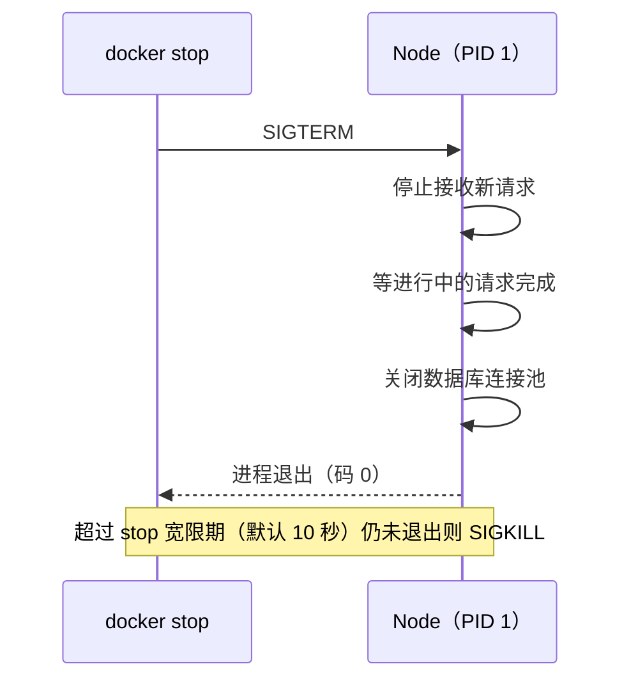

# Dockerfile 最佳实践

前两章讲了容器和镜像的原理。这一章落到具体的 Dockerfile：每条常用指令的正确用法、几个容易踩的语义坑、Node 服务特有的注意事项（信号、PID 1、健康检查）。下一章再在这个基础上讲多阶段构建和 pnpm monorepo。

## 从一个「能跑但很糟」的版本开始

很多教程给的第一个 Node Dockerfile 长这样：

```dockerfile
FROM node
COPY . .
RUN npm install
RUN npm run build
CMD npm start
```

它能跑，但几乎每一行都有问题：

| 行 | 问题 |
|---|---|
| `FROM node` | 没写版本，等于 `node:latest`，哪天 Node 大版本升级，构建就可能坏 |
| `COPY . .` | 任何文件变化都让后面的依赖安装重跑；没有 `.dockerignore` 时还会拷进 `node_modules` 和 `.env` |
| `RUN npm install` | 不按 lockfile 锁版本安装；开发依赖也装进了最终镜像 |
| `CMD npm start` | shell 形式加 npm 包装，`SIGTERM` 传不到 Node，容器停止要等超时被强杀 |
| 整体 | 没有 `WORKDIR`，文件散落在根目录；以 root 运行；没有健康检查 |

下面逐条改好。

## 一份合格的单阶段 Dockerfile

先给出结果，再解释每一部分。这是一个普通（非 monorepo）NestJS 项目的写法：

```dockerfile
# syntax=docker/dockerfile:1
FROM node:22-slim

WORKDIR /app

# Node 22 自带 corepack，按 package.json 的 packageManager 字段激活对应版本的 pnpm
RUN corepack enable

# 1. 只拷依赖清单，装依赖（这一层很少变）
COPY package.json pnpm-lock.yaml ./
# 编译要用 devDependencies，所以这里还不能设 NODE_ENV=production
RUN pnpm install --frozen-lockfile

# 2. 拷源码、编译（这一层经常变）
COPY tsconfig*.json nest-cli.json ./
COPY src ./src
RUN pnpm build && pnpm prune --prod

ENV NODE_ENV=production

# 3. 以非 root 用户运行
USER node
EXPOSE 3000

HEALTHCHECK --interval=30s --timeout=5s --start-period=20s --retries=3 \
  CMD node -e "fetch('http://127.0.0.1:3000/health') \
    .then(r=>process.exit(r.ok?0:1)) \
    .catch(()=>process.exit(1))"

CMD ["node", "dist/main.js"]
```

这一版已经比原来好很多，但编译工具和源码仍然留在镜像里。下一章用多阶段构建把它们去掉。

## 逐条指令的要点

### FROM：写死到主版本

```dockerfile
FROM node:22-slim
```

至少写到 Node 主版本和发行版变体。不写版本是在赌，写到 `node:22` 也意味着 Debian 版本可能在某次更新时变化。需要完全可复现时用 digest 锁定（上一章）。

开头那行 `# syntax=docker/dockerfile:1` 告诉 BuildKit 使用最新的 1.x 版 Dockerfile 语法前端，这样 `RUN --mount` 这类较新的特性在各种 Docker 版本上都可用。

### WORKDIR：别用 cd

```dockerfile
WORKDIR /app
```

`WORKDIR` 设置后续指令和容器运行时的工作目录，目录不存在会自动创建。不要在 `RUN` 里写 `cd`：每个 `RUN` 都是独立的 shell，`cd` 的效果不会带到下一条。

### COPY 而不是 ADD

`ADD` 能自动解压 tar、能从 URL 下载，这些「魔法」反而让人看不清它做了什么。拷本地文件一律用 `COPY`。

`COPY` 的几个细节：

- `COPY src ./src` 拷的是目录的**内容**到 `./src`，目标路径以 `/` 结尾或已存在时当作目录
- `COPY --chown=node:node` 可以在拷贝时直接改属主，避免后面再 `RUN chown -R`（那会把整个目录复制一份到新层，镜像翻倍）
- `COPY --from=<阶段>` 从其他构建阶段拷文件，下一章的主角

### RUN：合并、清理、加缓存挂载

装系统包要在**同一个** `RUN` 里更新索引、安装、清理缓存：

```dockerfile
RUN apt-get update \
 && apt-get install -y --no-install-recommends ca-certificates tini \
 && rm -rf /var/lib/apt/lists/*
```

拆成三个 `RUN` 的话，`apt-get update` 那层会被缓存，过一段时间再加包时用的是过期的索引；`rm` 写在后面的层里也不会让镜像变小。

alpine 上对应的写法是 `apk add --no-cache ...`，它不在镜像里留索引。

BuildKit 的**缓存挂载**能让包管理器的下载缓存在多次构建之间复用，又不进入镜像：

```dockerfile
ENV PNPM_HOME=/pnpm
RUN --mount=type=cache,id=pnpm,target=/pnpm/store \
    pnpm install --frozen-lockfile --store-dir /pnpm/store
```

依赖清单变了、这一层不得不重跑时，大部分包也不用重新下载。注意缓存挂载只在本机或配了缓存后端的构建器上有效，CI 的全新机器上它是空的。

### ENV 和 ARG

| | `ARG` | `ENV` |
|---|---|---|
| 生效时间 | 只在构建时 | 构建时和运行时 |
| 是否写进镜像 | 不写进 config，但会出现在构建历史里 | 写进 config，`docker inspect` 可见 |
| 典型用途 | 版本号、构建开关 | `NODE_ENV`、`PORT` |

**两者都不能放密钥。** `ENV` 直接可见；`ARG` 的值可能出现在 `docker history` 和构建缓存里。构建时需要密钥（比如私有 npm 源的 token），用密钥挂载：

```dockerfile
RUN --mount=type=secret,id=npmrc,target=/root/.npmrc \
    pnpm install --frozen-lockfile
```

```bash
docker build --secret id=npmrc,src=$HOME/.npmrc -t my-api .
```

密钥文件只在这条 `RUN` 执行期间挂载，不会留在任何层里。运行时的密钥（数据库密码、JWT 密钥）则通过环境变量文件或 Compose secrets 在**运行时**注入，永远不要进镜像（第 6、8 章）。

### USER：不要用 root 跑

官方 Node 镜像里自带一个 `node` 用户（UID 1000）。在 `CMD` 之前切过去：

```dockerfile
USER node
```

以 root 运行时，应用一旦被攻破，攻击者在容器里就是 root，离逃逸到宿主机更近一步。切成 `node` 后要注意：应用需要写的目录（上传文件的临时目录等）要提前 `chown` 给它，或者用 `COPY --chown`。

### EXPOSE：只是文档

`EXPOSE 3000` 不会打开任何端口，它只是在镜像 config 里记录「这个服务监听 3000」。真正对外暴露靠 `docker run -p` 或 compose 的 `ports`（第 5 章）。

## CMD 与 ENTRYPOINT：exec 形式和信号

### 两种写法

```dockerfile
CMD ["node", "dist/main.js"]   # exec 形式：直接执行 node
CMD node dist/main.js          # shell 形式：实际执行 /bin/sh -c "node dist/main.js"
```

shell 形式下，PID 1 是 `/bin/sh`，Node 是它的子进程。`docker stop` 发出的 `SIGTERM` 送到 sh，sh 默认不会转发给子进程。结果是 Node 收不到退出信号，Docker 等满默认的 10 秒超时后发 `SIGKILL` 强杀：正在处理的请求被腰斩，数据库连接没有正常关闭。

`CMD ["npm", "start"]` 同样有问题：npm 作为中间层，信号转发行为在不同版本里不可靠，而且多起一个进程。**最终运行阶段直接 exec 执行 node。**

### 优雅退出

收到信号之后，应用自己要做正确的事。NestJS 需要显式开启关闭钩子：

```ts
// main.ts
const app = await NestFactory.create(AppModule);
app.enableShutdownHooks(); // 收到 SIGTERM 时触发 onModuleDestroy / beforeApplicationShutdown
await app.listen(process.env.PORT ?? 3000);
```

开启后，Nest 会在收到 `SIGTERM` 时停止接收新连接、执行各模块的清理逻辑（比如关闭数据库连接池），然后退出。



### PID 1 与 init

第 1 章提到 PID 1 还要负责回收僵尸进程。如果你的服务会 spawn 子进程（调用 ffmpeg、跑 shell 脚本），子进程的子进程结束后无人回收，就会变成僵尸。解决办法是让一个极小的 init 进程当 PID 1：

```bash
docker run --init my-api          # Docker 内置的 tini
```

```yaml
# compose 里
services:
  api:
    init: true
```

也可以在镜像里装 `tini` 并写成 `ENTRYPOINT ["/usr/bin/tini", "--"]`（Debian 上的路径，alpine 上是 `/sbin/tini`）。tini 会把信号转发给子进程，并回收僵尸。只跑一个纯 Node 进程、不派生子进程的服务，不加也可以，但加上几乎没有成本。

### ENTRYPOINT 什么时候用

`ENTRYPOINT` 定义「这个镜像是什么命令」，`CMD` 提供默认参数，两者会拼起来。适合把镜像当作一个命令行工具：

```dockerfile
ENTRYPOINT ["node", "dist/cli.js"]
CMD ["--help"]
```

`docker run my-cli migrate` 就会执行 `node dist/cli.js migrate`。对普通 Web 服务，只用 `CMD` 更直观，`docker compose run api <别的命令>` 时也好覆盖。hatch-counter 的部署脚本就是这样，用同一个镜像跑迁移：

```bash
docker compose run --rm api ./node_modules/.bin/tsx src/db/migrate-cli.ts
```

## HEALTHCHECK：探活要探真的

`HEALTHCHECK` 让 Docker 定期检查容器是否健康，状态会显示在 `docker ps` 里，Compose 的 `depends_on: condition: service_healthy` 和 `up --wait` 都依赖它。

hatch-counter 的写法值得逐句看：

```dockerfile
# 探活打 /v1/health，它真去 select 一下：这个服务端口一开就通，而它干的每件事
# 都要数据库——只看端口的话，一个连不上库的实例会被当成健康的。
# 用 node 自己发请求是因为 alpine 里没有 curl，为这一句装一个不值。
# start-period 给 20 秒：Nest 起来要建连接、装模块，这段时间失败不算数
HEALTHCHECK --interval=30s --timeout=5s --start-period=20s --retries=3 CMD \
  node -e "fetch('http://127.0.0.1:'+(process.env.PORT||3000)+'/v1/health') \
    .then(r=>process.exit(r.ok?0:1)) \
    .catch(()=>process.exit(1))"
```

三个设计点：

1. **健康接口要检查真正的依赖。** 端口能连只说明进程活着，不说明能干活。对应的 `/v1/health` 会执行一次 `select 1`
2. **不为探活装 curl。** Node 18 起内置 `fetch`，用 `node -e` 发请求即可，镜像里少一个二进制
3. **`start-period` 给启动留时间。** 这段时间内失败不计入重试次数

| 参数 | 含义 |
|---|---|
| `--interval` | 两次检查的间隔 |
| `--timeout` | 单次检查超时 |
| `--start-period` | 启动宽限期，期间失败不算数 |
| `--retries` | 连续失败几次判为 unhealthy |

注意：单独的 Docker 不会因为 unhealthy 自动重启容器，`restart` 策略只看进程是否退出。健康状态主要给编排工具和部署脚本用。

## 编码 agent 写 Dockerfile 时的检查清单

让 Claude Code 生成或修改 Dockerfile 后，可以照这张表过一遍：

| 检查项 | 正确的样子 |
|---|---|
| 基础镜像 | 写明主版本和变体 |
| 依赖层 | 先拷 lockfile 再装依赖，用 `--frozen-lockfile` |
| `.dockerignore` | 在上下文根目录，排除 `node_modules`、`.env*`、`.git` |
| 密钥 | 不出现在 `ENV` / `ARG` / `COPY` 里 |
| 用户 | 最终阶段有 `USER` |
| 启动命令 | exec 形式，直接 `node`，不经 npm |
| 优雅退出 | 应用监听 `SIGTERM`（Nest 开 `enableShutdownHooks`） |
| 健康检查 | 探的是会访问真实依赖的接口 |

## 本章要点

- 指令顺序决定缓存：**先清单后源码**，任何 `COPY . .` 都要警惕
- 拷本地文件用 `COPY`，改属主用 `COPY --chown`，不要事后 `chown -R`
- 装系统包在一个 `RUN` 里完成更新、安装、清理；用缓存挂载加速依赖下载
- `ENV` 和 `ARG` 都不能放密钥；构建期密钥用 `--mount=type=secret`，运行期密钥运行时注入
- 用 `USER node` 以非 root 运行
- `CMD` 用 exec 形式直接执行 node，否则 `SIGTERM` 传不到应用；NestJS 要开 `enableShutdownHooks`
- 会派生子进程的服务加 `init: true`（tini）回收僵尸
- `HEALTHCHECK` 要探真正依赖数据库的接口，不只是端口
