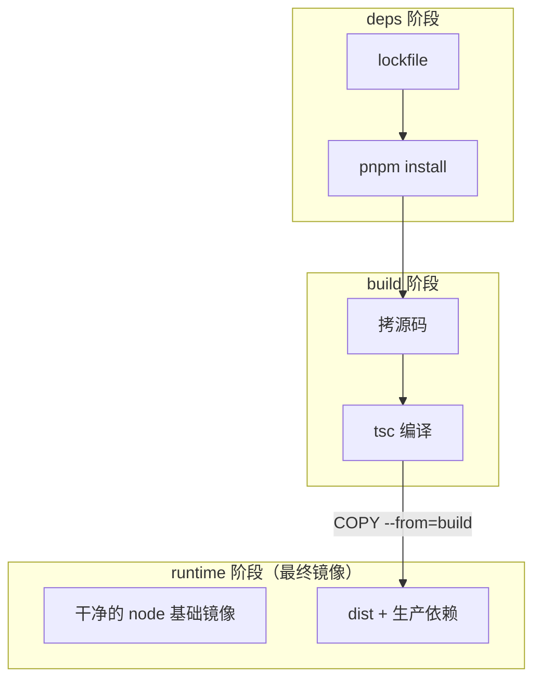

# 多阶段构建与瘦身

上一章的单阶段 Dockerfile 有个绕不开的矛盾：编译需要 TypeScript、Nest CLI 和一堆开发依赖，运行只需要 `dist/` 和生产依赖。单阶段里两者只能挤在同一个镜像中。多阶段构建（multi-stage build）把「构建环境」和「运行环境」拆开：前面的阶段负责编译，最后一个阶段只拷走需要的产物。本章先讲原理，再用 hatch-counter 的真实 Dockerfile 讲 pnpm monorepo 的写法，最后讲怎么量化和继续瘦身。

## 多阶段构建的原理

一个 Dockerfile 里可以有多个 `FROM`，每个 `FROM` 开启一个新阶段，可以用 `AS` 起名。后面的阶段用 `COPY --from=<名字>` 从前面的阶段拷文件。**最终镜像只包含最后一个阶段的层**，前面阶段的一切（源码、编译器、缓存）都不会进去。



除了瘦身，多阶段还有两个好处：

- **并行**：BuildKit 会分析阶段之间的依赖，互不依赖的阶段并行构建
- **按需构建**：`docker build --target build` 只构建到某个阶段，适合在 CI 里单独跑测试阶段

## pnpm monorepo 的特殊难题

普通单包项目的多阶段很直接。pnpm monorepo 难在两点：

1. **workspace 依赖。** 服务端 `apps/api` 通过 `workspace:*` 依赖共享包 `packages/core`。只把 `apps/api` 拷进构建上下文，pnpm 解析不了这条链接，安装会失败
2. **依赖是全仓的。** 根目录的 lockfile 记录了所有 app 的依赖：Electron、React Native、各种原生模块。不加控制地 `pnpm install`，会把桌面端和移动端的依赖全装进服务端镜像

所以构建上下文必须是**仓库根**，同时要用 `--filter` 只装服务端需要的那部分。

## hatch-counter 的真实 Dockerfile

下面是 hatch-counter 服务端的 Dockerfile（注释略有精简）。它分三个阶段：

```dockerfile
# 整个 workspace 都拷进来才装得动：server 通过 workspace:* 依赖 @counter/core，
# 只拷 apps/api 的话 pnpm 解不开那条 link。

FROM node:22-alpine AS deps
WORKDIR /repo
RUN corepack enable
COPY pnpm-workspace.yaml pnpm-lock.yaml package.json .npmrc ./
COPY packages/core/package.json packages/core/
COPY apps/api/package.json apps/api/
# 只装 core 和 server 这两个包的依赖，桌面端那些（electron、better-sqlite3）一个都不要
RUN pnpm install --frozen-lockfile --filter @counter/api... --ignore-scripts

FROM deps AS build
WORKDIR /repo
COPY packages/core packages/core
COPY apps/api apps/api
RUN pnpm --filter @counter/core build \
 && pnpm --filter @counter/api exec tsc -p tsconfig.json

FROM node:22-alpine AS runtime
WORKDIR /app
ENV NODE_ENV=production
RUN corepack enable
COPY --from=build /repo/node_modules /repo/node_modules
COPY --from=build /repo/packages/core /repo/packages/core
COPY --from=build /repo/apps/api /repo/apps/api
WORKDIR /repo/apps/api

HEALTHCHECK --interval=30s --timeout=5s --start-period=20s --retries=3 CMD \
  node -e "fetch('http://127.0.0.1:'+(process.env.PORT||3000)+'/v1/health') \
    .then(r=>process.exit(r.ok?0:1)) \
    .catch(()=>process.exit(1))"

CMD ["node", "dist/main.js"]
```

逐段看它解决了什么。

### deps 阶段：只拷清单

```dockerfile
COPY pnpm-workspace.yaml pnpm-lock.yaml package.json .npmrc ./
COPY packages/core/package.json packages/core/
COPY apps/api/package.json apps/api/
```

只拷 workspace 配置、lockfile 和**相关包的 package.json**，不拷任何源码。这样只要依赖没变，`pnpm install` 这一层就一直命中缓存。

注意 `.npmrc` 也要拷：pnpm 的 `node-linker`、`shamefully-hoist` 这些设置会影响 `node_modules` 的布局，镜像里装出来的结构必须和本地一致。

### 关键的 install 命令

```bash
pnpm install --frozen-lockfile --filter @counter/api... --ignore-scripts
```

| 参数 | 作用 |
|---|---|
| `--frozen-lockfile` | lockfile 和 package.json 不一致时直接失败，不偷偷更新。CI 和镜像构建必须加 |
| `--filter @counter/api...` | 只装 `@counter/api` **及其依赖的 workspace 包**。末尾的 `...` 表示「连同它依赖的包」，这里就是 `@counter/core` |
| `--ignore-scripts` | 不执行依赖的 postinstall 脚本，既快又安全；代价是需要编译原生模块的包会装不上 |

`--filter` 是 monorepo 镜像瘦身最重要的一步。hatch-counter 的注释特别提到 `better-sqlite3`：这是桌面端用的原生模块，pnpm 的 `.pnpm` 目录在全仓共享，不过滤的话它会出现在服务端镜像里，在 alpine 上还未必装得上。

如果某个服务端依赖确实需要 postinstall（比如下载平台二进制），可以去掉 `--ignore-scripts`，或者在 `package.json` 里用 pnpm 的 `onlyBuiltDependencies` 白名单只放行那几个包。

### build 阶段：继承 deps

```dockerfile
FROM deps AS build
```

`FROM deps` 表示基于上一个阶段继续，`node_modules` 已经在里面了。然后拷源码、先编共享包再编服务端。编译顺序很重要：服务端引用的是 `@counter/core` 编译后的产物。

### runtime 阶段：重新从干净的基础镜像开始

最终阶段重新 `FROM node:22-alpine`，从 build 阶段拷三样东西：`node_modules`、`packages/core`、`apps/api`。保持 `/repo/...` 的目录结构不变，是因为 pnpm 的 `node_modules` 里全是指向相对路径的符号链接，换了位置链接就断了。

## 继续瘦身：这份 Dockerfile 还能改什么

hatch-counter 这份 Dockerfile 是务实的，但有两处明显的余量：

1. **runtime 里的 `node_modules` 包含开发依赖。** deps 阶段为了编译装了 TypeScript 等开发依赖，runtime 原样拷了过去
2. **runtime 里有源码。** `COPY ... /repo/apps/api` 拷的是整个目录，包括 `src/` 和测试

不过第 1 条不能简单地删：它的部署脚本用同一个镜像跑数据库迁移，执行的是 `./node_modules/.bin/tsx src/db/migrate-cli.ts`，**依赖开发依赖 tsx 和 `src/` 下的源码**。这是一个合理的取舍：一个镜像既跑服务又跑迁移，部署简单；代价是镜像大一些。

如果要彻底瘦身，常见的做法有两种。

### 做法一：pnpm deploy

`pnpm deploy` 会把某个 workspace 包连同它的生产依赖**拷贝**（而不是链接）到一个独立目录，得到一个可以直接搬走的扁平目录，workspace 依赖也会被实体化进去：

```dockerfile
# syntax=docker/dockerfile:1
FROM node:22-alpine AS build
WORKDIR /repo
RUN corepack enable
COPY . .
RUN --mount=type=cache,id=pnpm,target=/pnpm/store \
    pnpm install --frozen-lockfile --filter @counter/api... --store-dir /pnpm/store
RUN pnpm --filter @counter/core build \
 && pnpm --filter @counter/api build \
 && pnpm --filter @counter/api deploy --prod /out

FROM node:22-alpine AS runtime
ENV NODE_ENV=production
WORKDIR /app
COPY --from=build --chown=node:node /out ./
USER node
CMD ["node", "dist/main.js"]
```

这里为了简洁用了 `COPY . .`，依赖层的缓存会因此变差，可以和前面「先拷清单」的写法结合。需要注意：pnpm 10 起，`pnpm deploy` 默认要求 workspace 开启 `inject-workspace-packages=true`，否则需要加 `--legacy` 参数。具体行为以你使用的 pnpm 版本文档为准。

迁移则单独处理：把迁移脚本也编译成 JS，或者单独做一个带开发依赖的 `migrate` 阶段，用 `--target migrate` 构建成另一个镜像。

### 做法二：打包成单文件

用 esbuild、tsup 或 Nest 自带的 webpack 模式把服务端打成一个 JS 文件，最终镜像里只放这个文件和少数无法打包的依赖（原生模块）。体积最小，但要处理动态 `require`、装饰器元数据等问题，NestJS 项目里踩坑较多，适合对体积非常敏感的场景。

### 其他瘦身手段

| 手段 | 效果 | 注意 |
|---|---|---|
| 换 alpine 或 distroless 基础镜像 | 基础层更小 | alpine 的 musl 兼容性；distroless 没有 shell |
| `pnpm prune --prod` | 删掉开发依赖 | 在单阶段或 deploy 之外的场景使用 |
| `.dockerignore` 排除测试、文档 | 减少 `COPY` 进来的文件 | 只影响上下文和拷贝的内容 |
| 不在最终阶段装 curl、git 等工具 | 减小体积和攻击面 | 探活用 `node -e` 替代 curl |
| 不要 `RUN chown -R` | 避免整个目录复制一份 | 用 `COPY --chown` |

## 量化：镜像大小去哪了

瘦身前先测量，不要凭感觉：

```bash
docker images my-api                        # 总大小
docker image history my-api:1.0.0           # 每一层的大小和对应指令
docker run --rm -it --entrypoint sh my-api:1.0.0 -c "du -sh /repo/node_modules"
```

开源工具 `dive` 可以交互式浏览每一层新增、修改、删除了哪些文件，并指出「被后面层删除但仍占空间」的浪费，非常适合排查。

一般来说，Node 服务镜像的大头是 `node_modules`，其次是基础镜像。优化顺序是：先确认没有装进无关的依赖（monorepo 的 `--filter`），再去掉开发依赖，最后才考虑换基础镜像。换基础镜像省下的空间往往不如去掉一个误装的大依赖。

还要记住：镜像大小影响的主要是**拉取时间**和**磁盘占用**。基础层在服务器上只存一份，每次发版真正需要传输的只是变化的那几层。所以与其执着于把镜像从 200MB 压到 150MB，不如保证依赖层缓存稳定、每次发版只传输几 MB 的代码层。

## 在 CI 里只跑到某个阶段

多阶段还能让测试复用同一套构建环境：

```dockerfile
FROM build AS test
RUN pnpm --filter @counter/api test
```

```bash
docker build --target test -f apps/api/Dockerfile .
```

不过对需要真实数据库的测试，在 CI 里直接起 service 容器、在 runner 上跑测试通常更简单。hatch-counter 的发布流水线就是先在 runner 上跑测试（带一个 Postgres 服务容器），全部通过后才进入构建镜像的 job。

## 本章要点

- 多阶段构建用多个 `FROM` 拆分构建环境和运行环境，**最终镜像只包含最后一个阶段**
- pnpm monorepo 的构建上下文必须是仓库根，因为 workspace 依赖需要整个 workspace 才能解析
- 先只拷 workspace 配置、lockfile、`.npmrc` 和相关包的 `package.json`，再安装，保证依赖层缓存稳定
- `pnpm install --frozen-lockfile --filter <app>...` 只装目标包及其 workspace 依赖，是 monorepo 瘦身的关键
- 拷贝 pnpm 的 `node_modules` 时要保持目录结构，否则符号链接会断
- 去掉开发依赖要先确认运行时没人用它（比如用 tsx 跑迁移）
- `pnpm deploy --prod` 能产出独立可搬运的目录，注意新版本 pnpm 的前置条件
- 先用 `docker image history` 或 dive 测量，再决定怎么瘦身
