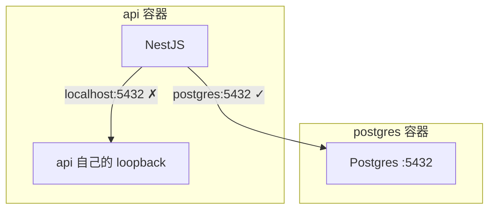
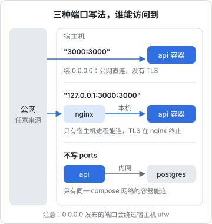

# 网络与存储卷

镜像构建好了，接下来是运行时的两大问题：容器之间、容器和外界怎么通信；数据存在哪里才不会丢。这两件事出错的代价都很大：端口绑错了，数据库或没有 TLS 的接口就直接暴露在公网上；数据放错了地方，一次 `docker rm` 整本账就没了。本章讲清楚原理，并对照 hatch-counter 的生产配置看每个选择。

## 容器网络的基本模型

第 1 章讲过，每个容器有自己的 NET namespace：自己的网卡、IP、路由表和 `localhost`。Docker 用不同的**网络驱动**把这些 namespace 连起来：

| 驱动 | 原理 | 用途 |
|---|---|---|
| `bridge` | 宿主机上建一个虚拟网桥，容器通过虚拟网卡对接到网桥 | 默认，单机最常用 |
| `host` | 不隔离网络，容器直接用宿主机的网络栈 | 对网络性能极敏感，或需要大量端口 |
| `none` | 只有 loopback | 完全不需要网络的批处理任务 |
| `overlay` | 跨主机的虚拟网络 | Swarm 等多机编排 |

单机部署几乎只用 bridge。

### 默认 bridge 和自定义 bridge

这是一个容易忽略但很关键的区别：

| | 默认 bridge（`docker0`） | 自定义 bridge |
|---|---|---|
| 怎么来的 | Docker 安装时自带，`docker run` 不指定网络时使用 | `docker network create` 或 Compose 自动创建 |
| 按容器名解析 | **不支持** | 支持，内置 DNS |
| 隔离 | 所有未指定网络的容器都在一起 | 只有加入这个网络的容器互通 |

自定义 bridge 网络里，Docker 运行一个内置 DNS 服务器，容器可以直接用**容器名或 Compose 服务名**访问彼此。这就是 Compose 里服务端能用 `postgres:5432` 连数据库的原因：

```text
DATABASE_URL=postgres://app_user:密码@postgres:5432/counter
```

这里的 `postgres` 不是什么魔法主机名，而是 compose 文件里那个服务的名字，由 Docker 内置 DNS 解析成 Postgres 容器在内部网络里的 IP。

Compose 会为每个项目自动建一个名为 `<项目名>_default` 的自定义 bridge，项目里所有服务默认都加入。所以用 Compose 时一般不需要手动建网络。

### 常见误区：容器里连 localhost



本机开发时数据库在 `localhost:5432`，搬进容器后就要改成服务名。最好通过环境变量配置数据库地址，而不是写在代码里。

### 容器访问宿主机上的服务

有时容器需要访问宿主机上的服务（比如宿主机上跑的一个开发数据库）。Docker Desktop 提供了 `host.docker.internal` 这个主机名；Linux 上的 Docker Engine 默认没有，需要显式加上：

```yaml
services:
  api:
    extra_hosts:
      - "host.docker.internal:host-gateway"
```

`host-gateway` 是一个特殊值，会被替换成宿主机在容器网络里的网关地址。宿主机上的服务需要监听在这个网关地址或 `0.0.0.0` 上，只监听 `127.0.0.1` 的话容器连不进去。

## 端口发布：绑在哪里决定谁能访问

容器网络默认只在宿主机内部可达。要让外部访问，需要**发布端口**，把宿主机的端口映射到容器端口：

```yaml
ports:
  - "3000:3000"             # 等价于 0.0.0.0:3000:3000，所有网卡都能访问
  - "127.0.0.1:3000:3000"   # 只有宿主机本机能访问
```

这一个 IP 前缀的差别，决定了服务是在公网上还是只在本机：



hatch-counter 的生产 compose 对两个服务做了不同的选择：

```yaml
services:
  postgres:
    # 不开端口。业务连接走 compose 内网，要 psql 一下用
    # `docker compose exec postgres psql -U counter counter`。
    # 映射到宿主机哪怕只绑 127.0.0.1，也等于给这台机器上任何一个进程开了条路

  api:
    # 只给宿主机的 nginx。绑 0.0.0.0 等于把一个没有 TLS 的接口直接挂公网上
    ports:
      - "127.0.0.1:3000:3000"
```

原则可以总结为：

| 服务 | 发布方式 | 理由 |
|---|---|---|
| 数据库、缓存 | **不发布** | 只有同网络的容器需要访问，运维用 `docker compose exec` |
| 应用服务（前面有反向代理） | `127.0.0.1:端口` | 只让宿主机上的 nginx 访问，TLS 和限流在 nginx 做 |
| 反向代理本身（若在容器里） | `80`、`443` 绑所有网卡 | 它就是对外的入口 |

### Docker 会绕过防火墙

很多人以为服务器开了 ufw、只放行 22/80/443，那 `3000:3000` 也不会暴露。**这是错的。** Docker 发布端口时会直接写 iptables 的 NAT 规则，流量在到达 ufw 管理的规则链之前就被转发进容器了。结果是 ufw 显示 3000 被拒绝，外网却能连上。

所以不能依赖宿主机防火墙来保护容器端口。正确的做法是：

1. 不需要外部访问的端口不发布，或者只绑 `127.0.0.1`
2. 在云厂商的安全组（宿主机外部的防火墙）里只放行必要端口，这是第二道防线
3. 如确需用宿主机防火墙管理容器流量，要在 Docker 专门的 `DOCKER-USER` 链里加规则，具体参考 Docker 官方文档的防火墙章节

## 存储：数据放在哪里

第 1 章讲过，容器的可写层随容器删除而消失。需要持久化的数据有三种挂载方式：

| 方式 | 写法示例 | 数据在哪 | 适合 |
|---|---|---|---|
| 命名卷（volume） | `pgdata:/var/lib/postgresql/data` | Docker 管理的目录（通常在 `/var/lib/docker/volumes/`） | 数据库等持久数据 |
| 绑定挂载（bind mount） | `./config:/app/config:ro` | 宿主机上你指定的路径 | 配置文件、开发时挂源码 |
| tmpfs | `tmpfs: /tmp` | 内存 | 临时文件、敏感的临时数据 |

### 命名卷：数据库的默认选择

```yaml
services:
  postgres:
    image: postgres:16-alpine
    volumes:
      - pgdata:/var/lib/postgresql/data

volumes:
  # 命名卷。放容器可写层的话，docker rm 一下整本账就没了
  pgdata:
```

命名卷的生命周期独立于容器：容器删除、重建、换镜像版本，卷都还在。`docker compose down` 默认**不会**删除命名卷，只有加 `-v` 才会，这个参数要格外小心。

命名卷相比绑定挂载的好处：

- 由 Docker 管理权限，容器里的 postgres 用户能正常读写，不会遇到宿主机目录属主不对的问题
- 首次挂载空卷时，Docker 会把镜像里该路径下的已有内容复制进卷
- 在 Mac 上性能远好于绑定挂载

一个和版本有关的提醒：Postgres 官方镜像在 18 版调整了数据目录的约定，升级大版本时，卷的挂载路径要按镜像说明修改。大版本升级本身也不能直接换镜像 tag，需要 `pg_upgrade` 或导出导入，这在[《PostgreSQL 运维》](../database-ops/)里会详细讲。

### 绑定挂载：权限是最大的坑

绑定挂载把宿主机目录直接映射进容器，容器里看到的文件属主是宿主机上的 UID。容器里以 `node`（UID 1000）运行，而宿主机目录属于 UID 1001 的 deploy 用户，就会 `EACCES`。常见解决办法：

- 宿主机上把目录属主改成容器里进程的 UID：`sudo chown -R 1000:1000 ./uploads`
- 只读挂载配置文件，加 `:ro`，容器不需要写
- 能用命名卷就用命名卷

开发环境里绑定挂载源码做热更新很常见，但在 Mac 上跨虚拟机的文件同步较慢，大量小文件的 `node_modules` 尤其明显。hatch-counter 的选择是开发时不把服务端放进容器，这也是原因之一。

### 卷的备份

卷在宿主机上就是一个目录，但**不要直接拷贝运行中的数据库目录**来备份，那样得到的文件可能不一致。数据库要用它自己的工具：

```bash
# 逻辑备份：导出成 SQL，压缩后存到宿主机
docker compose exec -T postgres pg_dump -U counter -Fc counter > backup-$(date +%F).dump

# 恢复
docker compose exec -T postgres pg_restore -U counter -d counter --clean < backup-2026-11-01.dump
```

`-T` 关掉伪终端分配，否则二进制输出会被终端处理搞坏。

非数据库的普通卷（比如上传文件目录），可以用一个临时容器打包：

```bash
docker run --rm -v myproj_uploads:/data -v "$PWD":/backup alpine \
  tar czf /backup/uploads-$(date +%F).tgz -C /data .
```

这些导出文件仍在宿主机上，只防误操作。要再送一份到异地并让失败可见（3-2-1、restic、心跳），见[《一人运维手册》3-2-1 原则](../production-ops/02-backup-dr.md#3-2-1-原则)；hatch-counter 目前为什么只靠云盘快照、这样做的代价，见同章的[案例](../production-ops/02-backup-dr.md#案例只有快照是一个知道的风险)；pg_dump 的格式选择和恢复演练见[《PostgreSQL 运维》第 2 章](../database-ops/02-backup-restore.md)。

### 日志也是存储

容器的标准输出默认由 `json-file` 日志驱动写到宿主机磁盘，**默认不限制大小**。一个日志量大的服务跑几个月，可能把磁盘写满。磁盘满了之后，Postgres 的表现是最难排查的那类故障。hatch-counter 给每个服务都配了日志轮转：

```yaml
logging:
  driver: json-file
  options: { max-size: "50m", max-file: "3" }
```

也可以在 `/etc/docker/daemon.json` 里设全局默认值，对之后新建的容器生效：

```json
{
  "log-driver": "json-file",
  "log-opts": { "max-size": "50m", "max-file": "3" }
}
```

改完要重启 Docker 守护进程，已有容器需要重建才会应用。

## 本章要点

- 单机用 bridge 网络；**自定义 bridge 才有按名字解析的内置 DNS**，Compose 自动为每个项目建一个
- 容器里的 `localhost` 是容器自己，连其他服务用服务名，地址通过环境变量配置
- 端口发布的 IP 前缀决定可见范围：`3000:3000` 是公网，`127.0.0.1:3000:3000` 只有本机
- 数据库不发布端口；有反向代理的应用只绑 `127.0.0.1`
- **Docker 发布的端口会绕过 ufw**，要靠不发布、绑本机和云安全组来保护
- 持久数据用命名卷；`docker compose down -v` 会删除卷，慎用
- 绑定挂载要注意宿主机目录的 UID 与容器内进程是否一致
- 数据库用 `pg_dump` 备份，不要直接拷运行中的数据目录
- 给容器日志配轮转，否则迟早写满磁盘

## 动手练习

1. **绑定地址决定谁能访问**：执行 `docker run -d --name p1 -p 127.0.0.1:8081:80 nginx:alpine` 和 `docker run -d --name p2 -p 8082:80 nginx:alpine`。在本机分别 `curl -sI localhost:8081` 和 `curl -sI localhost:8082`，再用局域网地址访问：`curl -sI --connect-timeout 3 http://$(ipconfig getifaddr en0):8081`（Linux 换成本机的局域网 IP），8082 同样试一次。

   验证：本机访问两个都返回 `200`；用局域网地址时 8081 连不上，8082 返回 `200`。做完 `docker rm -f p1 p2`。

   参考答案：`-p 8082:80` 等于绑 `0.0.0.0`，所有网卡上的请求都会被转进容器；`127.0.0.1:8081:80` 只接本机回环来的连接。放在服务器上，前者就是把服务挂到了公网。

2. **命名卷和容器的生命周期**：写一个 `compose.yaml`：

   ```yaml
   name: voltest
   services:
     app:
       image: alpine:3.20
       command: sh -c 'date >> /data/log && cat /data/log'
       volumes: [data:/data]
   volumes:
     data:
   ```

   执行三次 `docker compose run --rm app`，再执行 `docker compose down` 后跑一次，最后 `docker compose down -v` 后再跑一次。

   验证：前三次输出的行数依次是 1、2、3；`down` 之后是 4 行；`down -v` 之后又回到 1 行。

   参考答案：命名卷独立于容器存在，`down` 只删容器和网络；`-v` 连卷一起删，对数据库来说就是删库。

3. **空卷会被填充，绑定挂载会遮住**：执行 `docker run --rm -v demo_html:/usr/share/nginx/html nginx:alpine ls /usr/share/nginx/html`；再建一个空目录 `mkdir empty`，执行 `docker run --rm -v "$PWD/empty:/usr/share/nginx/html" nginx:alpine ls /usr/share/nginx/html`。

   验证：第一条列出 `50x.html` 和 `index.html`；第二条什么都不输出。做完 `docker volume rm demo_html`。

   参考答案：首次挂载空的命名卷时，Docker 会把镜像里该路径下已有的内容复制进卷；绑定挂载则直接用宿主机目录盖住镜像里的内容。用绑定挂载给数据库或网站目录时，要先想清楚镜像里原来的文件去哪了。
