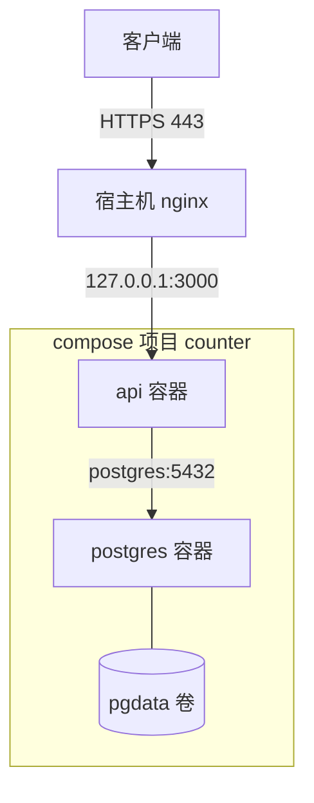
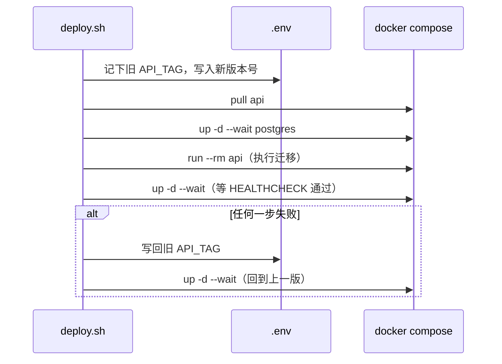

# Compose 编排

前面几章都是围绕单个容器。真实的服务至少有两个容器：应用和数据库，它们需要按顺序启动、共享网络、各自挂卷、各自读配置。用一串 `docker run` 手工维护这些参数既容易出错又无法版本化。Docker Compose 用一份 YAML 声明整套服务，`docker compose up` 一键拉起。本章以 hatch-counter 的生产 compose 文件为主线，讲清楚每个字段，再讲开发和生产配置怎么分、怎么用 Compose 做一次带迁移和回滚的发版。

## Compose 是什么

Compose 现在是 Docker CLI 的一个插件，命令是 `docker compose`（中间是空格）。早期独立的 Python 版 `docker-compose` 已经停止维护。两者的配置格式基本兼容，但新特性（`--wait`、`include`、`watch` 等）只在新版里有。

Compose 文件的几个基本概念：

| 概念 | 含义 |
|---|---|
| 项目（project） | 一份 compose 文件描述的整套服务，有一个项目名，是容器、网络、卷名字的前缀 |
| 服务（service） | 一种容器的配置，可以起多个副本 |
| 网络（network） | 默认自动建一个 `<项目名>_default` |
| 卷（volume） | 顶层声明的命名卷，实际名字是 `<项目名>_<卷名>` |

文件名推荐用 `compose.yaml`，`docker-compose.yml` 也能识别。旧教程里文件开头的 `version: "3.8"` 字段已经废弃，写了会有警告，不用再写。

## 案例：hatch-counter 的生产 compose

下面是 hatch-counter 生产环境的 compose 文件，替换了项目名和镜像仓库地址，保留了关键注释：

```yaml
name: counter

services:
  postgres:
    image: registry.example.com/counter/postgres:16-alpine
    restart: unless-stopped
    # 密码不放这儿，也不放 compose 自己的 .env——deploy.sh 每次发版都会改写 .env
    env_file: postgres.env
    # 不开端口，业务连接走 compose 内网
    volumes:
      - pgdata:/var/lib/postgresql/data
    healthcheck:
      # Postgres 起来的头一两秒会先关掉 initdb 的临时实例再起正式的，端口通了不等于能连
      test: ["CMD-SHELL", "pg_isready -U counter -d counter"]
      interval: 10s
      timeout: 3s
      retries: 12
    logging:
      driver: json-file
      options: { max-size: "20m", max-file: "3" }

  api:
    # tag 由 .env 里的 API_TAG 给，deploy.sh 负责改它
    image: registry.example.com/counter/api:${API_TAG}
    restart: unless-stopped
    env_file: api.env
    depends_on:
      postgres:
        condition: service_healthy
    # 只给宿主机的 nginx
    ports:
      - "127.0.0.1:3000:3000"
    logging:
      driver: json-file
      options: { max-size: "50m", max-file: "3" }

volumes:
  pgdata:
```

整体架构是这样的：



下面逐个字段讲。

### name：显式写项目名

```yaml
name: counter
```

不写的话，Compose 用 compose 文件所在目录的名字作为项目名。目录叫 `server` 或 `deploy` 时，很容易和同一台机器上另一个项目撞名，两个项目的容器会互相覆盖。显式写上项目名，容器名会变成 `counter-api-1`、`counter-postgres-1`，卷名是 `counter_pgdata`。

### image：只用自己仓库里的镜像

生产 compose 里两个镜像都来自自己的私有仓库，连 Postgres 官方镜像也是转存过去的一份。原因是服务器在境内，访问 Docker Hub 经常超时；部署时任何一个镜像拉不下来，整个发版就卡住。这个问题第 7 章展开讲。

### env_file 和 .env：两件不同的事

这是 Compose 里最容易混淆的概念：

| | `.env`（项目目录下） | `env_file:` |
|---|---|---|
| 作用 | 给 **compose 文件本身**做变量替换，如 `${API_TAG}` | 把变量注入**容器的环境变量** |
| 谁读 | Compose CLI 解析 YAML 时 | 容器启动时 |
| 容器里能看到吗 | 不能（除非在 `environment` 里引用） | 能 |

hatch-counter 把这两者严格分开：`.env` 里只有一行 `API_TAG=1.4.0`，由部署脚本改写；数据库密码在 `postgres.env`，应用配置在 `api.env`，都由一次性的生成脚本产生、不进 Git。注释里写明了原因：部署脚本每次发版都会改写 `.env`，密码放在里面可能会被冲掉。

`environment:` 也可以直接在 compose 文件里写变量，适合不敏感、和部署无关的值。密码这类东西不要直接写在 compose 文件里，否则会和文件一起进版本库。

用 `docker compose config` 可以看到变量替换后的最终配置，排查「变量为什么没生效」时非常有用。注意它会把 `env_file` 里的值也展开显示出来，别把输出贴到公开的地方。

### restart：容器挂了谁来拉起

| 策略 | 行为 |
|---|---|
| `no` | 默认，不自动重启 |
| `always` | 总是重启，包括 Docker 守护进程重启后 |
| `unless-stopped` | 同 `always`，但手动 `stop` 过的不会在守护进程重启后拉起 |
| `on-failure` | 只在非零退出码时重启 |

服务器上常驻的服务用 `unless-stopped`。配合 `systemctl enable docker`，机器重启后容器会自动回来，不需要另外写 systemd 单元。

### depends_on 加健康条件

```yaml
depends_on:
  postgres:
    condition: service_healthy
```

只写 `depends_on: [postgres]` 只保证启动**顺序**：Postgres 容器先启动，但不等它真正可连接。加上 `condition: service_healthy`，Compose 会等 Postgres 的 healthcheck 通过后才启动 api。

`condition` 有三个取值：

| 取值 | 等待条件 |
|---|---|
| `service_started` | 容器已启动（默认） |
| `service_healthy` | 健康检查通过 |
| `service_completed_successfully` | 容器运行结束且退出码为 0，适合一次性的初始化或迁移任务 |

即便如此，应用自己也应该能处理数据库暂时不可用：重连、启动时重试。`depends_on` 只管启动那一刻，运行中数据库重启它管不了。

### healthcheck：pg_isready 的细节

Postgres 首次初始化时会先起一个临时实例跑初始化脚本，然后关掉再起正式实例。只检查端口的话，可能在临时实例那一刻就判为健康。`pg_isready` 检查的是服务是否接受连接，更可靠。`retries: 12` 加 `interval: 10s` 给了首次初始化足够的时间。

## 开发和生产用不同的 compose 文件

hatch-counter 有两份 compose 文件，并且在注释里强调「别互相抄」：

| | 开发（`apps/api/docker-compose.yml`） | 生产（`deploy/docker-compose.yml`） |
|---|---|---|
| 服务 | 只有 Postgres | Postgres + api |
| 镜像 | Docker Hub 官方镜像 | 私有仓库镜像 |
| 密码 | 写死的开发密码 | 生成的随机密码，放在不入库的 env 文件里 |
| 端口 | 映射到宿主机 55432，方便本机工具连接 | 数据库不映射 |
| 容器名 | 用 `container_name` 固定，方便 `docker exec` | 不固定 |

开发库映射到 55432 而不是 5432，是为了避开本机其他项目的数据库。生产注释里写得很尖锐：照抄开发那份的端口和密码上线，「等于把库连密码一起公开了」。

除了分两份文件，Compose 还支持用**覆盖文件**叠加：

```bash
# compose.yaml 写公共部分，compose.override.yaml 默认自动叠加（适合放开发配置）
docker compose up

# 生产显式指定
docker compose -f compose.yaml -f compose.prod.yaml up -d
```

还可以用 `profiles` 让某些服务只在需要时启动：

```yaml
services:
  adminer:
    image: adminer
    profiles: [debug]
    ports:
      - "127.0.0.1:8080:8080"
```

`docker compose --profile debug up` 时才会启动它。

开发和生产差别很大时，分成两份独立文件反而更清晰，hatch-counter 就是这么选的。

## 用 Compose 发一版

hatch-counter 的部署脚本 `deploy.sh` 不到一百行有效代码，却把发版的顺序、等待、回滚都处理到了。核心流程如下：



对应的关键命令：

```bash
set -euo pipefail

# 记下上一版，回滚要用
PREV=$(sed -n "s/^API_TAG=//p" .env)

restore() {
  trap - ERR
  set_tag "$PREV"
  docker compose up -d --wait --wait-timeout 90
}
trap 'restore || true' ERR

set_tag "$VERSION"
docker compose pull api

# 库要先起着，下一步的迁移连的就是它
docker compose up -d --wait --wait-timeout 60 postgres

# 必须是 compose run 而不是 docker run：库在 compose 网络里，裸容器解析不了 postgres 这个名字
docker compose run --rm api ./node_modules/.bin/tsx src/db/migrate-cli.ts

# --wait 等的是镜像里的 HEALTHCHECK，不是「进程还在不在」
docker compose up -d --wait --wait-timeout 90
```

几个值得学的设计：

1. **迁移先于新容器启动。** 反过来的话，新代码会对着旧表结构运行几秒，那几秒里进来的是真实请求
2. **`compose run --rm` 跑一次性任务。** 它用服务的配置（镜像、env_file、网络）起一个临时容器，跑完即删。用裸 `docker run` 则不在 compose 网络里，解析不了服务名
3. **`up --wait` 代替自己写的 curl 循环。** 它等的是容器的 HEALTHCHECK 变成 healthy；自己在宿主机上 curl 端口，换容器那几秒端口是空的，分不清「还没起来」和「起来了但连不上库」
4. **失败自动回滚镜像。** `trap ... ERR` 在任何一步出错时把 tag 改回去再 `up`
5. **回滚退不了迁移。** 所以每个迁移都必须兼容上一版代码：先加列不删列，删列留到更晚的版本

还要注意：这种 `up` 方式会先停旧容器再起新容器，中间有几秒不可用。对单机小项目通常可以接受；需要零停机就要起两个实例在 nginx 后面轮换，这是[《部署与 CI/CD》](../deploy-release/)里的话题。

## 常用命令速查

| 命令 | 作用 |
|---|---|
| `docker compose up -d` | 后台启动，配置或镜像变了的服务会重建 |
| `docker compose up -d --wait` | 启动并等待健康检查通过 |
| `docker compose ps` | 看服务状态和健康状态 |
| `docker compose logs -f --tail 100 api` | 跟踪某个服务的日志 |
| `docker compose exec postgres psql -U counter counter` | 在运行中的容器里执行命令 |
| `docker compose run --rm api <命令>` | 用服务配置起临时容器跑一次性命令 |
| `docker compose pull` | 拉取最新镜像 |
| `docker compose config` | 输出合并、替换后的最终配置 |
| `docker compose down` | 停止并删除容器和网络（保留卷） |
| `docker compose down -v` | **连卷一起删**，数据库数据会丢 |

## 本章要点

- 用 `docker compose`（v2），文件不再需要 `version` 字段；用 `name:` 显式写项目名避免撞名
- `.env` 用于 compose 文件的变量替换，`env_file` 用于注入容器环境变量，两者不要混用
- 密码放在不入库的 env 文件里，不写进 compose 文件
- `depends_on` 配 `condition: service_healthy` 才会等数据库真正可用
- 常驻服务用 `restart: unless-stopped`
- 开发和生产配置差别大时分成两份文件，不要互相抄端口和密码
- 发版顺序：拉镜像 → 起库 → `compose run --rm` 跑迁移 → `up --wait` 等健康检查；失败自动回滚镜像
- 回滚只能退镜像，退不了迁移，迁移必须向后兼容

## 动手练习

1. **.env 和 env_file 各管什么**：在一个空目录里建三个文件：`.env` 写 `TAG=3.20`，`app.env` 写 `GREETING=hi`，`compose.yaml` 如下。然后执行 `docker compose run --rm app` 和 `docker compose config | grep image`。

   ```yaml
   name: envtest
   services:
     app:
       image: alpine:${TAG}
       env_file: app.env
       command: sh -c 'echo "greeting=$$GREETING tag=$$TAG"'
   ```

   验证：输出 `greeting=hi tag=`，`TAG` 在容器里是空的；`config` 里的镜像是 `alpine:3.20`。

   参考答案：`.env` 只给 compose 文件做变量替换，不进容器；`env_file` 才把变量注入容器。`$$` 是为了让 Compose 不替换、原样交给容器里的 shell。

2. **等健康，不只是等启动**：写一个会「慢慢变健康」的假数据库，比较两种 `depends_on`：

   ```yaml
   name: hctest
   services:
     db:
       image: alpine:3.20
       command: sh -c 'sleep 8; touch /tmp/ready; sleep 600'
       healthcheck: { test: ["CMD", "test", "-f", "/tmp/ready"], interval: 1s }
     app:
       image: alpine:3.20
       command: echo app started
       depends_on:
         db: { condition: service_healthy }
   ```

   执行 `time docker compose up app`，按 Ctrl+C 后 `docker compose down`；再把 `service_healthy` 改成 `service_started` 重做一次。

   验证：`service_healthy` 时 `app started` 大约 8 秒后才出现；`service_started` 时几乎立刻出现。

   参考答案：只写依赖关系或 `service_started` 只保证启动顺序；`service_healthy` 才等健康检查通过。真实场景里健康检查用 `pg_isready` 这类会真正连一下的命令。

3. **为什么迁移要用 compose run**：在上题的项目里（db 起着），执行 `docker compose run --rm app ping -c 1 db`，再执行 `docker run --rm alpine ping -c 1 db`。

   验证：第一条能解析出 `db` 的地址并收到回应；第二条报 `bad address 'db'`。做完 `docker compose down`。

   参考答案：`compose run` 用服务的配置起临时容器，加入项目网络，能用服务名；裸 `docker run` 在默认 bridge 上，解析不了服务名。部署脚本跑迁移连不上库，常见原因就是这一条。
