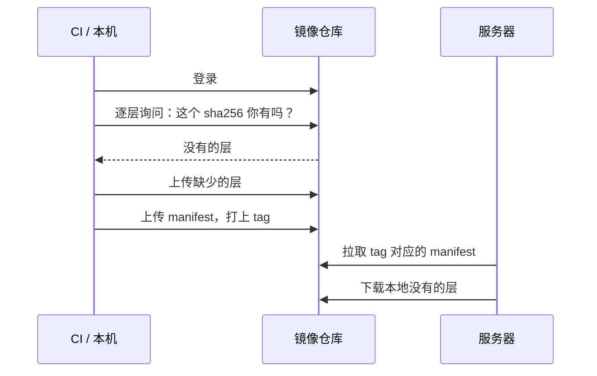

# 镜像仓库

镜像在本机构建好之后，要放到一个服务器能拉取的地方，这就是镜像仓库（registry）。仓库看起来只是个「存镜像的网盘」，但选哪家、怎么命名、CI 怎么推、服务器怎么拉、多架构怎么处理，每一项都可能让发版卡住。本章先讲仓库的工作方式，再讲国内服务器的特殊情况和 hatch-counter 踩过的几个真实的坑。

## 仓库的工作方式

仓库对外提供一套 HTTP API（OCI Distribution 规范），推和拉都是按内容摘要传输层和 manifest：



因为按内容寻址，基础镜像的层只在第一次推送和拉取时传输。之后每次发版，通常只有最上面的代码层和偶尔变化的依赖层需要传。这也是上一章强调「依赖层缓存要稳定」的另一层意义：依赖层不变，推送和拉取的数据量就小。

## 选哪个仓库

| 类型 | 例子 | 优点 | 注意 |
|---|---|---|---|
| Docker Hub | 官方镜像、公开镜像 | 生态默认，官方镜像都在这里 | 匿名和免费账号有拉取频率限制；国内访问不稳定 |
| 代码托管自带 | GitHub Container Registry（ghcr.io） | 和 GitHub Actions 集成好，用 `GITHUB_TOKEN` 即可推送 | 国内服务器拉取可能很慢 |
| 云厂商 | 阿里云 ACR、腾讯云 TCR、AWS ECR 等 | 和同地域服务器走内网，快、不计公网流量 | 个人版功能有限制，具体看厂商说明 |
| 自建 | 官方 `registry` 镜像、Harbor | 完全可控 | 要自己维护存储、证书、备份 |

对一个人的项目，最省心的组合通常是：**服务器所在云厂商的仓库作为主仓库**（同地域内网拉取），**ghcr.io 作为备份**。

Docker Hub 的拉取频率限制和具体额度会调整，以 Docker 官网说明为准。即便不在国内，CI 里频繁匿名拉取官方镜像也可能触发限制，登录后再拉是个好习惯。

## 国内服务器：编排里不留一个 Docker Hub 镜像

这是 hatch-counter 第一次上线时踩到的坑。它的生产 compose 文件里有这样一段注释（大意）：

> 境内这台机器访问 Docker Hub 是卡 60 秒再 `i/o timeout`，编排里一个 docker.io 的镜像都不留。

解决办法分两部分。

**自己的镜像**：CI 构建后直接推到云厂商仓库。

**第三方镜像**（比如 Postgres 官方镜像）：用一个手动触发的 GitHub Actions 工作流做**转存**。GitHub 的 runner 在境外，能顺利访问 Docker Hub，由它拉下来再推到自己的仓库：

```yaml
name: 转存镜像

on:
  workflow_dispatch:
    inputs:
      image:
        description: "Docker Hub 上的镜像，带 tag（如 postgres:16-alpine）"
        required: true

jobs:
  mirror:
    runs-on: ubuntu-latest
    env:
      REGISTRY: registry.example.com   # 你的仓库地址
      NAMESPACE: myproj
      SOURCE: ${{ inputs.image }}
    steps:
      - uses: docker/login-action@v3
        with:
          registry: ${{ env.REGISTRY }}
          username: ${{ secrets.REGISTRY_USERNAME }}
          password: ${{ secrets.REGISTRY_PASSWORD }}
      - name: 拉下来再推上去
        run: |
          set -eu
          target="$REGISTRY/$NAMESPACE/${SOURCE##*/}"
          docker pull --platform linux/amd64 "$SOURCE"
          docker tag "$SOURCE" "$target"
          docker push "$target"
```

升级 Postgres 版本时，要先跑一次这个工作流，再改 compose 里的 tag，否则服务器拉的是一个仓库里还不存在的 tag。

还有一种做法是在 `/etc/docker/daemon.json` 里配 `registry-mirrors` 加速器。注意它**只对 Docker Hub 生效**，而且公共加速器的可用性时有变化，不适合作为生产部署唯一的依赖。转存到自己的仓库更可控。

### 内网地址和公网地址

云厂商的仓库通常提供两个地址：公网地址和 VPC 内网地址。

- **CI（在云外）推送**：用公网地址
- **同地域服务器拉取**：用内网地址，速度快、不走公网流量

两个地址指向同一个仓库实例，换实例或换地域时要一起改。hatch-counter 的注释还记录了一个更隐蔽的坑：某云厂商个人版仓库的「实例专属域名」和老的共享域名解析到同一个 IP，用错了照样连得上，但会返回 403，看起来像密码错了。遇到「明明密码对却 403」时，先核对仓库地址是不是控制台上给出的那一个。

## CI 推送镜像

hatch-counter 的发布流水线把镜像同时推到两个仓库，用 `docker/metadata-action` 生成 tag：

```yaml
- uses: docker/setup-buildx-action@v3

- uses: docker/login-action@v3
  with:
    registry: ghcr.io
    username: ${{ github.actor }}
    password: ${{ secrets.GITHUB_TOKEN }}

- uses: docker/login-action@v3
  with:
    registry: ${{ env.REGISTRY }}
    username: ${{ secrets.REGISTRY_USERNAME }}
    password: ${{ secrets.REGISTRY_PASSWORD }}

- id: meta
  uses: docker/metadata-action@v5
  with:
    images: |
      ghcr.io/${{ github.repository }}/api
      ${{ env.REGISTRY }}/${{ env.NAMESPACE }}/api
    flavor: latest=false
    tags: |
      type=raw,value=${{ inputs.version }}
      type=raw,value=latest

- uses: docker/build-push-action@v6
  with:
    context: .
    file: apps/api/Dockerfile
    push: true
    provenance: false
    tags: ${{ steps.meta.outputs.tags }}
    labels: ${{ steps.meta.outputs.labels }}
    cache-from: type=gha
    cache-to: type=gha,mode=max
```

这里有几个从事故中学来的细节：

**仓库凭证用固定密码，不用临时令牌。** 发布流水线可能几个月才跑一次，临时令牌早就过期了。

**没配凭证就让流水线失败，不要静默跳过。** 静默跳过会推出一版服务器根本拉不到的镜像，而流水线还是绿的。注释里的原话是「那种绿比红更贵」。

**`provenance: false`。** 新版 buildx 默认会生成构建来源证明（provenance attestation），以额外 manifest 的形式挂在镜像索引里。并非所有仓库都支持这种 manifest：hatch-counter 遇到的情况是，ghcr 推送成功、某个人版云仓库报 `unknown manifest class`，于是线上真正拉取的那个仓库里没有这一版。如果你的仓库不支持，就关掉它；支持的话，provenance 和 SBOM 对供应链安全是有价值的。

**跨境推送要给足时间。** 从 GitHub runner 推到国内仓库，传层可能要十几分钟。hatch-counter 曾经把一次正常的慢推送当成卡死取消掉，导致镜像、tag 和通知三者状态不一致。之后给 job 设了 45 分钟的超时上限，并在注释里提醒「别看它不动就去点取消」。

### 推送顺序：不可逆的操作放最后

同一条流水线还调整了步骤顺序：先跑测试，再构建并推送镜像，**全部成功后**才提交版本号、打 Git tag。原来是 tag 触发构建，tag 先于可能失败的构建存在，失败后仓库、镜像、通知各说各的。现在 tag 在就说明真的发出去了，中途失败仓库里一个字都没变，用同一个版本号重跑即可。

## 多架构：Mac 构建，服务器跑不起来

Apple Silicon 的 Mac 上 `docker build` 默认产出 `linux/arm64` 镜像，而大多数云服务器是 `linux/amd64`。把 Mac 上构建的镜像推上去，服务器上会报：

```text
exec /usr/local/bin/docker-entrypoint.sh: exec format error
```

解决办法有三种：

| 做法 | 命令 | 说明 |
|---|---|---|
| 指定目标平台 | `docker build --platform linux/amd64 ...` | Mac 上通过模拟构建，比原生慢 |
| 构建多架构镜像 | `docker buildx build --platform linux/amd64,linux/arm64 --push ...` | 推送一个镜像索引，各平台自动拉对应版本 |
| 在 CI 上构建 | GitHub 托管 runner 默认是 amd64 | 最省心，本机只做开发 |

多架构镜像就是第 2 章说的**镜像索引**：同一个 tag 下挂着多个平台的 manifest，拉取时 Docker 自动选择匹配当前机器的那一个。查看一个镜像支持哪些平台：

```bash
docker buildx imagetools inspect node:22-alpine
```

如果只部署到 amd64 服务器，只构建 amd64 即可，没必要为多架构付出双倍构建时间。转存第三方镜像时同理，`docker pull --platform linux/amd64` 只搬一个平台，推上去是一个普通的单平台 manifest，还顺带避开了上面提到的 attestation 兼容问题。

## 凭证与清理

### 服务器上的登录凭证

`docker login` 默认把凭证以 base64 编码（**不是加密**）存在 `~/.docker/config.json` 里。在服务器上：

- 给部署用一个**只读**的拉取账号或令牌，不要用能推送的账号
- 桌面环境可以配置凭证助手（credential helper）存进系统钥匙串；服务器上至少保证这个文件只有部署用户可读

### 清理旧镜像

服务器上每发一版就多一个镜像，磁盘会慢慢被占满。但旧镜像是回滚的依据，不能每次发版都删光。hatch-counter 的部署脚本结尾提示「旧镜像没删，回滚要用」，攒多了再手动清理：

```bash
# 删除 30 天前创建、且没有被任何容器使用的镜像
docker image prune -a --filter "until=720h"

# 看各类资源占了多少磁盘
docker system df
```

仓库端也一样：云厂商仓库通常可以配置保留策略（比如只保留最近若干个 tag），按需开启。

## 本章要点

- 仓库按内容摘要传输，只传缺少的层；依赖层稳定，每次发版的传输量就小
- 推荐组合：服务器同地域的云仓库为主（内网拉取），ghcr.io 为备份
- 国内服务器的编排里不要依赖 Docker Hub：第三方镜像用 CI 转存到自己的仓库
- CI 推送用公网地址，服务器拉取用内网地址；「密码对却 403」先核对仓库域名
- CI 凭证用长期有效的，缺失就让流水线失败；仓库不支持 attestation 时设 `provenance: false`
- Mac 上构建的是 arm64，服务器多是 amd64：指定 `--platform` 或在 CI 上构建
- 服务器用只读凭证；旧镜像留着回滚，定期按时间清理
